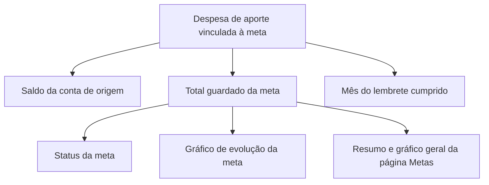
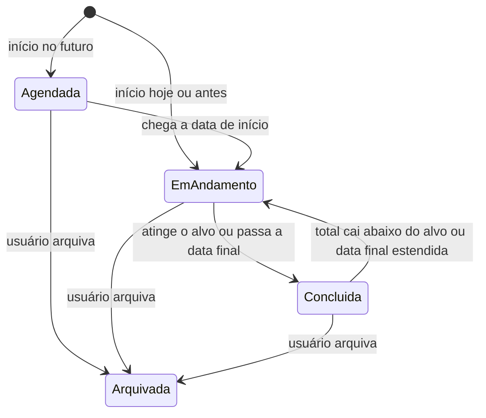
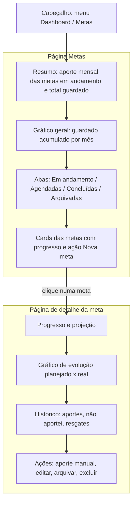
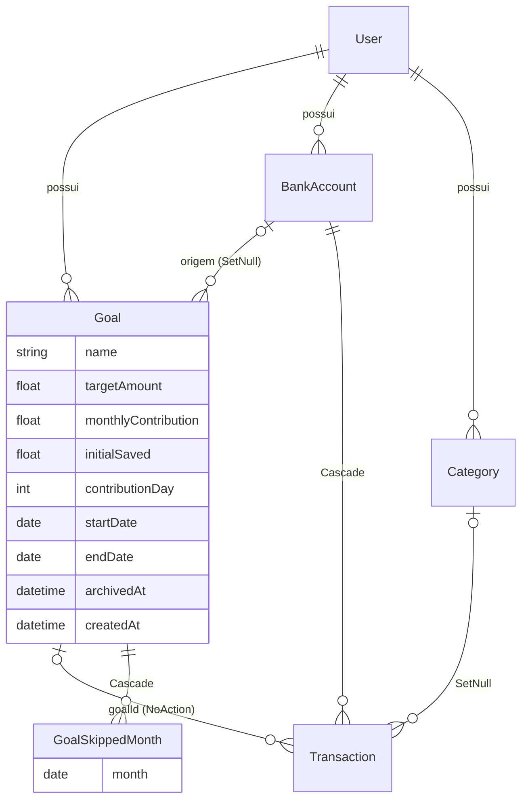
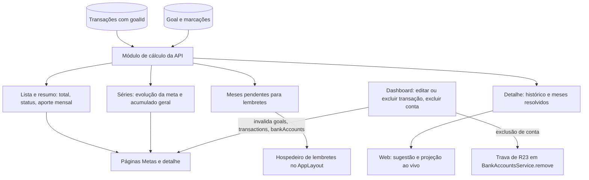
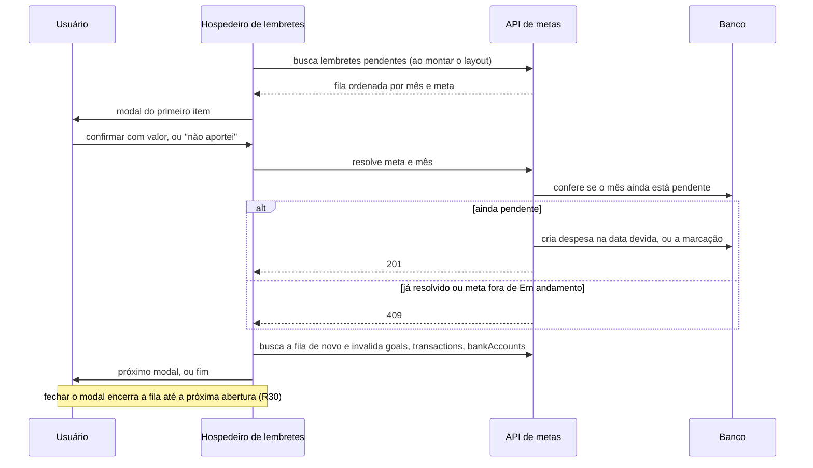
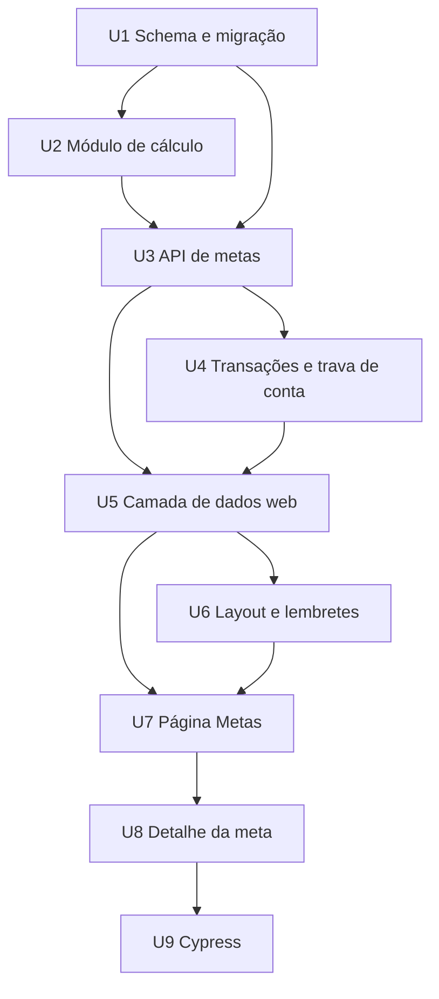

# Metas de economia - Plan

## Goal Capsule

- **Objective:** O usuário planeja e acompanha todas as suas metas de economia dentro do fintrack, com aportes que saem das próprias contas, e deixa de precisar do app pago que usa hoje para isso.
- **Means:** cada aporte é uma transação vinculada à meta, e a API calcula na leitura tudo o que deriva dela: total, status, meses pendentes e gráficos (Key Decision "O aporte é a própria transação", KTD2).
- **Authority:** os requisitos (R) decidem o comportamento do produto. Os KTDs decidem o mecanismo, dentro dos limites dos R que citam. As unidades não sobrescrevem nenhum dos dois, e AEs e Flows só ilustram.
- **Stop conditions:** pare e pergunte ao usuário se uma decisão marcada `session-settled` se mostrar inviável, se o backfill de categorias da migração não puder rodar no banco de destino, ou se ligar o `whitelist` do `ValidationPipe` quebrar algum fluxo além do `id` ignorado no update de conta (KTD10). Nunca rode reset, `db push` nem aceite um pedido de reset do Prisma num banco que tenha dados.
- **Execution profile:** dois códigos (`api/` e `web/`), em três fases: API, depois web, depois testes ponta a ponta. U2 é feita com testes antes do código.
- **Finisher:** `ce-work` implementa e verifica pelo Verification Contract. O usuário revisa e integra o PR.
- **Open blockers:** nenhum.

---

## Product Contract

### Summary

Uma página Metas no fintrack. Cada meta tem alvo, prazo, aporte mensal e conta de origem. Cada aporte é uma despesa nessa conta, registrada por um lembrete mensal ou manualmente, e o status da meta muda sozinho. A página traz um resumo do aporte mensal, um gráfico geral do dinheiro guardado e uma página de detalhe por meta com a evolução planejado x real. Na implementação, a meta não guarda status nem total: a API calcula os dois a partir das transações vinculadas, do mesmo jeito que já calcula o saldo das contas.

### Problem Frame

Hoje o usuário paga uma assinatura de outro app só para acompanhar metas de economia. O app atende ao que ele precisa, e o motivo da troca é o custo: ter a mesma função numa ferramenta própria. O fintrack já registra contas, categorias e transações, mas não tem nenhum conceito de meta ou de dinheiro separado para um objetivo. Por isso o acompanhamento fica fora do app, sem ligação com o saldo real das contas. O critério de sucesso é paridade: só dá para cancelar a assinatura se tudo entrar na primeira entrega.

---

### Key Decisions

- **O usuário informa o alvo e o aporte mensal, e o app sugere um aporte.** O usuário define os dois valores e vê se o plano fecha. Governs R1, R2, R3. (session-settled: user-directed — chosen over valor final derivado do plano e alvo informado com aporte só calculado: o usuário quer controlar os dois números e ver a projeção)
- **O aporte sai de uma conta como despesa.** O saldo das contas reflete o dinheiro separado para metas. Governs R10. (session-settled: user-directed — chosen over metas independentes das contas e transferência entre contas: o dinheiro não deve aparecer duas vezes, e o app não tem conceito de transferência)
- **O aporte é a própria transação.** A meta não guarda valores próprios além do ponto de partida, e o total guardado é calculado a partir das despesas vinculadas, como o saldo das contas já é hoje. Governs R11, R12, R18, R20. (session-settled: user-approved — chosen over livro próprio da meta espelhado em transações e exclusão dos aportes ao arquivar: uma fonte de verdade, sem sincronização entre dois registros, e sem perder o histórico de metas arquivadas)
- **A meta acompanha mudanças feitas na transação.** Governs R12. (session-settled: user-directed — chosen over transação bloqueada para edição fora da meta e meta independente da transação após a criação)
- **Aportes por lembrete mensal e também manuais.** O lembrete abre um modal por mês pendente, com "não aportei". Governs R13, R14, R15, R16, R17, R18. (session-settled: user-directed — chosen over só registro manual e só o lembrete do mês atual: o usuário quer cobrar cada mês e ainda poder aportar fora do dia)
- **O status é automático, e Concluída vale para alvo ou prazo, o que vier primeiro.** Governs R6, R7, R8. (session-settled: user-approved — chosen over concluir só ao atingir o alvo e conclusão manual)
- **Meta com aportes só pode ser arquivada, e o usuário escolhe se o dinheiro volta para a conta.** Governs R5, R19, R20, R21, R22. (session-settled: user-directed — chosen over excluir a meta mantendo as despesas e excluir a meta apagando as despesas)
- **Página própria com resumo no topo e detalhe em página separada.** Governs R24, R25, R26, R27, R28. (session-settled: user-directed — chosen over página em duas colunas com detalhe em modal e bloco de Metas dentro do Dashboard: escolhido a partir de um esboço visual das três opções)
- **Tudo entra na primeira entrega.** (session-settled: user-directed — chosen over uma primeira entrega menor: cancelar o app pago exige paridade)
- **Cada meta tem uma única conta de origem, editável na meta.** O lembrete e o aporte manual usam essa conta. Governs R1, R10.
- **O valor já guardado é só o ponto de partida.** Ele não sai de nenhuma conta, porque o saldo atual das contas já não inclui esse dinheiro. Governs R11, R21.
- **Os lembretes começam no mês de criação da meta.** Isso evita uma fila de modais para meses que o valor já guardado cobre. Governs R15.
- **O resgate volta para cada conta de onde saiu dinheiro.** No caso comum é uma conta só, mas a conta da meta ou de uma transação pode ter sido trocada no caminho. Governs R20.
- **Bloquear a exclusão de conta ligada a meta não arquivada.** Excluir uma conta apaga as transações dela e, portanto, os aportes. Governs R23. (session-settled: user-approved — chosen over bloquear só a conta de origem: uma conta que guarda aportes de uma meta ativa também os apagaria em silêncio)
- **O gráfico geral mostra o acumulado.** O requisito pede "o dinheiro guardado", e o aporte mensal já aparece no resumo. Governs R26.
- **Meta arquivada não pode ser desarquivada nesta entrega.** Depois de um resgate, reabrir a meta deixaria o histórico incoerente. Governs R9.
- **Lembrete atrasado registra o aporte no mês devido, e fechar o lembrete adia a fila.** Responder em maio ao lembrete de março precisa cumprir março, e não maio. Governs R29, R30.



---

### Requirements

**Criação e edição**

- R1. O usuário cria uma meta informando nome, data de início, data de fim, valor alvo, aporte mensal, valor já guardado, dia do mês do aporte e conta de origem.
- R2. Ao criar ou editar, o app sugere um aporte mensal: o alvo menos o total guardado, dividido pelos meses com dia de aporte que restam até a data final. O usuário aceita a sugestão ou informa outro valor.
- R3. A meta mostra a projeção: quanto terá na data final mantendo o aporte mensal atual e, se não chegar ao alvo, quanto vai faltar.
- R4. Qualquer meta não arquivada pode ser editada em todos os campos de R1. As mudanças valem dos próximos meses em diante e não alteram aportes já feitos.
- R5. Uma meta sem nenhum aporte pode ser excluída. Uma meta com aportes só pode ser arquivada.

**Status**

- R6. O status é calculado: Agendada enquanto a data de início está no futuro, Em andamento a partir dela, Concluída quando o total guardado atinge o alvo ou a data final passa (o que vier primeiro), e Arquivada só por ação do usuário.
- R7. O status é recalculado sempre que mudam o total guardado, o alvo ou as datas, então uma meta Concluída pode voltar a Em andamento.
- R8. Uma meta Concluída mostra se atingiu o alvo ou terminou abaixo dele.
- R9. Uma meta Arquivada fica só para leitura e não pode ser desarquivada.



**Aportes**

- R10. Cada aporte é uma despesa na conta de origem da meta, na categoria "Metas", com o nome "Aporte: <nome da meta>", e reduz o saldo dessa conta.
- R11. O total guardado da meta é o valor já guardado mais a soma das despesas de aporte vinculadas a ela.
- R12. Quando o usuário edita o valor, a data ou a conta de uma despesa de aporte na lista de transações do Dashboard, ou a exclui, a meta reflete a mudança.
- R13. O usuário pode registrar um aporte manual numa meta Em andamento, escolhendo a data e o valor.
- R14. Ao abrir o app, aparece um modal de lembrete para cada mês pendente de cada meta Em andamento, com o aporte mensal pré-preenchido e editável e as ações confirmar e "não aportei".
- R15. Um mês fica pendente quando o dia do aporte chegou (hoje é igual ou posterior a ele), o mês está dentro do período da meta, não é anterior ao mês de criação dela, e ainda não tem aporte nem marcação "não aportei".
- R16. Qualquer aporte com data dentro do mês, seja manual ou pelo lembrete, cumpre aquele mês.
- R17. Se o dia do aporte for 29, 30 ou 31, nos meses mais curtos o lembrete vale a partir do último dia do mês.
- R18. "Não aportei" fica registrado no histórico da meta para aquele mês e não movimenta dinheiro.
- R29. O aporte confirmado num lembrete recebe a data do dia de aporte daquele mês, ajustada por R17, e não a data em que o lembrete foi respondido.
- R30. Fechar um lembrete sem responder esconde os lembretes restantes até a próxima abertura do app, e o mês continua pendente.

**Arquivamento**

- R19. Ao arquivar uma meta com aportes, o usuário escolhe entre devolver o dinheiro às contas e mantê-lo como despesa comum.
- R20. Na devolução, o app cria uma receita "Resgate: <nome da meta>", com a data do arquivamento, em cada conta de onde saíram aportes, no valor dos aportes vindos daquela conta.
- R21. O valor já guardado inicial não gera resgate, e as despesas de aporte originais continuam registradas nos seus meses.
- R22. Se o dinheiro for mantido, as despesas de aporte continuam como despesas comuns, e a meta arquivada mantém o histórico.

**Contas**

- R23. O app impede excluir uma conta que é origem de uma meta não arquivada ou que guarda aportes de uma meta não arquivada, e informa quais metas estão ligadas a ela.

**Página Metas e detalhe da meta**

- R24. Metas é uma página própria, acessível por um menu no cabeçalho com Dashboard e Metas.
- R25. O topo da página mostra o aporte mensal somado das metas Em andamento e o total guardado das metas não arquivadas.
- R26. O gráfico geral mostra o total guardado acumulado mês a mês, somando as metas não arquivadas.
- R27. Abaixo do gráfico, as abas Em andamento, Agendadas, Concluídas e Arquivadas listam as metas em cards com nome, valor guardado sobre o alvo e barra de progresso, junto com a ação "Nova meta".
- R28. A página de detalhe de uma meta mostra o progresso, a projeção de R3, um gráfico de evolução planejado x real mês a mês, o histórico de aportes, "não aportei" e resgates, e as ações de aporte manual, editar, arquivar e excluir dentro das regras de R5, R9 e R13.



---

### Key Flows

- F1. Criar meta
  - **Trigger:** O usuário clica em "Nova meta" na página Metas.
  - **Steps:** O usuário preenche os campos de R1. O app mostra o aporte sugerido e a projeção, e o usuário mantém ou troca o aporte mensal e confirma.
  - **Outcome:** A meta aparece em Agendadas ou Em andamento, conforme R6.
  - **Covered by:** R1, R2, R3, R6
- F2. Lembrete de aporte
  - **Trigger:** O usuário abre o app com pelo menos um mês pendente.
  - **Steps:** O app mostra um modal por mês pendente, em ordem cronológica. Em cada um, o usuário confirma o valor (podendo editá-lo), o que cria a despesa de aporte, ou escolhe "não aportei".
  - **Outcome:** Nenhum mês pendente, e o histórico, o total e os gráficos atualizados.
  - **Covered by:** R10, R14, R15, R16, R17, R18, R29, R30
- F3. Arquivar meta com aportes
  - **Trigger:** O usuário escolhe "Arquivar" na página de detalhe.
  - **Steps:** O app pergunta se o dinheiro volta para as contas ou fica como despesa comum. Na devolução, cria os resgates.
  - **Outcome:** A meta vai para Arquivadas, só para leitura.
  - **Covered by:** R9, R19, R20, R21, R22

---

### Acceptance Examples

- AE1. **Covers R2, R3.** **Given** uma meta de jan/2027 a dez/2027, com alvo de R$ 10.000 e R$ 1.000 já guardados, **when** o usuário está preenchendo o aporte, **then** o app sugere R$ 750 por mês. **When** ele informa R$ 500, **then** a projeção mostra R$ 7.000 na data final, faltando R$ 3.000.
- AE2. **Covers R14, R15.** **Given** uma meta Em andamento criada em janeiro, com aporte no dia 5, e um usuário que não abre o app de 1º de março a 10 de maio, **when** ele abre o app em 10 de maio, **then** aparecem três modais, um para março, um para abril e um para maio.
- AE3. **Covers R16.** **Given** uma meta com aporte no dia 10, **when** o usuário registra um aporte manual no dia 3 do mesmo mês, **then** não aparece lembrete para aquele mês.
- AE4. **Covers R17.** **Given** uma meta com aporte no dia 31, **when** chega 28 de fevereiro de um ano não bissexto, **then** o mês de fevereiro fica pendente.
- AE5. **Covers R7, R12.** **Given** uma meta que ficou Concluída ao atingir o alvo antes da data final, **when** o usuário exclui uma das despesas de aporte pela lista de transações e o total fica abaixo do alvo, **then** a meta volta a Em andamento e os lembretes voltam nos meses seguintes.
- AE6. **Covers R6, R7, R8.** **Given** uma meta com R$ 7.000 de R$ 10.000 na data final, **when** a data final passa, **then** a meta fica Concluída, indicando que ficou abaixo do alvo, e os lembretes param. **When** o usuário estende a data final em seis meses, **then** a meta volta a Em andamento.
- AE7. **Covers R20, R21.** **Given** uma meta com R$ 1.000 já guardados e três aportes de R$ 500 saídos da conta Nubank, **when** o usuário arquiva e escolhe devolver o dinheiro, **then** o app cria uma receita "Resgate: <meta>" de R$ 1.500 na Nubank, com a data do arquivamento, e as três despesas de aporte continuam nos seus meses. **Given** que uma dessas despesas tinha sido trocada para a conta Inter, **then** são criados dois resgates: R$ 1.000 na Nubank e R$ 500 na Inter.
- AE8. **Covers R23.** **Given** que a conta Nubank é a conta de origem de uma meta Em andamento, **when** o usuário tenta excluir a Nubank, **then** o app bloqueia a exclusão e mostra o nome da meta.
- AE9. **Covers R23.** **Given** uma meta Em andamento com origem na Nubank e um aporte que o usuário trocou para a conta Inter no Dashboard, **when** ele tenta excluir a Inter, **then** o app bloqueia a exclusão e mostra o nome da meta.
- AE10. **Covers R7, R15.** **Given** uma meta com aporte no dia 5 que ficou Concluída ao bater o alvo em março, **when** o usuário exclui um aporte em 10 de junho e a meta volta a Em andamento, **then** abril, maio e junho ficam pendentes e geram três lembretes.
- AE11. **Covers R29.** **Given** um lembrete pendente de março numa meta com aporte no dia 5, **when** o usuário o confirma em 10 de maio, **then** a despesa criada tem data de 5 de março, aparece na lista de março do Dashboard e não cumpre o mês de maio.

---

### Success Criteria

- O usuário consegue recriar no fintrack as metas que acompanha hoje e acompanhá-las mês a mês sem abrir o app pago, a ponto de cancelar a assinatura.
- Depois de qualquer edição ou exclusão de transação, o total da meta, o saldo das contas e os gráficos mostram os mesmos valores.

---

### Scope Boundaries

- Rendimento ou juros sobre o dinheiro guardado.
- Resgate parcial de uma meta ativa.
- Notificações fora do app, como push ou e-mail.
- Meta com mais de uma conta de origem ao mesmo tempo.
- Desarquivar meta, conforme R9.
- Transferência entre contas como conceito geral do app.
- Tela para criar ou editar categorias.
- Fazer a página Metas respeitar o botão de ocultar valores que existe no Dashboard.

#### Considered and not built

- **Esconder a categoria "Metas" no modal de nova transação.** Uma despesa manual nessa categoria não vira aporte, mas a diferença aparece logo na página Metas. Mudaria se houver relato de confusão real.
- **Impedir pela API a troca de tipo de uma transação vinculada.** O web sempre reenvia o tipo original, e uma troca feita direto na API só tira a linha do total, que conta apenas despesas (KTD4). Mudaria se outro cliente passar a editar transações.
- **Guardar versões do plano para a linha "planejado".** A linha é desenhada com o plano atual (KTD2). Guardar versões exige dados novos para um ganho só visual. Mudaria se o usuário pedir o histórico do plano.
- **Congelar o histórico de metas arquivadas.** Se a conta que guarda os aportes de uma meta arquivada for excluída depois, o histórico perde essas linhas. Congelar exigiria um retrato da meta e contrariaria a Key Decision "O aporte é a própria transação".
- **Criar a categoria "Metas" sob demanda.** A migração e o cadastro garantem a categoria, e não existe tela nem endpoint para excluí-la ou renomeá-la (KTD5).

#### Deferred to Follow-Up Work

- Consertar os specs gerados que nunca funcionaram: os três `*.controller.spec.ts` e `api/src/modules/categories/categories.service.spec.ts`.
- Corrigir os erros de lint que já existem no web, como as aspas e os ponto e vírgula de `web/src/app/hooks/useTransactions.ts`.
- Ícone próprio para a categoria "Metas". Hoje uma chave desconhecida cai no ícone genérico de despesa ou receita.

---

### Dependencies / Assumptions

- A interface não permite criar categorias, e o cadastro cria só "Salary" e "House" (`api/src/modules/auth/auth.service.ts`). O próprio app precisa garantir as categorias "Metas" para usuários novos e já existentes (KTD5).
- Excluir uma conta apaga as transações dela em cascata (`api/prisma/schema.prisma`, modelo `Transaction`), e a interface permite excluir contas (`web/src/view/pages/Dashboard/modals/EditAccountModal/index.tsx`). Essa é a razão de R23.
- O saldo das contas já é calculado a partir das transações (`api/src/modules/bank-accounts/bank-accounts.service.ts`), então uma despesa de aporte reduz o saldo sem regra nova.
- Despesas podem ser editadas e excluídas pela lista de transações do Dashboard (`web/src/view/pages/Dashboard/modals/EditTransactionModal/index.tsx`), que é o caminho que R12 cobre.
- Não há biblioteca de gráficos em `web/package.json`.
- O app só tem a rota privada `/` (Dashboard), e o cabeçalho tem apenas o logo e o menu do usuário (`web/src/Router/index.tsx`, `web/src/view/pages/Dashboard/index.tsx`). O menu de R24 é novo.

---

## Planning Contract

### Product Contract preservation

Changed: R23 passou a cobrir também contas que guardam aportes de metas não arquivadas, por decisão do usuário durante o planejamento. Added: R29, R30, AE9, AE10, AE11 e uma Key Decision, todos esclarecimentos confirmados pelo usuário na síntese do planejamento. Removed: a seção Outstanding Questions do brainstorm, porque todas as perguntas foram resolvidas por KTD5, KTD6, KTD7, KTD12 e pela lista "Considered and not built". O restante ficou sem mudança.

### Key Technical Decisions

- KTD1. **Modelo de dados: `Goal`, `Transaction.goalId` e `GoalSkippedMonth`.** `Goal` guarda nome, alvo, aporte mensal, valor inicial, dia do aporte, início e fim só como data, conta de origem, `archivedAt` e `createdAt`. A conta de origem é anulável, com `onDelete: SetNull`, para que excluir a conta de uma meta arquivada não apague a meta. `Transaction.goalId` é anulável, com `onDelete: NoAction`: o banco recusa excluir uma meta que tem transações, o que garante R5 mesmo numa corrida, e a API traduz esse erro (P2003) em 409. `NoAction`, e não `Restrict`, porque o Postgres confere `RESTRICT` na hora e falharia numa futura exclusão de usuário em cascata. `GoalSkippedMonth` guarda a marcação "não aportei" com o mês fixado no primeiro dia dele e unicidade por meta e mês, e é apagada junto com a meta. Os valores seguem `Float`, como as colunas que já existem. Toda conversão para centavos arredonda para o centavo mais próximo, e total e alvo são comparados em centavos. Os valores em reais que os endpoints de metas recebem têm no máximo duas casas decimais. Segue as convenções de `api/prisma/schema.prisma`: ids `uuid`, `@@map` em camelCase e `Cascade` para o usuário.
- KTD2. **Tudo é calculado na leitura, num módulo puro da API.** O total guardado, o status, o indicador de alvo atingido, os meses do período, os meses pendentes, as séries dos dois gráficos e a divisão do resgate saem de funções puras em `api/src/modules/goals/goal-calculations.ts`. Não existe coluna de status. A precedência do status é Arquivada, depois Agendada, depois Concluída, depois Em andamento, porque R6 define Agendada como "enquanto a data de início está no futuro". Um status guardado ficaria velho assim que uma data passasse sem nenhuma escrita. A linha "planejado" usa o plano atual (ver Considered and not built). Segue o padrão de `currentBalance` em `api/src/modules/bank-accounts/bank-accounts.service.ts`.
- KTD3. **Uma regra de datas para tudo.**
  - "Hoje" vem do relógio do servidor no fuso `America/Sao_Paulo`, definido como constante do módulo de metas.
  - As datas que os endpoints de metas gravam (aporte, lembrete e resgate) são datas de calendário normalizadas para 12:00 UTC.
  - O mês de uma transação é o mês UTC da data dela, a mesma janela que a lista de transações já usa em `api/src/database/repositories/transactions.repositories.ts`.
  - Um mês está no período se o dia de aporte ajustado (R17) cai entre o início e o fim, inclusive.
  - Um mês está vencido quando hoje é igual ou posterior a esse dia (AE4).
  - Toda data que os endpoints de metas recebem (início, fim e aporte manual) é convertida para o dia de calendário em `America/Sao_Paulo` antes de ser gravada: início e fim como data, aporte às 12:00 UTC desse dia. Isso cobre a data padrão dos seletores, que é o instante atual (`new Date()`) e, depois das 21h em Brasília, já cai no dia seguinte em UTC.
  - O mês de criação da meta também é tirado de `createdAt` nesse fuso.
- KTD4. **Só despesas vinculadas contam no total, e o vínculo é explícito.** O total soma apenas as linhas EXPENSE com `goalId`. Os resgates também levam `goalId`, mas são INCOME e aparecem só no histórico. O vínculo nunca é deduzido da categoria nem do nome. Só o `GoalsService` grava `goalId`, e os DTOs de transação nunca aceitam esse campo (KTD10).
- KTD5. **Duas categorias "Metas", uma EXPENSE para aportes e uma INCOME para resgates.** O cadastro de usuário passa a criá-las. A migração cria as duas para usuários existentes, com `gen_random_uuid()` explícito, porque a coluna `id` de `category` não tem default no banco. A busca é por `userId`, chave de ícone `goal` e tipo. Se a categoria não existir, a escrita falha com erro em vez de gravar a transação sem categoria. O resgate precisa de uma categoria INCOME porque o modal de edição filtra categorias pelo tipo e exige uma categoria.
- KTD6. **Um endpoint por meta e mês resolve o lembrete.** Ele recebe confirmar (com valor) ou "não aportei". Confirmar cria a despesa com a data de R29. As duas ações só valem para um mês que está no conjunto de pendentes de hoje (U2). Em qualquer outro caso devolvem 409 sem gravar nada: mês já com aporte ou marcação, mês futuro, anterior à criação ou fora do período, ou meta fora de Em andamento. Uma marcação duplicada que bate na unicidade do banco (P2002) também vira 409. O web trata o 409 como resolvido e segue para o próximo. Junto com os dois botões desabilitados enquanto uma resposta está em andamento (U6), isso cobre clique duplo, nova tentativa e duas abas usadas uma depois da outra. Duas requisições exatamente simultâneas ainda podem gravar dois aportes. Para um usuário só isso é raro, aparece no histórico e se desfaz excluindo a despesa (R12).
- KTD7. **No web, a fila de lembretes é um retrato tirado quando o layout privado monta.** Depois de cada resposta, a fila é buscada de novo, porque um aporte pode concluir a meta e remover os meses seguintes dela. Fechar o modal encerra a fila até a próxima abertura do app (R30). Mudanças em metas feitas em outras telas não reabrem a fila. A ordem é mês crescente, depois data de criação da meta. Cada modal remonta com `key` por meta e mês, porque `DatePickerInput` e `Select` só leem o valor inicial uma vez.
- KTD8. **Arquivar é uma escrita única.** Uma `$transaction` interativa do Prisma, a primeira do repositório, fica dentro de um método do repositório de metas e segue esta ordem:
  1. Grava `archivedAt` só se ele ainda estiver vazio.
  2. Se nenhuma linha mudou, desfaz tudo e devolve 409. Assim dois pedidos de arquivamento ao mesmo tempo não criam dois resgates.
  3. Lê os aportes vinculados dentro da mesma transação e só então cria os resgates.

  Regras do resgate:
  - O resgate agrupa os aportes por conta e soma em centavos inteiros (KTD1).
  - Ele usa a data de hoje (KTD3), o nome "Resgate: <nome>" com o nome da meta no momento do arquivamento, e a categoria de KTD5.
  - Uma meta sem aportes é arquivada sem a pergunta de R19.
- KTD9. **A trava de exclusão de conta fica em `BankAccountsService.remove`.** Entre a checagem de dono e a exclusão, o serviço procura metas não arquivadas que têm a conta como origem ou que têm aportes nela. Se achar, lança `ConflictException` com mensagem e a lista de nomes das metas. O web lê essa lista e monta o aviso em português. É a primeira leitura de erro da API no web. Como `DatabaseModule` é `@Global`, o serviço injeta o repositório de metas sem criar dependência circular entre módulos.
- KTD10. **Endurecer os caminhos de transação e de conta por onde passa o dinheiro das metas.** Os três itens abaixo entram porque o caso é de segurança e envolve dinheiro: deixar para depois sairia mais caro.
  - **Whitelist.** `ValidationPipe` ganha `whitelist: true` em `api/src/main.ts`. Hoje o corpo da requisição chega inteiro ao Prisma. Com isso, um `PUT /transactions` grava `userId` (e gravaria `goalId`), e um `PUT /bank-accounts` aceita escritas de relação, como um `user.connect` por e-mail que move a conta para o Dashboard de outro usuário.
  - **Campos nomeados.** Além do whitelist, `TransactionsService` e `BankAccountsService` passam a enviar campos nomeados ao repositório, e o novo repositório de metas também. Assim, o fechamento não depende só da configuração do pipe.
  - **Dono da transação.** A busca de transação para editar ou excluir passa a filtrar por `userId` e transação, no mesmo formato de `bank-accounts.repositories.ts`, sem versão sem filtro. Hoje qualquer usuário logado altera transações de outro.

  O `id` que `bankAccountsService.update` manda no corpo passa a ser descartado, sem efeito, porque o id já vem da rota. Não usar `forbidNonWhitelisted`, que transformaria essa requisição em 400.
- KTD11. **O web calcula a sugestão e a projeção.** O formulário precisa desses valores enquanto o usuário digita, então `web/src/app/utils/goalPlanning.ts` calcula R2 e R3. Os meses restantes são os meses do período, a partir do mês de criação, que ainda não têm aporte nem marcação. Isso inclui meses pendentes passados e o mês atual. O detalhe da meta recebe da API quais meses já foram resolvidos. A sugestão é arredondada para cima no centavo, vale zero quando o total já atingiu o alvo e fica oculta quando não sobra nenhum mês. A projeção é o total mais o aporte vezes os meses restantes. A regra de "mês no período" fica duplicada entre a API (KTD2) e o web. As duas implementações usam os mesmos números de teste (AE1 e um caso com dia 31).
- KTD12. **Gráficos com Recharts 3.** A pesquisa externa comparou Recharts, Chart.js, Nivo, visx, Tremor e ApexCharts. Recharts tem API em JSX, tooltips fáceis de estilizar com Tailwind, tipos próprios, licença MIT e suporte a React 18. O Chart.js fica como segunda opção, se o tamanho do pacote pesar. Cada gráfico fica dentro de um contêiner com altura fixa, porque `ResponsiveContainer` não desenha nada sem altura definida no pai.
- KTD13. **Layout privado comum.** Um novo `web/src/view/layouts/AppLayout.tsx` tem o cabeçalho (logo, menu Dashboard | Metas com `NavLink` e menu do usuário), o `<Outlet/>` e o hospedeiro dos lembretes. As rotas `/`, `/metas` e `/metas/:goalId` ficam dentro dele. O Dashboard deixa de ter cabeçalho próprio. Segue o formato de `web/src/view/layouts/AuthLayout.tsx`.
- KTD14. **Cache.**
  - As chaves das queries de metas começam todas com `['goals']`.
  - Um helper invalida `['goals']`, `['transactions']` e `['bankAccounts']` juntos. Toda mutação que mexe em dinheiro usa esse helper: aporte, lembrete, arquivamento, edição de meta, edição e exclusão de transação, e exclusão de conta.
  - Sair da conta limpa todo o cache de queries. Hoje só `['users','me']` é removida, e metas de um usuário apareceriam para o próximo que entrasse no mesmo navegador.
- KTD15. **Estratégia de testes.**
  - Na API, a configuração do Jest em `api/package.json` ganha um `moduleNameMapper` para os imports `src/...`, porque hoje nenhum spec consegue resolver esses imports.
  - O módulo de cálculo é escrito com testes antes do código, usando os números dos AEs.
  - Os serviços tocados são testados com repositórios simulados via `useValue`.
  - O web não ganha um executor de testes unitários. Os fluxos são cobertos com Cypress.

### High-Level Technical Design

Modelo de dados (KTD1, KTD4, KTD5):



Quem calcula o quê (KTD2, KTD11, KTD14):



Resolução de um lembrete (KTD6, KTD7):



Precedência do status (KTD2). A primeira linha que se aplica decide:

| Ordem | Condição | Status |
|---|---|---|
| 1 | `archivedAt` preenchido | Arquivada |
| 2 | hoje antes da data de início | Agendada |
| 3 | total guardado maior ou igual ao alvo, ou hoje depois da data final | Concluída (atingiu o alvo se total maior ou igual ao alvo) |
| 4 | caso contrário | Em andamento |

### Output Structure

```text
api/src/modules/goals/
  goals.module.ts
  goals.controller.ts
  goals.service.ts
  goals.service.spec.ts
  goal-calculations.ts
  goal-calculations.spec.ts
  validate-goal-ownership.service.ts
  dto/
api/src/database/repositories/goals.repositories.ts
web/src/view/layouts/AppLayout.tsx
web/src/view/components/ContributionReminders/
web/src/view/components/GoalFormFields.tsx
web/src/view/pages/Goals/
  index.tsx
  useGoalsController.ts
  components/
  modals/NewGoalModal/
web/src/view/pages/GoalDetail/
  index.tsx
  useGoalDetailController.ts
  components/
  modals/
web/cypress/e2e/goals.cy.ts
```

### Sequencing

As unidades seguem três fases. A fase A (U1 a U4) monta a API e pode ser verificada sozinha pelos specs do Jest. A fase B (U5 a U8) monta o web sobre a API pronta. A fase C (U9) cobre os fluxos ponta a ponta e precisa de API, banco e web rodando.



### System-Wide Impact

- **Contrato da API de transações e contas.** Edição e exclusão de transação de outro usuário passam a devolver 404. Campos fora do DTO passam a ser descartados em todas as rotas. Isso fecha também a escrita de relações pelo `PUT /bank-accounts` (KTD10).
- **Exclusão de conta.** Pode passar a devolver 409 (R23, KTD9).
- **Cadastro.** Cria quatro categorias em vez de duas (KTD5).
- **Estrutura do web.** O cabeçalho sai do Dashboard e vai para o layout privado (KTD13).
- **Cache.** Mutações de transação e de conta passam a invalidar as queries de metas (KTD14).
- **Dados.** A migração altera `transactions` (coluna nova, anulável) e insere categorias para todos os usuários existentes.

### Risks & Dependencies

| Risco | Mitigação |
|---|---|
| A regra de "mês no período" duplicada entre a API e o web (KTD11) pode divergir | Os dois lados usam os mesmos casos de teste (AE1, dia 31 em fevereiro), e os specs da API e do Cypress conferem os mesmos números |
| Somar `Float` acumula erro (0,1 + 0,2) | Os valores em reais são somados em centavos inteiros no módulo de cálculo e no resgate (KTD8) |
| O backfill da migração exige `gen_random_uuid()` (Postgres 13 ou mais novo) | O `api/docker-compose.yaml` usa a imagem `postgres` mais recente. Se o banco de destino for mais antigo, pare (Stop conditions) |
| `whitelist: true` pode descartar campo que algum cliente usa | Todos os DTOs já são decorados. Os fluxos de cadastro, login, conta e transação são conferidos à mão (Verification Contract) |
| `ResponsiveContainer` do Recharts não desenha sem altura no pai | Contêiner com altura fixa (KTD12) |
| Editar uma migração depois de aplicada faz o Prisma pedir reset do banco | Gerar a migração sem aplicar, acrescentar o backfill e só então aplicar (U1). Testar num banco descartável. Num banco com dados, usar `migrate deploy` depois de um dump (Stop conditions) |
| A busca da categoria "Metas" sem `userId` usaria a categoria de outro usuário em todo aporte | Busca por `userId`, ícone e tipo, com erro se não achar (KTD5), e teste com dois usuários (U3) |
| `node_modules` não está instalado nesta worktree | Instalar as dependências de `api/` e `web/` antes de qualquer verificação |
| O lint do web já falha antes desta mudança | Rodar o lint só nos arquivos tocados. O conserto geral fica para depois (Deferred to Follow-Up Work) |

### Deferred to Implementation

- Nomes exatos dos endpoints, métodos e DTOs, desde que sigam KTD6, KTD8 e o formato dos controllers que já existem.
- Versão exata do Recharts 3, a ser conferida com `npm view recharts` na instalação, junto com o alinhamento de `react-is` com React 18.
- Se o modal de lembrete mostra um contador "n de N". É só apresentação.

---

## Implementation Units

### U1. Schema, migração e categorias padrão

- **Goal:** O banco passa a ter metas, o vínculo entre transação e meta, as marcações de "não aportei" e as duas categorias "Metas" para todo usuário.
- **Requirements:** R1, R10, R18, R20 (KTD1, KTD4, KTD5).
- **Dependencies:** nenhuma.
- **Files:**
  - `api/prisma/schema.prisma`
  - `api/prisma/migrations/<timestamp>_create_goals/migration.sql`
  - `api/src/modules/auth/auth.service.ts`
  - `api/src/modules/goals/goals.constants.ts`
  - `api/src/modules/auth/auth.service.spec.ts`
- **Approach:**
  1. Adicionar os modelos e relações de KTD1 ao schema e gerar a migração com `prisma migrate dev --create-only` e um nome, sem aplicar.
  2. Acrescentar à migração gerada o SQL que insere as categorias "Metas" EXPENSE e INCOME, com a chave de ícone de KTD5 e `gen_random_uuid()`, para cada usuário que ainda não as tem. Só então aplicar.
  3. Incluir as duas categorias no `createMany` do cadastro.
  4. Guardar a chave de ícone, os nomes e o fuso de KTD3 num arquivo de constantes do módulo de metas.
- **Patterns to follow:** convenções de `api/prisma/schema.prisma` (ids `uuid`, `@@map`, `onDelete`); migrações em `api/prisma/migrations/`.
- **Test scenarios:**
  - O cadastro cria quatro categorias: "Salary", "House", "Metas" EXPENSE e "Metas" INCOME, com a chave `goal` nas duas últimas.
  - A migração aplicada num banco descartável com dois usuários deixa cada um com exatamente uma "Metas" de cada tipo, e rodar o insert de novo não cria duplicatas.
- **Verification:** a migração aplica num banco limpo e num banco com dados. O Prisma Client gerado expõe `goal`, `goalSkippedMonth` e `Transaction.goalId`.

### U2. Módulo de cálculo de metas

- **Goal:** Uma única fonte, pura e testada, para total, status, meses do período, meses pendentes, séries dos gráficos e divisão do resgate.
- **Requirements:** R6, R7, R8, R11, R15, R16, R17, R20, R21, R25, R26, R28; AE2, AE3, AE4, AE5, AE6, AE7, AE10 (KTD2, KTD3, KTD4).
- **Dependencies:** U1 (tipos do Prisma).
- **Files:**
  - `api/src/modules/goals/goal-calculations.ts`
  - `api/src/modules/goals/goal-calculations.spec.ts`
  - `api/package.json` (`moduleNameMapper` do Jest)
- **Approach:**
  1. Funções puras que recebem a meta, as transações vinculadas, as marcações e "hoje", sem acessar o banco.
  2. Ajudantes de data de KTD3: mês de uma data, dia devido ajustado, período, vencido e "hoje" em `America/Sao_Paulo`.
  3. Status com a precedência da tabela do High-Level Technical Design.
  4. Série de evolução: o "planejado" vai do início ao fim com o plano atual, e o "real" vai até o mês atual.
  5. Série geral: o valor inicial entra no menor entre o mês de início e o mês de criação, o acumulado é por meta, só metas não arquivadas entram, e o último ponto bate com o total do resumo.
  6. Divisão do resgate por conta, somando em centavos.
- **Execution note:** escrever os testes primeiro, com os números dos AEs, e só depois as funções.
- **Patterns to follow:** cálculo derivado de `currentBalance` em `api/src/modules/bank-accounts/bank-accounts.service.ts`; janela UTC de mês em `api/src/database/repositories/transactions.repositories.ts`.
- **Test scenarios:**
  - Covers AE2. Meta criada em janeiro, dia 5, com aporte em fevereiro e hoje 10 de maio: pendentes março, abril e maio.
  - Covers AE4. Dia 31: em 28 de fevereiro de 2027 fevereiro está pendente. Em 27 de fevereiro não está.
  - Ano bissexto: dia 30 em fevereiro de 2028 vence em 29 de fevereiro.
  - Caso compartilhado com o web (KTD11): dia 31 e período de 15/fev/2027 a 30/abr/2027 dão os meses de fevereiro, março e abril no período.
  - Meta criada em 20 de outubro com início em 1º de setembro e dia 5: outubro está pendente e setembro não.
  - Início em 20 de janeiro com dia 5: janeiro fica fora do período. Fim em 3 de dezembro com dia 5: dezembro fica fora do período.
  - Covers AE3. Aporte em 3 de março numa meta com dia 10: março não fica pendente em 12 de março.
  - Uma marcação "não aportei" resolve o mês.
  - Um aporte com data fora do período conta no total e não resolve nenhum mês.
  - O total ignora resgates (INCOME com `goalId`) e transações sem vínculo.
  - Precedência: meta arquivada com total acima do alvo é Arquivada. Início no futuro com total acima do alvo é Agendada. Início no passado com total acima do alvo é Concluída.
  - Covers AE6. Data final passada com R$ 7.000 de R$ 10.000: Concluída, abaixo do alvo. Com a data final estendida: Em andamento.
  - Covers AE5. Meta concluída pelo alvo perde um aporte antes da data final: volta a Em andamento.
  - Covers AE10. Concluída em março pelo alvo e aporte excluído em 10 de junho: abril, maio e junho pendentes.
  - Covers AE7. Três aportes de R$ 500 na Nubank viram um resgate de R$ 1.500. Com um deles na Inter, viram R$ 1.000 na Nubank e R$ 500 na Inter. O valor inicial não entra.
  - Somar 0,1 e 0,2 dá exatamente 0,30 no total e no resgate.
  - Aportes de 0,29 e 1,15 somam 1,44 no total e no resgate. Um arredondamento por truncamento perderia centavos aqui.
  - Total de R$ 9.999,999… por erro de ponto flutuante, contra um alvo de R$ 10.000, conta como alvo atingido, porque a comparação é em centavos.
  - "Hoje" em 2027-03-05T02:00Z (dia 4 às 23h em Brasília): o mês de março com dia 5 ainda não venceu.
  - Série geral: o último ponto é igual ao total guardado das metas não arquivadas, e uma meta arquivada some de todos os meses.
  - Série de evolução: "planejado" igual a valor inicial mais aporte vezes os meses devidos até cada mês, e "real" vazio depois do mês atual.
- **Verification:** os specs do módulo passam com Jest, sem banco.

### U3. API de metas

- **Goal:** Endpoints para criar, listar, detalhar, editar, excluir, aportar, resolver lembretes e arquivar metas, com dono validado.
- **Requirements:** R1, R4, R5, R9, R10, R11, R13, R14, R18, R19, R20, R21, R22, R25, R26, R28, R29; F1, F2, F3; AE7, AE11 (KTD4, KTD6, KTD8).
- **Dependencies:** U1, U2.
- **Files:**
  - `api/src/modules/goals/goals.module.ts`
  - `api/src/modules/goals/goals.controller.ts`
  - `api/src/modules/goals/goals.service.ts`
  - `api/src/modules/goals/validate-goal-ownership.service.ts`
  - `api/src/modules/goals/dto/`
  - `api/src/database/repositories/goals.repositories.ts`
  - `api/src/database/repositories/transactions.repositories.ts`
  - `api/src/database/repositories/categories.repositories.ts`
  - `api/src/database/database.module.ts`
  - `api/src/app.module.ts`
  - `api/src/modules/goals/goals.service.spec.ts`
- **Approach:**
  1. Rotas, como direção e não como especificação: listar com campos derivados, resumo com série geral, lembretes pendentes, detalhe com histórico, série e meses resolvidos, criar, editar, excluir, aporte manual, resolver lembrete por mês, e arquivar.
  2. Todo corpo de requisição é uma classe DTO decorada, para que o pipe global valide e aplique o whitelist. Nada de tipo inline, interface ou `@Body('x')`.
     - Criação e edição: nome preenchido, alvo e aporte maiores que zero, valor inicial maior ou igual a zero, valores com no máximo duas casas, dia entre 1 e 31, fim maior ou igual ao início, e conta de origem do usuário (via `ValidateBankAccountOwnershipService`).
     - Aporte manual: valor positivo com duas casas e data ISO.
     - Lembrete: ação como enum (confirmar ou "não aportei") e valor positivo quando confirmar.
     - Arquivamento: devolução como booleano.
     - Parâmetros: `ParseUUIDPipe` em `:goalId` e mês validado no formato ano-mês.
  3. Editar ou aportar numa meta arquivada devolve erro (R9). O aporte manual só é aceito com a meta Em andamento (R13).
  4. Excluir confere no servidor, na hora, se a meta tem transações vinculadas (R5).
  5. O repositório de transações ganha a busca por `goalId`, ordenada por data. O repositório de categorias ganha a busca por `userId`, chave de ícone e tipo (KTD5). O repositório de metas recebe campos nomeados, não `data: any`. Toda leitura de lista, resumo e lembretes filtra pelo `userId` de quem chama.
  6. A exclusão traduz o erro de chave estrangeira do banco (P2003) em 409 (KTD1). O lembrete traduz a violação de unicidade (P2002) em 409 (KTD6).
- **Patterns to follow:** anatomia de `api/src/modules/bank-accounts/` (controller com `@ActiveUserId`, serviço de validação de dono, DTOs com class-validator); repositórios finos em `api/src/database/repositories/`.
- **Test scenarios:**
  - Criar com conta de outro usuário dá 404. Criar com fim antes do início dá 400.
  - Um aporte manual com data 2027-04-01T00:30:00Z (31 de março às 21h30 em Brasília) é gravado em 31 de março às 12:00 UTC e conta para março. Uma meta criada com início 2026-10-12T01:30:00Z fica com início em 11 de outubro.
  - Aporte manual ou lembrete com valor negativo, zero ou com três casas decimais dá 400, e nada é gravado.
  - Com dois usuários com categorias "Metas", o aporte e o resgate usam a categoria de quem chama. Sem a categoria, a escrita falha e nada é gravado.
  - O aporte manual cria uma EXPENSE na conta de origem, com a categoria "Metas" EXPENSE, o nome "Aporte: <meta>", o `goalId` e a data normalizada para 12:00 UTC.
  - Aporte manual numa meta Agendada, Concluída ou Arquivada é recusado.
  - Covers AE11. Confirmar em 10 de maio o lembrete de março (dia 5) cria a despesa com data 5 de março, com o valor informado no modal.
  - Confirmar ou marcar "não aportei" num mês que já tem aporte ou marcação devolve 409. Marcar "não aportei" duas vezes no mesmo mês devolve 409.
  - Confirmar um mês futuro, anterior à criação da meta ou fora do período devolve 409, e nada é gravado.
  - A lista de lembretes traz só metas Em andamento, ordenadas por mês e depois pela data de criação da meta.
  - Excluir meta com transação vinculada devolve 409, inclusive quando o erro vem do banco (P2003). Sem vínculo, a meta é excluída junto com as marcações.
  - Editar ou excluir uma meta arquivada é recusado (R9). Editar a conta de origem valida o dono da nova conta.
  - Covers AE7. Arquivar com devolução e aportes em duas contas grava `archivedAt` e dois resgates numa única transação do banco. Sem devolução, grava só `archivedAt`.
  - Arquivar meta já arquivada devolve 409, e o repositório só cria resgates depois de conseguir gravar `archivedAt` (KTD8). Arquivar com devolução numa meta sem aportes não cria resgate.
  - Detalhar ou alterar a meta de outro usuário devolve 404.
  - A lista, o resumo e os lembretes de um usuário não incluem metas, valores nem contas de outro usuário.
- **Verification:** os specs do serviço passam, com os repositórios simulados. As rotas respondem com o usuário autenticado num ambiente local.

### U4. Caminho de transações e trava de exclusão de conta

- **Goal:** Transações só podem ser alteradas pelo dono, sem gravar vínculo com meta pelo corpo da requisição, e uma conta ligada a meta ativa não pode ser excluída.
- **Requirements:** R12, R23; AE8, AE9 (KTD9, KTD10).
- **Dependencies:** U1, U3.
- **Files:**
  - `api/src/main.ts`
  - `api/src/database/repositories/transactions.repositories.ts`
  - `api/src/modules/transactions/transactions.service.ts`
  - `api/src/modules/bank-accounts/bank-accounts.service.ts`
  - `api/src/database/repositories/goals.repositories.ts`
  - `api/src/modules/transactions/transactions.service.spec.ts` (substitui o esqueleto gerado)
  - `api/src/modules/bank-accounts/bank-accounts.service.spec.ts` (substitui o esqueleto gerado)
- **Approach:**
  1. Ligar `whitelist: true` no `ValidationPipe` global.
  2. Filtrar por `userId` a busca da transação no update e no delete, com a busca recebendo usuário e transação. Adicionar `ParseUUIDPipe` no `DELETE /transactions/:transactionId`.
  3. Fazer `TransactionsService` e `BankAccountsService` (criar e editar) enviarem campos nomeados ao repositório (KTD10).
  4. Em `remove` da conta, consultar metas não arquivadas ligadas à conta (como origem ou por aporte) antes de excluir, e lançar o conflito com os nomes (KTD9).
- **Patterns to follow:** `NotFoundException` e `ConflictException` como em `api/src/modules/auth/auth.service.ts`; validação de dono como em `validate-bank-account-ownership.service.ts`.
- **Test scenarios:**
  - Editar ou excluir uma transação de outro usuário devolve 404, e o repositório não é chamado para alterar.
  - O update de transação envia ao repositório só nome, valor, data, tipo, conta e categoria. Um `goalId` ou `userId` vindo no DTO não chega ao repositório, então a despesa de aporte continua vinculada.
  - O update de conta envia ao repositório só nome, saldo inicial, tipo e cor.
  - Excluir uma transação com id que não é UUID devolve 400, e não 500.
  - Covers AE8. Excluir a conta de origem de uma meta Em andamento lança conflito com o nome da meta, e nada é excluído.
  - Covers AE9. Excluir uma conta que só guarda um aporte de meta não arquivada também lança conflito com o nome da meta.
  - Excluir a conta de origem de uma meta arquivada exclui a conta.
  - Excluir uma conta sem metas ligadas exclui a conta.
- **Verification:** os specs passam, o gate de whitelist do Verification Contract passa, e o cadastro, o login, a edição de conta e a edição de transação continuam funcionando.

### U5. Camada de dados do web, dependência de gráficos e cache

- **Goal:** O web consegue ler e alterar metas, os valores ficam coerentes entre telas e o erro de R23 chega ao usuário com os nomes das metas.
- **Requirements:** R2, R3, R12, R23; AE1, AE8, AE9 (KTD11, KTD12, KTD14).
- **Dependencies:** U3, U4.
- **Files:**
  - `web/package.json`
  - `web/src/app/entities/Goal.ts`
  - `web/src/app/entities/Transaction.ts`
  - `web/src/app/services/goalsService.ts`
  - `web/src/app/hooks/useGoals.ts`
  - `web/src/app/hooks/useGoal.ts`
  - `web/src/app/hooks/useGoalsSummary.ts`
  - `web/src/app/hooks/useGoalReminders.ts`
  - `web/src/app/utils/invalidateMoneyQueries.ts`
  - `web/src/app/utils/goalPlanning.ts`
  - `web/src/app/utils/getApiErrorPayload.ts`
  - `web/src/app/contexts/AuthContext.tsx`
  - `web/src/view/pages/Dashboard/modals/EditTransactionModal/useEditTransactionModalController.ts`
  - `web/src/view/pages/Dashboard/modals/EditAccountModal/useEditAccountModalController.ts`
  - `web/src/view/pages/Dashboard/components/DashboardContext/index.tsx`
- **Approach:**
  1. Adicionar o Recharts 3.
  2. Criar a entidade, o serviço e os hooks seguindo `web/CLAUDE.md` (camadas, serviço com funções nomeadas mais objeto, hooks finos sobre react-query). Esse arquivo não é versionado e existe só no clone principal.
  3. Criar o helper de invalidação de KTD14 e usá-lo na edição e na exclusão de transação e na exclusão de conta.
  4. Na exclusão de conta, ler o conflito e mostrar "Esta conta está ligada às metas: …" em português.
  5. Na saída da conta, limpar o cache.
  6. Corrigir o estado inicial `isEditAccountModalOpen` de `true` para `false`. Hoje o modal de editar conta só abre no segundo clique, e esse é o caminho de R23.
- **Patterns to follow:** `web/src/app/services/bankAccountsService.ts`, `web/src/app/hooks/useBankAccounts.ts`, `web/CLAUDE.md` (clone principal).
- **Test scenarios:**
  - Covers AE1. Para jan/2027 a dez/2027, alvo R$ 10.000, R$ 1.000 guardados e dia 5: sugestão de R$ 750. Com R$ 500: projeção de R$ 7.000, faltando R$ 3.000.
  - Sugestão com sobra de divisão (R$ 10.000 em 3 meses) arredonda para cima: R$ 3.333,34.
  - Sem meses restantes, a sugestão não aparece. Com o total acima do alvo, a sugestão é R$ 0,00.
  - Editar o valor de um aporte no Dashboard atualiza o card da meta sem recarregar a página.
  - Covers AE8. Excluir uma conta ligada a meta mostra o aviso com o nome da meta, e a conta continua na lista.
  - Sair e entrar com outro usuário não mostra as metas do anterior.
  - O modal de editar conta abre no primeiro clique no card.
  - Test expectation: não há executor de testes unitários no web (KTD15), então esses cenários são verificados pelas specs de U9.
- **Verification:** `tsc` do web passa, e os cenários acima passam em U9.

### U6. Layout privado, menu e lembretes

- **Goal:** Dashboard e Metas ficam sob um cabeçalho comum com menu, e os lembretes aparecem ao abrir o app.
- **Requirements:** R14, R24, R29, R30; F2; AE2 (KTD7, KTD13).
- **Dependencies:** U5.
- **Files:**
  - `web/src/view/layouts/AppLayout.tsx`
  - `web/src/Router/index.tsx`
  - `web/src/view/pages/Dashboard/index.tsx`
  - `web/src/view/components/ContributionReminders/index.tsx`
  - `web/src/view/components/ContributionReminders/useContributionRemindersController.ts`
- **Approach:**
  1. Mover o cabeçalho do Dashboard para o `AppLayout`, acrescentando `NavLink` para Dashboard e Metas.
  2. Registrar as rotas `/`, `/metas` e `/metas/:goalId` dentro do layout, sob o `AuthGuard` privado.
  3. O hospedeiro de lembretes busca a fila uma vez ao montar e controla o item atual, o encerramento ao fechar e a nova busca depois de cada resposta (KTD7).
  4. Cada modal mostra o nome da meta, o mês (`MONTHS`), a conta de origem e o valor pré-preenchido, editável com `InputCurrency`.
  5. Confirmar e "não aportei" ficam os dois desabilitados enquanto qualquer uma das respostas está em andamento (KTD6).
- **Patterns to follow:** `web/src/view/layouts/AuthLayout.tsx`; `web/src/view/components/Modal.tsx`; controllers de modal como `useTransactionModalController.ts`.
- **Test scenarios:**
  - O menu aparece no Dashboard e em Metas e marca a página atual.
  - Com dois meses pendentes, o primeiro modal é o do mês mais antigo. Confirmar abre o próximo, com o valor pré-preenchido da meta certa.
  - "Não aportei" registra a marcação e segue para o próximo.
  - Enquanto uma confirmação está em andamento, os dois botões ficam desabilitados.
  - Fechar o modal encerra a fila. Recarregar a página mostra a fila de novo (R30).
  - Uma resposta 409 segue para o próximo item sem mensagem de erro.
  - Uma falha de rede mostra um toast de erro e mantém o modal aberto no mesmo item.
  - Editar uma transação no Dashboard com a fila já encerrada não reabre lembretes.
- **Verification:** os cenários passam em U9. O Dashboard continua com a mesma aparência, só que agora com o menu.

### U7. Página Metas

- **Goal:** A página mostra o resumo, o gráfico geral, as abas por status com os cards e a criação de meta com sugestão e projeção.
- **Requirements:** R1, R2, R3, R8, R25, R26, R27; F1; AE1 (KTD11, KTD12).
- **Dependencies:** U5, U6.
- **Files:**
  - `web/src/view/pages/Goals/index.tsx`
  - `web/src/view/pages/Goals/useGoalsController.ts`
  - `web/src/view/pages/Goals/components/GoalsContext/`
  - `web/src/view/pages/Goals/components/GoalsSummary.tsx`
  - `web/src/view/pages/Goals/components/SavedByMonthChart.tsx`
  - `web/src/view/pages/Goals/components/GoalCard.tsx`
  - `web/src/view/pages/Goals/modals/NewGoalModal/`
  - `web/src/view/components/GoalFormFields.tsx`
- **Approach:**
  1. O resumo e o gráfico vêm de `useGoalsSummary`. As abas filtram `useGoals` pelo status calculado pela API.
  2. O `GoalFormFields` reúne os campos de R1, a sugestão e a projeção ao vivo (`goalPlanning`). Ele é usado pelo modal de nova meta e pelo de edição em U8.
  3. Estados vazios: sem metas, o resumo mostra R$ 0,00, o gráfico mostra uma mensagem e cada aba tem seu texto. Sem contas, "Nova meta" mostra um aviso apontando para o Dashboard.
  4. Na aba Concluídas, o card mostra "Meta atingida" ou "Terminou abaixo do alvo", a partir do indicador da API (R8).
  5. Os inputs ganham `id` para os testes do Cypress.
- **Patterns to follow:** `web/src/view/pages/Dashboard/` (contexto da página, modais em `modals/`, controller por componente); `fintrack-modal-scaffold` para o modal.
- **Test scenarios:**
  - Covers AE1. Com o período de janeiro a dezembro do ano seguinte ao da execução (para o teste não expirar), o modal de nova meta mostra a sugestão de R$ 750. Trocar para R$ 500 mostra a projeção de R$ 7.000, faltando R$ 3.000.
  - Uma meta Concluída por prazo com R$ 7.000 de R$ 10.000 mostra "Terminou abaixo do alvo" no card.
  - Uma meta criada com início no futuro aparece em Agendadas. Com início hoje, aparece em Em andamento.
  - O resumo mostra a soma dos aportes mensais das metas Em andamento e o total das não arquivadas.
  - O último ponto do gráfico geral é igual ao total do resumo.
  - Sem metas, aparecem os estados vazios. Sem contas, aparece o aviso.
- **Verification:** os cenários passam em U9, e a página funciona em largura de celular e de desktop.

### U8. Página de detalhe da meta

- **Goal:** A página de detalhe mostra progresso, projeção, gráfico de evolução e histórico, com as ações de aporte manual, editar, arquivar e excluir.
- **Requirements:** R3, R4, R5, R8, R9, R13, R19, R20, R21, R22, R28; F3; AE7 (KTD8, KTD11, KTD12).
- **Dependencies:** U7.
- **Files:**
  - `web/src/view/pages/GoalDetail/index.tsx`
  - `web/src/view/pages/GoalDetail/useGoalDetailController.ts`
  - `web/src/view/pages/GoalDetail/components/GoalEvolutionChart.tsx`
  - `web/src/view/pages/GoalDetail/components/GoalHistory.tsx`
  - `web/src/view/pages/GoalDetail/modals/EditGoalModal/`
  - `web/src/view/pages/GoalDetail/modals/ManualContributionModal/`
  - `web/src/view/pages/GoalDetail/modals/ArchiveGoalModal/`
- **Approach:**
  1. Ler `:goalId` com `useParams`. Um 404 redireciona para `/metas` com toast.
  2. Mostrar as ações conforme o status e o histórico. Excluir só numa meta não arquivada e sem aportes, com `ConfirmDeleteModal`. Aporte manual só Em andamento. Meta arquivada sem nenhuma ação.
  3. O modal de arquivar pergunta entre devolver e manter só quando há aportes.
  4. Meta arquivada cuja conta foi excluída mostra "conta excluída".
  5. Uma meta Concluída mostra no cabeçalho "Meta atingida" ou "Terminou abaixo do alvo", com o valor que faltou (R8).
- **Patterns to follow:** `web/src/view/pages/Dashboard/modals/EditTransactionModal/` (troca para `ConfirmDeleteModal`); `web/src/view/components/ConfirmDeleteModal.tsx`.
- **Test scenarios:**
  - O detalhe mostra o histórico com aportes, "não aportei" e resgates, em ordem de data.
  - Um aporte manual aparece na lista de transações do mês certo no Dashboard e atualiza o total e o gráfico.
  - O botão de aporte manual não aparece numa meta Agendada, Concluída ou Arquivada.
  - Excluir só aparece numa meta não arquivada e sem aportes.
  - Covers AE7. Arquivar com devolução cria "Resgate: <meta>" na conta de origem, e a meta vai para Arquivadas.
  - Uma meta arquivada não mostra editar, aportar, arquivar nem excluir.
  - Covers AE6. Uma meta Concluída por prazo com R$ 7.000 de R$ 10.000 mostra "Terminou abaixo do alvo" e o valor de R$ 3.000 que faltou.
  - Um `goalId` inexistente redireciona para `/metas` com toast.
- **Verification:** os cenários passam em U9.

### U9. Testes ponta a ponta com Cypress

- **Goal:** Os fluxos principais ficam cobertos de ponta a ponta no navegador.
- **Requirements:** F1, F2, F3; AE1, AE5, AE7, AE8, AE9; R2, R12, R24, R30 (KTD6, KTD11, KTD15).
- **Dependencies:** U8.
- **Files:**
  - `web/cypress/e2e/goals.cy.ts`
  - `web/cypress/support/commands.ts`
- **Approach:**
  1. Reaproveitar `cy.register`.
  2. Criar um comando que cria conta bancária via API com o token salvo, para não depender da interface do Dashboard em cada teste.
  3. Para ter um lembrete sem controlar o relógio do servidor, criar uma meta com dia 1 e início no dia 1º do mês atual, escolhido no seletor, que já nasce com o mês atual pendente.
  4. Usar `id` e textos visíveis como seletores, como nas specs existentes, e afirmar o resultado de cada passo.
- **Patterns to follow:** `web/cypress/support/commands.ts` (`cy.register`); skill `fintrack-cypress-e2e` do clone principal.
- **Test scenarios:**
  - Covers F1 / AE1. Uma meta de janeiro a dezembro do ano seguinte ao da execução mostra a sugestão de R$ 750 e a projeção esperada, e aparece em Agendadas.
  - Sugestão com sobra de divisão: R$ 10.000 em 3 meses mostra R$ 3.333,34.
  - Caso compartilhado com a API (KTD11): alvo de R$ 3.000, nada guardado, dia 31 e período de 15/fev a 30/abr do ano seguinte mostram sugestão de R$ 1.000,00.
  - Covers F2. Ao recarregar, o lembrete do mês atual aparece. Confirmar cria a despesa no Dashboard e reduz o saldo da conta.
  - Covers F2. "Não aportei" encerra o lembrete e aparece no histórico.
  - Fechar o lembrete sem responder: ele volta depois de recarregar.
  - Covers F3 / AE7. Arquivar com devolução cria o resgate no Dashboard, e a meta aparece em Arquivadas, só para leitura.
  - Covers AE8. Tentar excluir a conta de origem mostra o aviso com o nome da meta, e a conta continua.
  - Covers AE9. Trocar a conta de um aporte para uma segunda conta no Dashboard e tentar excluir essa segunda conta mostra o aviso com o nome da meta.
  - Covers AE5. Editar o valor de um aporte no Dashboard atualiza o card da meta em Metas sem recarregar.
  - Com o mês do lembrete já resolvido por uma requisição direta à API antes do clique, confirmar avança para o próximo lembrete sem mensagem de erro.
  - Enquanto a confirmação do lembrete está em andamento, os dois botões ficam desabilitados.
  - O menu leva do Dashboard para Metas e de volta.
  - Um usuário recém-cadastrado vê a página Metas vazia e nenhum lembrete, mesmo com metas de testes anteriores no banco.
- **Verification:** `npm run cy:run-e2e` passa com API, banco e web rodando.

---

## Verification Contract

Instale as dependências antes de tudo: `npm ci` em `api/` e em `web/`. O banco sobe com `docker compose up -d` em `api/`.

| Gate | Comando (em `api/` ou `web/`) | Aplica a | Passa quando |
|---|---|---|---|
| Migração | `npx prisma migrate dev --create-only --name create_goals`, editar o SQL, depois `npx prisma migrate dev` (em `api/`, num banco descartável com pelo menos dois usuários) | U1 | Aplica sem erro e sem pedido de reset, e cada usuário fica com uma "Metas" de cada tipo |
| Specs da API | `npx jest src/modules/goals src/modules/auth src/modules/transactions/transactions.service.spec.ts src/modules/bank-accounts/bank-accounts.service.spec.ts` (em `api/`) | U1 a U4 | Todos passam. Os esqueletos antigos ficam fora (Deferred to Follow-Up Work) |
| Tipos da API | `npx tsc --noEmit -p tsconfig.json` (em `api/`) | U1 a U4 | Sem erros |
| Lint da API | `npx eslint "src/**/*.ts"` (em `api/`, sem `--fix`) | U1 a U4 | Sem erros nos arquivos tocados |
| Whitelist | Requisições manuais: `POST /transactions` e `PUT /transactions/:id` com `goalId` e `userId` no corpo, e `PUT /bank-accounts/:id` com `userId` e `user` no corpo | U4 | As transações e a conta ficam sem esses campos, a despesa de aporte continua vinculada e a conta continua do mesmo usuário |
| Tipos e build do web | `npm run build` (em `web/`) | U5 a U8 | `tsc` e `vite build` passam |
| Lint do web | `npx eslint <arquivos tocados>` (em `web/`) | U5 a U9 | Sem erros nos arquivos tocados |
| Arquivamento concorrente | Duas requisições simultâneas de arquivar com devolução para a mesma meta, na API local | U3 | Uma recebe 409, e existe exatamente um resgate por conta |
| Ponta a ponta | `npm run cy:run-e2e` (em `web/`, com API em :3000, banco e `npm run dev`) | U5 a U9 | `goals.cy.ts` passa, e `signin.cy.ts` e `signup.cy.ts` continuam rodando |

---

## Definition of Done

- Todos os gates do Verification Contract passam.
- Cada R1 a R30 tem cobertura em pelo menos um spec da API ou uma spec do Cypress, ou numa verificação manual listada.
- O Dashboard continua funcionando como antes, agora sob o cabeçalho comum: listar, criar, editar e excluir transações e contas.
- Nenhum código de tentativa abandonada ficou no diff: arquivos, funções ou dependências que não são usados pela solução final foram removidos.
- Por unidade:
  - U1: migração e cadastro com as duas categorias.
  - U2: specs do módulo de cálculo cobrindo os AEs listados.
  - U3: rotas de metas com specs do serviço.
  - U4: trava de conta e caminho de transações com specs.
  - U5: helper de cache usado em todas as mutações de dinheiro.
  - U6: menu e fila de lembretes.
  - U7 e U8: páginas com estados vazios e de erro.
  - U9: spec de Cypress verde.
