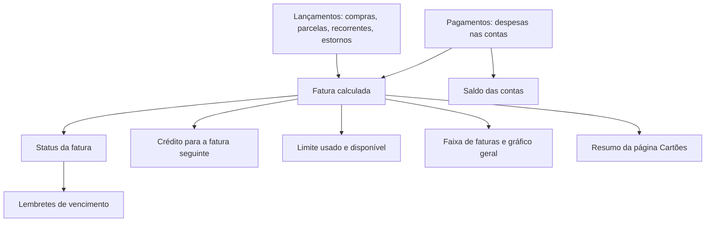
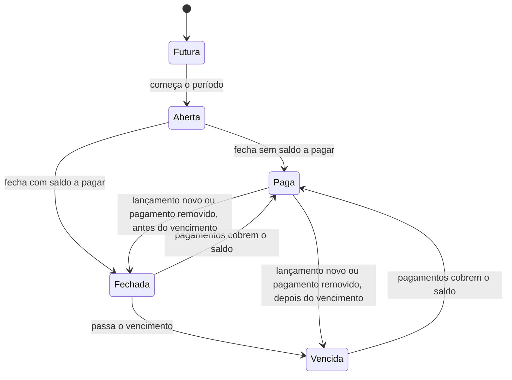
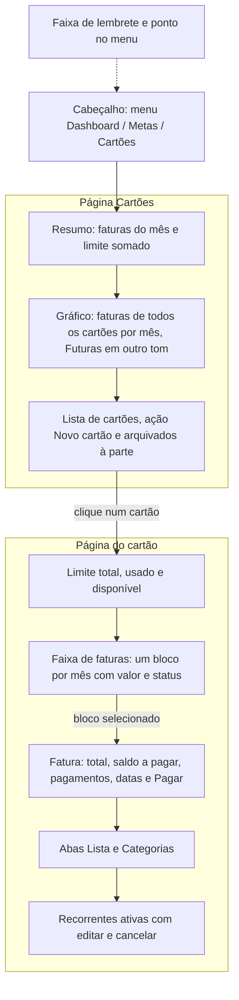
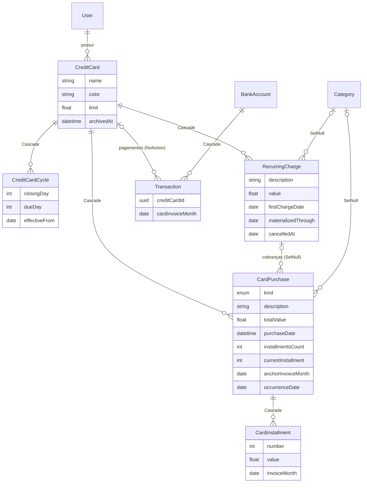
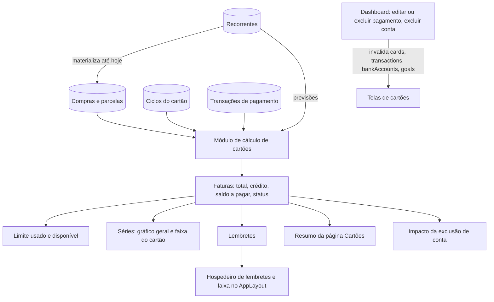
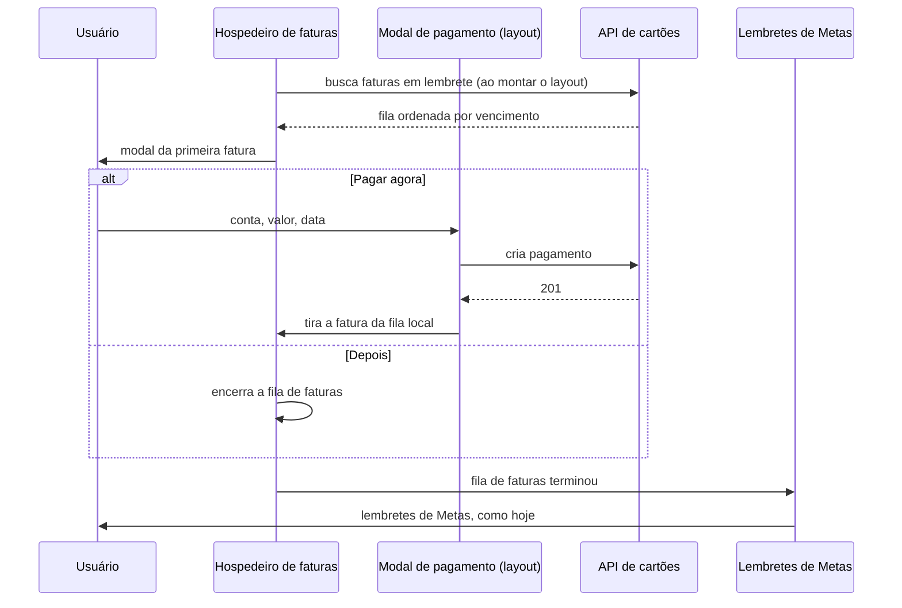
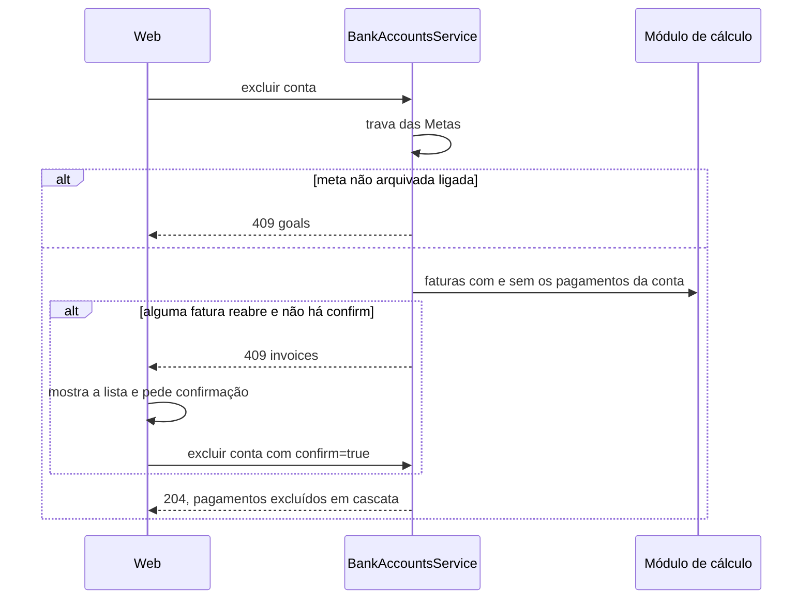
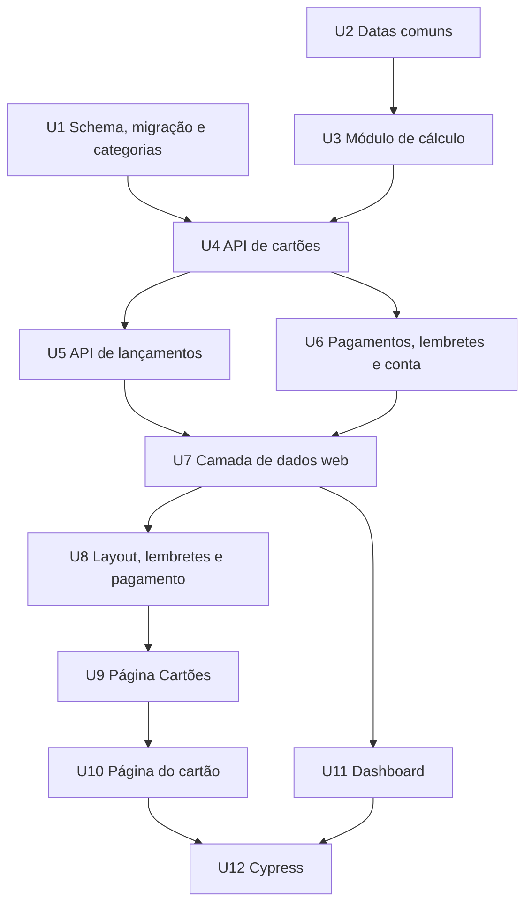

# Cartões de crédito - Plan

## Goal Capsule

- **Objective:** O usuário acompanha dentro do fintrack todos os seus cartões de crédito, de vários bancos: faturas, limite, parcelas futuras e gastos por categoria. Com isso, deixa de precisar do app pago e dos apps dos bancos para isso.
- **Means:** o app não guarda faturas. Ele calcula cada fatura a partir dos lançamentos do cartão e dos pagamentos, e cada pagamento é uma despesa numa conta (Key Decision "A fatura é calculada", KTD2).
- **Authority:** os requisitos (R) decidem o comportamento do produto. Os KTDs decidem o mecanismo, dentro dos limites dos R que citam. As unidades não sobrescrevem nenhum dos dois, e AEs e Flows só ilustram.
- **Stop conditions:** pare e pergunte ao usuário se uma decisão marcada `session-settled` se mostrar inviável, ou se o backfill de categorias da migração não puder rodar no banco de destino. Nunca rode reset nem `db push`, e nunca aceite um pedido de reset do Prisma, num banco que tenha dados.
- **Execution profile:** dois códigos (`api/` e `web/`), em três fases: API, depois web, depois testes ponta a ponta. U3 é feita com testes antes do código.
- **Finisher:** `ce-work` implementa e verifica pelo Verification Contract. O usuário revisa e integra o PR.
- **Open blockers:** nenhum.

---

## Product Contract

### Summary

Uma página Cartões no fintrack. Cada cartão tem limite, dia de fechamento e dia de vencimento, e cada compra avulsa, parcela, recorrente ou estorno cai na fatura certa pela data. O app calcula cada fatura a partir desses lançamentos e dos pagamentos. Os pagamentos saem das contas como despesas e podem ser parciais ou divididos entre contas. A página Cartões mostra o resumo e o gráfico de todos os cartões. Cada cartão tem uma faixa de faturas com os meses já comprometidos e as compras em lista ou por categoria. Lembretes avisam das faturas perto do vencimento.

### Problem Frame

Hoje o usuário acompanha os cartões no mesmo app pago que as Metas substituíram. No fintrack, ele registra só o pagamento de cada fatura, como despesa numa conta. O app pago é ruim para acompanhar cartões. Conferir fatura por fatura nos apps dos bancos também é ruim, porque os cartões estão em vários bancos.

Por isso o fintrack não mostra quanto cada cartão gastou, quanto do limite está livre, quais parcelas ainda vêm pela frente nem em que categorias o dinheiro vai. Trocar de app só faz sentido com paridade. Além da lista inicial, o usuário usa no app pago estornos, assinaturas recorrentes, lembrete de vencimento e limite disponível. Ele só cancela a assinatura quando tudo isso estiver no fintrack.

---

### Key Decisions

- **As compras ficam só em Cartões, e o pagamento é a despesa na conta.** O saldo das contas só muda com o pagamento, como já acontece hoje. Governs R27, R37. (session-settled: user-directed — chosen over compras também no Dashboard com o pagamento como transferência, e compras no Dashboard só para leitura: o app não tem transferência, e o gasto apareceria duas vezes)
- **O cadastro do cartão pede dia de fechamento e dia de vencimento.** A fatura de cada lançamento sai da data dele, sem trabalho extra no lançamento. Governs R1, R6. (session-settled: user-directed — chosen over só o vencimento com fechamento fixo, e escolher a fatura em cada compra: o fechamento fixo erra nos cartões fora do padrão)
- **A fatura é calculada, não cadastrada.** É o mesmo desenho do saldo das contas e do total das Metas: uma fonte de verdade, sem total congelado para conciliar. Governs R8, R9, R12, R13, R31. (session-settled: user-directed — chosen over fatura guardada com total congelado no fechamento: o total congelado só compensaria com juros ou com um valor do banco diferente da soma, e nenhum dos dois está no escopo)
- **O pagamento tem valor livre, e o que faltar fica na mesma fatura.** Governs R10, R26, R28. (session-settled: user-directed — chosen over só pagamento total, e resto passando para a fatura seguinte: permite pagar com duas contas sem misturar meses)
- **O crédito abate a fatura seguinte.** Governs R11. (session-settled: user-directed — chosen over crédito parado na fatura, e bloqueio de crédito: assim os totais batem com o banco)
- **O parcelamento em andamento entra pela parcela atual.** Governs R18. (session-settled: user-directed — chosen over data retroativa com faturas passadas marcadas como pagas, e data de início no cartão: nada é criado no passado e nada é pago duas vezes)
- **O usuário escolhe em qual fatura está a parcela atual.** Governs R18. (session-settled: user-directed — chosen over sempre na fatura aberta, e na primeira fatura não paga: no cadastro pode existir uma fatura fechada ainda não paga, e uma escolha errada desloca todas as parcelas em um mês)
- **O gráfico mostra o total de cada fatura, incluindo os meses futuros já comprometidos.** Governs R41, R43. (session-settled: user-directed — chosen over só até a fatura atual, e gasto pela data da compra: o gasto pela data da compra não bate com a fatura)
- **O resumo mostra as faturas do mês e o limite somado.** Governs R40. (session-settled: user-directed — chosen over só as faturas, e faturas com o total futuro)
- **A página do cartão é uma faixa de faturas.** Governs R43, R44, R45. (session-settled: user-directed — chosen over uma coluna com gráfico separado, e duas colunas: escolhido a partir de um esboço visual das três opções)
- **A página Cartões segue o padrão da página Metas.** Resumo e gráfico no topo e cartões embaixo, como foi mostrado no esboço. Governs R39, R40, R41, R42.
- **O lembrete aparece em modal ao abrir o app e numa faixa no topo.** Governs R33, R34, R35, R36. (session-settled: user-directed — chosen over só o modal, só a faixa, e só o status no cartão)
- **Estorno, recorrentes, lembrete e limite disponível entram.** São o que o usuário usa no app pago além da lista inicial. Governs R19, R20, R21, R22, R23, R31, R32, R33. (session-settled: user-directed — chosen over a lista inicial sem esses itens: sem eles não há paridade)
- **Tudo entra numa entrega.** (session-settled: user-directed — chosen over uma entrega em duas partes: cancelar o app pago exige paridade)
- **Sem conferência com o total do banco nesta entrega.** (session-settled: user-directed — chosen over pedir o total do banco no pagamento e lançar a diferença como "não registrado")
- **Excluir uma conta avisa em vez de bloquear.** Governs R38. (session-settled: user-approved — chosen over o bloqueio usado nas Metas: com o tempo quase toda conta terá pago alguma fatura, e o bloqueio impediria excluí-las)
- **Todo usuário ganha um conjunto padrão de categorias de despesa.** Hoje o cadastro cria só "House" como despesa e o app não cria categorias, então a visão por categoria não teria sentido. Governs R48. (session-settled: user-directed — chosen over gerenciar categorias nesta entrega, e usar só as categorias que já existem: o conjunto padrão resolve a visão por categoria sem uma feature a mais)
- **Um cartão arquivado que volta a dever aceita pagamento.** Excluir ou reduzir um pagamento no Dashboard, ou excluir a conta que pagou, pode reabrir uma fatura de cartão arquivado. Governs R5, R42. (session-settled: user-directed — chosen over bloquear a edição desses pagamentos no Dashboard, e desarquivar o cartão sozinho: a dívida fica visível e pagável sem mudar o estado do cartão)
- **Um lançamento tardio vai para a fatura da data dele, mesmo que ela já esteja paga.** Assim a fatura do app bate com a do banco, que já incluiu a compra. Governs R6, R24.
- **Editar ou excluir uma compra parcelada vale para todas as parcelas.** A diferença nas faturas pagas vira crédito ou saldo a pagar, pelas regras de R10 e R11. Governs R25.
- **A recorrente só ocupa limite quando a cobrança é lançada.** O banco também só desconta a assinatura quando cobra. Governs R20, R31.
- **Cartão com lançamentos só pode ser arquivado, e só sem saldo devedor.** Excluir apagaria o histórico das faturas pagas. Governs R4, R5.
- **"Fatura de cartão" não aparece ao criar uma despesa no Dashboard.** Hoje o usuário lança o pagamento da fatura direto no Dashboard. Com a categoria disponível ali, esse hábito criaria um pagamento sem vínculo com a fatura e um débito em dobro. Governs R49.



---

### Requirements

**Cadastro e ciclo de vida do cartão**

- R1. O usuário cadastra um cartão com nome, cor, limite, dia de fechamento e dia de vencimento.
- R2. Todos os campos de R1 podem ser editados. Uma mudança no dia de fechamento ou de vencimento vale da fatura Aberta em diante, e as faturas já fechadas mantêm as datas que tinham. Se, com os dias novos, o fechamento da fatura Aberta já tiver passado, a mudança vale só da fatura seguinte.
- R3. Se o dia de fechamento, de vencimento ou de uma cobrança recorrente for 29, 30 ou 31, nos meses mais curtos ele cai no último dia do mês.
- R4. Um cartão sem lançamentos e sem pagamentos pode ser excluído. Um cartão com lançamentos só pode ser arquivado, e só quando não deve nada, isto é, com o limite usado de R31 em zero ou menos. Fora disso, o app informa quanto o cartão ainda deve.
- R5. Um cartão arquivado sai do resumo, do limite somado e dos lembretes, não aceita lançamentos novos e tem as recorrentes encerradas. O histórico dele fica só para leitura, com uma exceção: as faturas que voltarem a ter saldo a pagar continuam com a ação Pagar.

**Faturas**

- R6. Cada lançamento pertence à primeira fatura que fecha depois da data dele. Assim, uma compra feita no próprio dia do fechamento já entra na fatura seguinte.
- R7. Cada fatura leva o nome do mês do seu vencimento.
- R8. O usuário não cria nem fecha faturas. O app calcula cada fatura a partir dos lançamentos e pagamentos dela.
- R9. O total da fatura é a soma das compras, parcelas e cobranças recorrentes dela, menos os estornos dela e menos o crédito vindo da fatura anterior (R11).
- R10. O saldo a pagar é o total menos os pagamentos da fatura. O que faltar depois de um pagamento parcial continua nesta fatura, sem juros, e não passa para a seguinte.
- R11. Quando os pagamentos passam do total, ou os estornos deixam o total negativo, a sobra vira crédito e abate a fatura seguinte do mesmo cartão.
- R12. O status da fatura é calculado. Ela é Futura antes de o período dela começar e Aberta durante o período. Depois do fechamento, é Paga quando o saldo a pagar é zero ou virou crédito, Fechada quando há saldo a pagar e o vencimento não passou, e Vencida quando há saldo a pagar depois do vencimento.
- R13. O status muda sozinho quando lançamentos ou pagamentos mudam, então uma fatura Paga pode voltar a Fechada ou Vencida.
- R14. A ação Pagar aparece nas faturas Aberta, Fechada e Vencida que têm saldo a pagar, e nunca nas Futuras.



**Lançamentos**

- R15. O usuário lança uma compra avulsa num cartão com descrição, valor, data e uma das suas categorias de despesa, exceto "Metas" e "Fatura de cartão".
- R16. Uma compra parcelada recebe o valor total e o número de parcelas. Cada parcela vale o total dividido pelo número de parcelas, e os centavos que sobrarem vão para a primeira.
- R17. A primeira parcela cai na fatura da data da compra, e cada parcela seguinte cai na fatura do mês seguinte.
- R18. Numa compra parcelada já em andamento, o usuário informa o valor da parcela, o número de parcelas, a parcela atual (ex.: 4 de 10), a data original da compra e a fatura em que a parcela atual está: a última que fechou ou a Aberta, que vem marcada. O app cria só as parcelas da atual em diante, a partir da fatura escolhida, e nenhuma em faturas anteriores. Depois, a parcela atual pode ser corrigida, mas a fatura escolhida não.
- R19. O usuário cadastra uma compra recorrente com descrição, valor, categoria e data da primeira cobrança, que não pode ser anterior ao início da última fatura fechada. Ela se repete todo mês no mesmo dia, com o ajuste de R3, até ser cancelada.
- R20. Cada cobrança recorrente vira um lançamento comum na sua data. Antes disso, ela aparece como previsão na fatura em que vai cair e conta nos gráficos de R41 e R43, mas fica fora do total da fatura e do limite.
- R21. Editar o valor, a descrição ou a categoria de uma recorrente vale para as cobranças que ainda não viraram lançamento. Cobranças já lançadas são editadas uma a uma, como qualquer lançamento.
- R22. Cancelar uma recorrente interrompe as cobranças a partir da data do cancelamento. As cobranças já lançadas continuam.
- R23. O usuário lança um estorno com descrição, valor, data e categoria opcional. O estorno cai na fatura da sua data (R6) e abate o total dela.
- R24. Num cartão não arquivado, qualquer lançamento pode ser criado, editado ou excluído, inclusive numa fatura Paga, e a fatura recalcula saldo, crédito e status (R10, R11, R13).
- R25. Editar ou excluir uma compra parcelada vale para todas as parcelas dela, inclusive as que estão em faturas pagas.

**Pagamento**

- R26. Para pagar uma fatura, o usuário escolhe a conta, o valor e a data. O valor vem preenchido com o saldo a pagar e pode ser trocado por um valor menor ou maior.
- R27. Cada pagamento é uma despesa na conta escolhida, na categoria "Fatura de cartão", com o nome "Fatura <cartão> <mês>", e reduz o saldo dessa conta.
- R28. Uma fatura pode receber vários pagamentos, de contas diferentes.
- R29. Quando o usuário edita o valor, a data, a conta, o nome ou a categoria de uma despesa de pagamento no Dashboard, ou a exclui, a fatura reflete a mudança. O pagamento continua ligado à mesma fatura mesmo quando a data muda.
- R30. Todo usuário, novo ou já existente, tem a categoria de despesa "Fatura de cartão".

**Limite**

- R31. O limite usado é tudo o que o cartão deve: os lançamentos de todas as faturas, inclusive as parcelas de faturas Futuras, menos estornos e pagamentos. Previsões de recorrentes ficam de fora (R20).
- R32. O limite disponível é o limite menos o limite usado. Ele pode ficar negativo: nesse caso o app avisa e não bloqueia o lançamento.

**Lembrete de vencimento**

- R33. Uma fatura entra em lembrete quando está Fechada a 5 dias ou menos do vencimento, ou Vencida, e sai quando o saldo a pagar zera.
- R34. Ao abrir o app, aparece um modal para cada fatura em lembrete, em ordem de vencimento e antes dos lembretes de Metas, com as ações "Pagar agora", que abre o pagamento de R26, e "Depois". Uma fatura paga por esse modal sai da fila, mesmo que o pagamento seja parcial.
- R35. "Depois" esconde os modais de fatura restantes até a próxima abertura do app. Os lembretes de Metas aparecem em seguida.
- R36. Enquanto houver fatura em lembrete, uma faixa no topo de todas as páginas logadas mostra a fatura de vencimento mais próximo, quantas outras estão em lembrete e o botão Pagar. O item Cartões do menu ganha um ponto.

**Contas e Dashboard**

- R37. Compras, parcelas, recorrentes e estornos de cartão não aparecem no Dashboard e não mudam o saldo de nenhuma conta. Do cartão, só os pagamentos (R27) aparecem no Dashboard.
- R38. Ao excluir uma conta cujos pagamentos, se removidos, deixariam alguma fatura com saldo a pagar, o app lista essas faturas, inclusive as de cartões arquivados, e pede confirmação. Com a confirmação, os pagamentos são excluídos junto com a conta e essas faturas são recalculadas (R13).
- R48. Todo usuário, novo ou já existente, tem as categorias de despesa Alimentação, Mercado, Lazer, Transporte, Viagem, Educação, Roupas e Outros.
- R49. A categoria "Fatura de cartão" não aparece ao criar uma despesa no Dashboard.

**Telas**

- R39. Cartões é uma página própria, no menu do cabeçalho junto de Dashboard e Metas.
- R40. O topo da página Cartões mostra o total das faturas que vencem no mês corrente, somando os cartões não arquivados, e o limite somado desses cartões: total, usado e disponível.
- R41. Ao lado do resumo, um gráfico de barras mostra, por mês de vencimento, de 6 meses atrás a 6 meses à frente, o total das faturas de todos os cartões não arquivados mais as previsões de recorrentes. As faturas Futuras aparecem em outro tom, e uma fatura com crédito aparece como zero.
- R42. Abaixo do gráfico fica a lista de cartões, com nome, fatura do mês, vencimento e limite disponível de cada um, e a ação "Novo cartão". Os cartões arquivados ficam separados dos ativos, e um arquivado com saldo a pagar mostra "deve R$ X".
- R43. A página de um cartão mostra o limite total, usado e disponível, e uma faixa de faturas com a mesma janela e os mesmos valores de R41. Cada bloco mostra o mês, o valor e o status, e a altura do bloco segue o valor. A faixa também inclui qualquer fatura mais antiga que ainda tenha saldo a pagar.
- R44. Selecionar um bloco abre a fatura logo abaixo, com total, saldo a pagar, pagamentos feitos, datas de fechamento e vencimento e a ação Pagar (R14). Ao abrir a página, fica selecionada a fatura mais antiga com saldo a pagar entre as Aberta, Fechada e Vencida ou, se não houver nenhuma, a Aberta.
- R45. Os lançamentos da fatura aparecem em duas abas. Lista mostra descrição, data, categoria e valor de cada lançamento e marca parcela (ex.: 4/10), recorrente, previsão e estorno. Categorias mostra o total e a fatia de cada categoria, com os estornos abatendo a própria categoria ou somados em "Sem categoria".
- R46. A página do cartão lista as recorrentes ativas dele, com as ações editar e cancelar.
- R47. O usuário lança compra avulsa, compra parcelada, recorrente e estorno a partir da página Cartões, escolhendo o cartão, ou da página do cartão.



---

### Key Flows

- F1. Cadastrar um cartão que já está em uso
  - **Trigger:** O usuário clica em "Novo cartão" na página Cartões.
  - **Steps:** O usuário preenche os campos de R1. Lança as compras avulsas da fatura Aberta, e da última fechada se ainda for pagá-la pelo app, com as datas reais. Para cada parcelamento em andamento, lança a compra com a parcela atual e a fatura em que ela está. Cadastra as recorrentes.
  - **Outcome:** As faturas da última fechada em diante e o limite usado refletem o cartão, sem nada criado em faturas anteriores.
  - **Covered by:** R1, R6, R15, R18, R19, R31
- F2. Pagar uma fatura
  - **Trigger:** O usuário escolhe Pagar na fatura, na faixa de lembrete ou no modal.
  - **Steps:** O usuário escolhe a conta, confere ou troca o valor e a data, e confirma. O app cria a despesa na conta. Para dividir o pagamento, o usuário repete o passo com outra conta.
  - **Outcome:** O status da fatura é recalculado, o pagamento aparece no Dashboard e o lembrete some quando o saldo a pagar zera.
  - **Covered by:** R10, R11, R26, R27, R28, R33, R36
- F3. Lembrete de vencimento
  - **Trigger:** O usuário abre o app com pelo menos uma fatura em lembrete.
  - **Steps:** O app mostra um modal por fatura, em ordem de vencimento. "Pagar agora" segue F2, e a fatura sai da fila. "Depois" esconde os modais de fatura restantes. Em seguida vêm os lembretes de Metas.
  - **Outcome:** A faixa no topo e o ponto no menu continuam até o saldo a pagar de cada fatura zerar.
  - **Covered by:** R33, R34, R35, R36

---

### Acceptance Examples

Nos exemplos, o cartão Nubank tem limite de R$ 10.000, fecha no dia 3 e vence no dia 10. As contas são Itaú e Inter.

- AE1. **Covers R6, R7.** **Given** o Nubank, **when** o usuário lança uma compra em 2 de outubro, **then** ela entra na fatura de outubro, que vence em 10/10. **When** a compra é de 3 de outubro, **then** ela entra na fatura de novembro.
- AE2. **Covers R16, R17.** **Given** uma compra de R$ 1.000 em 3x no Nubank, feita em 15 de outubro, **then** as parcelas são de R$ 333,34, R$ 333,33 e R$ 333,33, nas faturas de novembro, dezembro e janeiro.
- AE3. **Covers R18, R31.** **Given** que em 5 de outubro a fatura de outubro já fechou e o app do banco mostra nela a parcela 4/10 de R$ 400 de um notebook, **when** o usuário lança o notebook com parcela de R$ 400, 10 parcelas, parcela atual 4 e a fatura de outubro, **then** o app cria as parcelas 4 a 10, de R$ 400 cada, nas faturas de outubro a abril, e o limite usado sobe R$ 2.800.
- AE4. **Covers R10, R26, R27, R28.** **Given** a fatura de outubro Fechada com total de R$ 1.230, **when** o usuário paga R$ 1.000 pela conta Itaú, **then** o saldo a pagar de R$ 230 continua na fatura de outubro e a fatura de novembro não muda. **When** ele paga R$ 230 pela conta Inter, **then** a fatura fica Paga e o Dashboard mostra duas despesas "Fatura Nubank outubro".
- AE5. **Covers R9, R11, R23.** **Given** a fatura de novembro com R$ 200 em compras e um estorno de R$ 1.000, **then** o total de novembro fica em −R$ 800 e ela fica Paga ao fechar. **Given** R$ 1.500 em compras na fatura de dezembro, **then** o total de dezembro é R$ 700.
- AE6. **Covers R6, R13, R24, R33.** **Given** a fatura de outubro Paga, **when** em 20 de outubro o usuário lança uma compra esquecida de R$ 50 com data de 28 de setembro, **then** a compra entra na fatura de outubro, que fica Vencida com R$ 50 a pagar e entra em lembrete.
- AE7. **Covers R11, R25.** **Given** uma compra de R$ 1.000 em 10x, com as parcelas de agosto, setembro e outubro em faturas pagas e a de novembro na fatura Aberta, **when** o usuário exclui a compra, **then** todas as parcelas somem, cada fatura de agosto a outubro fica com R$ 100 pagos a mais, e o crédito acumulado chega à fatura de novembro como R$ 300.
- AE8. **Covers R20, R21, R31.** **Given** uma recorrente Netflix de R$ 55 com cobrança no dia 20 no Nubank, **when** é 10 de outubro, **then** a Netflix aparece como previsão na fatura de novembro e não conta no limite. **When** chega 20 de outubro, **then** ela vira lançamento e o limite usado sobe R$ 55. **When** o usuário muda o valor para R$ 60 em 25 de outubro, **then** a cobrança de 20 de novembro vem com R$ 60 e a de outubro continua com R$ 55.
- AE9. **Covers R32.** **Given** R$ 300 de limite disponível, **when** o usuário lança uma compra de R$ 500, **then** o app avisa, aceita o lançamento e o disponível fica em −R$ 200.
- AE10. **Covers R33, R34, R35, R36.** **Given** a fatura de outubro Fechada com R$ 1.230 a pagar, **when** o usuário abre o app em 6 de outubro, **then** aparece o modal da fatura. **When** ele escolhe "Depois", **then** o modal some até a próxima abertura, a faixa aparece em todas as páginas e o item Cartões ganha um ponto. **When** ele paga R$ 1.000, **then** a faixa continua com R$ 230. **When** ele paga o resto, **then** a faixa e o ponto somem.
- AE11. **Covers R38.** **Given** que a conta Itaú pagou as faturas de agosto e setembro do Nubank, **when** o usuário pede para excluir a Itaú, **then** o app avisa que essas duas faturas voltarão a ter saldo a pagar. **When** ele confirma, **then** as duas ficam Vencidas e entram em lembrete.
- AE12. **Covers R4, R5.** **Given** o Nubank com parcelas em faturas Futuras, **when** o usuário tenta arquivá-lo, **then** o app não deixa e informa quanto o cartão ainda deve. **Given** o limite usado em zero, **when** ele arquiva, **then** o Nubank sai do resumo, do limite somado e dos lembretes, e as recorrentes dele param.
- AE13. **Covers R2.** **Given** o Nubank fechando no dia 3, **when** em 5 de outubro o usuário muda o fechamento para o dia 10 e o vencimento para o dia 17, **then** a fatura de outubro mantém o fechamento em 3/10. A fatura de novembro passa a fechar em 10/11 e a vencer em 17/11, com as compras de 3/10 a 9/11.
- AE14. **Covers R21.** **Given** a cobrança da Netflix de 20 de outubro já lançada, **when** o usuário a exclui porque ela foi cobrada em outro cartão, **then** ela não volta a aparecer, e a cobrança de 20 de novembro continua prevista.
- AE15. **Covers R34, R36.** **Given** a fatura de outubro em lembrete com R$ 1.230 a pagar, **when** o usuário escolhe "Pagar agora" no modal e paga R$ 1.000, **then** o modal dessa fatura não volta, e a faixa continua com R$ 230.
- AE16. **Covers R29.** **Given** o pagamento "Fatura Nubank outubro" feito em 8 de outubro, **when** o usuário muda no Dashboard a data para 2 de novembro e a categoria para Outros, **then** o pagamento continua abatendo a fatura de outubro.
- AE17. **Covers R18, R25.** **Given** o notebook de AE3, **when** o usuário corrige a parcela atual de 4 para 5, **then** a fatura de outubro passa a ter a parcela 5/10 e as faturas de novembro a março têm as parcelas 6 a 10. A fatura de abril fica sem parcela do notebook.
- AE18. **Covers R5, R42.** **Given** o Nubank arquivado sem dever nada, **when** o usuário exclui no Dashboard o pagamento da fatura de setembro, **then** o Nubank aparece em Arquivados com "deve R$ X", a fatura de setembro mostra Pagar e o Nubank continua fora dos lembretes e do resumo.
- AE19. **Covers R2.** **Given** o Nubank fechando no dia 3 e vencendo no dia 10, **when** em 28 de outubro o usuário muda o fechamento para o dia 26 e o vencimento para o dia 2, **then** a fatura de novembro continua fechando em 3/11 e vencendo em 10/11. A mudança vale a partir da fatura de dezembro, que fecha em 26/11 e vence em 2/12.

---

### Success Criteria

- O usuário cadastra os cartões que usa hoje, traz os parcelamentos em andamento e acompanha faturas, limite e gastos por categoria sem abrir o app pago nem os apps dos bancos. Com isso, consegue cancelar a assinatura.
- Com todos os lançamentos registrados, o total de cada fatura e o limite disponível batem com os do banco.
- Depois de qualquer edição ou exclusão de lançamento, pagamento ou conta, as faturas, o limite, os gráficos e o saldo das contas mostram os mesmos valores.

---

### Scope Boundaries

- Juros, rotativo, IOF e multa por atraso. A anuidade, se houver, é lançada como compra.
- Cartão de débito. Compras no débito continuam sendo despesas de conta.
- Importar a fatura do banco, por arquivo ou por Open Finance.
- Cartões adicionais ou virtuais como cartões separados.
- Conferir o total do app com o total do banco na hora do pagamento.
- Antecipar parcelas ou pagar faturas Futuras.
- Compras de cartão no Dashboard ou no saldo das contas (R37).
- Desarquivar um cartão.
- Notificações fora do app, como push ou e-mail.
- Compras em moeda estrangeira.
- Transferência entre contas como conceito geral do app.
- Criar, editar ou excluir categorias.
- Mudar o tipo de um lançamento (avulsa, parcelada, estorno) ou o cartão dele depois de criado. O usuário exclui e lança de novo.
- O botão de esconder valores do Dashboard nas telas de Cartões, como já ficou de fora nas Metas.

#### Considered and not built

- **Vincular uma despesa já lançada no Dashboard a uma fatura.** Na migração, uma fatura fechada já paga fora do app só reabre se o usuário lançar compras nela, e o seletor de R18 já vem com a Aberta marcada. Construir se o usuário relatar faturas pagas duas vezes depois de migrar.
- **Rotina agendada para lançar as recorrentes.** O repositório não tem agendador, e a materialização na leitura (KTD6) dá o mesmo resultado para quem abre o app. Construir se aparecer outro consumidor dos lançamentos fora do app.
- **Bloquear duas requisições de pagamento simultâneas.** Para um usuário só, um pagamento duplicado é raro, aparece no Dashboard e se desfaz excluindo a despesa (R29). Mesma escolha das Metas (KTD6 de lá).
- **Esconder "Metas" da lista de categorias do Dashboard.** O problema é parecido com R49, mas está fora do escopo de cartões.

#### Deferred to Follow-Up Work

- Ícones próprios para "Fatura de cartão" e "Outros". Por enquanto os dois usam o ícone padrão de despesa, como "Metas".
- Traduzir para português as categorias antigas "House" e "Salary".
- Consertar o lint do web, que já falha antes desta mudança.

---

### Dependencies / Assumptions

- R6 supõe que uma compra feita no próprio dia do fechamento entra na fatura seguinte, o comportamento mais comum nos bancos brasileiros. Vale conferir com a fatura de um dos cartões do usuário.
- Os lançamentos são manuais. As faturas só batem com as do banco quando o usuário registra tudo o que foi cobrado.
- A regra de exclusão de conta das Metas continua valendo junto com R38: uma conta ligada a uma meta não arquivada segue bloqueada, e essa trava é conferida antes do aviso de faturas.

---

### Sources / Research

- `docs/plans/2026-10-11-2035-feat-metas-plan.md`: padrões reaproveitados. A transação é o próprio registro e a meta acompanha edições feitas nela (R10–R12 e KTD4 de lá). A categoria é criada para usuários novos e existentes (KTD5). O lembrete aparece em modal ao abrir o app (R14, R30, KTD7), e a página tem resumo e gráfico (R24–R28, KTD12). A exclusão de conta tem bloqueio (R23, KTD9), e os dias 29 a 31 têm ajuste (R17).
- `api/src/modules/bank-accounts/bank-accounts.service.ts`: o saldo da conta é calculado na leitura (saldo inicial + receitas − despesas, sem filtro de data), e `remove` bloqueia a exclusão de conta ligada a metas não arquivadas.
- `api/src/database/repositories/bank-accounts.repositories.ts` e `transactions.repositories.ts`: o saldo e a lista do Dashboard leem todas as transações, sem filtro. Por isso os lançamentos de cartão precisam de tabelas próprias (KTD1).
- `api/prisma/schema.prisma`: toda transação exige uma conta, e excluir a conta exclui as transações dela em cascata. Valores em `Float`.
- `api/src/modules/auth/auth.service.ts`: o cadastro cria só Salary, House e as duas "Metas". `api/src/modules/categories/categories.service.ts` não cria categorias.
- `api/src/modules/goals/goal-calculations.ts`: funções de data no fuso `America/Sao_Paulo`, datas às 12:00 UTC, chaves de mês, ajuste do dia 29 a 31 (`getDueDate`) e soma em centavos.
- `web/src/view/layouts/AppLayout.tsx` e `web/src/view/components/ContributionReminders/`: menu, hospedeiro de lembretes com fila tirada ao montar e "fechar adia a fila".
- `web/src/view/pages/Goals/` e `web/src/view/pages/GoalDetail/`: resumo, gráfico com Recharts em contêiner de altura fixa, abas e página de detalhe.
- `web/src/app/utils/invalidateMoneyQueries.ts`: atualização conjunta das queries que dependem de dinheiro.

---

## Planning Contract

### Product Contract preservation

Changed: R1 (cor), R2 (fechamento da Aberta já passado), R14 (Pagar só com saldo a pagar), R15 (categorias excluídas), R18 (valor da parcela, data original e correção da parcela atual), R19 (data mínima da primeira cobrança), R29 (nome, categoria e data), R34, R35 e R36 (ordem com as Metas e fila depois do pagamento), R38 (só quando alguma fatura reabre, incluindo cartões arquivados), R41, R43 e R44 (janela, valores e seleção), todos esclarecimentos confirmados pelo usuário na síntese do planejamento. Changed: R5 e R42, por decisão do usuário durante o planejamento (cartão arquivado que volta a dever). Added: R48 e R49, AE14 a AE19 e três Key Decisions. Removed: a seção Outstanding Questions do brainstorm, porque todas as perguntas foram resolvidas em R1, R36, R41, R43, KTD5, KTD11 e KTD12. O restante ficou sem mudança.

### Key Technical Decisions

- KTD1. **Lançamentos de cartão ficam em tabelas próprias, e só o pagamento é uma transação.** O saldo das contas e a lista do Dashboard somam toda linha de `transactions`, então um lançamento de cartão ali quebraria R37. O modelo novo:
  - `CreditCard` guarda nome, cor, limite, `archivedAt` e `createdAt`.
  - `CreditCardCycle` guarda o dia de fechamento, o dia de vencimento e o mês de vencimento a partir do qual a versão vale, com unicidade por cartão e mês (KTD3).
  - `CardPurchase` é o que o usuário lança e edita. Guarda o tipo (compra ou estorno), descrição, categoria opcional, valor total, data, número de parcelas, parcela atual, mês da fatura âncora (só em R18) e, para cobranças recorrentes, a recorrente e a data da cobrança, com unicidade nesse par.
  - `CardInstallment` é uma linha por parcela, com número, valor e o mês de vencimento da fatura em que cai.
  - `RecurringCharge` guarda descrição, valor, categoria, data da primeira cobrança, `materializedThrough` e `cancelledAt`.
  - `Transaction` ganha `creditCardId` e `cardInvoiceMonth`, os dois anuláveis. `creditCardId` usa `onDelete: NoAction`, então o banco recusa excluir um cartão com pagamentos (R4), e a API traduz o erro P2003 em 409, como nas Metas.
  - Os lançamentos e as recorrentes são apagados em cascata com o cartão, porque R4 só deixa excluir um cartão sem lançamentos. A categoria usa `SetNull`.

  Os valores seguem `Float`, como as colunas que já existem. Toda soma e comparação de dinheiro é feita em centavos inteiros (KTD2), e os DTOs aceitam no máximo duas casas decimais. Segue as convenções de `api/prisma/schema.prisma`: ids `uuid`, `@@map` em camelCase, meses e dias de calendário em `@db.Date` e `Cascade` para o usuário.
- KTD2. **A fatura é calculada num módulo puro, e sua identidade é o par (cartão, mês de vencimento).** Cada parcela grava, ao ser escrita, o mês da fatura em que cai, e cada pagamento grava `cardInvoiceMonth`. `api/src/modules/cards/card-calculations.ts` agrupa parcelas e pagamentos por mês e percorre os meses em ordem para aplicar R9 a R12, carregando o crédito de um mês para o seguinte. O módulo calcula também status, limite (R31), lembretes (R33), resumo (R40), séries dos gráficos (R41, R43) e o impacto da exclusão de uma conta (R38). Não existe tabela nem coluna de fatura. O mês gravado na parcela mantém estáveis as faturas fechadas quando os dias do cartão mudam (R2) e a âncora de R18, sem guardar nenhum total. Governs R8, R9, R12, R13, R31. (session-settled: user-directed — chosen over fatura guardada com total congelado no fechamento: o total congelado só compensaria com juros ou com um valor do banco diferente da soma, e nenhum dos dois está no escopo)
- KTD3. **As datas de cada fatura saem do mês de vencimento e da versão de ciclo que vale para ele.**
  - A versão que vale para um mês M é a mais recente com início menor ou igual a M. Antes da primeira versão, vale a primeira.
  - O vencimento é o dia de vencimento ajustado dentro de M (R3).
  - O fechamento é o dia de fechamento ajustado dentro de M quando ele é menor que o dia de vencimento, e dentro de M−1 caso contrário. Se o ajuste deixar o fechamento igual ou depois do vencimento, o fechamento vira a véspera do vencimento. Assim cada mês tem exatamente uma fatura, e dois meses nunca vencem no mesmo dia.
  - O período de uma fatura vai do fechamento da anterior (inclusive) até a véspera do seu fechamento. Um lançamento pertence ao mês cuja fatura tem o menor fechamento estritamente maior que a data dele (R6).
  - Se o fechamento calculado para um mês não ficar depois do fechamento do mês anterior, ele vira o dia seguinte a esse fechamento. Isso só acontece logo depois de uma mudança de ciclo que leva o fechamento para o mês anterior ao vencimento, e evita dois períodos sobrepostos.
  - A primeira versão do cartão começa no mês da última fatura fechada no dia do cadastro, e não no mês da Aberta. Assim uma mudança de dias logo depois do cadastro grava uma versão nova, em vez de substituir a única versão e mudar as datas das faturas já fechadas.
  - Ao mudar os dias (R2), a nova versão começa no mês da fatura Aberta se o novo fechamento desse mês for maior que hoje e maior que o início do período. Caso contrário, começa no mês seguinte (AE19). Os meses já gravados nas parcelas e nos pagamentos nunca são reescritos por uma mudança de ciclo.
- KTD4. **Uma regra de datas para tudo, num módulo comum.** "Hoje" é o dia de calendário em `America/Sao_Paulo`. Datas de compra e pagamento são gravadas às 12:00 UTC desse dia, e meses, ciclos e recorrentes em `@db.Date`. As funções genéricas de `api/src/modules/goals/goal-calculations.ts` (centavos, dia de calendário, hoje, 12:00 UTC, chaves de mês e ajuste do dia) e a constante de fuso de `goals.constants.ts` vão para `api/src/shared/calendar.ts`. O módulo de metas passa a importá-las de lá, sem mudar comportamento.
- KTD5. **Parcelas são linhas, e editar uma compra parcelada regenera as linhas.**
  - Na compra comum, o valor de cada parcela é o total em centavos dividido por N, com o resto na parcela 1 (R16). A parcela n cai no mês da compra mais n−1 (R17).
  - Em R18, o formulário recebe o valor da parcela, N, a parcela atual k, a data original e a fatura âncora. O total gravado é o valor da parcela vezes N. As parcelas k a N têm todas esse valor e caem a partir da âncora. A âncora precisa ser a última fatura fechada ou a Aberta, e a data original não pode ser posterior ao fechamento da âncora.
  - Editar valor, N, data ou parcela atual apaga e recria as linhas da compra numa única transação do Prisma. Em R18, a âncora fica fixa e passa a receber a nova parcela atual (AE17). Editar descrição ou categoria não mexe nas linhas.
  - N vai de 2 a 48 na compra parcelada. Tipo e cartão não podem ser editados (Scope Boundaries).
- KTD6. **As recorrentes viram lançamentos quando os dados são lidos.** O repositório não tem agendador.
  - Toda leitura de cartões (lista, resumo, detalhe e lembretes) e todo arquivamento ou cancelamento começam materializando, para o usuário, as cobranças com data entre a marca d'água da recorrente e hoje.
  - A leitura reserva o intervalo antes de gravar. Numa transação interativa, um `updateMany` na recorrente, filtrado pelo id e pelo `materializedThrough` lido, avança a marca d'água para hoje. Com `count` 0, outra leitura já materializou e nada é criado. Com `count` 1, cada cobrança é criada com `create`, aninhando a sua `CardInstallment` com o mês calculado por KTD3. É o mesmo formato de guarda de `GoalsRepository.archive`.
  - No Prisma 4.16 do projeto, `createMany` não grava relações nem devolve ids, por isso a reserva usa `create` aninhado. A unicidade de recorrente e data fica como segunda barreira. Um P2002 aborta a transação inteira no Postgres, então a leitura trata esse erro como "já materializado" e segue sem gravar. Assim duas leituras simultâneas não duplicam cobranças, e uma cobrança excluída não volta (AE14).
  - Cobranças com data igual ou posterior a `cancelledAt` não são criadas. Cancelar grava `cancelledAt` com a data de hoje e materializa na mesma transação: as cobranças anteriores a hoje ainda são lançadas e a de hoje não. Uma cobrança de hoje que uma leitura anterior já lançou continua (R22).
  - As previsões das cobranças futuras, dentro da janela dos gráficos, são calculadas no módulo de KTD2 e nunca gravadas.
- KTD7. **O pagamento é a própria transação, ligada à fatura por um vínculo explícito.**
  - Só o serviço de cartões grava `creditCardId` e `cardInvoiceMonth`. Os DTOs de transação nunca aceitam esses campos, e o `ValidationPipe` com `whitelist` descarta o que vier a mais.
  - A edição pelo Dashboard já envia só campos nomeados (`transactions.service.ts`), então o vínculo continua depois de editar valor, data, conta, nome ou categoria (R29, AE16). Só linhas EXPENSE contam como pagamento. Uma troca de tipo feita direto pela API faz a linha deixar de contar, como foi aceito nas Metas.
  - O nome é "Fatura <cartão> <mês por extenso>", com "/AAAA" no fim quando o ano da fatura é diferente do ano do pagamento. Mudar o nome do cartão não renomeia pagamentos antigos.
  - A API aceita pagamento em fatura Aberta, Fechada ou Vencida. Num cartão arquivado, só quando a fatura tem saldo a pagar (R5). Fatura Futura ou Paga devolve 409. Se a categoria "Fatura de cartão" não existir, a escrita falha com erro, como nas Metas.
- KTD8. **Categorias padrão e "Fatura de cartão" no cadastro e na migração.**
  - O cadastro passa a criar Alimentação (`food`), Mercado (`grocery`), Lazer (`fun`), Transporte (`transport`), Viagem (`travel`), Educação (`education`), Roupas (`clothes`), Outros (`other`) e "Fatura de cartão" (`credit-card`), todas EXPENSE.
  - A migração cria essas categorias para os usuários existentes, com `gen_random_uuid()` explícito e `WHERE NOT EXISTS` por usuário, ícone e tipo, no mesmo formato do backfill das Metas.
  - A lista fica em `api/src/modules/categories/categories.constants.ts`, usada pelo cadastro. A migração repete os mesmos valores em SQL.
  - Os lançamentos de cartão aceitam só categorias do usuário do tipo EXPENSE e diferentes de `goal` e `credit-card`. A API confere o tipo, porque `ValidateCategoryOwnershipService` só confere o dono.
  - O web tira `credit-card` da lista de categorias do novo lançamento do Dashboard (R49).
- KTD9. **Excluir uma conta passa a ter dois passos.**
  1. Primeiro roda a trava das Metas, como hoje.
  2. Depois o serviço busca os pagamentos de cartão da conta. Para cada cartão afetado, o módulo de KTD2 calcula as faturas com e sem esses pagamentos e lista as que passam de saldo a pagar zero ou negativo para positivo, inclusive em cartões arquivados.
  3. Se a lista não estiver vazia e a requisição não tiver `confirm=true`, a API devolve 409 com `invoices`, cada item com cartão, mês e novo saldo a pagar. É um formato diferente do 409 de `goals`.
  4. Com `confirm=true`, ou com a lista vazia, a conta é excluída e os pagamentos vão junto pela cascata que já existe.

  `BankAccountsService` injeta os repositórios de cartões sem criar dependência circular, porque `DatabaseModule` é `@Global`.
- KTD10. **Excluir e arquivar cartão.**
  - Excluir só é permitido sem compras e sem pagamentos. Recorrentes que nunca geraram cobrança são apagadas junto. O P2003 de KTD1 é a segunda barreira.
  - Arquivar materializa as recorrentes, calcula o limite usado e devolve 409 com o valor devido quando ele é positivo (R4). Senão, grava `archivedAt` e cancela as recorrentes com a data de hoje.
  - Num cartão arquivado, criar, editar ou excluir lançamentos, editar o cartão e criar recorrentes devolvem 409. Só o pagamento de KTD7 continua aceito.
- KTD11. **Lembretes no web: faturas antes das Metas, e o pagamento hospedado no layout.**
  - Um novo hospedeiro de lembretes de fatura em `AppLayout` tira a fila ao montar, como `ContributionReminders`. Enquanto essa fila não termina (vazia, esgotada ou dispensada com "Depois"), `ContributionReminders` não abre (R34, R35).
  - "Pagar agora" abre o modal de pagamento. Se o pagamento der certo, a fatura sai da fila local sem buscar a fila de novo, o que evita reabrir o mesmo modal depois de um pagamento parcial (AE15). Se o usuário cancelar, o modal do lembrete volta.
  - O modal de pagamento fica num contexto do layout, porque a faixa e o modal de lembrete oferecem Pagar em qualquer página. A página do cartão usa o mesmo contexto.
  - A conta vem preenchida com a conta do último pagamento daquele cartão, quando existe.
  - A faixa e o ponto do menu usam a mesma rota de lembretes como query normal, atualizada pelas invalidações de KTD13. A faixa mostra a fatura de vencimento mais próximo e "e mais N".
- KTD12. **Gráfico e faixa de faturas com a mesma série.**
  - A API devolve, por cartão e no somatório, uma série de 13 meses de vencimento, de 6 meses atrás a 6 à frente. Na faixa do cartão, a série começa antes se houver uma fatura mais antiga com saldo a pagar (R43).
  - Cada ponto traz o total, as previsões, o saldo a pagar, o status e se a fatura é Futura. O valor desenhado é o total limitado a zero, mais as previsões (R41).
  - O gráfico geral usa um `BarChart` do Recharts num contêiner de altura fixa, como os gráficos das Metas (KTD12 de lá). O tooltip mostra o total, as previsões e o crédito.
  - A faixa do cartão não usa Recharts. É uma linha de botões com rolagem horizontal, cada um com altura proporcional ao maior valor da série e uma altura mínima que mantém clicáveis os blocos de valor zero ou com crédito (R44). O bloco selecionado é marcado com `aria-pressed`.
- KTD13. **Cache.** As chaves das queries de cartões começam todas com `['cards']`. `invalidateMoneyQueries` passa a invalidar `['cards']` também, então editar ou excluir um pagamento no Dashboard e excluir uma conta atualizam as telas de cartões. Mutações que só mexem em lançamentos invalidam apenas `['cards']`. Pagamento, arquivamento e exclusão de cartão usam `invalidateMoneyQueries`.
- KTD14. **Estrutura da API.** Um módulo `cards` com rota base `/cards`. As rotas fixas (`summary`, `reminders`) vêm antes de `:cardId`, e os meses usam o `ParseMonthPipe` (`YYYY-MM`) que já existe. O módulo tem dois serviços:
  - `CardsService` cuida de cartões, leituras, pagamentos e lembretes.
  - `CardEntriesService` cuida de compras, estornos e recorrentes.

  Os dois usam um `ValidateCardOwnershipService` no formato de `validate-goal-ownership.service.ts`. Os repositórios novos são `credit-cards`, `card-purchases` e `recurring-charges`, registrados em `DatabaseModule`, e todos filtram por `userId`.
- KTD15. **Estratégia de testes.**
  - `card-calculations.ts` é escrito com testes antes do código, usando os números dos AEs e uma tabela de casos de datas.
  - Os serviços são testados com repositórios simulados via `useValue`, no formato de `goals.service.spec.ts`, inclusive o falso de `$transaction`.
  - O web não ganha executor de testes unitários. Os fluxos são cobertos com Cypress, com datas montadas a partir do relógio real.

### High-Level Technical Design

Modelo de dados (KTD1, KTD2):



Quem calcula o quê (KTD2, KTD6, KTD9, KTD13):



Datas da fatura do mês de vencimento M (KTD3). As regras são aplicadas nesta ordem:

| Passo | Regra | Exemplo (fecha 28, vence 29, M = fev/2027) |
|---|---|---|
| 1 | Versão de ciclo: a mais recente com início ≤ M | fecha 28, vence 29 |
| 2 | Vencimento = dia de vencimento ajustado em M | 28/02 (29 não existe) |
| 3 | Fechamento = dia de fechamento ajustado em M se fecha < vence, senão em M−1 | 28/02 |
| 4 | Se fechamento ≥ vencimento, fechamento = véspera do vencimento | 27/02 |
| 5 | Se o fechamento não ficar depois do fechamento do mês anterior, ele vira o dia seguinte a esse fechamento | não se aplica |
| 6 | Período = do fechamento da fatura anterior até a véspera do fechamento | 28/01 a 26/02 |

Cascata de uma fatura, em centavos (KTD2), percorrendo os meses em ordem:

```text
crédito_entrada = crédito_saída do mês anterior (0 no primeiro)
total            = compras + parcelas + cobranças − estornos − crédito_entrada
saldo_a_pagar    = total − pagamentos
crédito_saída    = max(0, −saldo_a_pagar)
status           = Futura | Aberta | (Paga se saldo_a_pagar ≤ 0) | Fechada | Vencida   (R12, hoje em America/Sao_Paulo)
```

Lembrete ao abrir o app (KTD11):



Exclusão de conta (KTD9):



### Output Structure

```text
api/src/shared/calendar.ts
api/src/modules/cards/
  cards.module.ts
  cards.controller.ts
  cards.constants.ts
  cards.service.ts
  cards.service.spec.ts
  card-entries.service.ts
  card-entries.service.spec.ts
  card-calculations.ts
  card-calculations.spec.ts
  validate-card-ownership.service.ts
  dto/
api/src/modules/categories/categories.constants.ts
api/src/database/repositories/
  credit-cards.repositories.ts
  card-purchases.repositories.ts
  recurring-charges.repositories.ts
web/src/app/entities/CreditCard.ts
web/src/app/services/cardsService.ts
web/src/view/components/InvoiceReminders/
web/src/view/components/PayInvoiceModal/
web/src/view/components/CardEntryModal/
web/src/view/pages/Cards/
web/src/view/pages/CardDetail/
web/cypress/e2e/cards.cy.ts
```

### Sequencing

As unidades seguem três fases. A fase A (U1 a U6) monta a API e pode ser verificada sozinha pelos specs do Jest. A fase B (U7 a U11) monta o web sobre a API pronta. A fase C (U12) cobre os fluxos ponta a ponta e precisa de API, banco e web rodando.



### System-Wide Impact

- **Saldo das contas e Dashboard.** Não mudam de comportamento. Os pagamentos de fatura são transações comuns de despesa e entram no saldo e na lista como qualquer outra (R37).
- **Exclusão de conta.** Pode passar a devolver um segundo 409, com `invoices`, e aceita `confirm=true` (KTD9). A trava das Metas continua igual e vem antes.
- **Cadastro.** Passa a criar 13 categorias em vez de 4 (KTD8). A migração insere 9 categorias para cada usuário existente.
- **Dados.** A migração cria cinco tabelas e acrescenta duas colunas anuláveis em `transactions`.
- **Lembretes.** Os de Metas passam a esperar a fila de faturas terminar (KTD11).
- **Cache.** `invalidateMoneyQueries` passa a invalidar `['cards']`, o que atinge todas as telas que já o usam (KTD13).
- **Módulo de metas.** Passa a importar as funções de data e centavos de `api/src/shared/calendar.ts`, sem mudar comportamento (KTD4).

### Risks & Dependencies

| Risco | Mitigação |
|---|---|
| Somar `Float` acumula erro, e uma fatura de R$ 0,00 ficaria Vencida para sempre | Toda soma e comparação em centavos inteiros no módulo de cálculo (KTD2), com teste de 0,10 + 0,20 contra 0,30 |
| A regra de datas de KTD3 erra em meses curtos ou quando o fechamento é maior que o vencimento | Tabela de casos em `card-calculations.spec.ts`: dia 31, fevereiro com 28/29, fechamento igual ao vencimento, fechamento 28 e vencimento 5, AE1, AE13 e AE19 |
| Ler e materializar recorrentes em toda requisição custa uma escrita por leitura | O custo vem da marca d'água: quando ela já está em hoje, a escrita é pulada. Para um usuário só, o volume é pequeno |
| Duas abas materializando ao mesmo tempo | Unicidade de recorrente e data, com `skipDuplicates` (KTD6) |
| O backfill da migração exige `gen_random_uuid()` (Postgres 13 ou mais novo) | `api/docker-compose.yaml` usa a imagem `postgres` mais recente. Se o banco de destino for mais antigo, pare (Stop conditions) |
| Editar uma migração depois de aplicada faz o Prisma pedir reset do banco | Gerar a migração com `--create-only`, acrescentar o backfill e só então aplicar (U1). Testar num banco descartável. Num banco com dados, usar `migrate deploy` depois de um dump |
| Quem se cadastrar entre a migração e a nova versão da API fica sem as categorias novas | Subir a API junto com a migração. Rodar o backfill de novo resolve, porque ele é idempotente (`NOT EXISTS`) |
| Dois modais Radix abertos ao mesmo tempo no layout | Os lembretes de Metas esperam a fila de faturas (KTD11) |
| `node_modules` não está instalado nesta worktree | Rodar `npm ci` em `api/` e `web/` antes de qualquer verificação |
| A worktree não tem `api/.env`, e o contêiner `pag` é compartilhado com o checkout principal, cujo banco `fintrack` tem dados | Usar um banco próprio, `fintrack_cards`, no mesmo contêiner (Verification Contract). A API do teste ponta a ponta lê o mesmo `.env` |
| O lint do web já falha antes desta mudança | Rodar o lint só nos arquivos tocados (Deferred to Follow-Up Work) |
| `npm test` na API roda specs gerados que nunca funcionaram | Rodar a lista de specs do Verification Contract |

### Deferred to Implementation

- Nomes exatos dos endpoints, métodos e DTOs, desde que sigam KTD7, KTD9, KTD14 e o formato dos controllers que já existem.
- O formato exato da resposta de cada leitura, desde que traga os campos de R40 a R46 já calculados, sem o web refazer contas.
- Se a faixa de faturas centraliza o bloco selecionado ao abrir. É só apresentação.

---

## Implementation Units

| U-ID | Título | Arquivos principais | Depende de |
|---|---|---|---|
| U1 | Schema, migração e categorias padrão | `api/prisma/schema.prisma`, migração nova, `auth.service.ts`, `categories.constants.ts` | — |
| U2 | Funções de data e centavos comuns | `api/src/shared/calendar.ts`, `goal-calculations.ts` | — |
| U3 | Módulo de cálculo de cartões | `card-calculations.ts` | U2 |
| U4 | API de cartões: cadastro, ciclo de vida e leituras | `cards.controller.ts`, `cards.service.ts`, repositórios | U1, U3 |
| U5 | API de lançamentos | `card-entries.service.ts`, `dto/` | U4 |
| U6 | API de pagamentos, lembretes e exclusão de conta | `cards.service.ts`, `bank-accounts.service.ts` | U4 |
| U7 | Camada de dados do web | `cardsService.ts`, `CreditCard.ts`, hooks, `invalidateMoneyQueries.ts` | U5, U6 |
| U8 | Layout: menu, lembretes, faixa e pagamento | `AppLayout.tsx`, `InvoiceReminders/`, `PayInvoiceModal/` | U7 |
| U9 | Página Cartões | `pages/Cards/`, `CardEntryModal/` | U8 |
| U10 | Página do cartão | `pages/CardDetail/` | U9 |
| U11 | Dashboard: categoria e exclusão de conta | `NewTransactionModal`, `EditAccountModal`, `ConfirmDeleteModal.tsx` | U7 |
| U12 | Testes ponta a ponta com Cypress | `web/cypress/e2e/cards.cy.ts`, `commands.ts` | U10, U11 |

### U1. Schema, migração e categorias padrão

**Goal:** criar as tabelas de cartões, o vínculo de pagamento em `transactions` e as categorias de despesa para usuários novos e existentes.

**Requirements:** R1, R30, R48; KTD1, KTD8.

**Dependencies:** nenhuma.

**Files:**
- `api/prisma/schema.prisma`
- `api/prisma/migrations/<timestamp>_create_cards/migration.sql`
- `api/src/modules/categories/categories.constants.ts`
- `api/src/modules/auth/auth.service.ts`
- `api/src/modules/auth/auth.service.spec.ts`

**Approach:**
1. Acrescentar os modelos e o enum de tipo de compra de KTD1, com os `onDelete` descritos lá e as relações inversas em `User`, `Category` e `Transaction`.
2. Gerar a migração com `prisma migrate dev --create-only`, acrescentar no fim o backfill de KTD8 e só então aplicar.
3. Criar `categories.constants.ts` com a lista padrão (nome e ícone) e o ícone `credit-card`. O cadastro usa essa lista junto com Salary, House e as duas "Metas".

**Patterns to follow:** `api/prisma/migrations/20261012003142_create_goals/migration.sql` (backfill com `NOT EXISTS`); `goals.constants.ts` para as constantes de categoria.

**Test scenarios:**
- O cadastro cria Salary, House, as duas "Metas", as oito categorias padrão e "Fatura de cartão", com os ícones e tipos de KTD8.
- Aplicar a migração num banco com um usuário existente cria as nove categorias novas uma vez só.
- Rodar o backfill de novo não duplica nada.
- Um usuário que já tem uma categoria EXPENSE com ícone `food` não ganha uma segunda.

**Verification:** a migração aplica num banco descartável e o spec de cadastro passa.

### U2. Funções de data e centavos comuns

**Goal:** mover as funções genéricas de data e centavos das Metas para um módulo comum que os cartões também usam.

**Requirements:** KTD4.

**Dependencies:** nenhuma.

**Files:**
- `api/src/shared/calendar.ts`
- `api/src/modules/goals/goal-calculations.ts`
- `api/src/modules/goals/goals.constants.ts`
- `api/src/modules/goals/goals.service.ts`
- `api/src/database/repositories/goals.repositories.ts`

**Approach:** mover sem renomear o comportamento: centavos, dia de calendário no fuso, hoje, 12:00 UTC, chaves de mês e ajuste do dia (`getDueDate`). Nomes neutros (sem "Goals") no módulo novo. Os arquivos de metas passam a importar dali.

**Test expectation:** none -- é uma mudança de lugar sem mudança de comportamento. Os specs de metas que já existem precisam continuar passando sem edição.

**Verification:** `goal-calculations.spec.ts` e `goals.service.spec.ts` passam e o `tsc` da API não acusa erro.

### U3. Módulo de cálculo de cartões

**Goal:** implementar em funções puras toda a regra de faturas, limite, lembretes, séries e impacto de exclusão de conta.

**Requirements:** R2, R3, R6, R7, R9, R10, R11, R12, R13, R16, R17, R18, R20, R31, R33, R38, R40, R41, R43, R44; KTD2, KTD3, KTD5, KTD6, KTD12.

**Dependencies:** U2.

**Files:**
- `api/src/modules/cards/card-calculations.ts`
- `api/src/modules/cards/card-calculations.spec.ts`

**Approach:**
1. Datas: versão de ciclo do mês, datas da fatura, período e mês da fatura de uma data (KTD3), e o mês de início de uma mudança de ciclo (R2).
2. Parcelas: divisão em centavos e posição das parcelas, comum e com âncora (KTD5).
3. Recorrentes: datas de cobrança entre dois dias com o ajuste de R3, respeitando `cancelledAt`, e previsões dentro de uma janela.
4. Cascata das faturas de um cartão em centavos, com status e crédito (diagrama em High-Level Technical Design).
5. Derivados: limite usado (R31), faturas em lembrete (R33), fatura selecionada por padrão (R44), resumo (R40), séries (KTD12) e faturas que reabrem sem um conjunto de pagamentos (KTD9).

Entrada estrutural, sem Prisma, no formato de `GoalSnapshot` em `goal-calculations.ts`.

**Execution note:** escrever os testes antes do código, a partir dos números dos AEs e da tabela de datas.

**Patterns to follow:** `api/src/modules/goals/goal-calculations.ts` e o spec dele (construtores `day()` e nomes de teste por AE).

**Test scenarios:**
- Covers AE1. Fecha 3 e vence 10: uma compra em 2/10 vai para outubro e uma em 3/10 vai para novembro.
- Fecha 28 e vence 5: a fatura de novembro fecha em 28/10 e vence em 5/11. Uma compra em 27/10 vai para novembro e uma em 28/10 vai para dezembro.
- Fecha 28 e vence 29 em fev/2027: fevereiro vence em 28/02 e fecha em 27/02, e março vence em 29/03. Nenhum mês repete vencimento.
- Fecha 10 e vence 10: a fatura de novembro fecha em 10/10 e vence em 10/11.
- Fecha 31: em abril o fechamento cai em 30/04.
- Covers AE13. Mudança em 5/10 para fecha 10 e vence 17: outubro mantém 3/10, e novembro fecha em 10/11 e vence em 17/11.
- Covers AE19. Mudança em 28/10 para fecha 26 e vence 2: novembro mantém 3/11 e 10/11, e a nova versão começa em dezembro.
- Mudança em 26/10 de fecha 25 e vence 30 para fecha 20 e vence 1: novembro fecha em 25/11, dezembro fecha em 26/11 e vence em 1/12, e janeiro fecha em 20/12.
- Primeira versão gravada no mês da última fatura fechada: um cartão cadastrado em 4/10 e editado em 5/10 mantém as datas de outubro.
- Covers AE2. R$ 1.000 em 3x em 15/10 viram R$ 333,34, R$ 333,33 e R$ 333,33 em novembro, dezembro e janeiro.
- Covers AE3. Âncora outubro, parcela de R$ 400, k = 4 e N = 10 geram 7 parcelas de outubro a abril, e o limite usado sobe R$ 2.800.
- Covers AE17. Com a mesma âncora e k = 5, as parcelas 5 a 10 vão de outubro a março.
- Covers AE4. Total de R$ 1.230 com pagamento de R$ 1.000 deixa R$ 230 a pagar em outubro, e novembro não recebe crédito.
- Covers AE5. Novembro com R$ 200 de compras e R$ 1.000 de estorno tem total de −R$ 800 e fica Paga depois do fechamento. Dezembro, com R$ 1.500, tem total de R$ 700.
- Covers AE7. Ao tirar as parcelas de R$ 100 de três faturas pagas, o crédito chega a novembro como R$ 300.
- Status: no dia do fechamento a fatura já é Fechada. No dia do vencimento continua Fechada, e no dia seguinte fica Vencida. Antes do início do período ela é Futura.
- Covers AE6. Uma compra nova numa fatura Paga cujo vencimento já passou deixa a fatura Vencida.
- Uma fatura Aberta paga por inteiro antes do fechamento continua Aberta.
- Três pagamentos de R$ 0,10, R$ 0,20 e R$ 0,30 contra um total de R$ 0,60 deixam a fatura Paga.
- Covers AE8. Uma previsão de R$ 55 aparece na série e fica fora do total e do limite. Depois de materializada, entra nos dois.
- Covers AE9. Um limite de R$ 10.000 com R$ 10.200 usados dá −R$ 200 de disponível.
- Lembretes: uma fatura Fechada a 5 dias do vencimento entra, a 6 dias não entra. Vencida entra, e Paga não entra.
- Recorrente com primeira cobrança em 31/01 cobra em 28/02 e 31/03. Com `cancelledAt` em 20/03, a cobrança de 20/03 não é gerada.
- Seleção padrão (R44): a fatura Vencida mais antiga com saldo vence a Aberta. Sem saldo em nenhuma, a escolhida é a Aberta, e uma Futura nunca é escolhida.
- Série: 13 meses centrados no mês atual. Uma fatura com total negativo vira zero no valor desenhado. Uma Vencida de oito meses atrás estende a faixa do cartão.
- Covers AE11. Tirar os pagamentos da Itaú de agosto e setembro lista as duas faturas. Tirar um pagamento a mais de agosto, cujo crédito cobria setembro, lista setembro também.

**Verification:** `card-calculations.spec.ts` passa, e o módulo não importa Prisma nem Nest.

### U4. API de cartões: cadastro, ciclo de vida e leituras

**Goal:** expor o cadastro, a edição, a exclusão, o arquivamento e as leituras de cartões, materializando as recorrentes antes de ler.

**Requirements:** R1, R2, R4, R5, R39, R40, R41, R42, R43, R44, R46; KTD3, KTD6, KTD10, KTD12, KTD14.

**Dependencies:** U1, U3.

**Files:**
- `api/src/modules/cards/cards.module.ts`
- `api/src/modules/cards/cards.controller.ts`
- `api/src/modules/cards/cards.constants.ts`
- `api/src/modules/cards/cards.service.ts`
- `api/src/modules/cards/cards.service.spec.ts`
- `api/src/modules/cards/validate-card-ownership.service.ts`
- `api/src/modules/cards/dto/create-card.dto.ts`
- `api/src/modules/cards/dto/update-card.dto.ts`
- `api/src/database/repositories/credit-cards.repositories.ts`
- `api/src/database/repositories/recurring-charges.repositories.ts`
- `api/src/database/repositories/card-purchases.repositories.ts`
- `api/src/database/repositories/transactions.repositories.ts`
- `api/src/database/database.module.ts`
- `api/src/app.module.ts`

**Approach:**
1. Criar o cartão grava a primeira versão de ciclo, com início no mês da última fatura fechada (KTD3).
2. Editar dias grava ou substitui a versão do mês que KTD3 escolher.
3. As leituras são lista, resumo, detalhe e lembretes. Cada uma materializa as recorrentes do usuário (KTD6), carrega cartões, ciclos, parcelas, pagamentos e recorrentes, e devolve o que o módulo de U3 calcula. O repositório de compras nasce aqui, com as leituras de compras e parcelas e a materialização. O repositório de transações ganha a leitura dos pagamentos de um cartão.
4. O detalhe traz o cartão, a série da faixa, as faturas da janela com lançamentos e pagamentos, as recorrentes ativas e a conta do último pagamento.
5. Excluir e arquivar seguem KTD10, com o P2003 traduzido para 409.

**Patterns to follow:** `api/src/modules/goals/` (controller com rotas fixas antes do id, `toGoalView`, erros 409, `$transaction` interativa no repositório); `validate-goal-ownership.service.ts`.

**Test scenarios:**
- Criar um cartão com dias de 1 a 31, limite positivo com até duas casas e cor grava a primeira versão de ciclo. Dia 0, dia 32 ou limite com três casas devolvem 400.
- O cartão de outro usuário devolve 404 em toda rota.
- Covers AE13. Editar os dias em 5/10 cria a versão de novembro, e a fatura de outubro mantém as datas.
- Um cartão cadastrado em 4/10 (fecha 3, vence 10) e editado em 5/10 para fecha 10 e vence 17 mantém outubro fechando em 3/10 e vencendo em 10/10, e novembro passa a fechar em 10/11.
- Covers AE19. Editar os dias em 28/10 cria a versão de dezembro.
- Excluir um cartão sem lançamentos devolve 204 e leva junto as recorrentes que nunca cobraram. Com uma compra, devolve 409.
- Excluir um cartão com pagamento devolve 409, inclusive quando o P2003 vem do banco.
- Covers AE12. Arquivar com parcelas futuras devolve 409 com o valor devido. Com o limite usado em zero, grava `archivedAt` e cancela as recorrentes.
- Arquivar materializa antes de conferir: uma cobrança de ontem ainda não materializada conta no valor devido.
- Num cartão arquivado, editar o cartão devolve 409.
- Uma leitura com cobrança vencida até hoje cria a cobrança e a parcela dela uma vez. Uma segunda leitura, e duas leituras ao mesmo tempo, não duplicam.
- O resumo soma só as faturas que vencem no mês corrente dos cartões não arquivados, e o limite somado ignora os arquivados.
- A lista põe os arquivados à parte e mostra o valor devido de um arquivado com saldo (AE18).

**Verification:** os specs de cartões passam e as rotas respondem com o usuário logado.

### U5. API de lançamentos

**Goal:** expor compra avulsa, compra parcelada (nova e em andamento), estorno, recorrente, edição e exclusão.

**Requirements:** R15, R16, R17, R18, R19, R20, R21, R22, R23, R24, R25, R32, R47; KTD5, KTD6, KTD8, KTD10.

**Dependencies:** U4.

**Files:**
- `api/src/modules/cards/card-entries.service.ts`
- `api/src/modules/cards/card-entries.service.spec.ts`
- `api/src/modules/cards/dto/create-card-purchase.dto.ts`
- `api/src/modules/cards/dto/update-card-purchase.dto.ts`
- `api/src/modules/cards/dto/create-recurring-charge.dto.ts`
- `api/src/modules/cards/dto/update-recurring-charge.dto.ts`
- `api/src/modules/cards/cards.controller.ts`
- `api/src/database/repositories/card-purchases.repositories.ts`

**Approach:**
1. Criar uma compra grava a compra e as parcelas, com os meses calculados por U3, numa transação. As escritas entram no repositório de compras criado em U4.
2. Editar segue KTD5. A data nova de uma avulsa ou de um estorno recalcula o mês da fatura.
3. Validar a categoria: precisa ser do usuário, EXPENSE e não pode ter ícone `goal` nem `credit-card` (KTD8). No estorno ela é opcional.
4. Criar recorrente valida a data da primeira cobrança contra o início da última fatura fechada (R19). Editar recorrente muda só a regra (R21). Cancelar segue KTD6.
5. Num cartão arquivado, toda escrita devolve 409 (KTD10). Um limite estourado não bloqueia nada (R32), e o aviso fica no web.

**Patterns to follow:** `goals.service.ts` (`createContribution`, validação de dono antes de gravar); DTOs de `api/src/modules/goals/dto/`.

**Test scenarios:**
- Uma compra avulsa em 2/10 grava uma parcela no mês de outubro (AE1).
- Covers AE2. Uma compra de R$ 1.000 em 3x grava as três parcelas com os valores e meses certos.
- N = 1 ou 49 na compra parcelada devolve 400.
- Covers AE3. Uma compra em andamento com âncora em outubro grava as parcelas 4 a 10.
- Âncora em setembro, quando a última fechada é outubro, devolve 400. Uma data original depois do fechamento da âncora também.
- Covers AE17. Corrigir a parcela atual de 4 para 5 regenera as parcelas a partir de outubro, e a âncora não muda.
- Covers AE7. Excluir uma compra parcelada apaga todas as parcelas.
- Editar o total de uma compra parcelada regenera as parcelas numa transação.
- Editar só a descrição não mexe nas parcelas.
- Uma categoria de outro usuário devolve 404. Uma categoria INCOME, "Metas" ou "Fatura de cartão" devolve 400.
- Um estorno sem categoria é aceito e cai na fatura da data.
- Uma recorrente com primeira cobrança antes do início da última fatura fechada devolve 400.
- Covers AE8. Mudar o valor de uma recorrente não altera a cobrança já lançada.
- Covers AE14. Excluir uma cobrança já lançada não a recria na leitura seguinte.
- Cancelar uma recorrente no dia 20, antes de a cobrança do dia 20 ser lançada, não gera essa cobrança.
- Toda escrita num cartão arquivado devolve 409.
- Covers AE9. Uma compra acima do disponível é gravada.

**Verification:** os specs de lançamentos passam.

### U6. API de pagamentos, lembretes e exclusão de conta

**Goal:** criar o pagamento de fatura como transação ligada, expor os lembretes e transformar a exclusão de conta em dois passos.

**Requirements:** R14, R26, R27, R28, R29, R33, R34, R38; KTD7, KTD9, KTD10.

**Dependencies:** U4.

**Files:**
- `api/src/modules/cards/cards.service.ts`
- `api/src/modules/cards/cards.service.spec.ts`
- `api/src/modules/cards/dto/create-invoice-payment.dto.ts`
- `api/src/modules/cards/cards.controller.ts`
- `api/src/database/repositories/transactions.repositories.ts`
- `api/src/modules/transactions/transactions.service.spec.ts`
- `api/src/modules/bank-accounts/bank-accounts.service.ts`
- `api/src/modules/bank-accounts/bank-accounts.service.spec.ts`
- `api/src/modules/bank-accounts/bank-accounts.controller.ts`

**Approach:**
1. O pagamento recebe cartão, mês, conta, valor e data. Ele valida o dono da conta e do cartão, calcula a fatura com U3, aplica as regras de KTD7 e grava a despesa com o vínculo.
2. A rota de lembretes devolve as faturas em lembrete dos cartões não arquivados, em ordem de vencimento, com cartão, mês, saldo a pagar e vencimento.
3. `BankAccountsService.remove` ganha o parâmetro `confirm` e segue KTD9. O controller lê `confirm` da query.
4. O spec de transações ganha um caso que prova que a edição mantém `creditCardId` e `cardInvoiceMonth`.

**Patterns to follow:** `createContribution` e `remove` em `goals.service.ts` e `bank-accounts.service.ts`; o formato do 409 com `goals`.

**Test scenarios:**
- Covers AE4. Pagar R$ 1.000 pela Itaú cria uma despesa "Fatura Nubank outubro" na categoria "Fatura de cartão", com o vínculo. Um segundo pagamento pela Inter quita a fatura.
- Pagar uma fatura Futura ou Paga devolve 409.
- Covers AE18. Pagar uma fatura com saldo de um cartão arquivado é aceito. Pagar uma fatura sem saldo do mesmo cartão devolve 409.
- Uma conta de outro usuário devolve 404.
- Sem a categoria "Fatura de cartão", o pagamento falha com erro e não grava nada.
- Pagar em 2027 uma fatura de dezembro de 2026 gera o nome "Fatura Nubank dezembro/2026".
- Os lembretes vêm em ordem de vencimento e deixam de fora cartões arquivados e faturas Pagas.
- Covers AE16. Editar a data e a categoria de um pagamento pela rota de transações mantém `creditCardId` e `cardInvoiceMonth`.
- Um corpo de transação com `creditCardId` não grava o campo.
- Covers AE11. Excluir uma conta com pagamentos que reabrem faturas, sem `confirm`, devolve 409 com a lista. Com `confirm=true`, exclui.
- Uma conta com pagamentos que não reabrem nenhuma fatura é excluída direto.
- Uma conta ligada a meta não arquivada continua devolvendo o 409 de `goals`, antes de olhar as faturas.
- A lista de faturas que reabrem inclui as de cartões arquivados.

**Verification:** os specs de cartões, transações e contas passam.

### U7. Camada de dados do web

**Goal:** dar ao web os tipos, o serviço, as queries e a atualização de cache das telas de cartões.

**Requirements:** R29, R37; KTD13.

**Dependencies:** U5, U6.

**Files:**
- `web/src/app/entities/CreditCard.ts`
- `web/src/app/services/cardsService.ts`
- `web/src/app/services/bankAccountsService.ts`
- `web/src/app/hooks/useCards.ts`
- `web/src/app/hooks/useCard.ts`
- `web/src/app/hooks/useCardsSummary.ts`
- `web/src/app/hooks/useInvoiceReminders.ts`
- `web/src/app/utils/invalidateMoneyQueries.ts`
- `web/src/app/utils/cardEntryCategories.ts`
- `web/src/app/utils/getApiErrorPayload.ts`

**Approach:**
1. Os tipos espelham as respostas de U4 a U6. O serviço segue o formato de `goalsService.ts`.
2. As chaves começam com `['cards']` (KTD13), e `invalidateMoneyQueries` passa a incluir `['cards']`.
3. `cardEntryCategories` filtra as categorias de despesa válidas para lançamentos de cartão (KTD8).
4. `getApiErrorPayload` ganha o campo `invoices`.
5. `bankAccountsService.remove` aceita `confirm`.

**Patterns to follow:** `web/src/app/services/goalsService.ts`, `web/src/app/hooks/useGoals.ts`, `useGoalReminders.ts` (query com `enabled: false` para a fila).

**Test expectation:** none -- a unidade só liga o web à API, sem regra própria. Os fluxos de U12 cobrem as chamadas e a atualização de cache.

**Verification:** `npm run build` passa.

### U8. Layout: menu, lembretes, faixa e pagamento

**Goal:** pôr Cartões no menu, o ponto, a faixa de lembrete, a fila de modais de fatura antes das Metas e o modal de pagamento acessível em qualquer página.

**Requirements:** R14, R26, R33, R34, R35, R36, R39; KTD11.

**Dependencies:** U7.

**Files:**
- `web/src/view/layouts/AppLayout.tsx`
- `web/src/Router/index.tsx`
- `web/src/view/components/InvoiceReminders/index.tsx`
- `web/src/view/components/InvoiceReminders/useInvoiceRemindersController.ts`
- `web/src/view/components/InvoiceReminders/InvoiceReminderBanner.tsx`
- `web/src/view/components/PayInvoiceModal/index.tsx`
- `web/src/view/components/PayInvoiceModal/usePayInvoiceModalController.ts`
- `web/src/view/components/PayInvoiceModal/PayInvoiceContext.tsx`
- `web/src/view/components/ContributionReminders/index.tsx`
- `web/src/view/components/ContributionReminders/useContributionRemindersController.ts`

**Approach:**
1. Acrescentar Cartões ao array de navegação, com um ponto quando a query de lembretes não está vazia.
2. Acrescentar as rotas `/cartoes` e `/cartoes/:cardId` dentro de `AppLayout`.
3. O provedor de pagamento envolve o conteúdo do layout. O modal de pagamento tem conta (pré-preenchida segundo KTD11), valor pré-preenchido com o saldo a pagar e data, e usa `invalidateMoneyQueries` ao concluir.
4. A faixa fica entre o cabeçalho e o `<Outlet/>`.
5. O hospedeiro de faturas segue KTD11. `ContributionReminders` ganha uma propriedade que segura a fila até a de faturas terminar.

**Patterns to follow:** `ContributionReminders/` (fila tirada ao montar, `key` por item, ações desabilitadas enquanto uma resposta está em andamento); `InputCurrency` com `valueIsNumericString={false}`; `DatePickerInput` remontado com `key`.

**Test scenarios** (Cypress, escritos em U12):
- Covers AE10. Com uma fatura Fechada a vencer em até 5 dias, recarregar mostra o modal. "Depois" deixa a faixa e o ponto em Cartões, e pagar tudo pela faixa tira os dois.
- Covers AE15. "Pagar agora" com valor parcial não reabre o modal, e a faixa mostra o resto.
- Com uma fatura em lembrete e uma meta com mês pendente, o modal da fatura aparece antes do de Metas. Depois de "Depois", o modal de Metas aparece (R34, R35).
- Cancelar o modal de pagamento aberto por "Pagar agora" volta ao modal do lembrete.
- Sem fatura em lembrete, os lembretes de Metas aparecem como hoje e não há faixa nem ponto.

**Verification:** `npm run build` passa, e com uma fatura em lembrete a faixa e o modal aparecem em `/`, `/metas` e `/cartoes`.

### U9. Página Cartões

**Goal:** montar a página Cartões com resumo, gráfico, lista de cartões, cadastro de cartão e lançamento com escolha de cartão.

**Requirements:** R1, R15, R16, R18, R19, R23, R32, R40, R41, R42, R47; KTD5, KTD12.

**Dependencies:** U8.

**Files:**
- `web/src/view/pages/Cards/index.tsx`
- `web/src/view/pages/Cards/useCardsController.ts`
- `web/src/view/pages/Cards/components/CardsSummary.tsx`
- `web/src/view/pages/Cards/components/InvoicesByMonthChart.tsx`
- `web/src/view/pages/Cards/components/CardTile.tsx`
- `web/src/view/pages/Cards/modals/NewCardModal/index.tsx`
- `web/src/view/pages/Cards/modals/NewCardModal/useNewCardModalController.ts`
- `web/src/view/components/CardFormFields.tsx`
- `web/src/view/components/CardEntryModal/index.tsx`
- `web/src/view/components/CardEntryModal/useCardEntryModalController.ts`
- `web/src/view/constants/CardConstants.ts`

**Approach:**
1. A grade do topo segue `web/src/view/pages/Goals/index.tsx`: resumo à esquerda e gráfico à direita.
2. O gráfico é um `BarChart` em contêiner de altura fixa. As faturas Futuras usam um tom mais claro, e o tooltip segue KTD12.
3. A lista mostra os cartões ativos e, numa seção à parte, os arquivados com "deve R$ X" quando for o caso.
4. O formulário de cartão reutiliza `ColorsDropdownInput`.
5. O modal de lançamento tem abas Compra, Parcelada, Recorrente e Estorno.
   - A aba Parcelada tem um interruptor "já em andamento" que troca os campos para os de R18 e mostra o seletor de fatura (última fechada ou Aberta, com a Aberta marcada).
   - O modal recebe o cartão pré-selecionado quando aberto da página do cartão.
   - Depois de salvar, se o limite disponível ficar negativo, o modal mostra o aviso de R32.

**Patterns to follow:** `web/src/view/pages/Goals/` (contexto da página, abas, cards, estados vazios); `SavedByMonthChart.tsx`; `GoalFormFields.tsx` e `goalForm.ts` (zod, moeda, datas com `toCalendarNoonIso`).

**Test scenarios** (Cypress, escritos em U12):
- Covers F1. Cadastrar um cartão pela UI e lançar uma compra avulsa e um parcelamento em andamento com a fatura Aberta. A lista mostra o cartão com a fatura do mês e o limite disponível certos.
- Uma compra avulsa no cartão não aparece no Dashboard e não muda o saldo da conta (R37).
- Lançar uma compra em 2x pela página Cartões, escolhendo o cartão, soma o valor ao resumo das faturas do mês.
- Lançar uma compra acima do disponível mostra o aviso e grava a compra (R32).
- O gráfico tem 13 barras e marca as faturas Futuras.

**Verification:** `npm run build` passa, e a página mostra os números calculados pela API sem refazer contas.

### U10. Página do cartão

**Goal:** montar a página do cartão com limite, faixa de faturas, detalhe da fatura, abas Lista e Categorias, recorrentes e ações do cartão.

**Requirements:** R2, R4, R5, R14, R21, R22, R24, R25, R43, R44, R45, R46; KTD10, KTD12.

**Dependencies:** U9.

**Files:**
- `web/src/view/pages/CardDetail/index.tsx`
- `web/src/view/pages/CardDetail/useCardDetailController.ts`
- `web/src/view/pages/CardDetail/components/InvoiceStrip.tsx`
- `web/src/view/pages/CardDetail/components/InvoiceDetail.tsx`
- `web/src/view/pages/CardDetail/components/InvoiceEntriesList.tsx`
- `web/src/view/pages/CardDetail/components/InvoiceCategories.tsx`
- `web/src/view/pages/CardDetail/components/RecurringChargesList.tsx`
- `web/src/view/pages/CardDetail/modals/EditCardModal/index.tsx`
- `web/src/view/pages/CardDetail/modals/EditCardModal/useEditCardModalController.ts`
- `web/src/view/pages/CardDetail/modals/EditRecurringChargeModal/index.tsx`
- `web/src/view/pages/CardDetail/modals/EditRecurringChargeModal/useEditRecurringChargeModalController.ts`

**Approach:**
1. O cabeçalho tem os botões de ícone de `GoalActionButton`: editar, arquivar, excluir e novo lançamento.
2. A faixa de faturas segue KTD12, e a seleção inicial vem pronta da API (R44).
3. O detalhe da fatura lista os pagamentos e mostra Pagar só quando a fatura aceita pagamento (R14, R5), abrindo o modal do contexto de U8.
4. A aba Lista abre a edição de cada lançamento no modal de U9 em modo de edição, que trava tipo e cartão e tem a ação excluir com `ConfirmDeleteModal` (R24).
   - Uma parcela abre a compra inteira, e o aviso de exclusão diz quantas parcelas saem (R25).
   - Uma cobrança recorrente já lançada edita e exclui só aquela cobrança (R21).
   - Uma previsão não abre edição. Ela aponta para a recorrente na lista de R46.

   A aba Categorias usa as cores e ícones de `CategoryIcon`.
5. A lista de recorrentes tem editar e cancelar.
6. Os erros 409 de arquivar e excluir aparecem como toast com o valor devido. Num cartão arquivado, as ações de escrita somem, menos Pagar.

**Patterns to follow:** `web/src/view/pages/GoalDetail/` (modal aberto por estado local, redirecionamento em 404, histórico em lista); `ConfirmDeleteModal`.

**Test scenarios** (Cypress, escritos em U12):
- Uma compra em 2x mostra as parcelas 1/2 e 2/2 em blocos seguidos da faixa, e a aba Categorias soma a categoria na fatura selecionada.
- Ao abrir a página com uma fatura Fechada com saldo, ela vem selecionada (R44).
- Covers AE16. Mudar no Dashboard a categoria de um pagamento mantém a fatura Paga na página do cartão.
- Excluir no Dashboard um pagamento faz a fatura voltar a ter saldo e mostrar Pagar (R29).
- Cancelar uma recorrente tira ela da lista de recorrentes ativas.
- Covers AE12. Arquivar um cartão com parcelas futuras mostra o valor devido. Sem dívida, o cartão vai para Arquivados e perde as ações de escrita.

**Verification:** `npm run build` passa, e um cartão de outro usuário redireciona para `/cartoes` com aviso.

### U11. Dashboard: categoria e exclusão de conta

**Goal:** tirar "Fatura de cartão" do novo lançamento e trocar a exclusão de conta pelo fluxo de dois passos com a lista de faturas.

**Requirements:** R38, R49; KTD8, KTD9.

**Dependencies:** U7.

**Files:**
- `web/src/view/pages/Dashboard/modals/NewTransactionModal/useTransactionModalController.ts`
- `web/src/view/pages/Dashboard/modals/EditAccountModal/index.tsx`
- `web/src/view/pages/Dashboard/modals/EditAccountModal/useEditAccountModalController.ts`
- `web/src/view/components/ConfirmDeleteModal.tsx`

**Approach:**
1. O controller do novo lançamento filtra as categorias com ícone `credit-card`.
2. Na exclusão de conta, um 409 com `invoices` abre um segundo `ConfirmDeleteModal` com a lista "Fatura <cartão> <mês>". Confirmar chama a exclusão com `confirm=true`. O 409 de `goals` continua como hoje.
3. `ConfirmDeleteModal` passa a aceitar conteúdo React na descrição. O botão Cancelar passa a chamar `onClose`, porque hoje não tem `onClick` e o usuário precisa poder recusar o aviso.

**Patterns to follow:** `useEditAccountModalController.ts` (leitura do 409 com `getApiErrorPayload`).

**Test scenarios** (Cypress, escritos em U12):
- A lista de categorias do novo lançamento do Dashboard não tem "Fatura de cartão" (R49).
- Covers AE11. Excluir uma conta que pagou faturas mostra a lista das faturas. Cancelar mantém a conta, e confirmar exclui a conta e reabre as faturas.
- Excluir uma conta ligada a meta não arquivada continua mostrando o aviso das Metas.

**Verification:** `npm run build` passa, e o fluxo antigo de exclusão de conta ligada a meta continua igual.

### U12. Testes ponta a ponta com Cypress

**Goal:** cobrir os fluxos principais de cartões contra API, banco e web reais.

**Requirements:** F1, F2, F3; R29, R34, R35, R36, R37, R38, R49.

**Dependencies:** U10, U11.

**Files:**
- `web/cypress/e2e/cards.cy.ts`
- `web/cypress/support/commands.ts`

**Approach:** escrever em `cards.cy.ts` os cenários de U8 a U11 e os desta unidade. Comandos novos semeiam pela API (`createCard`, `createCardPurchase`, `payInvoice`), no formato de `createGoal`. Todas as datas são montadas a partir do dia real, como em `goals.cy.ts`. Cada teste cria um usuário novo.

**Patterns to follow:** `web/cypress/e2e/goals.cy.ts` (`brl()`, `signUp()`, `pickDate`, `selectAccount`, seletores por `role`).

**Test scenarios:** os cenários de Cypress listados em U8, U9, U10 e U11, todos em `cards.cy.ts`. Além deles:
- Covers AE4. Pagar parte de uma fatura por uma conta e o resto por outra deixa a fatura Paga, e o Dashboard mostra as duas despesas.

**Verification:** `cards.cy.ts` e `goals.cy.ts` passam, também com `TZ=UTC`.

---

## Verification Contract

| Gate | Comando (no diretório indicado) | Aplica a | Sinal de pronto |
|---|---|---|---|
| Dependências | `npm ci` em `api/` e em `web/` | todas | instalação sem erro |
| Banco | Em `api/`: `docker compose up -d`; criar `api/.env` a partir de `.env.example` com `DATABASE_URL` no banco `fintrack_cards` do contêiner `pag`; `npx prisma migrate deploy` para as migrações existentes; criar um usuário; só então gerar e aplicar a migração nova com `npx prisma migrate dev` | U1 em diante | migração aplicada no banco `fintrack_cards`, com backfill. Esta worktree nunca aponta para o banco `fintrack` |
| Specs da API | `npx jest src/modules/cards src/modules/goals src/modules/auth src/modules/transactions/transactions.service.spec.ts src/modules/bank-accounts/bank-accounts.service.spec.ts` em `api/` | U1 a U6 | todos passam |
| Tipos da API | `npx tsc --noEmit -p tsconfig.json` em `api/` | U1 a U6 | sem erro |
| Lint da API | `npx eslint "src/**/*.ts"` em `api/` | U1 a U6 | sem erro nos arquivos tocados |
| Build do web | `npm run build` em `web/` | U7 a U11 | sem erro |
| Lint do web | `npx eslint <arquivos tocados>` em `web/` | U7 a U12 | sem erro nos arquivos tocados |
| Ponta a ponta | `npm run cy:run-e2e` em `web/`, com a API em :3000, o banco e `npm run dev` em :5173. Rodar também com `TZ=UTC` | U12 | `cards.cy.ts` e `goals.cy.ts` passam |
| Backfill | aplicar a migração num banco com um usuário criado antes dela e rodar o SQL do backfill de novo | U1 | nove categorias novas por usuário, sem duplicatas |

---

## Definition of Done

- Todas as unidades U1 a U12 estão implementadas, e cada gate do Verification Contract que se aplica a elas passa.
- Todo R de R1 a R49 é atendido, e todo AE está coberto por um teste de U3 a U6 ou de U12.
- Nenhuma decisão `session-settled` foi alterada sem confirmação do usuário.
- O módulo de cálculo não importa Prisma nem Nest, e nenhuma tela do web refaz contas de fatura.
- Os specs de Metas que já existiam passam sem edição de comportamento.
- Não sobra código de tentativas abandonadas, `console.log` de depuração nem migração extra no diff.
