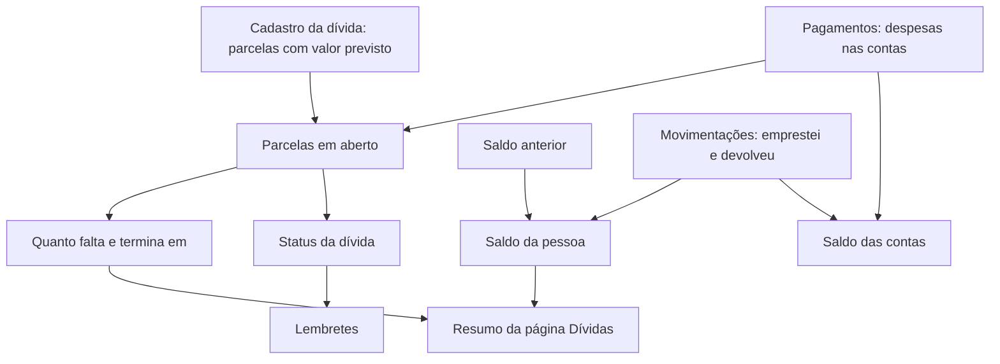
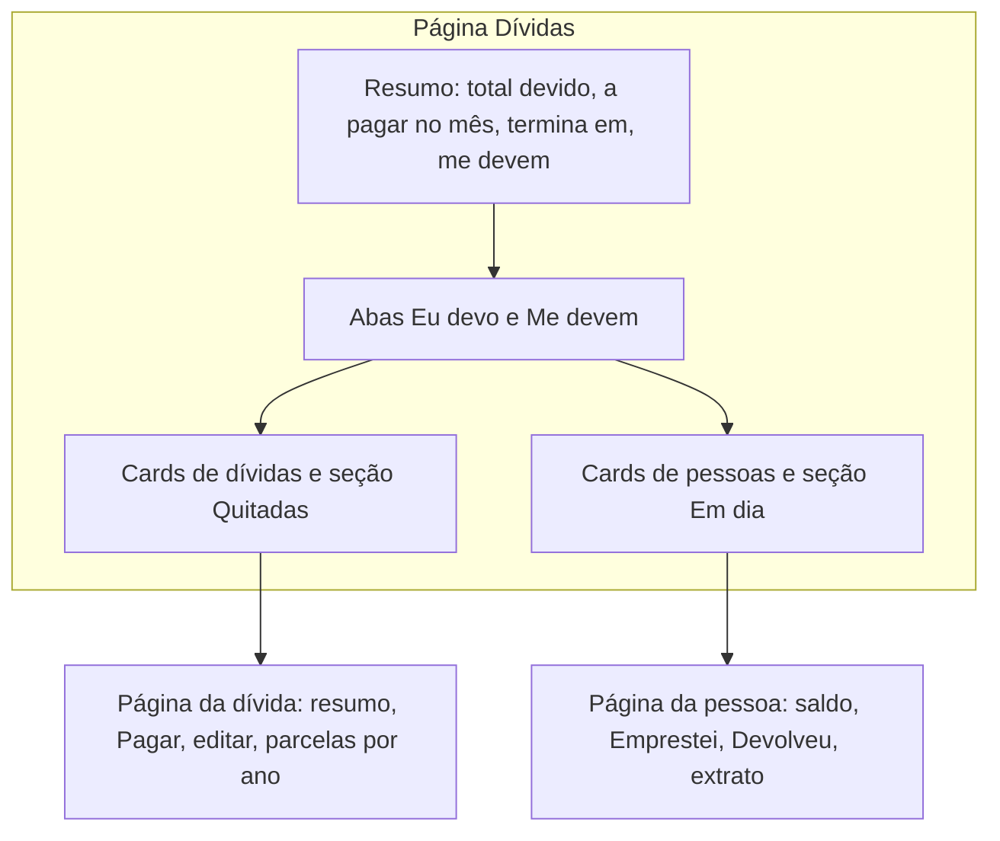
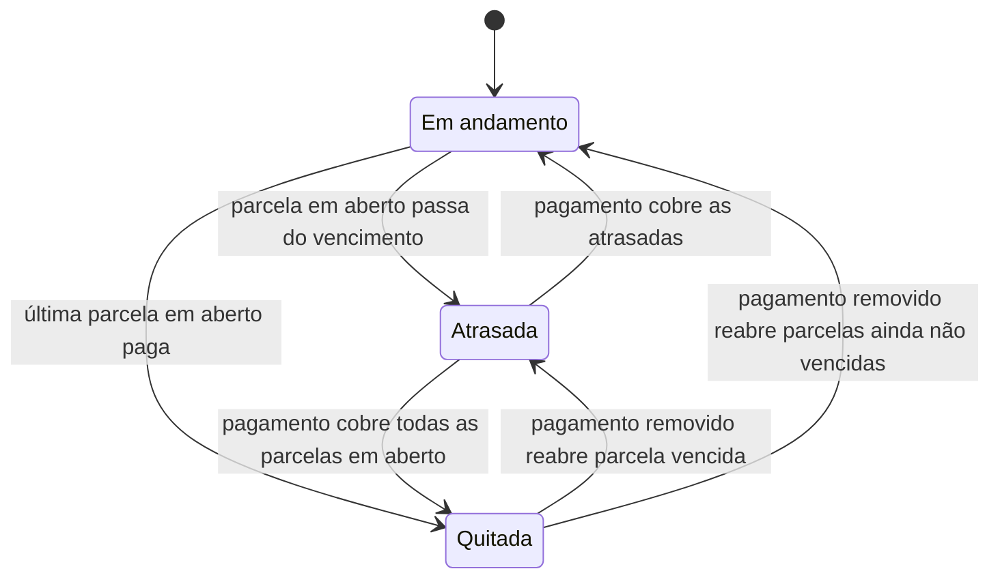
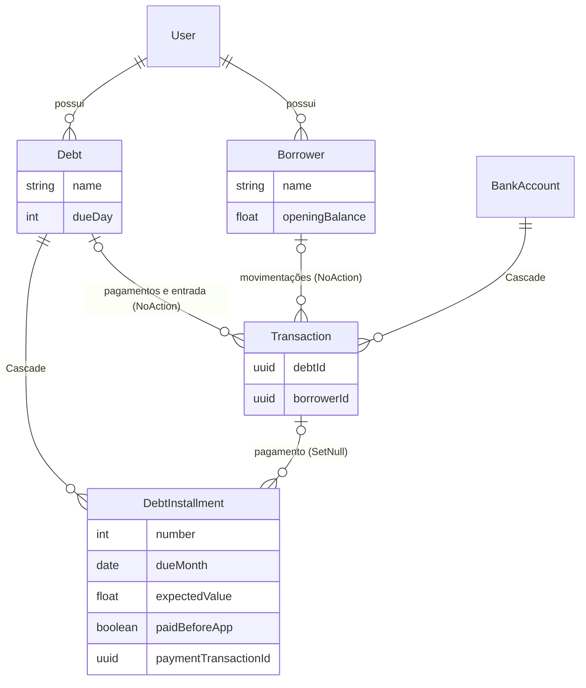
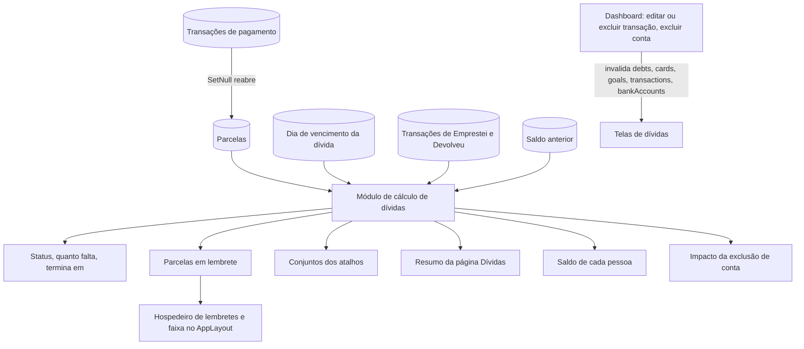
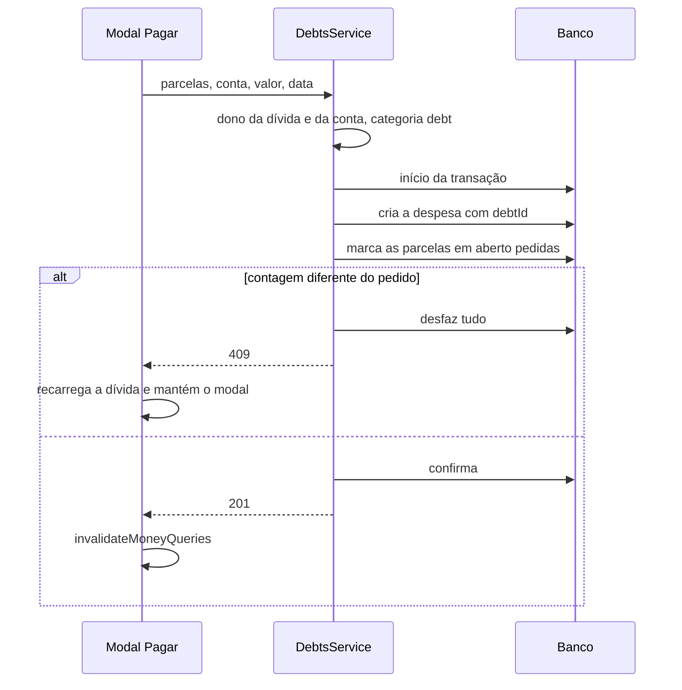
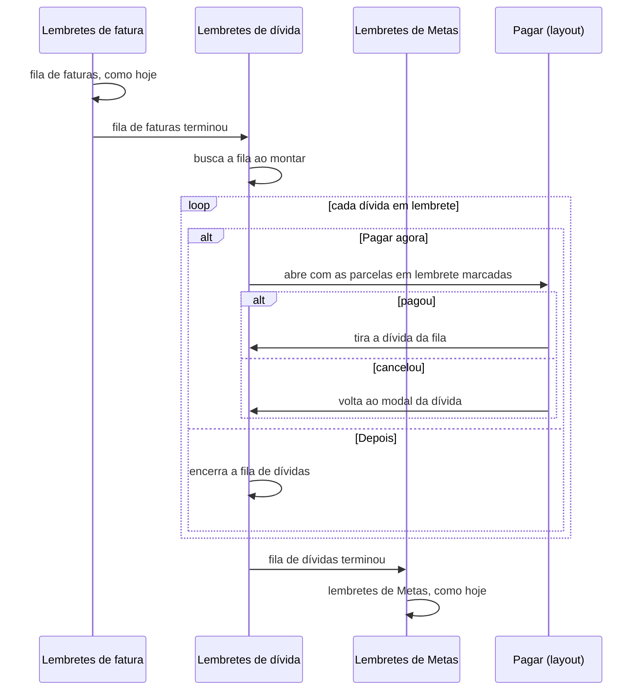
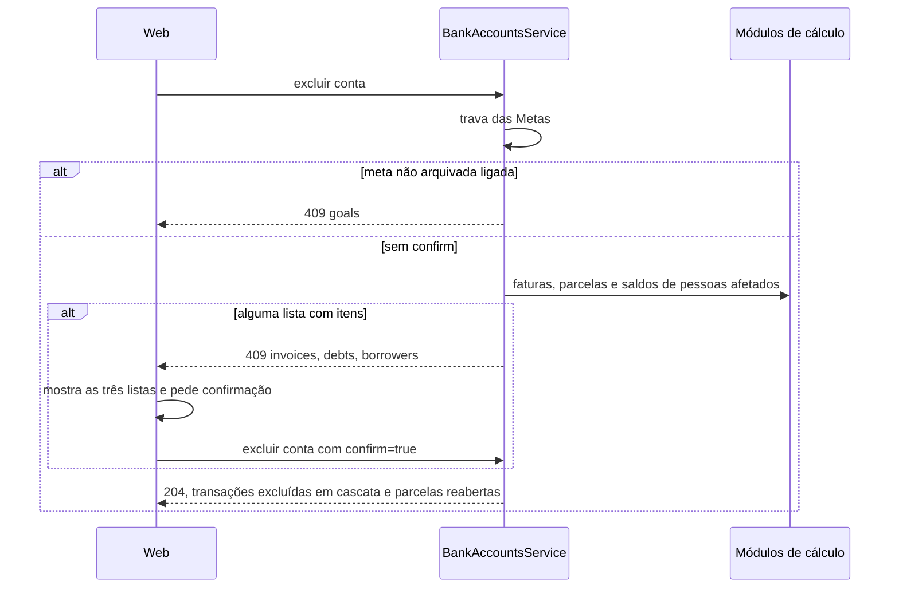
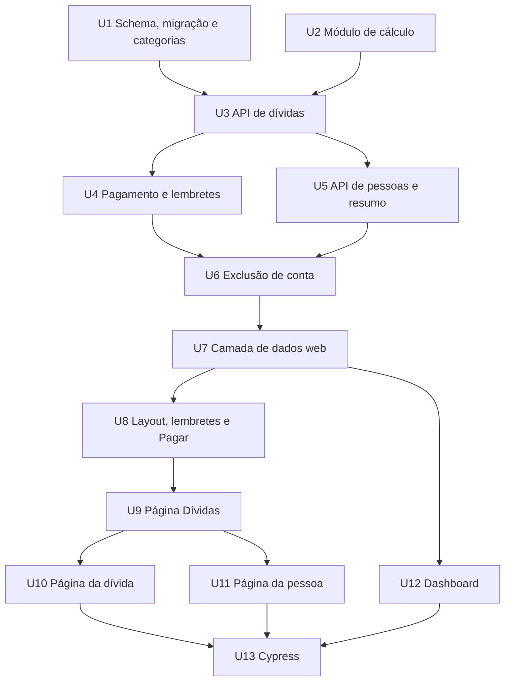

# Dívidas - Plan

## Goal Capsule

- **Objective:** O usuário acompanha no fintrack as dívidas que paga em parcelas e o dinheiro que emprestou a outras pessoas. A qualquer momento ele sabe quanto deve no total, quando cada dívida termina e quanto cada pessoa ainda deve, e o saldo das contas bate com o banco. Com isso, deixa de usar o bloco de notas.
- **Means:** cada parcela é uma linha ligada à transação que a pagou, e o extrato de cada pessoa sai das transações ligadas a ela. Tudo o que o app mostra é calculado na leitura por um módulo puro, sem total guardado (KTD1, KTD2).
- **Authority:** os requisitos (R) decidem o comportamento do produto. Os KTDs decidem o mecanismo, dentro dos limites dos R que citam. As unidades não sobrescrevem nenhum dos dois, e AEs e Flows só ilustram.
- **Stop conditions:** pare e pergunte ao usuário se uma decisão marcada `session-settled` se mostrar inviável, ou se o backfill de categorias da migração não puder rodar no banco de destino. Nunca rode reset nem `db push`, e nunca aceite um pedido de reset do Prisma, num banco que tenha dados. Esta worktree usa só o banco `fintrack_dividas`.
- **Execution profile:** dois códigos, `api/` e `web/`, em três fases: API em U1 a U6, web em U7 a U12 e testes ponta a ponta em U13. U2 é feita com testes antes do código.
- **Finisher:** `ce-work` implementa e verifica pelo Verification Contract. O usuário revisa e integra o PR.
- **Open blockers:** nenhum.

---

## Product Contract

### Summary

Uma página Dívidas no fintrack, com dois lados. Em "Eu devo", cada financiamento ou empréstimo é uma lista de parcelas com valor previsto. Uma única ação Pagar quita uma ou várias parcelas de uma vez (a do mês, as atrasadas, as últimas ou todas) e registra o valor realmente pago como despesa na conta escolhida. Em "Me devem", cada pessoa tem um extrato: o que foi emprestado sai da conta como despesa, o que ela devolve entra como receita, e o saldo mostra quanto ela ainda deve. Os lembretes de parcela seguem o modelo de Cartões.

### Problem Frame

Hoje o usuário acompanha dois tipos de dívida num bloco de notas. Para cada financiamento ou empréstimo bancário (carro, imóvel, empréstimo no banco) ele mantém uma lista com as parcelas, por exemplo 40 linhas, e todo mês preenche o valor pago. Para o dinheiro que emprestou, mantém uma lista com o valor emprestado e, na mesma lista, cada devolução com data e pessoa. A planilha Finance.xlsx do usuário tem uma aba "Bola de neve da dívida" com juros e projeção mês a mês, mas ela nunca foi preenchida, e nenhuma aba controla dinheiro emprestado.

O bloco de notas não soma nada. Para saber quanto deve no total, quando cada dívida acaba ou quanto cada pessoa ainda deve, o usuário faz a conta na mão. Nada avisa quando uma parcela fica sem registro. Os pagamentos anotados também não têm ligação com as contas do fintrack, então as anotações e o saldo das contas podem não bater.

---

### Key Decisions

- **Os dois lados entram no mesmo plano.** Dívidas que o usuário paga e dinheiro que ele emprestou formam uma só funcionalidade, com a mesma base: um saldo que cai a cada pagamento. (session-settled: user-directed — chosen over só as dívidas do usuário, e só o dinheiro emprestado: o usuário quer largar as duas listas do bloco de notas juntas)
- **Toda movimentação vira transação na conta escolhida.** Pagar parcela é despesa, emprestar é despesa, receber devolução é receita. Governs R7, R19, R26, R30. (session-settled: user-directed — chosen over só as parcelas mexerem na conta, e nada mexer na conta: só assim o saldo das contas bate, e o usuário aceitou que empréstimos e devoluções entrem nos totais de receita e despesa do mês)
- **"Quanto falta" é a soma das parcelas em aberto, sem juros.** É o que o bloco de notas já faz. Governs R13, R14. (session-settled: user-directed — chosen over um saldo devedor informado pelo usuário, e o cálculo com juros Price ou SAC da planilha: o cálculo com juros é o mais caro de construir e manter, e o usuário não precisa dele)
- **Dívida é sempre parcelada, e empréstimo a uma pessoa é sempre livre.** Governs R5, R25, R26. (session-settled: user-directed — chosen over os dois formatos nos dois lados, e formato livre também nas dívidas: é o que o usuário já faz no bloco de notas)
- **Cada pessoa tem um extrato único.** Uma devolução não aponta para um empréstimo específico. Governs R25, R27. (session-settled: user-directed — chosen over empréstimos separados, em que cada devolução indica qual empréstimo abate: o extrato é o mais próximo da lista atual)
- **Pagar também quita tudo, paga atrasadas juntas e antecipa parcelas do fim.** Governs R17. (session-settled: user-directed — chosen over pagar só a parcela do mês)
- **Uma única ação Pagar, com seleção de parcelas.** Um mecanismo cobre os quatro casos de pagamento. A página segue o padrão de Metas e Cartões e a página da dívida é a lista do bloco de notas. Governs R1, R16, R17, R18, R19, R21, R22, R23, R36. (session-settled: user-directed — chosen over quatro ações separadas com nome de intenção, e uma agenda mensal de parcelas que substitui o modal de lembrete: é o menor acréscimo de tela e mantém os lembretes iguais aos de Cartões)
- **O que já existe entra pela situação atual.** Nada antes do app vira transação, porque isso deixaria errado o saldo atual das contas. Governs R5, R6, R25. (session-settled: user-directed — chosen over copiar o histórico do bloco de notas com datas e valores reais: o cadastro fica rápido, e o histórico antigo não aparece no app)
- **A entrada do dinheiro de um empréstimo novo é opcional no cadastro.** Governs R7. (session-settled: user-directed — chosen over nunca registrar a entrada: num empréstimo bancário o dinheiro cai na conta, e num financiamento vai direto para o vendedor)
- **O valor previsto é igual para todas as parcelas, com ajuste "desta parcela em diante".** Atende parcela fixa (Price) e reajustes sem pedir a tabela inteira. Governs R11, R13. (session-settled: user-directed — chosen over valor sempre fixo, e tabela completa parcela a parcela: o valor sempre fixo superestima o "quanto falta" de um financiamento SAC, e a tabela completa dá trabalho demais no cadastro)
- **Uma parcela fecha com um pagamento.** O valor pago pode ser diferente do previsto. Governs R19, R20. (session-settled: user-approved — chosen over parcela paga em parte: o usuário registra o valor pago, e a diferença vem de multa ou desconto)
- **Não existe arquivamento.** Dívida quitada e pessoa com saldo zero vão para seções próprias, e só se exclui o que não tem transação. Governs R3, R4, R35. (session-settled: user-approved — chosen over arquivar como em Metas e Cartões: o status calculado já tira da frente o que terminou)
- **Uma dívida aceita até 480 parcelas.** Governs R8. (session-settled: user-approved — chosen over o teto de 48 parcelas das compras de Cartões: um financiamento de imóvel tem de 360 a 420 parcelas)
- **A fila de lembretes de Dívidas vem depois da de Cartões e antes da de Metas.** O que é contratual vem antes do que é opcional. Governs R22.
- **"Me devem" não tem lembrete.** Não há data combinada para a devolução. Governs R24.
- **Uma devolução não pode ser maior que o saldo da pessoa.** Evita erro de digitação, já que o lado "Me devem" não registra dívida do usuário com uma pessoa. Governs R28.
- **Excluir um pagamento reabre as parcelas, e excluir uma conta avisa em vez de bloquear.** É o mesmo comportamento das faturas em Cartões. Governs R32, R33.
- **As categorias de Dívidas não aparecem ao criar uma transação no Dashboard, nem ao editar uma que não veio de Dívidas.** Um pagamento de parcela lançado direto no Dashboard ficaria sem vínculo com a dívida e seria registrado duas vezes. Governs R34. (session-settled: user-approved — chosen over esconder só na criação, como "Fatura de cartão" em Cartões: a edição deixaria o mesmo buraco de um pagamento sem vínculo)
- **"Pagar agora" marca as parcelas que estão em lembrete.** Governs R22. (session-settled: user-approved — chosen over marcar as atrasadas e a do mês: no fim do mês o modal abriria vazio para uma parcela que vence no começo do mês seguinte)
- **O dia de vencimento vale para toda parcela em aberto, inclusive a que reabre depois.** O app guarda só o mês de cada parcela. Governs R10. (session-settled: user-approved — chosen over gravar a data de vencimento de cada parcela: uma parcela reaberta depois de uma mudança de dia ficaria com o dia antigo)
- **O número de parcelas e a próxima parcela só se corrigem antes do primeiro pagamento.** Depois disso, mudar a contagem mudaria o que um pagamento já registrado cobriu. Governs R12.



---

### Requirements

**Página Dívidas**

- R1. O menu ganha o item Dívidas, depois de Cartões. A página Dívidas tem um resumo no topo e duas abas, "Eu devo" e "Me devem".
- R2. O resumo mostra o total que o usuário deve, o valor a pagar no mês, o mês em que termina a última dívida e o total que as pessoas ainda devem a ele. O total devido é a soma do "quanto falta" de R14, e o valor a pagar no mês soma as parcelas em aberto que vencem no mês atual e as atrasadas. O total que as pessoas devem soma só os saldos positivos.
- R3. A aba "Eu devo" mostra um card por dívida com nome, parcelas pagas sobre o total (por exemplo, 18/48), quanto falta, a próxima parcela com o vencimento e o status de R15. As dívidas Quitadas ficam numa seção Quitadas, abaixo das outras.
- R4. A aba "Me devem" mostra um card por pessoa com nome e saldo. Pessoas com saldo zero ou negativo ficam numa seção "Em dia", abaixo das outras.



**Cadastro e edição da dívida**

- R5. O usuário cadastra uma dívida com nome, valor da parcela, número total de parcelas, dia de vencimento, a próxima parcela a pagar e o mês em que ela vence. Numa dívida nova, a próxima parcela é a 1.
- R6. As parcelas anteriores à próxima a pagar contam como pagas antes do app. Elas aparecem na lista sem valor pago, data ou conta, e não criam transação.
- R7. No cadastro, o usuário pode marcar que o dinheiro do empréstimo entrou numa conta e informar o valor recebido, o que cria uma receita nessa conta. A opção vem desmarcada.
- R8. Uma dívida aceita até 480 parcelas.
- R9. Se o dia de vencimento for 29, 30 ou 31, nos meses mais curtos a parcela vence no último dia do mês.
- R10. O nome e o dia de vencimento podem ser editados a qualquer momento. Um dia de vencimento novo vale para as parcelas em aberto, inclusive as que voltarem a ficar em aberto depois da mudança.
- R11. O usuário pode mudar o valor previsto a partir de uma parcela em aberto, e a mudança vale dela até a última. As parcelas pagas mantêm o valor que tinham.
- R12. O número total de parcelas, a próxima parcela a pagar e o mês em que ela vence só podem ser corrigidos enquanto nenhuma parcela tiver pagamento registrado. A entrada de R7 não conta como pagamento.

**Parcelas, saldo e status**

- R13. Cada parcela tem número, mês de vencimento e valor previsto. O valor previsto começa igual ao valor da parcela do cadastro e muda só por R11.
- R14. "Quanto falta" é a soma dos valores previstos das parcelas em aberto, e "termina em" é o mês de vencimento da última parcela em aberto. O app não calcula juros.
- R15. O status da dívida é calculado. Ela é Atrasada quando alguma parcela em aberto passou do vencimento, Quitada quando não resta parcela em aberto e Em andamento nos outros casos. O status muda sozinho quando pagamentos são registrados, editados ou removidos.
- R16. A página da dívida mostra todas as parcelas, agrupadas por ano, com o valor previsto de cada uma. Nas pagas, mostra também o valor pago, a data e a conta do pagamento que a cobriu, ou a marca "antes do app" de R6. Os anos sem parcela em aberto vêm recolhidos.



**Pagamento**

- R17. A ação Pagar mostra as parcelas em aberto para o usuário marcar, com quatro atalhos: só a do mês, as atrasadas mais a do mês, as últimas N parcelas e todas. Ele também pode marcar parcelas avulsas.
- R18. O usuário informa a conta, a data e o valor realmente pago. O valor vem preenchido com a soma prevista das parcelas marcadas, e a data com o dia de hoje.
- R19. Confirmar cria uma única despesa na conta escolhida, com a categoria de pagamento de dívidas e um nome que identifica a dívida e as parcelas cobertas. Todas as parcelas marcadas ficam pagas, mesmo que o valor pago seja diferente da soma prevista.
- R20. Cada parcela é coberta por um único pagamento. Não existe parcela paga em parte.
- R36. "As últimas N" marca as N parcelas em aberto de número mais alto, com N entre 1 e o número de parcelas em aberto. Um atalho que não teria nenhuma parcela para marcar fica desativado.

**Lembretes**

- R21. Uma dívida entra em lembrete quando tem parcela em aberto que vence em 5 dias ou menos, ou que já venceu. Ela sai do lembrete quando nenhuma parcela em aberto está nessa condição.
- R22. Ao abrir o app, aparece um modal para cada dívida em lembrete, em ordem de vencimento, depois dos modais de fatura de Cartões e antes dos de Metas. "Pagar agora" abre o Pagar de R17 com todas as parcelas da dívida que estão em lembrete por R21 já marcadas. "Depois" esconde os modais de dívida restantes até a próxima abertura do app.
- R23. Enquanto houver dívida em lembrete, uma faixa no topo de todas as páginas logadas mostra a parcela de vencimento mais próximo, quantas outras dívidas estão em lembrete e o botão Pagar. O item Dívidas do menu ganha um ponto. Quando a faixa de faturas de Cartões também aparece, a de dívidas fica logo abaixo dela.
- R24. Dívidas Quitadas e pessoas de "Me devem" nunca entram em lembrete.

**Me devem**

- R25. O usuário cadastra uma pessoa com nome e, se quiser, um saldo anterior, que é quanto ela já devia antes do app. O saldo anterior pode ser editado e não mexe em conta.
- R26. Na página da pessoa, "Emprestei" registra valor, data e conta e cria uma despesa nessa conta. "Devolveu" registra valor, data e conta e cria uma receita nessa conta.
- R27. O saldo da pessoa é o saldo anterior mais o total emprestado menos o total devolvido. A página da pessoa mostra o saldo e o extrato das movimentações em ordem de data.
- R28. "Devolveu" recusa um valor maior que o saldo da pessoa e informa o máximo aceito. Se uma edição ou exclusão no Dashboard deixar o saldo negativo, o card e a página da pessoa mostram quanto ela devolveu a mais.
- R29. Uma pessoa em "Em dia" continua aceitando "Emprestei" e volta para a lista principal quando o saldo fica positivo.

**Transações, contas e exclusões**

- R30. Pagamentos de parcela, empréstimos, devoluções e a entrada de R7 aparecem no Dashboard como transações com categorias próprias de Dívidas. Elas entram no saldo das contas e nos totais de receita e despesa do mês.
- R31. A transação é o próprio registro, e pagamentos e movimentações são editados e excluídos pelo Dashboard. Editar no Dashboard o valor, a data, a conta ou a categoria muda o pagamento ou a movimentação, e as parcelas que um pagamento cobre não mudam com a data.
- R32. Excluir no Dashboard um pagamento reabre as parcelas que ele cobria. Excluir um empréstimo ou uma devolução muda o saldo da pessoa.
- R33. Excluir uma conta com pagamentos de dívida ou movimentações de pessoas avisa quais parcelas vão reabrir e quais saldos de pessoas vão mudar, e só exclui com confirmação. A trava das Metas para conta ligada a meta não arquivada continua valendo.
- R34. As categorias de Dívidas não aparecem como opção ao criar uma transação no Dashboard, nem ao editar uma transação que não está ligada a uma dívida ou a uma pessoa.
- R35. Uma dívida ou pessoa sem nenhuma transação ligada pode ser excluída. Com transação ligada, seja pagamento, entrada de R7 ou movimentação, o app não deixa excluir.

---

### Key Flows

- F1. Cadastrar uma dívida em andamento
  - **Trigger:** O usuário clica em "Nova dívida" na aba "Eu devo".
  - **Steps:** Ele preenche nome, valor da parcela, total de parcelas, dia de vencimento, a próxima parcela a pagar e o mês dela, e deixa desmarcada a entrada do dinheiro.
  - **Outcome:** A dívida aparece com as parcelas anteriores marcadas como pagas antes do app, o "quanto falta" e o "termina em", sem nenhuma transação criada.
  - **Covered by:** R5, R6, R13, R14, R16
- F2. Pagar parcelas
  - **Trigger:** O usuário escolhe Pagar na página da dívida, no modal de lembrete ou na faixa.
  - **Steps:** Ele marca as parcelas por um atalho ou uma a uma, escolhe a conta, confere a data e o valor pago e confirma.
  - **Outcome:** O Dashboard mostra uma despesa, as parcelas marcadas ficam pagas, e o "quanto falta", o "termina em", o status e o lembrete são recalculados.
  - **Covered by:** R14, R15, R17, R18, R19, R20, R21
- F3. Lembrete de parcela
  - **Trigger:** O usuário abre o app com pelo menos uma dívida em lembrete.
  - **Steps:** Depois da fila de faturas, o app mostra um modal por dívida, em ordem de vencimento. "Pagar agora" segue F2, e a dívida sai da fila. "Depois" esconde os modais de dívida restantes. Em seguida vêm os lembretes de Metas.
  - **Outcome:** A faixa no topo e o ponto no menu continuam até nenhuma dívida estar em lembrete.
  - **Covered by:** R21, R22, R23
- F4. Acompanhar o dinheiro emprestado a uma pessoa
  - **Trigger:** O usuário clica em "Nova pessoa" na aba "Me devem".
  - **Steps:** Ele informa o nome e o saldo anterior, se houver. Quando empresta, registra "Emprestei" com a conta de onde o dinheiro saiu. Quando recebe, registra "Devolveu" com a conta onde o dinheiro entrou.
  - **Outcome:** O saldo da pessoa mostra quanto ela ainda deve, cada movimentação aparece no Dashboard, e a pessoa vai para "Em dia" quando o saldo zera.
  - **Covered by:** R4, R25, R26, R27, R28, R29

---

### Acceptance Examples

Nos exemplos, hoje é 13/10/2026. A dívida Carro tem 48 parcelas de R$ 1.200 com vencimento no dia 10. As contas são Itaú e Inter, e a pessoa é João.

- AE1. **Covers R5, R6, R14.** **Given** que o usuário cadastra o Carro com a próxima parcela a pagar 19, vencendo em novembro de 2026, **then** as parcelas 1 a 18 aparecem como pagas antes do app, sem transação. O Carro deve R$ 36.000 e termina em abril de 2029.
- AE2. **Covers R15, R17, R19, R20.** **Given** que em 15/12/2026 o Carro tem em aberto as parcelas 19 e 20, vencidas em 10/11 e 10/12, e está com status Atrasada, **when** o usuário escolhe "as atrasadas mais a do mês" e paga R$ 2.450 pela Itaú, **then** o Dashboard mostra uma única despesa de R$ 2.450. As parcelas 19 e 20 ficam pagas, o "quanto falta" cai para R$ 33.600 e o Carro volta ao status Em andamento.
- AE3. **Covers R14, R17.** **Given** o Carro depois de AE2, **when** o usuário escolhe "as últimas 3" e paga R$ 3.000 pela Inter, **then** as parcelas 46 a 48 ficam pagas, o "quanto falta" cai para R$ 30.000 e o "termina em" passa de abril para janeiro de 2029.
- AE4. **Covers R3, R15, R17, R24.** **Given** o Carro depois de AE3, com as parcelas 21 a 45 em aberto somando R$ 30.000, **when** o usuário escolhe "todas" e paga R$ 24.000, **then** todas ficam pagas. O Carro fica com status Quitada, vai para a seção Quitadas e sai dos lembretes.
- AE5. **Covers R8, R11, R14.** **Given** um financiamento Apartamento com 360 parcelas de R$ 3.000 e as parcelas 1 a 24 pagas, **when** o usuário muda o valor previsto para R$ 2.950 a partir da parcela 25, **then** as parcelas pagas continuam com R$ 3.000 e o "quanto falta" passa de R$ 1.008.000 para R$ 991.200.
- AE6. **Covers R21, R22, R23.** **Given** que a parcela 19 do Carro vence em 10/11 e não foi paga, **when** o usuário abre o app em 6/11, **then** o modal do Carro aparece depois dos modais de fatura. **When** ele escolhe "Depois", **then** o modal some até a próxima abertura, a faixa aparece em todas as páginas e o item Dívidas ganha um ponto. **When** ele paga a parcela 19, **then** a faixa e o ponto somem.
- AE7. **Covers R15, R21, R32.** **Given** o pagamento de R$ 2.450 de AE2, **when** em 20/12 o usuário o exclui no Dashboard, **then** as parcelas 19 e 20 voltam a ficar em aberto, o "quanto falta" sobe R$ 2.400, e o Carro fica com status Atrasada e entra em lembrete.
- AE8. **Covers R25, R26, R27, R28.** **Given** que o usuário cadastra João com saldo anterior de R$ 1.500, **when** registra "Emprestei" de R$ 500 pela Inter, **then** a Inter tem uma despesa de R$ 500 e o saldo do João é R$ 2.000. **When** registra "Devolveu" de R$ 300 na Itaú, **then** a Itaú tem uma receita de R$ 300 e o saldo é R$ 1.700. **When** tenta registrar "Devolveu" de R$ 2.000, **then** o app recusa e informa que o máximo é R$ 1.700.
- AE9. **Covers R4, R28, R29, R32.** **Given** João com saldo de R$ 300, **when** o usuário registra "Devolveu" de R$ 300, **then** João vai para "Em dia". **When** o usuário exclui no Dashboard o "Emprestei" de R$ 500 de AE8, **then** o saldo fica em −R$ 500 e o card do João mostra que ele devolveu R$ 500 a mais. **When** o usuário registra "Emprestei" de R$ 800, **then** o saldo fica em R$ 300 e João volta para a lista principal.
- AE10. **Covers R7, R14.** **Given** que o usuário pegou um empréstimo pessoal de R$ 10.000, **when** cadastra "Empréstimo Itaú" com 24 parcelas de R$ 550, próxima parcela 1 vencendo em novembro, e marca que R$ 10.000 entraram na Itaú, **then** a Itaú tem uma receita de R$ 10.000 e a dívida deve R$ 13.200.
- AE11. **Covers R33.** **Given** que a Itaú pagou as parcelas 19 e 20 do Carro em AE2 e recebeu a devolução de R$ 300 do João em AE8, **when** o usuário pede para excluir a Itaú, **then** o app avisa que as parcelas 19 e 20 do Carro voltarão a ficar em aberto e que o saldo do João vai subir R$ 300. **When** ele confirma, **then** a conta e as transações dela são excluídas, e o Carro fica com status Atrasada.
- AE12. **Covers R9.** **Given** uma dívida com vencimento no dia 31, **then** a parcela de fevereiro de 2027 vence em 28/02/2027.
- AE13. **Covers R12, R35.** **Given** o Carro com o pagamento de AE2, **when** o usuário tenta excluí-lo ou mudar o total de parcelas, **then** o app não deixa. **Given** uma dívida recém-cadastrada sem pagamento e sem entrada, **when** o usuário corrige a próxima parcela de 19 para 20, **then** as parcelas 1 a 19 passam a contar como pagas antes do app. **When** ele exclui essa dívida, **then** ela some.
- AE14. **Covers R21, R22.** **Given** a dívida Moto com vencimento no dia 2 e a parcela de janeiro em aberto, **when** o usuário abre o app em 29/12/2026, **then** a Moto está em lembrete. **When** ele escolhe "Pagar agora", **then** o Pagar abre com a parcela de janeiro marcada, mesmo ela não sendo atrasada nem de dezembro.
- AE15. **Covers R10, R32.** **Given** o Carro com a parcela 19 paga, **when** o usuário muda o dia de vencimento de 10 para 15 e depois exclui no Dashboard o pagamento da parcela 19, **then** a parcela 19 reabre vencendo em 15/11.
- AE16. **Covers R11, R12.** **Given** o Carro recém-cadastrado, sem pagamento, com o valor previsto mudado para R$ 1.100 a partir da parcela 30, **when** o usuário muda o total de 48 para 50 parcelas, **then** as parcelas 30 a 48 continuam com R$ 1.100 e as novas 49 e 50 também ficam com R$ 1.100.
- AE17. **Covers R34.** **Given** uma despesa "Mercado" lançada no Dashboard, **when** o usuário a edita, **then** "Dívidas" e "Empréstimos" não aparecem entre as categorias. **Given** o pagamento de AE2, **when** o usuário o edita, **then** a categoria "Dívidas" aparece selecionada.
- AE18. **Covers R36.** **Given** o Carro com as parcelas 21 a 48 em aberto, exceto a 47, que foi paga avulsa, **when** o usuário escolhe "as últimas 3", **then** ficam marcadas as parcelas 45, 46 e 48. **Given** que a parcela do mês já está paga, **then** o atalho "só a do mês" fica desativado.

---

### Success Criteria

- O usuário cadastra as dívidas e os empréstimos que tem hoje, para de usar o bloco de notas e responde sem fazer conta na mão quanto deve no total, quando cada dívida termina e quanto cada pessoa ainda deve.
- Com os pagamentos, empréstimos e devoluções registrados pela página Dívidas, o saldo de cada conta no fintrack bate com o do banco.
- Depois de qualquer edição ou exclusão de pagamento, movimentação ou conta, a dívida, a pessoa, o resumo, os lembretes e o saldo das contas mostram os mesmos valores.

---

### Scope Boundaries

- Juros, amortização, sistemas Price ou SAC, correção por índice e desconto calculado na antecipação ou na quitação. O app só registra o valor pago (R14, R19).
- A estratégia bola de neve da planilha, que joga a parcela de uma dívida quitada na próxima.
- Dívidas do usuário sem parcelas, como dever dinheiro a uma pessoa, e empréstimos parcelados a terceiros.
- Histórico anterior ao app, como parcelas já pagas com valor e data ou empréstimos antigos linha a linha.
- Parcela paga em parte (R20).
- Arquivar dívidas ou pessoas.
- Lembrete de cobrança para quem deve ao usuário.
- Notificações fora do app, como push ou e-mail.
- Importar contratos, boletos ou extratos do banco.
- Renegociação como conceito. O usuário quita a dívida antiga pelo valor cobrado e cadastra a nova.
- Dívidas em moeda estrangeira.
- O botão de esconder valores do Dashboard nas telas de Dívidas, como ficou de fora em Metas e Cartões.

#### Considered and not built

- **Bloquear na API as categorias de Dívidas em `POST` e `PUT /transactions`.** O web já esconde as categorias (R34), e Metas e Cartões também só escondem no web. Construir se aparecer um cliente da API fora do web.
- **Travar a troca de tipo de uma transação ligada.** O modal de edição do Dashboard não troca o tipo, e o saldo da pessoa sai do tipo de cada transação (KTD5). Construir se algum cliente passar a trocar o tipo.
- **Bloquear duas devoluções simultâneas para a mesma pessoa.** Para um usuário só, o botão em carregamento já evita o envio duplo, e uma devolução duplicada aparece no Dashboard e se desfaz excluindo a transação. É a mesma escolha de Cartões.
- **Saldo acumulado linha a linha no extrato da pessoa.** Uma edição no Dashboard pode deixar somas intermediárias sem sentido, e o saldo final de R27 responde à pergunta do usuário.
- **Esconder as categorias de Dívidas nos lançamentos de cartão.** Uma compra de cartão com a categoria "Dívidas" é só um rótulo errado, sem efeito em saldo. Construir se o usuário relatar o engano.

#### Deferred to Follow-Up Work

- O gráfico de parcelas por mês na página Dívidas, como o de Metas e Cartões. O resumo de R2 já mostra quanto o usuário deve, quanto vence no mês e quando termina.
- Uma observação livre nas movimentações de uma pessoa, para anotar o motivo do empréstimo.

---

### Dependencies / Assumptions

- O valor previsto é o valor do boleto. Como o app não calcula juros, o "quanto falta" de um financiamento é maior que o valor de quitação que o banco informaria. O valor de quitação real entra pelo pagamento "todas" de R17.
- Os lançamentos são manuais. Os valores só batem com o banco quando o usuário registra pelo app tudo o que pagou, emprestou e recebeu.
- Usuários que já existem também precisam das categorias de Dívidas, como aconteceu com "Metas" e "Fatura de cartão".

---

### Sources / Research

- `docs/plans/2026-10-12-2102-feat-cartoes-plan.md`: padrões reaproveitados. O parcelamento em andamento entra pela parcela atual (R18 e Key Decision de lá). O lembrete tem modal ao abrir o app, faixa no topo e ponto no menu (R33–R36). A exclusão de conta avisa em vez de bloquear (R38). "Fatura de cartão" fica fora da criação de transação no Dashboard (R49). Os dias 29 a 31 caem no último dia do mês (R3).
- `docs/plans/2026-10-11-2035-feat-metas-plan.md`: a transação é o próprio registro, e a meta acompanha edições feitas nela. A categoria foi criada para usuários novos e existentes. O resgate usa uma categoria de receita "Metas".
- `api/src/modules/cards/card-calculations.ts`: `REMINDER_DAYS_BEFORE_DUE = 5` e a regra de entrada no lembrete. A faixa de faturas mostra 13 meses em volta do atual, por isso a página da dívida precisa ser uma lista (R16).
- `api/src/modules/cards/dto/create-card-purchase.dto.ts` e `web/src/view/components/CardEntryModal/useCardEntryModalController.ts`: compras parceladas aceitam de 2 a 48 parcelas. Dívidas precisa de um limite próprio (R8).
- `web/src/view/layouts/AppLayout.tsx`: menu com Dashboard, Metas e Cartões, ponto no item Cartões e fila de lembretes em que os modais de Metas esperam a fila de faturas.
- `api/src/modules/bank-accounts/bank-accounts.service.ts`: o saldo da conta é calculado a partir das transações. A exclusão tem a trava das Metas e um aviso em duas etapas para faturas que reabrem.
- `api/src/modules/auth/auth.service.ts`: o cadastro de usuário cria as categorias padrão, inclusive Salary e Metas como receita e "Fatura de cartão" como despesa.
- `web/src/view/pages/Dashboard/modals/EditTransactionModal/useEditTransactionModalController.ts`: o modal de edição filtra as categorias pelo tipo da transação.
- `api/src/shared/calendar.ts`: dias no fuso de São Paulo, chaves de mês e soma de dinheiro em centavos.
- Planilha Finance.xlsx do usuário, fora do repositório: a aba "Bola de neve da dívida" é um modelo vazio, com nome do crédito, saldo inicial e atual, pagamento mínimo, juros anual, data de início, meses restantes e tabela mensal de saldo, juros, pagamento esperado e pagamento real. Nenhuma aba controla dinheiro emprestado.

---

## Planning Contract

### Product Contract preservation

- Changed, confirmado pelo usuário na síntese do planejamento: R10 passa a valer para parcelas que reabrem, R22 marca as parcelas em lembrete, R23 empilha as faixas e R34 vale também na edição de transações sem vínculo.
- Changed, esclarecimento sem mudança de escopo: R2 soma só saldos positivos, e R12 inclui o mês da próxima parcela e diz que a entrada não conta como pagamento.
- Added: R36 com a regra dos atalhos, confirmada na síntese, AE14 a AE18 e duas Key Decisions. A Key Decision de R34 passou a incluir a edição.
- Removed: a seção Outstanding Questions, resolvida em R23, KTD3, KTD5 e KTD6.
- O restante ficou sem mudança.

### Key Technical Decisions

- KTD1. **Parcelas são linhas, e o pagamento fica ligado pela própria parcela.** Um pagamento cobre várias parcelas, então o vínculo não cabe numa coluna da transação, como em Metas e Cartões. O modelo novo:
  - `Debt` guarda nome, dia de vencimento e `createdAt`. O total de parcelas é a contagem das linhas.
  - `DebtInstallment` guarda número, mês de vencimento em `@db.Date`, valor previsto, `paidBeforeApp` e `paymentTransactionId`, com unicidade por dívida e número. A ligação com `Debt` usa `Cascade`, e a ligação com `Transaction` usa `SetNull`.
  - `Borrower` guarda nome, `openingBalance` (padrão 0) e `createdAt`.
  - `Transaction` ganha `debtId` e `borrowerId`, os dois anuláveis e com `onDelete: NoAction`. O banco então recusa excluir uma dívida ou pessoa com transações (R35), e a API traduz o P2003 em 409, como nas Metas.

  Uma parcela está paga quando tem `paidBeforeApp` ou `paymentTransactionId`. Excluir o pagamento, pelo Dashboard ou pela cascata da exclusão de conta, reabre as parcelas pelo `SetNull`, sem nenhuma mudança em `api/src/modules/transactions/` (R32). Os valores seguem `Float`, como as colunas existentes, com as convenções de `api/prisma/schema.prisma`: ids `uuid`, `@@map` em camelCase e `Cascade` para o usuário. Uma tabela de junção entre parcela e transação daria o mesmo resultado com uma tabela a mais, por isso não se qualificou como alternativa.
- KTD2. **Tudo o que é derivado sai de um módulo puro, em centavos, com "hoje" em São Paulo.** `api/src/modules/debts/debt-calculations.ts` recebe dados estruturais, sem Prisma, e o dia de hoje:
  - O vencimento de uma parcela é o dia de vencimento atual da dívida ajustado dentro do mês dela (R9, R10). Governs R10. (session-settled: user-approved — chosen over gravar a data de vencimento de cada parcela: uma parcela reaberta depois de uma mudança de dia ficaria com o dia antigo)
  - "Quanto falta", "termina em" e o status (R14, R15). Uma parcela que vence hoje não está atrasada. Ela fica atrasada no dia seguinte.
  - As parcelas em lembrete: em aberto e com vencimento até hoje mais 5 dias, inclusive as vencidas (R21).
  - Os conjuntos dos atalhos "só a do mês" e "as atrasadas mais a do mês" (R17, R36). O detalhe da dívida devolve esses conjuntos já prontos.
  - O nome do pagamento por KTD3, o resumo de R2, o saldo da pessoa por KTD5, a reconciliação de KTD4 e o impacto da exclusão de conta de KTD7.
- KTD3. **Pagar é atômico e confere a seleção dentro da transação do banco.**
  - O DTO recebe os números das parcelas, a conta, o valor e a data. Os números formam uma lista não vazia, sem repetição, de 1 a N. O valor é positivo, com no máximo duas casas, e a data fica na janela de KTD11.
  - Numa transação interativa do Prisma, o serviço cria a despesa e depois marca as parcelas com um `updateMany` filtrado por dívida, números, `paymentTransactionId` nulo e `paidBeforeApp` falso. Se a contagem for diferente do número de parcelas pedidas, o serviço lança um erro, a transação é desfeita e a API devolve 409. É o mesmo formato de guarda de `GoalsRepository.archive`.
  - A despesa usa a categoria `debt` de despesa. Se ela não existir, a escrita falha com erro, como nas Metas.
  - O nome sai do conjunto pago, não do atalho usado. As regras abaixo valem nesta ordem, e a primeira que servir decide. Todas as parcelas em aberto viram "Quitação: Carro". Uma parcela vira "Parcela 19/48: Carro". Um intervalo que termina na última parcela e só tem parcelas de meses futuros vira "Antecipação: Carro (46–48)". Outro intervalo vira "Parcelas 19–20/48: Carro". Um conjunto salteado vira "Parcelas 19–20, 25/48: Carro", com no máximo três intervalos e o resto resumido como "e mais N".
  - No web, um 409 recarrega a dívida e mantém o modal aberto. A conta vem preenchida com a do último pagamento da dívida, quando existe (padrão de KTD11 de Cartões).
- KTD4. **Cadastro e edição gravam linhas, e as edições de R12 reconciliam por número.**
  - O cadastro cria a dívida e as N linhas numa única transação do Prisma, com `createMany`. As linhas antes da próxima parcela k recebem `paidBeforeApp`, e a linha n cai no mês da próxima parcela mais (n − k). A entrada de R7, quando marcada, é criada na mesma transação, como receita da categoria `debt`, com `debtId` e a data do cadastro.
  - Validação: N de 1 a 480, k de 1 a N, dia de 1 a 31 e valor positivo com no máximo duas casas.
  - Mudar o valor previsto (R11) exige uma parcela inicial em aberto e atualiza só as parcelas em aberto de número igual ou maior.
  - As edições de R12 recebem 409 quando alguma linha tem `paymentTransactionId`. Sem pagamento, as linhas são reconciliadas por número numa transação: as que continuam mantêm o valor previsto, as novas recebem o valor da última linha antiga, as que passam de N são apagadas, `paidBeforeApp` é recalculado pela nova próxima parcela e todos os meses são recalculados a partir do novo mês dela.
  - Excluir uma dívida com qualquer transação ligada, pagamento ou entrada, devolve 409 com uma mensagem que diz o que bloqueia. O P2003 de KTD1 é a segunda barreira.
- KTD5. **O extrato da pessoa é derivado das transações ligadas a ela.**
  - "Emprestei" cria uma despesa e "Devolveu" cria uma receita, as duas da categoria `loan`, com `borrowerId` e os nomes "Empréstimo: João" e "Devolução: João".
  - O saldo é o saldo anterior mais as despesas ligadas menos as receitas ligadas, em centavos e pelo tipo de cada transação.
  - "Devolveu" acima do saldo devolve 409 com o máximo aceito (R28). A conferência usa o saldo atual, mesmo para uma devolução com data passada.
  - O saldo anterior não pode ser negativo. Nomes repetidos são aceitos.
  - Excluir uma pessoa com movimentações devolve 409, e o P2003 de KTD1 é a segunda barreira.
  - O detalhe da pessoa traz o saldo anterior à parte, no topo do extrato, e as movimentações da mais recente para a mais antiga.
- KTD6. **Duas categorias, "Dívidas" e "Empréstimos", cada uma como despesa e como receita.** Os ícones são `debt` e `loan`. "Dívidas" serve para o pagamento de parcelas e para a entrada de R7. "Empréstimos" serve para "Emprestei" e "Devolveu". Governs R30, R34. (session-settled: user-approved — chosen over uma categoria única "Dívidas" para tudo: os totais do mês não separariam dívida de empréstimo)
  - As constantes ficam em `api/src/modules/categories/categories.constants.ts`. O cadastro de usuário cria as quatro linhas, e a migração as cria para os usuários existentes com `gen_random_uuid()` e `WHERE NOT EXISTS` por usuário, ícone e tipo, no formato do backfill das Metas.
  - O web esconde `debt` e `loan` no modal de nova transação e no modal de edição de uma transação sem `debtId` e sem `borrowerId` (R34). A API não bloqueia essas categorias, como em Metas e Cartões.
- KTD7. **A exclusão de conta junta faturas, parcelas e pessoas num único aviso.**
  1. Primeiro roda a trava das Metas, como hoje.
  2. Sem `confirm=true`, o serviço calcula as faturas que reabrem, como hoje. Calcula também as parcelas cobertas por pagamentos da conta, agrupadas por dívida, e a mudança de saldo de cada pessoa com movimentações na conta (KTD2).
  3. Se alguma das três listas tiver itens, a API devolve um único 409 com `invoices`, `debts` e `borrowers`, e uma mensagem genérica. A entrada de R7 não gera aviso, porque some só da conta.
  4. Com `confirm=true`, ou com as três listas vazias, a conta é excluída e a cascata e o `SetNull` fazem o resto.

  No web, `getApiErrorPayload` passa a tipar as três listas, e o `ConfirmDeleteModal` de `EditAccountModal` mostra as três numa só confirmação.
- KTD8. **Lembretes de dívida entram entre os de fatura e os de Metas, e o Pagar fica no layout.** Governs R21, R22, R23, R24.
  - `GET /debts/reminders` devolve uma entrada por dívida em lembrete, com as parcelas em lembrete, o vencimento mais próximo, a soma prevista e a conta do último pagamento. A ordem é pelo vencimento mais próximo, depois nome e id, para ficar estável entre buscas.
  - Um novo hospedeiro `DebtReminders` em `AppLayout` tira a fila ao montar, como `InvoiceReminders`, e espera a fila de faturas terminar. Ele termina quando a fila está vazia, esgotada, dispensada com "Depois" ou quando a busca falha, para nunca travar os lembretes de Metas. `ContributionReminders` passa a esperar as duas filas.
  - "Pagar agora" abre o Pagar com as parcelas em lembrete marcadas (R22). Um pagamento tira a dívida da fila local sem buscar de novo. Cancelar volta ao modal do lembrete, como em Cartões.
  - O Pagar fica num `PayDebtProvider` no layout, porque a faixa, o modal do lembrete e a página da dívida o abrem em qualquer página.
  - `DebtReminderBanner` fica logo abaixo de `InvoiceReminderBanner` (R23). O ponto do menu deixa de ser fixo em `/cartoes` e passa a vir de cada item. (session-settled: user-approved — chosen over uma faixa única para faturas e dívidas: cada faixa já tem o seu botão Pagar)
- KTD9. **Estrutura da API.** Um módulo `debts` com dois controllers:
  - `/debts`: lista, resumo, lembretes, detalhe, cadastro, edição, valor previsto, exclusão e pagamentos. As rotas fixas (`summary`, `reminders`) vêm antes de `:debtId`.
  - `/borrowers`: lista, detalhe, cadastro, edição, exclusão e movimentações.

  Os serviços são `DebtsService` e `BorrowersService`, com `ValidateDebtOwnershipService` e `ValidateBorrowerOwnershipService` no formato de `validate-card-ownership.service.ts`. Os repositórios novos são `debts.repositories.ts` e `borrowers.repositories.ts`, registrados em `providers` e `exports` de `DatabaseModule`, e todos filtram por `userId`. O módulo importa `BankAccountsModule` para validar contas. A lista e o resumo agregam no servidor, e só o detalhe devolve as linhas, porque uma dívida pode ter 480.
- KTD10. **Cache.** As chaves das queries de dívidas e pessoas começam todas com `['debts']`. `invalidateMoneyQueries` passa a invalidar `['debts']`, e os modais de edição e exclusão de transação e de conta do Dashboard já chamam essa função. Pagar, "Emprestei", "Devolveu", a entrada e as exclusões usam `invalidateMoneyQueries`. Mudanças de nome, dia, valor previsto e saldo anterior invalidam só `['debts']`. Nenhuma query de dívidas usa `staleTime: Infinity`. O `QueryClient` de `web/src/App.tsx` desliga `refetchOnWindowFocus` para todo o app, então a query de lembretes de dívida liga essa opção para si. Assim a faixa e o ponto conferem o dia de novo quando o usuário volta à aba, inclusive depois da meia-noite.
- KTD11. **Datas.** "Hoje" é `getToday()` em `America/Sao_Paulo`, e as datas de transação são gravadas com `toNoonUtc`, como em Metas e Cartões. As datas de pagamento, movimentação e entrada aceitam até 120 meses antes ou depois de hoje. O mês da próxima parcela aceita a mesma janela, e as parcelas podem ir até 480 meses depois dele. Os anos são sempre formatados com quatro dígitos.
- KTD12. **Estratégia de testes.**
  - `debt-calculations.ts` é escrito com testes antes do código, usando os números dos AEs.
  - Os serviços são testados com repositórios simulados via `useValue`, no formato de `cards.service.spec.ts`, inclusive o falso de `$transaction`.
  - O web não ganha executor de testes unitários. Os fluxos são cobertos com Cypress, com datas montadas a partir do relógio real, como em `web/cypress/e2e/cards.cy.ts`.

### High-Level Technical Design

Modelo de dados (KTD1):



Quem calcula o quê (KTD2, KTD7, KTD10):



Pagar (KTD3):



Fila de lembretes ao abrir o app (KTD8):



Exclusão de conta (KTD7):



### Output Structure

```text
api/src/modules/debts/
  debts.module.ts
  debts.controller.ts
  borrowers.controller.ts
  debts.constants.ts
  debts.service.ts
  debts.service.spec.ts
  borrowers.service.ts
  borrowers.service.spec.ts
  debt-calculations.ts
  debt-calculations.spec.ts
  validate-debt-ownership.service.ts
  validate-borrower-ownership.service.ts
  dto/
api/src/database/repositories/
  debts.repositories.ts
  borrowers.repositories.ts
web/src/app/entities/Debt.ts
web/src/app/entities/Borrower.ts
web/src/app/services/debtsService.ts
web/src/app/services/borrowersService.ts
web/src/view/components/DebtReminders/
web/src/view/components/PayDebtModal/
web/src/view/pages/Debts/
web/src/view/pages/DebtDetail/
web/src/view/pages/BorrowerDetail/
web/cypress/e2e/debts.cy.ts
```

### Sequencing

A fase A (U1 a U6) monta a API e pode ser verificada sozinha pelos specs do Jest. A fase B (U7 a U12) monta o web sobre a API pronta. A fase C (U13) cobre os fluxos ponta a ponta e precisa de API, banco e web rodando.



### System-Wide Impact

- **Saldo das contas e Dashboard.** Não mudam de comportamento. Pagamentos, empréstimos, devoluções e entradas são transações comuns e entram no saldo e na lista como qualquer outra (R30).
- **Exclusão de transação.** Excluir um pagamento passa a reabrir parcelas pelo `SetNull`, sem código novo no módulo de transações (KTD1).
- **Exclusão de conta.** O 409 de faturas vira um 409 com três listas (KTD7). A trava das Metas continua igual e vem antes.
- **Cadastro.** Passa a criar 17 categorias em vez de 13 (KTD6). A migração insere 4 categorias para cada usuário existente.
- **Dados.** A migração cria três tabelas e acrescenta duas colunas anuláveis em `transactions`.
- **Lembretes.** Os de Metas passam a esperar as filas de faturas e de dívidas (KTD8).
- **Cache.** `invalidateMoneyQueries` passa a invalidar `['debts']`, o que atinge todas as telas que já o usam (KTD10).

### Risks & Dependencies

| Risco | Mitigação |
|---|---|
| Somar `Float` acumula erro, e uma dívida ou pessoa ficaria com R$ 0,01 fantasma | Toda soma e comparação em centavos no módulo de cálculo (KTD2), com teste de 0,10 + 0,20 contra 0,30. A única soma de dinheiro do web, o valor preenchido do Pagar, também é feita em centavos (U8) |
| O dia 29 a 31 e o fuso erram o vencimento ou o status | Tabela de casos em `debt-calculations.spec.ts` (dia 31, fevereiro com 28 e 29, vencimento hoje e ontem) e Cypress também com `TZ=UTC` |
| Uma fila de lembretes que nunca termina trava os lembretes de Metas | O hospedeiro termina com fila vazia ou com erro na busca (KTD8), com cenário em U13 |
| O backfill da migração exige `gen_random_uuid()` (Postgres 13 ou mais novo) | O contêiner `pag` usa a imagem `postgres` mais recente. Se o banco de destino for mais antigo, pare (Stop conditions) |
| Editar uma migração depois de aplicada faz o Prisma pedir reset do banco | Gerar a migração com `--create-only`, acrescentar o backfill e só então aplicar (U1). Num banco com dados, usar `migrate deploy` depois de um dump |
| Quem se cadastrar entre a migração e a nova versão da API fica sem as categorias novas | Subir a API junto com a migração. O backfill é idempotente e pode rodar de novo |
| `node_modules` não está instalado em `api/` nem em `web/` nesta worktree | Rodar `npm ci` nos dois antes de qualquer verificação |
| O contêiner `pag` é compartilhado com o checkout principal, cujo banco `fintrack` tem dados | `api/.env` desta worktree já aponta para o banco `fintrack_dividas`. Nunca trocar para `fintrack` |
| O lint do web já falha antes desta mudança | Rodar o lint só nos arquivos tocados |
| `npm test` na API roda specs gerados que nunca funcionaram | Rodar a lista de specs do Verification Contract |
| As skills `fintrack-*` do projeto ficam no checkout principal, fora desta worktree | As convenções delas estão nos padrões citados em cada unidade: controller hook por página, `id` nos elementos para o Cypress, textos em português |

### Deferred to Implementation

- Nomes exatos dos endpoints, métodos e DTOs, desde que sigam KTD3, KTD7, KTD9 e o formato dos controllers que já existem.
- O formato exato de cada resposta, desde que traga os valores de R2, R3, R14, R15, R16 e R27 já calculados, sem o web refazer contas.
- Se os grupos de ano do Pagar e da página da dívida abrem com o ano atual expandido. É só apresentação.

---

## Implementation Units

| U-ID | Título | Arquivos principais | Depende de |
|---|---|---|---|
| U1 | Schema, migração e categorias | `api/prisma/schema.prisma`, migração nova, `categories.constants.ts`, `auth.service.ts` | — |
| U2 | Módulo de cálculo de dívidas | `debt-calculations.ts` | — |
| U3 | API de dívidas: cadastro, edição, leituras e exclusão | `debts.controller.ts`, `debts.service.ts`, `debts.repositories.ts` | U1, U2 |
| U4 | API de pagamento e lembretes | `debts.service.ts`, `dto/` | U3 |
| U5 | API de pessoas e resumo da página | `borrowers.controller.ts`, `borrowers.service.ts`, `borrowers.repositories.ts` | U3 |
| U6 | Exclusão de conta | `bank-accounts.service.ts` | U4, U5 |
| U7 | Camada de dados do web | entidades, serviços, hooks, `invalidateMoneyQueries.ts` | U6 |
| U8 | Layout: menu, lembretes, faixa e Pagar | `AppLayout.tsx`, `DebtReminders/`, `PayDebtModal/` | U7 |
| U9 | Página Dívidas | `pages/Debts/`, `Router/index.tsx` | U8 |
| U10 | Página da dívida | `pages/DebtDetail/` | U9 |
| U11 | Página da pessoa | `pages/BorrowerDetail/` | U9 |
| U12 | Dashboard: categorias e exclusão de conta | `NewTransactionModal`, `EditTransactionModal`, `EditAccountModal` | U7 |
| U13 | Testes ponta a ponta com Cypress | `web/cypress/e2e/debts.cy.ts`, `commands.ts` | U10, U11, U12 |

### U1. Schema, migração e categorias

**Goal:** criar as tabelas de dívidas e pessoas, os vínculos em `transactions` e as categorias "Dívidas" e "Empréstimos" para usuários novos e existentes.

**Requirements:** R5, R13, R25, R30, R35; KTD1, KTD6.

**Dependencies:** nenhuma.

**Files:**
- `api/prisma/schema.prisma`
- `api/prisma/migrations/<timestamp>_create_debts/migration.sql`
- `api/src/modules/categories/categories.constants.ts`
- `api/src/modules/auth/auth.service.ts`
- `api/src/modules/auth/auth.service.spec.ts`

**Approach:**
1. Acrescentar os modelos de KTD1 com os `onDelete` descritos lá, as relações inversas em `User` e `Transaction` e um índice em `paymentTransactionId`.
2. Gerar a migração com `prisma migrate dev --create-only`, acrescentar no fim o backfill de KTD6 e só então aplicar.
3. Acrescentar as constantes de nome e ícone de "Dívidas" e "Empréstimos" em `categories.constants.ts`. O cadastro cria as duas como despesa e como receita.

**Patterns to follow:** `api/prisma/migrations/20261012003142_create_goals/migration.sql` (backfill com os dois tipos e `NOT EXISTS`); `api/prisma/migrations/20261013004731_create_cards/migration.sql`.

**Test scenarios:**
- O cadastro cria "Dívidas" e "Empréstimos" como EXPENSE e INCOME, com os ícones `debt` e `loan`, além das categorias que já cria hoje.
- Aplicar a migração num banco com um usuário existente cria as quatro categorias novas uma vez só.
- Rodar o backfill de novo não duplica nada.
- Um usuário que já tem uma categoria EXPENSE com ícone `debt` não ganha uma segunda.

**Verification:** a migração aplica no banco `fintrack_dividas` e o spec de cadastro passa.

### U2. Módulo de cálculo de dívidas

**Goal:** implementar em funções puras toda a regra de vencimento, status, saldos, lembretes, atalhos, nomes, reconciliação e impacto de exclusão de conta.

**Requirements:** R2, R6, R9, R10, R11, R12, R14, R15, R17, R19, R21, R22, R27, R28, R33, R36; KTD2, KTD3, KTD4, KTD5, KTD7.

**Dependencies:** nenhuma.

**Files:**
- `api/src/modules/debts/debt-calculations.ts`
- `api/src/modules/debts/debt-calculations.spec.ts`
- `api/src/modules/debts/debts.constants.ts`

**Approach:**
1. Linhas de um cadastro e plano de reconciliação de uma edição de R12 (KTD4).
2. Vencimento de cada parcela pelo dia atual da dívida, com o ajuste de `getDayInMonth` de `api/src/shared/calendar.ts`.
3. Por dívida: parcelas em aberto, "quanto falta", "termina em", status, parcelas em lembrete e conjuntos dos atalhos.
4. Nome do pagamento a partir do conjunto pago e do conjunto em aberto (KTD3).
5. Resumo de R2, saldo da pessoa por KTD5 e impacto da exclusão de uma conta por KTD7.

Entrada estrutural, sem Prisma, no formato de `card-calculations.ts`, com `today` como parâmetro.

**Execution note:** escrever os testes antes do código, a partir dos números dos AEs.

**Patterns to follow:** `api/src/modules/cards/card-calculations.ts` e o spec dele (construtores de dia e nomes de teste por AE).

**Test scenarios:**
- Covers AE1. Próxima parcela 19 em novembro de 2026, 48 parcelas de R$ 1.200: as linhas 1 a 18 têm `paidBeforeApp`, o "quanto falta" é R$ 36.000 e o "termina em" é abril de 2029.
- Covers AE2. Em 15/12/2026, com 19 e 20 em aberto, o status é Atrasada e o atalho "as atrasadas mais a do mês" é {19, 20}. Com as duas pagas, o "quanto falta" é R$ 33.600 e o status é Em andamento.
- Covers AE3. Com 21 a 48 em aberto, pagar 46 a 48 leva o "termina em" para janeiro de 2029 e o "quanto falta" para R$ 30.000.
- Covers AE4. Pagar todas as parcelas em aberto gera o nome "Quitação: Carro" e o status Quitada.
- Covers AE5. Valor de R$ 2.950 a partir da 25 num financiamento de 360 parcelas com 1 a 24 pagas: o "quanto falta" vai de R$ 1.008.000 para R$ 991.200 e as pagas mantêm R$ 3.000.
- Covers AE12. Dia 31: a parcela de fevereiro de 2027 vence em 28/02/2027, e a de fevereiro de 2028 em 29/02/2028.
- Covers AE14. Dia 2, hoje 29/12/2026: a parcela de janeiro está em lembrete, e o atalho "só a do mês" fica vazio.
- Covers AE15. Com o dia mudado de 10 para 15, uma parcela 19 de novembro que volta a ficar em aberto vence em 15/11.
- Covers AE16. Reconciliação de 48 para 50 com R$ 1.100 a partir da 30: as novas 49 e 50 recebem R$ 1.100. De 50 para 46, as linhas 47 a 50 saem. Próxima parcela de 19 para 20: a linha 19 passa a `paidBeforeApp`.
- Covers AE18. Com 47 paga e 21 a 46 e 48 em aberto, as últimas 3 em aberto são 45, 46 e 48.
- Vencimento hoje: status Em andamento e em lembrete. Vencimento ontem: Atrasada. Vencimento em 5 dias: em lembrete. Em 6 dias: fora do lembrete.
- Nomes: uma parcela vira "Parcela 19/48: Carro", 19 e 20 viram "Parcelas 19–20/48: Carro", 46 a 48 só no futuro viram "Antecipação: Carro (46–48)", e cinco intervalos salteados mostram três e "e mais 2".
- Parcelas de R$ 0,10 e R$ 0,20 somam exatamente R$ 0,30 no "quanto falta".
- Resumo: com duas dívidas, o "termina em" é o mês mais distante. Sem dívida em aberto, ele é vazio. Uma pessoa com saldo negativo não entra no total que as pessoas devem.
- Covers AE8. Saldo anterior de R$ 1.500, despesa de R$ 500 e receita de R$ 300 dão saldo de R$ 1.700, e o máximo de uma devolução é R$ 1.700.
- Covers AE9. Sem a despesa de R$ 500, o mesmo extrato dá −R$ 500.
- Covers AE11. Uma conta com o pagamento das parcelas 19 e 20 e a devolução de R$ 300 do João gera um aviso com as parcelas 19 e 20 do Carro e +R$ 300 no saldo do João. Uma entrada de R7 na mesma conta não gera aviso.

**Verification:** `debt-calculations.spec.ts` passa, e o módulo não importa Prisma nem Nest.

### U3. API de dívidas: cadastro, edição, leituras e exclusão

**Goal:** expor o cadastro, a edição, a lista, o detalhe e a exclusão de dívidas.

**Requirements:** R3, R5, R6, R7, R8, R10, R11, R12, R13, R14, R15, R16, R35; KTD4, KTD9, KTD11.

**Dependencies:** U1, U2.

**Files:**
- `api/src/modules/debts/debts.module.ts`
- `api/src/modules/debts/debts.controller.ts`
- `api/src/modules/debts/debts.service.ts`
- `api/src/modules/debts/debts.service.spec.ts`
- `api/src/modules/debts/validate-debt-ownership.service.ts`
- `api/src/modules/debts/dto/`
- `api/src/database/repositories/debts.repositories.ts`
- `api/src/database/database.module.ts`
- `api/src/app.module.ts`

**Approach:**
1. Repositório com `include` tipado por `Prisma.validator`, filtrando por `userId`, e operações de várias escritas em `$transaction`.
2. O detalhe devolve as linhas com vencimento calculado e, nas pagas, valor, data e conta do pagamento. Devolve também os conjuntos dos atalhos, as parcelas em lembrete, a conta do último pagamento e se a dívida já tem pagamento (para o web mostrar ou não os campos de R12).
3. A lista devolve por dívida os valores de R3 e as seções. O resumo de R2 fica em U5, porque precisa dos saldos das pessoas.
4. A exclusão segue KTD4, com o tratamento de P2003 de `cards.service.ts`.

**Patterns to follow:** `api/src/modules/cards/cards.controller.ts`, `cards.service.ts`, `api/src/database/repositories/credit-cards.repositories.ts`.

**Test scenarios:**
- Covers AE1. Cadastrar o Carro com próxima parcela 19 grava 48 linhas e nenhuma transação.
- Covers AE10. Cadastrar com a entrada marcada cria uma receita de R$ 10.000 na conta, com a categoria `debt` de receita e `debtId`.
- 481 parcelas, próxima parcela maior que o total, dia 32 ou mês fora da janela devolvem 400.
- Mudar o valor previsto a partir de uma parcela paga devolve 409.
- Covers AE13. Mudar o total ou a próxima parcela com um pagamento registrado devolve 409. Com só a entrada, a mudança é aceita.
- Covers AE13. Excluir uma dívida com pagamento ou entrada devolve 409. Um P2003 também vira 409. Sem transação, a dívida é excluída com as linhas.
- Uma dívida de outro usuário devolve 404.

**Verification:** `debts.service.spec.ts` passa e o `tsc` da API não acusa erro.

### U4. API de pagamento e lembretes

**Goal:** registrar o Pagar de forma atômica e expor as dívidas em lembrete.

**Requirements:** R17, R18, R19, R20, R21, R22, R24, R36; KTD3, KTD8, KTD11.

**Dependencies:** U3.

**Files:**
- `api/src/modules/debts/debts.service.ts`
- `api/src/modules/debts/debts.controller.ts`
- `api/src/modules/debts/dto/create-debt-payment.dto.ts`
- `api/src/modules/debts/debts.service.spec.ts`
- `api/src/database/repositories/debts.repositories.ts`

**Approach:**
1. `POST /debts/:debtId/payments` valida dono da dívida e da conta, busca a categoria e grava por KTD3.
2. `GET /debts/reminders` lê as dívidas com parcelas em aberto e devolve a fila de KTD8.

**Patterns to follow:**
- `api/src/modules/cards/cards.service.ts`: `payInvoice` e `findReminders`.
- `api/src/database/repositories/goals.repositories.ts`: `archive`, com a guarda por `updateMany` e contagem.

**Test scenarios:**
- Covers AE2. Pagar 19 e 20 com R$ 2.450 cria uma única despesa de R$ 2.450 com `debtId`, e as duas linhas apontam para ela.
- Uma seleção com uma parcela já paga devolve 409, e nenhuma transação fica gravada.
- Lista vazia, número repetido ou fora de 1 a N devolve 400.
- Valor zero ou com três casas devolve 400.
- Uma conta de outro usuário devolve 404.
- Sem a categoria `debt`, a escrita falha com erro e nada é gravado.
- Covers AE6, AE14. A fila traz a Moto com a parcela de janeiro em 29/12 e o Carro com a 19 em 6/11, em ordem de vencimento.
- Covers AE4. Uma dívida Quitada não aparece na fila.

**Verification:** os cenários de pagamento e lembrete de `debts.service.spec.ts` passam.

### U5. API de pessoas e resumo da página

**Goal:** expor o cadastro, a edição, a exclusão, o extrato e as movimentações das pessoas, e o resumo da página Dívidas.

**Requirements:** R2, R4, R25, R26, R27, R28, R29, R35; KTD5, KTD9, KTD11.

**Dependencies:** U3.

**Files:**
- `api/src/modules/debts/borrowers.controller.ts`
- `api/src/modules/debts/borrowers.service.ts`
- `api/src/modules/debts/borrowers.service.spec.ts`
- `api/src/modules/debts/validate-borrower-ownership.service.ts`
- `api/src/modules/debts/dto/`
- `api/src/database/repositories/borrowers.repositories.ts`
- `api/src/database/database.module.ts`
- `api/src/modules/debts/debts.module.ts`
- `api/src/modules/debts/debts.controller.ts`
- `api/src/modules/debts/debts.service.ts`
- `api/src/modules/debts/debts.service.spec.ts`

**Approach:** controller `/borrowers` no mesmo módulo. A lista devolve por pessoa o saldo e a seção de R4. O detalhe devolve saldo, saldo anterior e movimentações. "Emprestei" e "Devolveu" chegam numa só rota de movimentação, com o tipo no corpo. O resumo de R2, na rota `/debts/summary` de KTD9, entra aqui, porque soma as dívidas e os saldos das pessoas.

**Patterns to follow:** `api/src/modules/goals/goals.service.ts` (`createContribution`, categoria por ícone); `validate-goal-ownership.service.ts`.

**Test scenarios:**
- Covers AE8. Saldo anterior de R$ 1.500, "Emprestei" de R$ 500 e "Devolveu" de R$ 300 criam uma despesa e uma receita com `borrowerId` e deixam o saldo em R$ 1.700.
- Covers AE8. "Devolveu" de R$ 2.000 devolve 409 com o máximo de R$ 1.700, e nada é gravado.
- "Devolveu" de exatamente o saldo, com centavos acumulados de 0,10 + 0,20, é aceito.
- Saldo anterior negativo devolve 400. Duas pessoas com o mesmo nome são aceitas.
- Excluir uma pessoa com movimentações devolve 409. Sem movimentações, ela é excluída.
- Covers AE9. Com a despesa de R$ 500 excluída, o detalhe mostra −R$ 500 e a lista põe a pessoa em "Em dia".
- Uma pessoa de outro usuário devolve 404.
- Integração: o resumo soma as dívidas do usuário e os saldos positivos das pessoas, sem trazer as linhas.

**Verification:** `borrowers.service.spec.ts` e o cenário de resumo de `debts.service.spec.ts` passam.

### U6. Exclusão de conta

**Goal:** avisar numa só confirmação as faturas, parcelas e saldos de pessoas que mudam ao excluir uma conta.

**Requirements:** R33; KTD7.

**Dependencies:** U4, U5.

**Files:**
- `api/src/modules/bank-accounts/bank-accounts.service.ts`
- `api/src/modules/bank-accounts/bank-accounts.service.spec.ts`

**Approach:** dentro do bloco sem `confirm`, juntar o cálculo de faturas que já existe com o impacto de KTD7 e devolver o 409 combinado. `BankAccountsService` injeta os repositórios de dívidas e pessoas, que vêm do `DatabaseModule` global.

**Patterns to follow:** o próprio `remove` de `bank-accounts.service.ts` e os mocks de `bank-accounts.service.spec.ts`.

**Test scenarios:**
- Covers AE11. Uma conta com o pagamento das parcelas 19 e 20 e a devolução de R$ 300 devolve 409 com `debts` e `borrowers` preenchidos e `invoices` vazio.
- Uma conta ligada a uma meta não arquivada devolve o 409 das Metas, mesmo com pagamentos de dívida.
- Uma conta só com faturas que reabrem devolve o 409 com `debts` e `borrowers` vazios.
- Uma conta só com a entrada de R7 é excluída sem 409.
- Com `confirm=true`, a conta é excluída.

**Verification:** `bank-accounts.service.spec.ts` passa.

### U7. Camada de dados do web

**Goal:** dar ao web os tipos, serviços e hooks de dívidas e pessoas, e atualizar as telas de dívidas em toda mutação de dinheiro.

**Requirements:** R30, R31, R32, R33; KTD6, KTD10.

**Dependencies:** U6.

**Files:**
- `web/src/app/entities/Debt.ts`
- `web/src/app/entities/Borrower.ts`
- `web/src/app/entities/Transaction.ts`
- `web/src/app/services/debtsService.ts`
- `web/src/app/services/borrowersService.ts`
- `web/src/app/hooks/useDebts.ts`
- `web/src/app/hooks/useDebt.ts`
- `web/src/app/hooks/useDebtsSummary.ts`
- `web/src/app/hooks/useDebtReminders.ts`
- `web/src/app/hooks/useBorrowers.ts`
- `web/src/app/hooks/useBorrower.ts`
- `web/src/app/utils/invalidateMoneyQueries.ts`
- `web/src/app/utils/debtCategories.ts`
- `web/src/app/utils/getApiErrorPayload.ts`

**Approach:** um serviço por recurso, no formato de `cardsService.ts`. `Transaction` ganha `debtId` e `borrowerId`, que a lista já devolve. `useDebtReminders` liga `refetchOnWindowFocus` (KTD10). `debtCategories.ts` guarda os ícones `debt` e `loan`, espelhando a API.

**Patterns to follow:** `web/src/app/services/cardsService.ts`, `web/src/app/hooks/useCards.ts`, `useInvoiceReminders.ts`, `web/src/app/utils/cardEntryCategories.ts`.

**Test expectation:** none -- tipos, chamadas e chaves de cache, cobertos pelo build e por U13.

**Verification:** o build do web passa.

### U8. Layout: menu, lembretes, faixa e Pagar

**Goal:** pôr Dívidas no menu, encaixar os lembretes de dívida na fila e hospedar o Pagar no layout.

**Requirements:** R1, R17, R18, R19, R21, R22, R23, R24, R36; KTD3, KTD8.

**Dependencies:** U7.

**Files:**
- `web/src/view/layouts/AppLayout.tsx`
- `web/src/view/components/DebtReminders/index.tsx`
- `web/src/view/components/DebtReminders/useDebtRemindersController.ts`
- `web/src/view/components/DebtReminders/DebtReminderBanner.tsx`
- `web/src/view/components/PayDebtModal/index.tsx`
- `web/src/view/components/PayDebtModal/usePayDebtModalController.ts`
- `web/src/view/components/PayDebtModal/PayDebtContext.tsx`
- `web/src/view/components/PayDebtModal/usePayDebt.ts`
- `web/src/view/constants/DebtConstants.ts`

**Approach:**
1. Menu: item Dívidas depois de Cartões, e o ponto passa a vir de cada item.
2. Fila: `DebtReminders` com `isHeld` e `onDone`, encadeado entre `InvoiceReminders` e `ContributionReminders` (KTD8).
3. Pagar: lista das parcelas em aberto agrupada por ano, botões dos atalhos (desativados quando vazios), campo de N para "as últimas N", conta, data e valor. O valor acompanha a soma prevista das marcadas até o usuário editá-lo. A soma é feita em centavos inteiros e volta para reais uma vez só, porque somar `Float` direto gera valores como 2550.9900000000002, que o DTO de KTD3 recusa. Sem contas, o modal mostra o estado vazio com link para o Dashboard.
4. Faixa: abaixo da faixa de faturas, com a dívida de vencimento mais próximo e "e mais N".

**Patterns to follow:**
- `web/src/view/components/InvoiceReminders/`: fila, faixa e `onDone`.
- `web/src/view/components/PayInvoiceModal/`: provider no layout.
- `web/src/view/components/ContributionReminders/`: `isHeld`.

**Test expectation:** none -- o web não tem executor unitário. Os cenários ficam em U13.

**Verification:** o build passa e, com o app rodando, os modais de fatura, dívida e meta aparecem nessa ordem.

### U9. Página Dívidas

**Goal:** criar a página com o resumo, as abas e os cadastros de dívida e pessoa.

**Requirements:** R1, R2, R3, R4, R5, R6, R7, R8, R9, R25; KTD4, KTD11.

**Dependencies:** U8.

**Files:**
- `web/src/Router/index.tsx`
- `web/src/view/pages/Debts/index.tsx`
- `web/src/view/pages/Debts/useDebtsController.ts`
- `web/src/view/pages/Debts/components/`
- `web/src/view/pages/Debts/modals/NewDebtModal/`
- `web/src/view/pages/Debts/modals/NewBorrowerModal/`
- `web/src/app/utils/debtForm.ts`

**Approach:** rota `/dividas` dentro do `AppLayout`. O resumo mostra os quatro valores de R2, com "termina em" vazio quando não há dívida e o rótulo do valor do mês deixando claro que inclui as atrasadas. Cada aba tem estado vazio. O cadastro de dívida valida como a API (KTD4, KTD11), e marcar a entrada mostra conta e valor.

**Patterns to follow:**
- `web/src/view/pages/Cards/`: controller hook, `openModal` em união e modais com zod e react-hook-form.
- `web/src/app/utils/goalForm.ts`: `positiveCurrency` e `toCalendarNoonIso`.

**Test expectation:** none -- coberto por U13.

**Verification:** o build passa e a página abre com e sem dados.

### U10. Página da dívida

**Goal:** mostrar a lista de parcelas e as ações da dívida.

**Requirements:** R10, R11, R12, R14, R15, R16, R17, R35; KTD3, KTD4.

**Dependencies:** U9.

**Files:**
- `web/src/view/pages/DebtDetail/index.tsx`
- `web/src/view/pages/DebtDetail/useDebtDetailController.ts`
- `web/src/view/pages/DebtDetail/components/`
- `web/src/view/pages/DebtDetail/modals/EditDebtModal/`
- `web/src/view/pages/DebtDetail/modals/AdjustExpectedValueModal/`

**Approach:** rota `/dividas/:debtId`. O topo traz "quanto falta", "termina em", status e as ações Pagar, editar e excluir. A lista agrupa por ano e recolhe os anos sem parcela em aberto (R16). Cada parcela em aberto tem a ação "Ajustar valor daqui em diante", que abre o ajuste de R11 com essa parcela fixada. A edição só mostra total, próxima parcela e mês quando a dívida não tem pagamento. A exclusão usa `ConfirmDeleteModal` e mostra o 409 como aviso. Uma dívida inexistente volta para `/dividas` com aviso.

**Patterns to follow:** `web/src/view/pages/CardDetail/` (`useParams`, redirecionamento em 404, modais de edição).

**Test expectation:** none -- coberto por U13.

**Verification:** o build passa e a página abre uma dívida de 360 parcelas sem travar.

### U11. Página da pessoa

**Goal:** mostrar o extrato da pessoa e registrar "Emprestei" e "Devolveu".

**Requirements:** R25, R26, R27, R28, R29, R35; KTD5.

**Dependencies:** U9.

**Files:**
- `web/src/view/pages/BorrowerDetail/index.tsx`
- `web/src/view/pages/BorrowerDetail/useBorrowerDetailController.ts`
- `web/src/view/pages/BorrowerDetail/modals/BorrowerMovementModal/`
- `web/src/view/pages/BorrowerDetail/modals/EditBorrowerModal/`

**Approach:** rota `/dividas/pessoas/:borrowerId`. Um modal de movimentação serve para os dois tipos. O 409 de "Devolveu" mostra o máximo aceito no campo de valor. Um saldo negativo aparece como "devolveu R$ X a mais".

**Patterns to follow:** `web/src/view/pages/GoalDetail/` (histórico de transações ligadas e ações no topo).

**Test expectation:** none -- coberto por U13.

**Verification:** o build passa e o extrato de AE8 aparece na página.

### U12. Dashboard: categorias e exclusão de conta

**Goal:** esconder as categorias de Dívidas onde R34 pede e mostrar o aviso combinado da exclusão de conta.

**Requirements:** R33, R34; KTD6, KTD7.

**Dependencies:** U7.

**Files:**
- `web/src/view/pages/Dashboard/modals/NewTransactionModal/useTransactionModalController.ts`
- `web/src/view/pages/Dashboard/modals/EditTransactionModal/useEditTransactionModalController.ts`
- `web/src/view/pages/Dashboard/modals/EditAccountModal/useEditAccountModalController.ts`
- `web/src/view/pages/Dashboard/modals/EditAccountModal/index.tsx`
- `web/src/view/components/ConfirmDeleteModal.tsx`

**Approach:**
1. Nova transação: o filtro que já tira `credit-card` passa a tirar `debt` e `loan`.
2. Edição: tirar `debt` e `loan` quando a transação não tem `debtId` nem `borrowerId`.
3. Exclusão de conta: o 409 combinado alimenta uma só confirmação com as três listas.

**Patterns to follow:** o filtro de `CARD_PAYMENT_CATEGORY_ICON` e o fluxo de `reopenedInvoices` que já existem nesses arquivos.

**Test expectation:** none -- coberto por U13.

**Verification:** o build passa e o lint dos arquivos tocados não acusa erro.

### U13. Testes ponta a ponta com Cypress

**Goal:** cobrir os fluxos de Dívidas de ponta a ponta, contra a API e o banco reais.

**Requirements:** F1, F2, F3, F4; AE2, AE3, AE4, AE6, AE7, AE8, AE11, AE14, AE17; KTD12.

**Dependencies:** U10, U11, U12.

**Files:**
- `web/cypress/e2e/debts.cy.ts`
- `web/cypress/support/commands.ts`

**Approach:** um usuário novo por teste, dados criados pela API com comandos novos (`createDebt`, `payDebt`, `createBorrower`, `createBorrowerMovement`) e datas montadas a partir de hoje. Seletores por `id` ou texto, em português.

**Patterns to follow:** `web/cypress/e2e/cards.cy.ts` (datas relativas, ordem dos lembretes, aviso de exclusão de conta, pagamento excluído que reabre) e `web/cypress/support/commands.ts`.

**Test scenarios:**
- Covers F1. Cadastrar pela tela uma dívida em andamento mostra no card as parcelas pagas sobre o total, o "quanto falta" e o "termina em".
- Covers AE2. Com duas parcelas vencidas, "as atrasadas mais a do mês" e um valor com multa criam uma única despesa no Dashboard, e o "quanto falta" cai pela soma prevista.
- Covers AE3. "As últimas 3" encurta o "termina em".
- Covers AE4. "Todas" com valor menor leva a dívida para Quitadas.
- Covers AE7. Excluir o pagamento no Dashboard reabre as parcelas e a dívida volta a Atrasada.
- Covers AE6. Com uma fatura, uma dívida e uma meta em lembrete, os modais aparecem nessa ordem. "Depois" no de dívida mostra a faixa e o ponto em Dívidas.
- Covers AE14. Uma parcela que vence daqui a 3 dias abre o Pagar já marcada pelo "Pagar agora".
- Uma fila de dívidas vazia não segura os lembretes de Metas.
- Covers AE8. O fluxo do João mostra o saldo de R$ 2.000 e depois R$ 1.700, e uma devolução de R$ 2.000 é recusada com o máximo.
- Covers AE11. Excluir a conta que pagou parcelas e recebeu uma devolução mostra a dívida e a pessoa no aviso, e confirmar reabre as parcelas.
- Covers AE17. "Dívidas" e "Empréstimos" não aparecem na nova transação nem na edição de uma despesa comum.

**Verification:** `debts.cy.ts`, `cards.cy.ts` e `goals.cy.ts` passam, também com `TZ=UTC`.

---

## Verification Contract

| Gate | Comando (no diretório indicado) | Aplica a | Sinal de pronto |
|---|---|---|---|
| Dependências | `npm ci` em `api/` e em `web/` | todas | instalação sem erro |
| Banco | Em `api/`, com o contêiner `pag` rodando: criar o banco `fintrack_dividas` se não existir, aplicar as migrações existentes com `npx prisma migrate deploy` e criar um usuário. Só então gerar e aplicar a migração nova com `npx prisma migrate dev` | U1 em diante | migração aplicada no banco `fintrack_dividas`, com backfill. Esta worktree nunca aponta para o banco `fintrack` |
| Specs da API | `npx jest src/modules/debts src/modules/bank-accounts/bank-accounts.service.spec.ts src/modules/auth src/modules/cards src/modules/goals src/modules/transactions/transactions.service.spec.ts` em `api/` | U1 a U6 | todos passam |
| Tipos da API | `npx tsc --noEmit -p tsconfig.json` em `api/` | U1 a U6 | sem erro |
| Lint da API | `npx eslint "src/**/*.ts"` em `api/` | U1 a U6 | sem erro nos arquivos tocados |
| Build do web | `npm run build` em `web/` | U7 a U12 | sem erro |
| Lint do web | `npx eslint <arquivos tocados>` em `web/` | U7 a U13 | sem erro nos arquivos tocados |
| Ponta a ponta | `npm run cy:run-e2e` em `web/`, com a API em :3000, o banco e `npm run dev` em :5173. Rodar também com `TZ=UTC` | U13 | `debts.cy.ts`, `cards.cy.ts` e `goals.cy.ts` passam |
| Backfill | aplicar a migração num banco com um usuário criado antes dela e rodar o SQL do backfill de novo | U1 | quatro categorias novas por usuário, sem duplicatas |

---

## Definition of Done

- Todas as unidades U1 a U13 estão implementadas, e cada gate do Verification Contract que se aplica a elas passa.
- Todo R de R1 a R36 é atendido, e todo AE está coberto por um teste de U2 a U6 ou de U13.
- Nenhuma decisão `session-settled` foi alterada sem confirmação do usuário.
- O módulo de cálculo não importa Prisma nem Nest, e nenhuma tela do web refaz contas de dívida ou de saldo de pessoa. A exceção é a soma prevista das parcelas marcadas no Pagar, feita em centavos (U8).
- Os specs de Cartões, Metas e transações que já existiam passam sem edição de comportamento.
- Não sobra código de tentativas abandonadas, `console.log` de depuração nem migração extra no diff.
