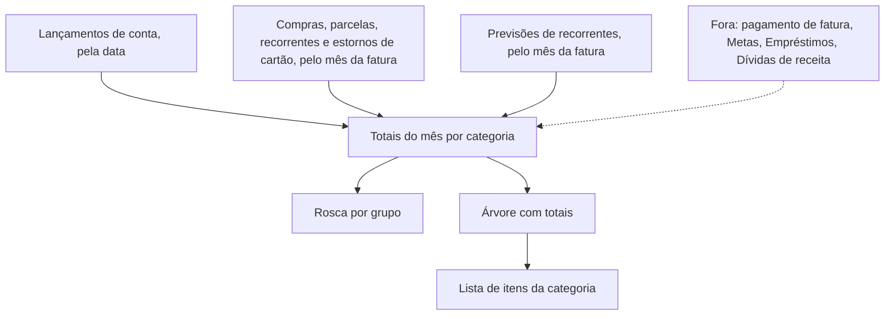
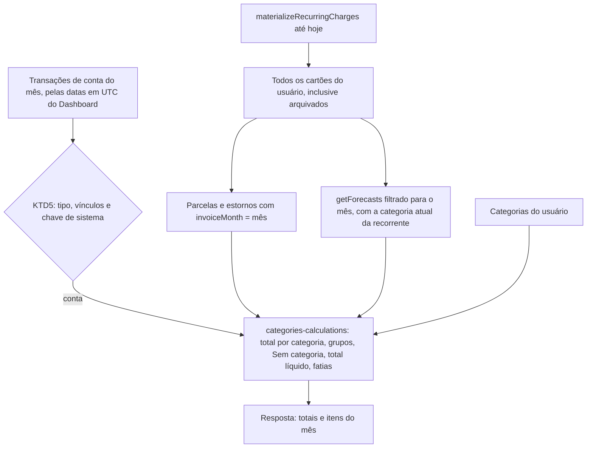
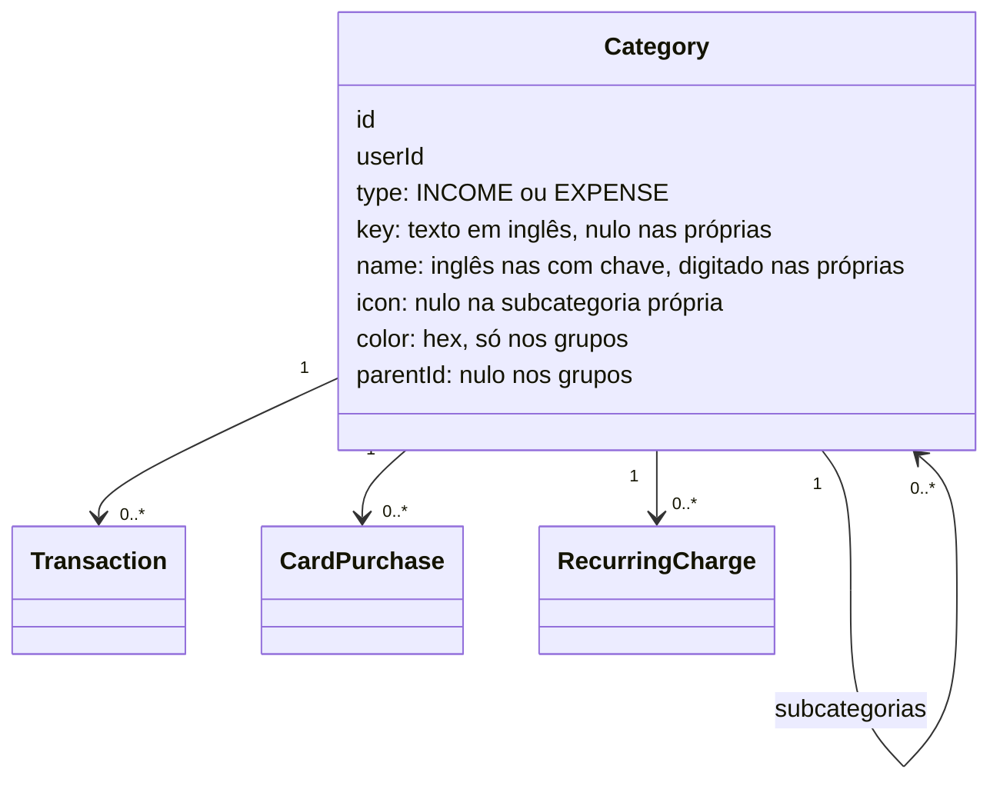
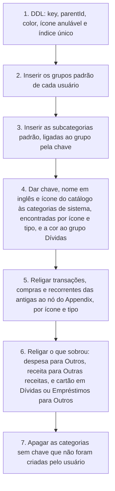

# Categorias - Plan

## Goal Capsule

- **Objective:** No fintrack, o usuário vê para onde foi o dinheiro de cada mês. Os gastos aparecem por grupo e por subcategoria, juntando contas e cartões, na mesma árvore de categorias que ele usa no Visor e nas categorias que ele mesmo criar. Com isso, ele deixa de precisar do Visor para essa função. Esta entrega cobre a árvore de categorias e a página Categorias.
- **Means:** cada usuário tem a própria cópia da árvore, e cada categoria padrão ou de sistema tem uma chave fixa em inglês que o web traduz (KTD1, KTD3). Um módulo puro calcula os totais do mês a partir das transações de conta e dos lançamentos de cartão (KTD4, KTD5).
- **Authority:** os requisitos (R) decidem o comportamento do produto. Os KTDs decidem o mecanismo, dentro dos limites dos R que citam. As unidades não sobrescrevem nenhum dos dois, e AEs e Flows só ilustram. Ficam fora desta entrega "onde dá para cortar" e tags, descritos em How This Work Fits Together.
- **Stop conditions:** pare e pergunte ao usuário se uma decisão marcada `session-settled` se mostrar inviável, ou se a migração deixar algum item sem categoria que antes tinha uma. Nunca rode reset nem `db push` num banco com dados que não seja o `fintrack_categorias` desta worktree.
- **Execution profile:** dois códigos, `api/` e `web/`, em três fases: API em U1 a U5, web em U6 a U10 e testes ponta a ponta em U11. U3 é feita com testes antes do código.
- **Finisher:** `ce-work` implementa e verifica pelo Verification Contract. O usuário revisa e integra o PR.
- **Open blockers:** nenhum.

---

## Product Contract

### Summary

As categorias passam a formar uma árvore de dois níveis, grupo e subcategoria, separada para despesas e para receitas. A árvore padrão é copiada do Visor e completada com os grupos que faltavam. As categorias padrão são fixas, e o usuário pode criar as próprias subcategorias e os próprios grupos. Uma página nova, Categorias, mostra o mês com uma rosca por grupo e a árvore com os totais de contas e cartões. Clicar numa categoria lista os itens dela. As categorias que existem hoje são levadas para a árvore nova. Uma chave fixa por categoria substitui o reconhecimento das categorias de sistema pelo ícone, e um módulo puro na API calcula os totais do mês.

### Problem Frame

Hoje o usuário acompanha para onde vai o dinheiro no Visor Finance, um app pago. Ele considera perfeita a parte de categorias do Visor e quer ter tudo num só app. O fintrack já cobre contas, metas, cartões e dívidas. Mas tem só oito categorias planas de despesa, mais "House" e "Salary" em inglês, e nenhuma tela que some os gastos por categoria. O único agrupamento por categoria é a aba Categorias da fatura de um cartão, e ela não junta cartões e contas. O usuário também não consegue criar categorias, porque criar, editar e excluir existem na API só como stubs.

Sem a árvore e a página, o fintrack não responde "para onde foi o dinheiro deste mês". O próximo passo que o usuário quer, "onde dá para cortar", também fica sem base, porque ele classifica cada categoria como fixa, cortável, flexível ou opcional.

---

### Key Decisions

- **A árvore e a página entram juntas, e "onde dá para cortar" fica para o próximo plano.** (session-settled: user-approved — chosen over só a árvore, as três partes juntas, e começar por "onde cortar": a página é onde se vê se a árvore funciona, e "onde cortar" depende da árvore)
- **A árvore padrão é a do Visor.** Os 11 grupos visíveis nos prints do usuário ficam iguais, e os grupos que faltavam seguem o mesmo estilo. O usuário considera perfeita a parte de categorias do Visor. Governs R2. (session-settled: user-directed — chosen over o usuário mandar o restante da lista do Visor: o agente completa e o usuário revisa)
- **O usuário personaliza criando categorias próprias, e tags ficam para depois.** Governs R10, R11, R12. (session-settled: user-approved — chosen over categorias e tags, e só tags: com uma única árvore, cada gasto fica num só lugar e as somas fecham, e tag pode entrar depois sem migrar dados)
- **As categorias antigas são mapeadas para a árvore nova.** O app ainda está em desenvolvimento, então o banco pode mudar sem preservar dados de produção. Governs R19, R20. (session-settled: user-approved — chosen over manter as antigas ao lado da árvore nova, e recomeçar do zero)
- **A API guarda e devolve as categorias padrão em inglês, e o web traduz.** Governs R3, R4. (session-settled: user-directed — chosen over guardar uma chave em inglês e o nome em português como dado)
- **As categorias padrão são fixas.** O "web traduz" dispensa gerenciar nomes sobrescritos. Governs R5. (session-settled: user-approved — chosen over fixas mas ocultáveis, e editáveis como as próprias)
- **Cada usuário recebe a própria cópia da árvore padrão, e cada categoria padrão tem um identificador fixo.** Esse identificador também substitui a busca por ícone que hoje encontra as categorias de sistema. Um catálogo único compartilhado faria todo lançamento, compra e recorrente apontar para dois tipos de categoria. O custo da cópia: incluir uma categoria padrão no futuro exige migrar os usuários existentes. Governs R2, R3.
- **Um item pode ficar direto num grupo ou numa subcategoria.** O Visor faz assim, e o total do grupo soma os dois. Governs R16, R27.
- **Excluir uma subcategoria própria leva os itens para o grupo dela, e excluir um grupo próprio pede um destino.** Governs R14, R15. (session-settled: user-approved — chosen over sempre escolher o destino, bloquear, e deixar os itens sem categoria)
- **O gasto de cartão entra pelo mês da fatura.** Governs R33. (session-settled: user-approved — chosen over a data da compra: o mês da fatura mostra quanto do mês está comprometido, e uma compra grande parcelada não distorce o mês em que foi feita)
- **As previsões de cobranças recorrentes entram nos totais.** Governs R34. (session-settled: user-directed — chosen over contar só o que já aconteceu: o usuário usa a página para ver o mês fechado que o espera)
- **Das categorias de sistema, só a Dívidas de despesa entra na página.** Pagamento de dívida é custo real. Aporte em meta é dinheiro guardado, e empréstimo é dinheiro que volta. Governs R8, R9. (session-settled: user-approved — chosen over todas entrarem, e nenhuma entrar)
- **Clicar numa categoria lista os itens dela no mês, só para leitura.** Governs R36, R37, R38, R39. (session-settled: user-approved — chosen over recategorizar direto na lista, e mostrar só os totais)
- **O seletor de categoria fica agrupado e sem busca, e esconde todas as categorias de sistema, inclusive Metas.** O plano de cartões tinha deixado "esconder Metas" para depois. Ao editar, o seletor mostra também a categoria atual escondida, e não mais todas as categorias. Governs R17, R18.
- **Pagamento de fatura, metas, empréstimos e entrada de dívida ficam fora pelo vínculo do item, e não só pela categoria.** O Dashboard deixa trocar a categoria de um pagamento de fatura (AE16 do plano de Cartões), e o pagamento não pode passar a contar por isso. Governs R9.
- **Cartão arquivado continua contando o que já está nas faturas, sem previsões.** As parcelas que faltam são dinheiro devido, e um cartão arquivado não gera previsão desde o plano de Cartões. Governs R33, R34.
- **Uma subcategoria própria herda o ícone e a cor do grupo.** O usuário não precisa gerenciar um ícone para cada subcategoria. Governs R11, R12.

<!-- ce-section: work-relationships -->
### How This Work Fits Together

Este plano cobre a árvore de categorias e a página Categorias. A lista abaixo é o entendimento atual das partes seguintes, e não um roadmap fechado.

- **"Onde dá para cortar":** tipo de gasto por categoria (Fixo, Cortável, Flexível, Opcional), divisão 30/20/50, médias, cortáveis e projeção.
  - Depends on: a árvore deste plano, porque o tipo de gasto é dado a cada grupo ou subcategoria.
  - Shares: a regra do que entra no total do mês (R31 a R35).
  - Still to decide: mês de calendário ou ciclo próprio, como o "Seu mês" do Visor.
- **Tags:** marcadores livres, vários por item, para cortes como "Viagem Japão".
  - Can proceed independently of "onde dá para cortar".
  - Still to decide: se a página Categorias ganha um total por tag.

---

### Requirements

**Árvore padrão**

- R1. Uma categoria é um grupo ou uma subcategoria dentro de um grupo, sem terceiro nível. Despesas e receitas têm árvores separadas.
- R2. Todo usuário tem a árvore padrão do Appendix, com os grupos e as subcategorias de despesa e de receita.
- R3. A API guarda e devolve em inglês as categorias padrão e as de sistema, e o web mostra cada uma pelo nome em português do Appendix.
- R4. O web mostra uma categoria própria com o nome que o usuário digitou.
- R5. O usuário não renomeia, não troca o ícone e não exclui uma categoria padrão.
- R6. Cada grupo padrão tem cor e ícone próprios. Cada subcategoria padrão tem ícone próprio, na cor do grupo.

**Categorias de sistema**

- R7. Fatura de cartão, Metas, Dívidas e Empréstimos continuam servindo aos fluxos de Cartões, Metas e Dívidas, e o usuário não as edita nem as exclui.
- R8. A Dívidas de despesa aparece na árvore de despesas como um grupo sem subcategorias, e o usuário não cria subcategoria nela.
- R9. Pagamento de fatura, Metas, Empréstimos e a entrada do dinheiro de uma dívida (Dívidas de receita) não aparecem na árvore nem entram em nenhum total da página, de despesa ou de receita. Isso vale mesmo quando o usuário troca a categoria de um desses itens.

**Categorias próprias**

- R10. O usuário cria uma subcategoria dentro de qualquer grupo de despesa ou de receita, padrão ou próprio, exceto o grupo Dívidas (R8).
- R11. O usuário cria um grupo próprio de despesa ou de receita, com nome, cor e um ícone do conjunto que o app oferece.
- R12. Uma subcategoria própria tem só nome e aparece com o ícone e a cor do grupo dela.
- R13. O usuário renomeia uma categoria própria. Num grupo próprio, também troca o ícone e a cor.
- R40. O app recusa uma subcategoria com o mesmo nome de outra do mesmo grupo, e um grupo com o mesmo nome de outro grupo do mesmo tipo, sem diferenciar maiúsculas de minúsculas.
- R14. Quando o usuário exclui uma subcategoria própria, os lançamentos de conta, as compras de cartão e as cobranças recorrentes dela vão para o grupo dela.
- R15. Para excluir um grupo próprio, o usuário escolhe um destino do mesmo tipo, grupo ou subcategoria, fora do grupo excluído e fora das categorias de sistema. Os itens do grupo e das subcategorias dele vão para o destino, e as subcategorias são excluídas junto.

**Uso da categoria nos itens**

- R16. Um lançamento de conta, uma compra de cartão ou uma cobrança recorrente fica num grupo ou numa subcategoria.
- R17. Os modais de novo lançamento, de edição de lançamento, de compra de cartão e de cobrança recorrente mostram a árvore do tipo do item no seletor de categoria. Cada grupo pode ser escolhido, e as subcategorias aparecem indentadas abaixo dele.
- R18. O seletor não mostra categorias de sistema, Metas incluída. Ao editar um item que está numa categoria escondida, o seletor mostra também essa categoria.

**Categorias que já existem**

- R19. Cada categoria antiga passa para o lugar equivalente na árvore nova, segundo o mapeamento do Appendix, e leva junto os lançamentos, as compras e as cobranças recorrentes ligados a ela.
- R20. Depois da migração, nenhum usuário tem categoria fora da árvore nem duas categorias padrão iguais.

**Página Categorias**

- R21. Uma página nova, Categorias, aparece na navegação do app.
- R22. A página alterna entre Despesas e Receitas e tem um seletor de mês que vai para meses passados e futuros.
- R23. Uma rosca mostra o total líquido do mês no centro. As fatias são os grupos com total positivo, mais uma fatia cinza de "Sem categoria" quando esse total é positivo.
- R24. A árvore lista todos os grupos do tipo escolhido, do maior total do mês para o menor. Cada grupo mostra o total e o número de subcategorias, e as subcategorias aparecem abaixo dele com o total de cada uma.
- R25. Cada grupo pode ser recolhido e expandido. Grupos e subcategorias com total zero no mês aparecem esmaecidos.
- R26. Cada linha tem um menu só com as ações que valem para ela. Um grupo oferece criar subcategoria, exceto Dívidas, e uma categoria própria também oferece editar e excluir. A página tem uma ação para criar um grupo próprio no tipo escolhido.
- R27. O total de um grupo soma os itens ligados direto a ele e os itens das subcategorias dele.
- R28. Quando há no mês itens sem categoria, ou numa categoria que não é do tipo da aba, uma linha "Sem categoria" mostra o total deles.
- R29. Uma categoria com total negativo no mês aparece na árvore com o valor negativo e fica fora da rosca.
- R30. A página diz, num texto curto, o que não entra nos totais, conforme R9.

**O que entra no total do mês**

- R31. Os totais da página juntam lançamentos de conta e itens de cartão, conforme R32 a R35.
- R32. Um lançamento de conta entra no mês da data dele.
- R33. Uma compra, uma parcela, uma cobrança recorrente ou um estorno de cartão entra no mês da fatura em que cai, mesmo num cartão arquivado. Cada parcela entra no mês da fatura dela.
- R34. A previsão de uma cobrança recorrente entra no mês da fatura em que vai cair, com o mesmo peso de uma cobrança já feita. Um cartão arquivado não tem previsões.
- R35. Um estorno de cartão abate da própria categoria, ou de "Sem categoria" quando não tem categoria.

**Itens de uma categoria**

- R36. Clicar num grupo, numa subcategoria ou em "Sem categoria" abre a lista dos itens dela no mês. A lista só serve para leitura.
- R37. Cada item da lista mostra data, descrição, valor e origem, que é o nome da conta ou do cartão.
- R38. A lista de um grupo inclui os itens ligados direto a ele e os das subcategorias dele, e cada item mostra a subcategoria em que está.
- R39. A lista marca parcela (por exemplo, 4/10), previsão e estorno.



---

### Key Flows

- F1. Ver para onde foi o dinheiro
  - **Trigger:** o usuário abre a página Categorias.
  - **Steps:** a página abre no mês atual, em Despesas. O usuário vê a rosca e a árvore, muda de mês ou passa para Receitas, e clica num grupo ou numa subcategoria para ver os itens.
  - **Outcome:** o usuário sabe quanto foi para cada grupo e subcategoria e quais itens formam cada total.
  - **Covered by:** R21 a R25, R27 a R39
- F2. Criar uma categoria própria
  - **Trigger:** o usuário não encontra um lugar adequado para um gasto.
  - **Steps:** no menu de um grupo, o usuário escolhe criar subcategoria e dá um nome. Ou, pela ação da página, cria um grupo com nome, ícone e cor. A categoria nova aparece na árvore e no seletor dos modais.
  - **Covered by:** R10 a R12, R17, R26
- F3. Excluir um grupo próprio
  - **Trigger:** o usuário escolhe excluir no menu de um grupo próprio.
  - **Steps:** o app pede o destino dos itens, o usuário escolhe uma categoria permitida e confirma. Os itens vão para o destino, e o grupo e as subcategorias dele somem.
  - **Covered by:** R15

---

### Acceptance Examples

- AE1. **Covers R27, R38.** **Given** em outubro o grupo Compras tem R$ 643 em itens ligados direto a ele, R$ 244 em Compras online e R$ 144 em Livraria. **When** o usuário abre outubro. **Then** Compras mostra R$ 1.031, e a lista de Compras traz os três conjuntos, cada item com a subcategoria em que está.
- AE2. **Covers R33.** **Given** uma compra de R$ 1.200 em 12x no cartão, com a primeira parcela na fatura de outubro. **When** o usuário vê outubro e novembro. **Then** a categoria da compra tem R$ 100 em cada mês, e não R$ 1.200 em outubro.
- AE3. **Covers R34, R39.** **Given** hoje é 17/10, e o Spotify de R$ 12,90 em Serviços digitais › Música é cobrado no dia 25 e ainda é previsão na fatura de outubro. **When** o usuário abre outubro. **Then** Música mostra R$ 12,90, e a lista marca o item como previsão.
- AE4. **Covers R9, R33.** **Given** as compras da fatura de outubro somam R$ 2.000, e o usuário paga essa fatura com R$ 2.000 de uma conta em outubro. **When** o usuário abre outubro. **Then** as despesas somam R$ 2.000, distribuídos pelas categorias das compras, e não R$ 4.000.
- AE5. **Covers R29, R35.** **Given** em outubro o único item de Serviços digitais › Cashback é um estorno de cartão de R$ 50. **When** o usuário abre outubro. **Then** Cashback mostra −R$ 50 na árvore e não aparece na rosca.
- AE6. **Covers R14.** **Given** a subcategoria própria "Ração", em Compras, tem três lançamentos e uma cobrança recorrente. **When** o usuário a exclui. **Then** os quatro itens passam para Compras, e o total de Compras no mês não muda.
- AE7. **Covers R15.** **Given** o grupo próprio de despesa "Casamento" tem as subcategorias "Buffet" e "Fotógrafo". **When** o usuário exclui "Casamento". **Then** a lista de destinos não oferece "Casamento", "Buffet", "Fotógrafo", categorias de receita nem categorias de sistema. Depois que o usuário escolhe Lazer › Entretenimento, todos os itens dos três vão para lá, e "Buffet" e "Fotógrafo" são excluídas.
- AE8. **Covers R17, R18.** **Given** o usuário cria uma despesa no Dashboard. **When** abre o seletor de categoria. **Then** vê Alimentação, que pode ser escolhida, com Delivery, Supermercado e Restaurantes indentadas abaixo, e não vê Metas, Fatura de cartão, Dívidas nem Empréstimos.
- AE9. **Covers R19, R20.** **Given** antes da migração o usuário tem lançamentos em "Mercado" e em "Salary". **When** a migração roda. **Then** os lançamentos de "Mercado" ficam em Alimentação › Supermercado, os de "Salary" ficam em Receita › Salário, e "Mercado" e "Salary" deixam de existir.
- AE10. **Covers R5, R8, R26.** **Given** a árvore de despesas. **When** o usuário abre os menus. **Then** o menu de Alimentação oferece só criar subcategoria, Delivery não tem nenhuma ação, e Dívidas também não.
- AE11. **Covers R9.** **Given** o usuário trocou a categoria do pagamento de uma fatura de R$ 2.000 para Outros no Dashboard. **When** abre o mês do pagamento. **Then** Outros não muda, e as despesas continuam somando só as compras da fatura.
- AE12. **Covers R18.** **Given** um pagamento de parcela de dívida na categoria Dívidas. **When** o usuário abre esse lançamento para editar. **Then** o seletor mostra a árvore de despesas sem as categorias de sistema, mais Dívidas, que vem marcada.
- AE13. **Covers R40.** **Given** o grupo Alimentação, que tem a subcategoria padrão Delivery. **When** o usuário tenta criar a subcategoria "delivery" em Alimentação. **Then** o app recusa e diz que o nome já existe nesse grupo.
- AE14. **Covers R33, R34.** **Given** um cartão arquivado com a parcela 5/10 de uma compra em Eletrônicos na fatura de novembro e uma cobrança recorrente de Streaming. **When** o usuário abre novembro. **Then** Eletrônicos inclui a parcela, e Streaming não tem previsão desse cartão.

---

### Success Criteria

- O usuário responde, só no fintrack, quanto foi para cada grupo e cada subcategoria num mês e quais itens formam cada total, sem abrir o Visor.
- A soma da árvore de despesas de um mês é igual aos lançamentos de despesa das contas mais os itens de cartão das faturas daquele mês, previsões incluídas, menos o que R9 exclui.

---

### Scope Boundaries

**Deferred for later**

- Tipo de gasto (Fixo, Cortável, Flexível, Opcional), divisão 30/20/50, médias, comparação com meses anteriores e "onde dá para cortar". É o próximo plano, construído sobre esta árvore.
- Tags.
- Orçamento por categoria (o "Saldo / -" no centro da rosca do Visor).
- Automações e regras de categorização, e as outras abas do Visor (Tipo de gasto, Tags, Automações, Filtros).
- Trocar a categoria de um item pela lista da página.
- Ocultar, renomear ou excluir categorias padrão.
- Mover uma subcategoria de um grupo para outro.
- Busca por nome no seletor de categoria.
- Filtro por categoria na lista de transações do Dashboard.
- Importar dados do Visor.
- Previsão das parcelas de dívida ainda não pagas no grupo Dívidas. Hoje só os cartões têm previsão.

**Considered and not built**

- Validar na API que o tipo da categoria bate com o tipo do lançamento. Os seletores já filtram pelo tipo, e um item fora do tipo conta em "Sem categoria" (R28), então a soma não se perde. Mudaria a decisão um item assim aparecer em uso real.
- Pedir destino só quando o grupo próprio tem itens. R15 pede o destino sempre, e isso evita uma contagem extra antes de excluir.

---

### Dependencies / Assumptions

- O banco é de desenvolvimento e pode ser migrado ou recriado sem preservar dados de usuários reais.
- A página conta de propósito de um jeito diferente de outras telas. O total da fatura deixa as previsões de fora (R20 do plano de Cartões), e o Dashboard não mostra itens de cartão (R37 do plano de Cartões). Já a página Categorias conta os dois (R33, R34). Por isso, o total do mês na página não bate com o total da fatura nem com o Dashboard.
- O app tem hoje ícones para oito categorias de despesa e um ícone genérico de receita. A árvore padrão precisa de um ícone para cada grupo e para cada subcategoria, e eles vêm da biblioteca `lucide-react` (KTD8).

---

### Sources / Research

- `api/prisma/schema.prisma`: o model `Category` é plano (nome, ícone, tipo). `Transaction`, `CardPurchase` e `RecurringCharge` têm `categoryId` opcional com `onDelete: SetNull`, e o model `CardInstallment` guarda uma parcela por linha, cada uma com o mês da fatura dela.
- `api/src/modules/categories/categories.constants.ts` e `api/src/modules/auth/auth.service.ts`: são as categorias criadas no cadastro. As migrations de metas, cartões e dívidas repetem esse cadastro em SQL para os usuários que já existiam.
- `api/src/modules/categories/categories.service.ts`: criar, editar, buscar uma e excluir são stubs.
- `findByIcon` em `api/src/database/repositories/categories.repositories.ts` é usado em `goals.service.ts`, `cards.service.ts`, `debts.service.ts` e `borrowers.service.ts`. O web também filtra por ícone em `web/src/app/utils/cardEntryCategories.ts` e `web/src/app/utils/debtCategories.ts`.
- `api/src/modules/cards/card-calculations.ts`: `getForecasts` projeta as previsões de recorrentes por mês de fatura, e `getCategoryTotals` faz o estorno abater da própria categoria.
- `web/src/view/pages/CardDetail/components/InvoiceCategories.tsx`: o único gráfico por categoria que existe hoje.
- `web/src/view/components/icons/categories/iconsMap.ts`: os ícones de categoria que existem hoje.
- `web/src/view/components/ColorsDropdownInput.tsx`: o seletor de cor usado em contas e cartões.
- `web/src/Router/index.tsx`: as rotas de hoje. Não existe página de categorias.
- `docs/plans/2026-10-12-2102-feat-cartoes-plan.md`: R20 (previsões), R37 (cartão fora do Dashboard), R45 (aba Categorias da fatura), R48 e R49 (categorias padrão e Fatura de cartão), e o item adiado "Esconder Metas".
- `docs/plans/2026-10-13-2253-feat-dividas-plan.md`: as categorias Dívidas e Empréstimos e o filtro delas no Dashboard.

---

## Planning Contract

### Product Contract preservation

- Changed, confirmado pelo usuário na síntese do planejamento:
  - R3 vale também para as categorias de sistema.
  - R9 vale mesmo depois que o usuário troca a categoria do item.
  - R18 mostra a categoria atual escondida, no lugar de "funciona como hoje".
  - R23 define o centro e as fatias da rosca.
  - R33 e R34 dizem o que um cartão arquivado conta.
- Changed, esclarecimento sem mudança de escopo: R28 inclui itens numa categoria de outro tipo, e o Appendix ganhou o destino das categorias antigas fora do mapeamento.
- Added: R40, AE11 a AE14 e três Key Decisions (seletor ao editar, exclusão pelo vínculo, cartão arquivado).
- Removed: a seção Outstanding Questions do brainstorm, resolvida em R40, KTD1, KTD8 e U9.
- O restante ficou sem mudança.

### Key Technical Decisions

- KTD1. **Uma categoria ganha chave, pai e cor, e o ícone passa a ser opcional.** `Category` recebe:
  - `key`: texto em inglês e `snake_case`, só nas categorias padrão e de sistema. É único por usuário, tipo e chave. Como o Postgres trata nulos como distintos, as categorias próprias, que não têm chave, convivem sem conflito.
  - `parentId`: a ligação com o grupo, numa relação da tabela com ela mesma, com `onDelete: Cascade`. O serviço move os itens antes de excluir, então a cascata só apaga subcategorias já vazias.
  - `color`: o hex da paleta de `web/src/view/constants/ColorsConstants.ts`, só nos grupos. O grupo Dívidas (`debts` de despesa) também tem cor e ícone, porque aparece na árvore e na rosca (R8).
  - `icon`: fica anulável. Subcategoria própria não tem ícone.

  O `name` de uma categoria com chave é o nome em inglês, e o de uma categoria própria é o que o usuário digitou. A chave das categorias de sistema é `card_payment`, `goals`, `debts` ou `loans`, e o tipo separa a despesa da receita. Governs R1 a R7. (session-settled: user-directed — chosen over guardar uma chave em inglês e o nome em português como dado: o usuário quer a API toda em inglês e a tradução no web)
- KTD2. **O catálogo vive em `api/src/modules/categories/categories.constants.ts`, e a migração o repete em SQL.** É a convenção que o próprio arquivo descreve para metas, cartões e dívidas. O cadastro cria a árvore com UUIDs gerados antes, com `randomUUID` de `node:crypto`, porque o `createMany` aninhado de hoje não liga uma subcategoria a um grupo criado na mesma chamada. Governs R2.
- KTD3. **Uma categoria de sistema é reconhecida pela chave, nunca pelo ícone.**
  - `findByKey(userId, key, type)` substitui `findByIcon` nos serviços de metas, cartões, dívidas e pessoas.
  - A validação de lançamentos de cartão recusa qualquer chave de sistema e qualquer categoria de receita.
  - O web filtra pelas mesmas chaves.

  Com isso, um grupo próprio com o mesmo ícone de uma categoria de sistema continua sendo uma categoria comum. Governs R7, R8, R18.
- KTD4. **Os totais do mês saem de um módulo puro, em centavos.** `api/src/modules/categories/categories-calculations.ts` recebe as categorias do usuário, as transações de conta já filtradas e os lançamentos de cartão do mês. Ele devolve:
  - o total direto de cada categoria;
  - o total de cada grupo, com as subcategorias;
  - o total de "Sem categoria";
  - o total líquido;
  - a fatia de cada grupo, calculada só sobre totais positivos.

  Um item numa categoria que não é da árvore da aba conta em "Sem categoria". O módulo não importa Prisma nem Nest e segue o formato de `card-calculations.ts`. Governs R23, R24, R27, R28, R29, R31, R35.
- KTD5. **Uma transação de conta conta quando cumpre três condições.**
  1. É do tipo da aba.
  2. Não tem nenhum destes vínculos: `creditCardId` (pagamento de fatura), `goalId`, `borrowerId`, ou `debtId` num lançamento de receita.
  3. A categoria dela não é `card_payment`, `goals`, `loans` nem `debts` de receita.

  O vínculo resolve o pagamento que teve a categoria trocada, e a chave resolve os lançamentos antigos sem vínculo. Os lançamentos de cartão contam só na aba Despesas. Governs R9, R32.
- KTD6. **Os lançamentos de cartão do mês saem do mesmo caminho das telas de Cartões.**
  1. O serviço chama `materializeRecurringCharges(userId, today)`.
  2. Ele carrega todos os cartões, inclusive os arquivados, com `findManyByUserId`.
  3. Uma função pura nova junta, de todos os cartões, as parcelas com `invoiceMonth` igual ao mês e as previsões de `getForecasts` filtradas para o mês.

  A previsão usa a categoria atual da cobrança recorrente, como `CardsService.toInvoiceView` faz hoje. Sem o primeiro passo, uma cobrança que venceu ontem e ainda não virou compra some do mês. Governs R33, R34, R39.
- KTD7. **A API de categorias tem cinco rotas.**
  - `GET /categories`: lista plana com `key`, `parentId`, `icon` e `color`.
  - `POST /categories`: cria um grupo, com tipo, nome, ícone e cor, ou uma subcategoria, com `parentId` e nome. O tipo da subcategoria vem do grupo.
  - `PUT /categories/:categoryId`: muda nome, ícone e cor.
  - `DELETE /categories/:categoryId`: aceita `destinationCategoryId`, obrigatório para grupo.
  - `GET /categories/summary/:month?type=EXPENSE|INCOME`: devolve os totais e os itens do mês numa chamada só.

  A rota estática fica antes de `:categoryId`, e o mês usa `ParseMonthPipe`. O web filtra os itens da categoria clicada a partir do resumo, sem refazer nenhuma conta. Governs R10 a R15, R22, R36 a R39.
- KTD8. **Os ícones vêm de `lucide-react`.** São cerca de 90 ícones de domínio, como farmácia, combustível e academia. Os ícones do Radix não cobrem esses temas, e desenhar 70 SVGs à mão sairia inconsistente.
  - `iconsMap` mapeia as chaves de ícone do app para componentes do Lucide, importados um a um.
  - `CategoryIcon` vira um quadrado com o fundo `bg` da paleta e o ícone na cor do grupo.
  - Uma subcategoria sem ícone usa o ícone e a cor do grupo.
  - O web resolve ícone e cor pela lista de categorias em cache, e não pelo item. Por isso as telas de itens não precisam incluir o grupo em cada consulta.
  - Os oito SVGs de despesa de hoje saem quando nada mais os usar. `Expense` e `Income` ficam, porque o botão de novo lançamento e o card de conta os usam.

  Governs R6, R11, R12.
- KTD9. **A tradução é um mapa de chave para nome em português.** O mapa `CATEGORY_LABELS` fica em `web/src/view/constants/CategoryConstants.ts`, no padrão de `INVOICE_STATUS_LABELS`. Toda tela que mostra o nome de uma categoria usa `getCategoryName(category)`, que devolve o nome em português quando há chave e o nome guardado quando não há. A ordem do mesmo mapa define a ordem do catálogo no seletor e o desempate da árvore. As categorias próprias vêm depois, em ordem alfabética do português. Governs R3, R4, R24.
- KTD10. **Uma única função monta as opções do seletor nos quatro modais.** `getCategoryOptions(categories, type, currentCategoryId?)` devolve a árvore do tipo sem as categorias de sistema, mais a categoria atual quando ela está escondida. Ela substitui `getCardEntryCategories` e `getManualEntryCategories`. O `Select` ganha uma marca `indent` por opção. É uma lista plana com recuo, e não `Group` e `Label` do Radix, porque o grupo também precisa ser escolhido. Governs R17, R18.
- KTD11. **Mover os itens e excluir acontece numa transação do Prisma.** Um `updateMany` muda o `categoryId` em `transaction`, `cardPurchase` e `recurringCharge`, e depois as categorias são excluídas. A operação passa pelo repositório, sem o serviço de cartões, para alcançar também os itens de cartões arquivados. O destino precisa ser do usuário, do mesmo tipo, de fora do grupo excluído e de fora das categorias de sistema. Governs R14, R15.
- KTD12. **A API garante nome único entre as categorias próprias, e o web cobre os nomes traduzidos.** A API compara o nome com os irmãos guardados, sem diferenciar maiúsculas e ignorando espaços nas pontas, e responde 409 quando há repetição. A API não conhece os nomes em português das padrão, então o formulário do web também compara com os nomes exibidos dos irmãos. Governs R40.
- KTD13. **A migração religa os itens antes de apagar qualquer categoria antiga.** As três ligações usam `SetNull`, então apagar antes deixaria itens sem categoria sem nenhum aviso. A ordem está no diagrama de High-Level Technical Design. As categorias antigas são encontradas por ícone e tipo, como nos backfills anteriores, e não pelo nome, porque cadastros antigos podem ter outros nomes. Governs R19, R20.
- KTD14. **O seletor de mês da página é um componente novo.** O carrossel do Dashboard não passa de um ano para outro. O componente usa `formatMonth` e `getCurrentMonth` e tem setas para o mês anterior e o seguinte. Ele fica limitado a 120 meses para cada lado de hoje, o mesmo `MAX_DATE_DISTANCE_MONTHS` da API, porque `getForecasts` percorre os meses um a um. Governs R22.

### High-Level Technical Design

O cálculo do resumo do mês:



A forma da categoria:



A ordem da migração (KTD13):



No passo 7, as categorias antigas são todas sem chave. Antes da migração não existem categorias próprias, então o passo apaga toda categoria sem chave.

### Output Structure

```text
api/src/modules/categories/
  categories-calculations.ts          novo
  categories-calculations.spec.ts     novo
  categories.constants.ts             catálogo com chaves
  categories.controller.ts            reescrito
  categories.service.ts               reescrito
  dto/create-category.dto.ts          reescrito
  dto/update-category.dto.ts          reescrito
  dto/delete-category.dto.ts          novo
web/src/view/pages/Categories/
  index.tsx
  useCategoriesController.ts
  components/MonthNavigator.tsx
  components/CategoriesDonut.tsx
  components/CategoryTree.tsx
  modals/CategoryItemsModal/
  modals/CategoryFormModal/
  modals/DeleteCategoryModal/
web/src/view/constants/CategoryConstants.ts
web/src/app/utils/categories.ts
```

### Sequencing

1. U1 cria a forma nova e o catálogo. Ela renomeia constantes que os serviços de U2 importam, então a API só volta a compilar ao fim de U2. Faça e verifique U1 e U2 juntas.
2. U3 não depende de nada e pode ser feita em paralelo com U1 e U2.
3. U4 e U5 dependem de U1 a U3.
4. No web, U6 vem primeiro. U7 e U8 dependem de U6, e U9 e U10 dependem de U7.
5. U11 fecha com os testes ponta a ponta.

### System-Wide Impact

- **Metas, Cartões e Dívidas:** os três passam a buscar a categoria de sistema pela chave (U2). Os specs de serviço deles trocam o mock de `findByIcon`.
- **Cadastro:** cria cerca de 100 categorias por usuário no lugar de 16 (U1).
- **Todas as telas que mostram categoria:** a lista do Dashboard, as faturas, as recorrentes e os quatro modais passam a usar o nome traduzido e o ícone novo (U7, U8).
- **Atualização de dados:** `invalidateMoneyQueries` passa a invalidar `['categories']`, então qualquer mudança de dinheiro atualiza o resumo do mês (U6).
- **Testes ponta a ponta existentes:** `cards.cy.ts` e `debts.cy.ts` acham categorias pelo ícone e pelos nomes antigos e precisam mudar (U11).

### Risks & Dependencies

| Risco | Mitigação |
|---|---|
| A migração deixa itens sem categoria | A ordem de KTD13, e a verificação do Verification Contract que compara a contagem de itens sem categoria antes e depois |
| O catálogo em TS e o SQL da migração divergem | O gate Migração compara a árvore de um usuário migrado com a de um usuário cadastrado depois, campo a campo |
| `lucide-react` aumenta o bundle | Os ícones são importados um a um, e o Vite descarta o resto. O gate de build do web confirma |
| A primeira rosca do app com recharts | Usar `PieChart` com `innerRadius`, as cores da paleta e um `aria-label` em português, como nos gráficos de Metas |
| Os specs de categorias de hoje não compilam a injeção de dependências | U4 os reescreve com os repositórios falsos, no padrão de `debts.service.spec.ts` |

### Deferred to Implementation

- O nome e a chave em inglês de cada categoria do Appendix, seguindo KTD1.
- O ícone do Lucide para cada grupo e subcategoria, e a cor de cada grupo padrão dentro da paleta. O Visor serve de referência visual.
- Os nomes exatos dos campos da resposta do resumo e das funções puras.
- O timestamp da pasta da migração.

---

## Implementation Units

| U-ID | Título | Arquivos principais | Depende de |
|---|---|---|---|
| U1 | Schema, catálogo e migração | `schema.prisma`, migração nova, `categories.constants.ts`, `auth.service.ts` | — |
| U2 | Chave de sistema no lugar do ícone na API | `categories.repositories.ts`, serviços de metas, cartões, dívidas e pessoas | U1 |
| U3 | Módulo puro dos totais do mês | `categories-calculations.ts` | — |
| U4 | API de gestão de categorias | `categories.controller.ts`, `categories.service.ts`, `dto/` | U1, U2 |
| U5 | API do resumo do mês | `categories.service.ts`, `transactions.repositories.ts`, `credit-cards.repositories.ts` | U3, U4 |
| U6 | Camada de dados do web | `categoriesService.ts`, `useCategories.ts`, `CategoryConstants.ts`, `utils/categories.ts` | U5 |
| U7 | Ícones e nomes traduzidos nas telas | `iconsMap.ts`, `CategoryIcon.tsx`, telas de Dashboard e CardDetail | U6 |
| U8 | Seletor agrupado nos quatro modais | `Select.tsx`, os quatro modais | U6 |
| U9 | Página Categorias: leitura | `pages/Categories/`, `Router/index.tsx`, `AppLayout.tsx` | U7 |
| U10 | Página Categorias: gestão | `pages/Categories/modals/` | U9 |
| U11 | Testes ponta a ponta | `web/cypress/e2e/categories.cy.ts`, `cards.cy.ts`, `debts.cy.ts` | U8, U10 |

### U1. Schema, catálogo e migração

**Goal:** dar à categoria a forma de árvore com chave, criar a árvore padrão no cadastro e levar os usuários existentes para ela.

**Requirements:** R1 a R8, R19, R20; KTD1, KTD2, KTD13.

**Dependencies:** nenhuma.

**Files:**
- `api/prisma/schema.prisma`
- `api/prisma/migrations/<timestamp>_category_tree/migration.sql`
- `api/src/modules/categories/categories.constants.ts`
- `api/src/modules/goals/goals.constants.ts`
- `api/src/modules/auth/auth.service.ts`
- `api/src/modules/auth/auth.service.spec.ts`

**Approach:**
1. Acrescentar a `Category` os campos de KTD1, a relação com ela mesma e o índice único por usuário, tipo e chave.
2. Reescrever `categories.constants.ts` como o catálogo do Appendix: grupos com chave, nome em inglês, ícone e cor, e subcategorias com chave, chave do grupo, nome e ícone. Também as categorias de sistema com chave e ícone. O grupo Dívidas também tem cor. As constantes `*_CATEGORY_ICON` e `*_CATEGORY_NAME` viram `*_CATEGORY_KEY`, inclusive a de metas em `goals.constants.ts`.
3. Reescrever a criação de categorias no cadastro a partir do catálogo, com os UUIDs gerados antes (KTD2), mais as categorias de sistema dos dois tipos.
4. Gerar a migração com `prisma migrate dev --create-only` e escrever o SQL dos passos 2 a 7 de KTD13 depois do DDL, no padrão de `INSERT ... SELECT ... CROSS JOIN (VALUES ...)` dos backfills anteriores.

**Patterns to follow:** `api/prisma/migrations/20261013004731_create_cards/migration.sql` e `api/prisma/migrations/20261014030000_create_debts/migration.sql`, nos backfills com `NOT EXISTS`.

**Test scenarios:**
- O cadastro cria todos os grupos e subcategorias do Appendix, cada subcategoria ligada ao grupo certo e com o tipo do grupo.
- O cadastro cria `card_payment` de despesa, e `goals`, `debts` e `loans` de despesa e de receita, todas com chave.
- O cadastro cria 16 grupos de despesa com 65 subcategorias e 3 grupos de receita com 10 subcategorias, e cada grupo tem o mesmo número de subcategorias que no Appendix, sem chave repetida no mesmo tipo.
- Nenhuma categoria criada no cadastro fica sem chave.

**Verification:** a migração aplica no banco `fintrack_categorias`, e o gate Migração do Verification Contract passa, inclusive o mapeamento de AE9 e a comparação com a árvore do cadastro.

### U2. Chave de sistema no lugar do ícone na API

**Goal:** fazer metas, cartões, dívidas e pessoas encontrarem e recusarem categorias de sistema pela chave.

**Requirements:** R7, R18; KTD3.

**Dependencies:** U1.

**Files:**
- `api/src/database/repositories/categories.repositories.ts`
- `api/src/modules/goals/goals.service.ts`
- `api/src/modules/cards/cards.service.ts`
- `api/src/modules/cards/card-entries.service.ts`
- `api/src/modules/debts/debts.service.ts`
- `api/src/modules/debts/borrowers.service.ts`
- `api/src/modules/goals/goals.service.spec.ts`
- `api/src/modules/cards/cards.service.spec.ts`
- `api/src/modules/cards/card-entries.service.spec.ts`
- `api/src/modules/debts/debts.service.spec.ts`
- `api/src/modules/debts/borrowers.service.spec.ts`

**Approach:**
1. Trocar `findByIcon` por `findByKey(userId, key, type)` no repositório e nos quatro serviços.
2. Em `CardEntriesService.validateCategory`, trocar `EXCLUDED_CATEGORY_ICONS` por "recusar qualquer chave de sistema", mantendo a recusa de categoria de receita.
3. Trocar os mocks e fixtures de ícone nos specs pelas chaves.

**Patterns to follow:** a mensagem de erro e o 500 de categoria de sistema ausente que cada serviço já usa, como `'Debt category not found.'`.

**Test scenarios:**
- Aportar numa meta usa a categoria `goals` de despesa, e resgatar usa a de receita.
- Pagar uma fatura usa `card_payment`.
- Pagar uma parcela de dívida usa `debts` de despesa, e a entrada do dinheiro de uma dívida usa `debts` de receita.
- Emprestar usa `loans` de despesa, e a devolução usa `loans` de receita.
- Uma compra de cartão em `debts` ou em `loans` é recusada com 400, como hoje acontece com `goals`.
- Uma compra de cartão num grupo próprio com o ícone `credit-card` é aceita.

**Verification:** os specs de metas, cartões e dívidas passam com as chaves, e nenhuma ocorrência de `findByIcon` sobra na API.

### U3. Módulo puro dos totais do mês

**Goal:** calcular, sem banco, os totais por categoria, grupo, "Sem categoria" e o total líquido de um mês, e juntar os lançamentos de cartão do mês.

**Requirements:** R9, R23, R24, R27 a R29, R31 a R35; KTD4, KTD5, KTD6.

**Dependencies:** nenhuma.

**Files:**
- `api/src/modules/categories/categories-calculations.ts`
- `api/src/modules/categories/categories-calculations.spec.ts`

**Approach:**
1. Uma função que decide se uma transação de conta conta, pelas regras de KTD5.
2. Uma função que recebe os cartões no formato que `findManyByUserId` devolve, o dia de hoje e o mês. Ela devolve as parcelas e os estornos do mês e as previsões do mês, de todos os cartões (KTD6). As previsões usam `getForecasts` de `card-calculations.ts`.
3. Uma função que recebe as categorias e os itens que contam e devolve os totais de KTD4, em centavos, com `toCents` e `fromCents`.

**Execution note:** escreva os testes antes do código, a partir dos AEs.

**Patterns to follow:** `api/src/modules/cards/card-calculations.ts`, com as seções, os tipos exportados e `getCategoryTotals`. `api/src/modules/cards/card-calculations.spec.ts`, com os helpers `day()` e `m()`.

**Test scenarios:**
- Covers AE1. Compras com R$ 643 direto no grupo, R$ 244 em Compras online e R$ 144 em Livraria dão R$ 1.031 no grupo e o valor de cada subcategoria.
- Covers AE2. Uma compra de R$ 1.200 em 12x com a primeira parcela em outubro dá R$ 100 em outubro e em novembro.
- Covers AE3. Uma cobrança recorrente de R$ 12,90 que vence dia 25, com hoje em 17/10, aparece como previsão em outubro na categoria atual da recorrente.
- Covers AE4. Compras de R$ 2.000 na fatura de outubro e o pagamento de R$ 2.000 da fatura dão R$ 2.000 de despesa.
- Covers AE11. O pagamento de uma fatura com a categoria trocada para Outros não conta, porque tem `creditCardId`.
- Covers AE5. Um estorno de R$ 50 como único item de Cashback dá −R$ 50 em Cashback, e Cashback fica sem fatia.
- Covers AE14. Num cartão arquivado, a parcela de novembro conta, e não há previsão.
- Um aporte de meta, um empréstimo, uma devolução e a entrada do dinheiro de uma dívida não contam. Um pagamento de parcela de dívida conta em Dívidas.
- Uma transação antiga sem vínculo nas categorias `goals` ou `card_payment` não conta.
- Um item sem categoria e um item numa categoria de receita, na aba Despesas, contam em "Sem categoria".
- A aba Receitas não inclui nenhum lançamento de cartão.
- O total líquido soma os negativos, e as fatias somam 100% sobre os grupos positivos e "Sem categoria" positivo.
- Um mês sem itens dá total zero e nenhuma fatia.

**Verification:** o spec passa, e o módulo não importa Prisma nem Nest.

### U4. API de gestão de categorias

**Goal:** listar, criar, renomear e excluir categorias próprias com as regras do produto.

**Requirements:** R5, R7, R8, R10 a R16, R40; KTD7, KTD11, KTD12.

**Dependencies:** U1, U2.

**Files:**
- `api/src/modules/categories/categories.controller.ts`
- `api/src/modules/categories/categories.service.ts`
- `api/src/modules/categories/categories.module.ts`
- `api/src/modules/categories/dto/create-category.dto.ts`
- `api/src/modules/categories/dto/update-category.dto.ts`
- `api/src/modules/categories/dto/delete-category.dto.ts`
- `api/src/modules/categories/validate-category-ownership.service.ts`
- `api/src/modules/categories/entities/category.entity.ts`
- `api/src/database/repositories/categories.repositories.ts`
- `api/src/modules/categories/categories.service.spec.ts`
- `api/src/modules/categories/categories.controller.spec.ts`

**Approach:**
1. Reescrever o controller no padrão de `debts.controller.ts`: `@ActiveUserId()`, `ParseUUIDPipe` e `@Put`, e `@Delete` com `NO_CONTENT`.
2. Fazer as DTOs com class-validator.
   - Criação: `parentId` opcional. Sem ele, exigir tipo, ícone e cor. Com ele, só o nome.
   - Edição: nome, mais ícone e cor quando a categoria é grupo.
   - Exclusão: `destinationCategoryId` opcional.
3. Fazer a validação de posse devolver a categoria.
4. Regras do serviço:
   - Só categorias sem chave são editadas ou excluídas.
   - O pai de uma subcategoria precisa ser um grupo e não pode ser de sistema.
   - Um nome repetido devolve 409 (KTD12).
   - Excluir uma subcategoria move os itens para o grupo dela.
   - Excluir um grupo exige um destino válido e move tudo (KTD11).
5. Acrescentar no repositório criar, atualizar, achar irmãos e o "mover e excluir" numa transação.

**Patterns to follow:** `api/src/modules/debts/debts.service.ts`, nas mensagens em constantes e nos 400, 404 e 409. `api/src/modules/debts/debts.service.spec.ts`, nos repositórios falsos em memória e no `describe` de validação das DTOs.

**Test scenarios:**
- Criar a subcategoria "Ração" em Compras devolve uma subcategoria de despesa ligada a Compras, sem ícone.
- Criar um grupo de receita "Freelas" com ícone e cor devolve um grupo de receita.
- Criar uma subcategoria em Dívidas, em `goals` ou dentro de outra subcategoria devolve 400.
- Criar um grupo sem ícone ou sem cor devolve 400 pela validação da DTO.
- Covers AE13. Criar "delivery" num grupo que já tem uma subcategoria própria "Delivery" devolve 409. A comparação com os nomes traduzidos das padrão fica no web.
- Renomear uma subcategoria própria funciona. Mandar ícone ou cor para uma subcategoria devolve 400.
- Editar ou excluir uma categoria com chave devolve 409.
- Editar ou excluir uma categoria de outro usuário devolve 404.
- Covers AE6. Excluir "Ração", que tem três lançamentos e uma recorrente, move os quatro para Compras.
- Excluir uma subcategoria própria move também as compras de um cartão arquivado.
- Excluir um grupo próprio sem destino devolve 400.
- Covers AE7. Excluir "Casamento" com destino em "Buffet", numa categoria de receita ou numa de sistema devolve 400. Com destino em Lazer › Entretenimento, move os itens do grupo e das subcategorias e apaga as três categorias.
- `GET /categories` devolve só as categorias do usuário, com `key`, `parentId`, `icon` e `color`.

**Verification:** os specs de categorias passam e compilam a injeção de dependências, coisa que os de hoje não fazem.

### U5. API do resumo do mês

**Goal:** expor o resumo do mês, com totais e itens, para a página.

**Requirements:** R9, R22, R31 a R39; KTD5, KTD6, KTD7.

**Dependencies:** U3, U4.

**Files:**
- `api/src/modules/categories/categories.controller.ts`
- `api/src/modules/categories/categories.service.ts`
- `api/src/modules/categories/categories.module.ts`
- `api/src/database/repositories/transactions.repositories.ts`
- `api/src/database/repositories/credit-cards.repositories.ts`
- `api/src/modules/categories/categories.service.spec.ts`

**Approach:**
1. Uma rota `GET /categories/summary/:month` com `ParseMonthPipe` e `type` validado. Ela fica declarada antes de `:categoryId`.
2. No serviço:
   1. materializar as recorrentes e carregar os cartões (KTD6);
   2. buscar as transações do mês com os limites em UTC do Dashboard, trazendo o nome da conta e os campos de vínculo;
   3. chamar as funções de U3.
3. Montar cada item com id, data, descrição, valor, categoria, origem (conta ou cartão, com o nome), parcela e total de parcelas, previsão e estorno.
4. Estender `categorySelect` de `credit-cards.repositories.ts` com `key` e `parentId`.
5. Importar no `CategoriesModule` o que for preciso para usar os repositórios de cartões.

**Patterns to follow:** `CardsService.loadCards` e `toInvoiceView` em `api/src/modules/cards/cards.service.ts`, nos ids de parcela `${purchase.id}:${number}`. `getToday()` de `api/src/shared/calendar.ts`.

**Test scenarios:**
- Uma cobrança recorrente que venceu ontem e ainda não virou compra aparece no mês. Esse caso prova a materialização.
- O resumo de outubro junta uma despesa de conta de 5/10 e uma parcela da fatura de outubro. Cada item tem a origem com o nome da conta ou do cartão.
- Uma parcela traz número e total, por exemplo 4 e 10, uma previsão traz a marca de previsão, e um estorno traz a marca de estorno.
- Um mês futuro traz as parcelas já lançadas e as previsões.
- O tipo `INCOME` traz só transações de receita que contam.
- Um mês fora do formato `YYYY-MM` devolve 400, e um `type` inválido devolve 400.
- O resumo só traz itens do usuário autenticado.

**Verification:** os specs passam, e uma chamada real com um usuário de teste devolve totais que batem com a soma dos itens.

### U6. Camada de dados do web

**Goal:** dar ao web os tipos, serviços, hooks e helpers da árvore, do resumo e da tradução.

**Requirements:** R3, R4, R12, R17, R18, R24; KTD7, KTD9, KTD10.

**Dependencies:** U5.

**Files:**
- `web/src/app/services/categoriesService.ts`
- `web/src/app/hooks/useCategories.ts`
- `web/src/app/hooks/useCategoriesSummary.ts`
- `web/src/app/entities/Transaction.ts`
- `web/src/app/entities/CreditCard.ts`
- `web/src/view/constants/CategoryConstants.ts`
- `web/src/app/utils/categories.ts`
- `web/src/app/utils/invalidateMoneyQueries.ts`

**Approach:**
1. Estender o tipo `Category` com `key`, `parentId`, `color` e `icon` anulável, e acrescentar `create`, `update`, `remove` e `getSummary` ao serviço.
2. Criar `useCategoriesSummary(month, type)` com a chave `['categories', 'summary', month, type]`.
3. Em `CategoryConstants.ts`, criar `CATEGORY_LABELS` com todas as chaves do Appendix e as de sistema, na ordem do catálogo.
4. Em `utils/categories.ts`, criar `getCategoryName`, a montagem da árvore de um tipo, a resolução de ícone e cor pelo grupo (KTD8) e `getCategoryOptions` (KTD10).
5. Acrescentar `['categories']` em `invalidateMoneyQueries`.

**Patterns to follow:** `web/src/app/services/debtsService.ts` e `web/src/app/hooks/useDebts.ts`. `INVOICE_STATUS_LABELS` em `web/src/view/constants/CardConstants.ts`.

**Test expectation:** none. O web não tem executor de testes de unidade. Os helpers são cobertos pelos cenários de U11 e pelo build.

**Verification:** o build do web passa, e `getCategoryName` cobre toda chave criada pelo cadastro de U1.

### U7. Ícones e nomes traduzidos nas telas

**Goal:** mostrar todas as categorias com o nome em português e o ícone novo em todas as telas que já existem.

**Requirements:** R3, R4, R6, R12; KTD8, KTD9.

**Dependencies:** U6.

**Files:**
- `web/package.json`
- `web/src/view/components/icons/categories/iconsMap.ts`
- `web/src/view/components/icons/categories/CategoryIcon.tsx`
- `web/src/view/components/icons/categories/expense/`
- `web/src/view/pages/Dashboard/components/Transactions/index.tsx`
- `web/src/view/pages/CardDetail/components/InvoiceCategories.tsx`
- `web/src/view/pages/CardDetail/components/InvoiceEntriesList.tsx`
- `web/src/view/pages/CardDetail/components/RecurringChargesList.tsx`

**Approach:**
1. Instalar `lucide-react` e reescrever `iconsMap` como um mapa de chave de ícone para componente do Lucide.
2. Mudar `CategoryIcon` para receber a categoria e a lista de categorias, ou o ícone e a cor já resolvidos, e desenhar o quadrado de KTD8. A chamada atual com só o tipo, usada no card de conta, continua funcionando.
3. Trocar `category.name` por `getCategoryName` e o ícone pelo resolvido nas quatro telas.
4. Apagar os oito SVGs de despesa que ficarem sem uso.

**Patterns to follow:** o uso de `colors` em `web/src/view/components/ColorsDropdownInput.tsx` para o par `color` e `bg`.

**Test expectation:** none. É apresentação, coberta pelos cenários de U11 que conferem nomes em português na fatura e no Dashboard.

**Verification:** o build do web passa, e a lista do Dashboard e a aba Categorias da fatura mostram nomes em português com o ícone novo.

### U8. Seletor agrupado nos quatro modais

**Goal:** trocar o seletor plano pela árvore agrupada nos modais de lançamento, compra de cartão e recorrente.

**Requirements:** R17, R18; KTD10.

**Dependencies:** U6.

**Files:**
- `web/src/view/components/Select.tsx`
- `web/src/view/pages/Dashboard/modals/NewTransactionModal/index.tsx`
- `web/src/view/pages/Dashboard/modals/NewTransactionModal/useTransactionModalController.ts`
- `web/src/view/pages/Dashboard/modals/EditTransactionModal/index.tsx`
- `web/src/view/pages/Dashboard/modals/EditTransactionModal/useEditTransactionModalController.ts`
- `web/src/view/components/CardEntryModal/index.tsx`
- `web/src/view/components/CardEntryModal/useCardEntryModalController.ts`
- `web/src/view/pages/CardDetail/modals/EditRecurringChargeModal/index.tsx`
- `web/src/view/pages/CardDetail/modals/EditRecurringChargeModal/useEditRecurringChargeModalController.ts`
- `web/src/app/utils/cardEntryCategories.ts`
- `web/src/app/utils/debtCategories.ts`

**Approach:**
1. Acrescentar ao `Select` a marca `indent` por opção. O recuo fica no espaçamento do item, fora do texto que o Radix copia para o campo fechado, então o campo mostra só o nome da subcategoria.
2. Nos quatro controllers, montar as opções com `getCategoryOptions`, passando a categoria atual na edição.
3. Apagar `cardEntryCategories.ts` e `debtCategories.ts` quando ficarem sem uso. Quem ainda usa só uma chave importa a constante de `CategoryConstants.ts`.

**Patterns to follow:** o `Select` de Radix que já existe, com `role="option"`, que os testes ponta a ponta usam.

**Test expectation:** none. Os cenários de seletor ficam em U11.

**Verification:** o build passa, e os quatro modais abrem com a árvore agrupada.

### U9. Página Categorias: leitura

**Goal:** criar a página com seletor de mês, abas, rosca, árvore e lista de itens.

**Requirements:** R21 a R30, R36 a R39; KTD9, KTD14.

**Dependencies:** U7.

**Files:**
- `web/src/Router/index.tsx`
- `web/src/view/layouts/AppLayout.tsx`
- `web/src/view/pages/Categories/index.tsx`
- `web/src/view/pages/Categories/useCategoriesController.ts`
- `web/src/view/pages/Categories/components/MonthNavigator.tsx`
- `web/src/view/pages/Categories/components/CategoriesDonut.tsx`
- `web/src/view/pages/Categories/components/CategoryTree.tsx`
- `web/src/view/pages/Categories/modals/CategoryItemsModal/index.tsx`

**Approach:**
1. Criar a rota `/categorias` no grupo privado e o item "Categorias" no menu, depois de "Dívidas".
2. O controller guarda o mês, que começa em `getCurrentMonth()`, a aba, os grupos recolhidos e a categoria aberta. Na linha de um grupo, a seta recolhe e expande, com `aria-expanded`, o resto da linha abre a lista de itens, e o menu é um terceiro alvo que não dispara os outros dois.
3. A árvore vem de `useCategories` mais `useCategoriesSummary`. Os grupos ficam em ordem decrescente de total, com o desempate de KTD9. As linhas com total zero ficam esmaecidas, e "Sem categoria" fica por último.
4. A rosca é um `PieChart` do recharts com as fatias do resumo e o total líquido no centro.
5. Uma frase curta abaixo da árvore diz o que não entra (R30).
6. A lista de itens abre num modal, com os itens do resumo filtrados pela categoria clicada.

**Patterns to follow:** as abas de `web/src/view/pages/Debts/index.tsx`. Os gráficos de `web/src/view/pages/Goals/components/SavedByMonthChart.tsx`. O estado de modal no controller de `web/src/view/pages/Debts/useDebtsController.ts`.

**Test expectation:** none. Os cenários da página ficam em U11.

**Verification:** a página abre em `/categorias` no mês atual e muda de mês e de aba sem erro.

### U10. Página Categorias: gestão

**Goal:** criar, renomear e excluir categorias próprias pelos menus da página.

**Requirements:** R10 a R15, R26, R40; KTD11, KTD12.

**Dependencies:** U9.

**Files:**
- `web/src/view/pages/Categories/components/CategoryTree.tsx`
- `web/src/view/pages/Categories/modals/CategoryFormModal/index.tsx`
- `web/src/view/pages/Categories/modals/CategoryFormModal/useCategoryFormModalController.ts`
- `web/src/view/pages/Categories/modals/DeleteCategoryModal/index.tsx`
- `web/src/view/pages/Categories/modals/DeleteCategoryModal/useDeleteCategoryModalController.ts`
- `web/src/view/components/IconsDropdownInput.tsx`
- `web/src/app/utils/categoryForm.ts`

**Approach:**
1. O menu de cada linha usa `DropdownMenu` e mostra só as ações de R26. A página tem um botão "Nova categoria" para criar um grupo na aba atual.
2. Um modal de formulário serve para criar e editar:
   - grupo: nome, ícone e cor. A cor usa `ColorsDropdownInput`. O ícone usa um `IconsDropdownInput` novo, com a mesma casca, que mostra em grade as chaves de `iconsMap` na cor escolhida;
   - subcategoria: só o nome.

   O schema zod recusa o nome igual ao nome exibido de um irmão (KTD12).
3. O modal de exclusão confirma. Num grupo, ele pede o destino num `Select` montado com `getCategoryOptions` sem o próprio grupo e as subcategorias dele.
4. Os toasts ficam em português, inclusive o 409 de nome repetido, no padrão do commit 5f259b3. Depois de cada mudança, `['categories']` é invalidada.

**Patterns to follow:** `web/src/view/pages/DebtDetail/modals/EditDebtModal/useEditDebtModalController.ts`, no tratamento do 409. `web/src/app/utils/debtForm.ts`, nos schemas zod com mensagens em português.

**Test expectation:** none. Os cenários de gestão ficam em U11.

**Verification:** criar, renomear e excluir funcionam pela página, e a árvore e o seletor dos modais mostram a mudança.

### U11. Testes ponta a ponta

**Goal:** cobrir a página, a gestão e o seletor, e ajustar os testes de Cartões e Dívidas à árvore nova.

**Requirements:** F1 a F3; AE1 a AE14 onde a interface os mostra.

**Dependencies:** U8, U10.

**Files:**
- `web/cypress/e2e/categories.cy.ts`
- `web/cypress/e2e/cards.cy.ts`
- `web/cypress/e2e/debts.cy.ts`
- `web/cypress/support/commands.ts`

**Approach:**
1. Em `cards.cy.ts` e `debts.cy.ts`, trocar `withCategory(icon)` por uma busca pela chave e os nomes antigos pelos novos. Mercado vira Supermercado, e Viagem vira Turismo.
2. Criar `categories.cy.ts` com `signUp()` e dados criados pela API, no padrão dos testes existentes.

**Patterns to follow:** `web/cypress/e2e/debts.cy.ts`, com os títulos citando o AE, os seletores por texto em português e o helper `brl()`.

**Test scenarios:**
- Covers F1 / AE1. Com lançamentos em Compras, Compras online e Livraria, a página mostra o total do grupo, e a lista do grupo tem os três itens com a subcategoria de cada um.
- Covers AE2. Uma compra em 12x mostra o valor da parcela em outubro e em novembro pelo seletor de mês.
- Covers AE4 / AE11. Pagar a fatura e trocar a categoria do pagamento para Outros não muda o total de despesas.
- Covers AE5. Um estorno sozinho em Cashback aparece com valor negativo.
- Covers F2. Criar a subcategoria "Ração" em Compras faz ela aparecer na árvore e no seletor do novo lançamento, recuada abaixo de Compras.
- Covers AE13. Criar "delivery" em Alimentação mostra o erro de nome repetido.
- Covers AE6. Excluir "Ração" com um lançamento leva o lançamento para Compras.
- Covers F3 / AE7. Excluir um grupo próprio pede o destino, e os itens aparecem no destino.
- Covers AE8. O seletor do novo lançamento não tem Metas, Fatura de cartão, Dívidas nem Empréstimos.
- Covers AE12. Editar um pagamento de dívida mostra Dívidas selecionada no seletor.
- Covers AE10. O menu de Alimentação só tem "Criar subcategoria", e Delivery não tem menu.
- O seletor de mês passa de dezembro para janeiro do ano seguinte.

**Verification:** `categories.cy.ts`, `cards.cy.ts`, `debts.cy.ts` e `goals.cy.ts` passam.

---

## Verification Contract

| Gate | Comando (no diretório indicado) | Aplica a | Sinal de pronto |
|---|---|---|---|
| Ambiente | Copiar `api/.env` do checkout principal e trocar o nome do banco para `fintrack_categorias` | todas | a API sobe apontando para `fintrack_categorias` |
| Dependências | `npm ci` em `api/` e em `web/`, e `npm install lucide-react` em `web/` (U7) | todas | instalação sem erro |
| Banco | Em `api/`, com o Postgres de `api/docker-compose.yaml` rodando e antes de editar `schema.prisma`: criar `fintrack_categorias`, aplicar as migrações existentes com `npx prisma migrate deploy` e, com o código da base, criar um usuário com um lançamento em cada categoria antiga da coluna "Antes" do Appendix, uma compra e uma recorrente de cartão em Dívidas, e um item de cada fluxo de sistema (meta, fatura, dívida e empréstimo). Só então gerar e aplicar a migração nova com `npx prisma migrate dev` | U1 em diante | migração aplicada sem erro |
| Migração | No banco do gate anterior, contar os itens sem categoria antes e depois da migração e listar a chave da categoria de cada item do usuário antigo. Depois, cadastrar um usuário novo e comparar por SQL o conjunto de tipo, chave, chave do grupo, ícone e cor dos dois usuários | U1 | A contagem não muda. Cada item está no nó do Appendix, só os itens de cartão em Dívidas foram para Outros, e os itens de sistema mantêm a categoria de sistema. Os dois usuários têm a mesma árvore, sem nenhuma diferença |
| Specs da API | `npx jest src/modules/categories src/modules/auth src/modules/cards src/modules/goals src/modules/debts src/modules/transactions/transactions.service.spec.ts` em `api/` | U1 a U5 | todos passam |
| Tipos da API | `npx tsc --noEmit -p tsconfig.json` em `api/` | U1 a U5 | sem erro |
| Lint da API | `npx eslint "src/**/*.ts"` em `api/` | U1 a U5 | sem erro nos arquivos tocados |
| Build do web | `npm run build` em `web/` | U6 a U10 | sem erro |
| Lint do web | `npx eslint <arquivos tocados>` em `web/` | U6 a U11 | sem erro nos arquivos tocados |
| Ponta a ponta | `npm run cy:run-e2e` em `web/`, com a API em :3000, o banco e `npm run dev` em :5173 | U11 | `categories.cy.ts`, `cards.cy.ts`, `debts.cy.ts` e `goals.cy.ts` passam |

---

## Definition of Done

- As unidades U1 a U11 estão implementadas, e cada gate do Verification Contract que se aplica a elas passa.
- Todo R de R1 a R40 é atendido. Todo AE está coberto por um teste de U1 a U5 ou de U11, exceto AE9, que é coberto pelo gate Migração.
- Nenhuma decisão `session-settled` foi alterada sem confirmação do usuário.
- Nenhum código da API ou do web reconhece categoria de sistema por ícone ou por nome.
- O módulo `categories-calculations.ts` não importa Prisma nem Nest, e o web não refaz nenhuma conta de total.
- Os specs de Cartões, Metas, Dívidas e transações que já existiam passam, mudando só ícone e nome de categoria.
- Não sobra código de tentativas abandonadas, `console.log` de depuração, SVG sem uso nem migração extra no diff.

---

## Appendix

### Árvore padrão

A coluna "Antes" mostra qual categoria antiga passa para cada lugar (R19). O grupo Dívidas é de sistema (R8).

**Despesas**

| Grupo | Subcategorias | Antes |
|---|---|---|
| Compras | Compras online, Livraria, Artigos esportivos, Eletrônicos, Infantil e brinquedos, Material de escritório, Pet, Roupas | Roupas → Compras › Roupas |
| Educação | Escola, Cursos online, Jardim de infância, Universidade | Educação → grupo |
| Serviços | Telecomunicações, Internet, Celular, TV | |
| Utilidades | Energia elétrica, Gás, Água | |
| Alimentação | Delivery, Supermercado, Restaurantes | Alimentação → grupo; Mercado → Alimentação › Supermercado |
| Saúde | Dentista, Farmácia, Hospital/Labs, Optometria, Seguro saúde | |
| Transferências | PIX, Boleto, DOC, TED, Transferências a terceiros | |
| Moradia | Utensílios domésticos, Aluguel, IPTU | House → grupo |
| Serviços digitais | Streaming, Música, Jogos, Cashback | |
| Lazer | Ingressos, Academia, Bem-estar, Bem-estar e fitness, Entretenimento, Estádios e arenas, Prática esportiva, Turismo | Lazer → grupo; Viagem → Lazer › Turismo |
| Transporte | Combustível, Transporte público, Táxi e apps, Estacionamento, Pedágio, Manutenção do veículo, Seguro do veículo, IPVA e licenciamento | Transporte → grupo |
| Impostos e taxas | Imposto de renda, Tarifas bancárias, Juros e multas, Outros impostos | |
| Cuidados pessoais | Cabeleireiro e barbearia, Cosméticos, Estética | |
| Doações | Caridade, Presentes, Dízimo | |
| Outros | nenhuma | Outros → grupo |
| Dívidas | nenhuma | Dívidas de despesa |

**Receitas**

| Grupo | Subcategorias | Antes |
|---|---|---|
| Receita | Salário, Aposentadoria, Atividades empresariais, Auxílio governamental, Receita não recorrente | Salary → Receita › Salário |
| Investimentos | Rendimentos e juros, Dividendos | |
| Outras receitas | Reembolso, Presente recebido, Venda de itens | |

As categorias Fatura de cartão, Metas, Empréstimos e Dívidas de receita continuam existindo fora da árvore, conforme R7 e R9.

Uma categoria antiga que não está na coluna "Antes" vai para Outros, se for de despesa, ou para Outras receitas, se for de receita. Compras e cobranças recorrentes de cartão que estão em Dívidas ou Empréstimos vão para Outros.
