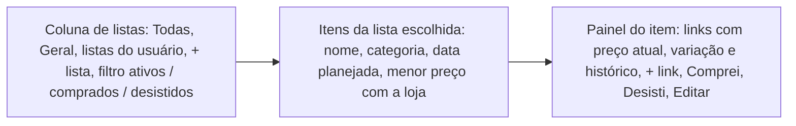
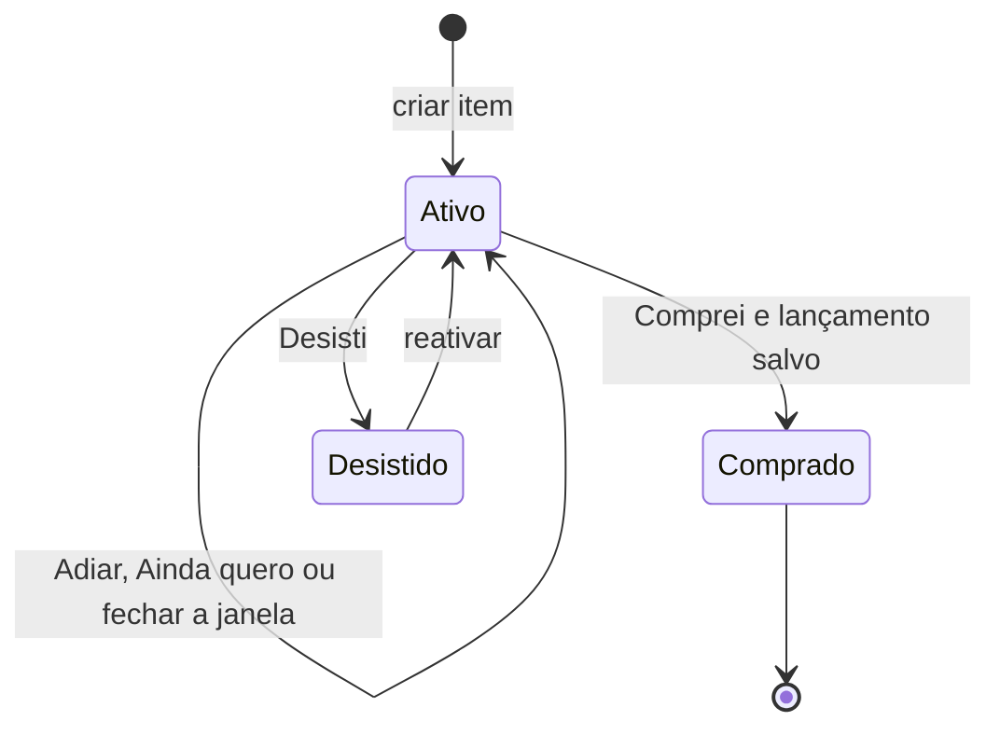
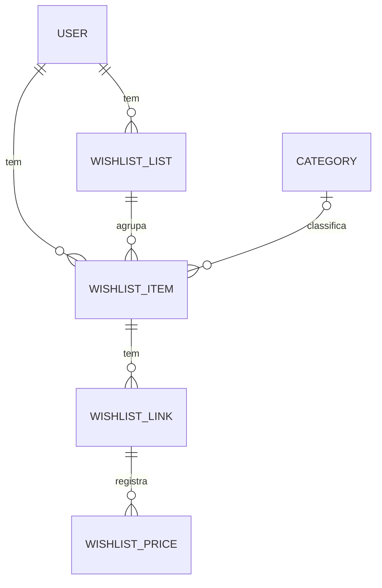
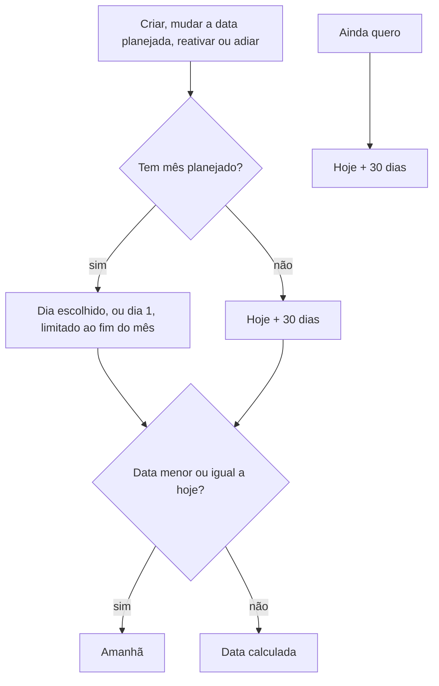
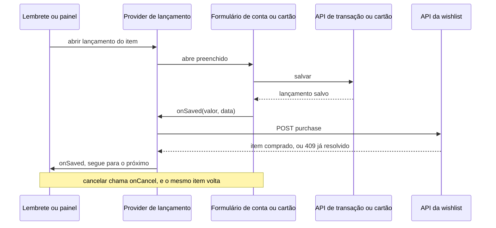

# Wishlist - Plan

## Goal Capsule

- **Objective:** O usuário guarda no fintrack tudo o que pretende comprar, de várias lojas, e o app traz cada item de volta na hora certa até ele comprar ou desistir. Ele deixa de depender de abas abertas, carrinhos e favoritos de cada loja. Esta entrega cobre a wishlist com preços registrados à mão.
- **Means:** um módulo novo na API guarda listas, itens, links e preços, e um módulo puro calcula a data do próximo lembrete e o menor preço (KTD1, KTD2). O web reaproveita a fila de lembretes e os formulários de lançamento, que um provider no layout abre de qualquer página (KTD5, KTD6, KTD7).
- **Authority:** os requisitos (R) decidem o comportamento do produto, e as Key Decisions registram por quê. Os KTDs decidem o mecanismo, dentro dos limites dos R que citam. As unidades não sobrescrevem nenhum dos dois, e AEs e Flows só ilustram. O monitoramento de preço por IA e o vínculo com Metas não são escopo ativo e estão descritos em How This Work Fits Together.
- **Stop conditions:** pare e pergunte ao usuário se uma decisão marcada `session-settled` se mostrar inviável, ou se a migração não conseguir criar a lista Geral para os usuários existentes. Nunca rode reset nem `db push`, e nunca aceite um pedido de reset do Prisma, num banco que tenha dados. Esta worktree usa só o banco `fintrack_wishlist`.
- **Execution profile:** dois códigos, `api/` e `web/`, em duas fases: API em U1 a U6 e web em U7 a U10, com cenários ponta a ponta próprios em U8 a U10. U7 só tem tipos, serviço e comandos, exercitados pelos cenários seguintes. U2 é feita com testes antes do código.
- **Finisher:** `ce-work` implementa e verifica pelo Verification Contract. O `lfg` abre o PR, e o usuário revisa e integra.
- **Open blockers:** nenhum.

---

## Product Contract

### Summary

Uma página nova, Wishlist, organiza o que o usuário pretende comprar em listas por contexto. Cada item tem uma categoria de despesa, links de lojas com o histórico de preços registrado à mão e uma data planejada (um mês, com dia opcional). Todo item ativo tem um próximo lembrete, que aparece ao abrir o app até o usuário comprar, adiar ou desistir. "Comprei" abre o lançamento na conta ou no cartão já preenchido.

### Problem Frame

Hoje o usuário guarda o que pretende comprar em abas abertas, carrinhos e favoritos de cada loja. Como são muitas lojas, a lista fica espalhada e longa, e o item se perde: ele esquece que precisava comprar, e a compra passa batido. Nenhum desses lugares avisa na hora certa nem mostra o preço de uma loja ao lado do preço de outra. Quando ele finalmente compra, ainda lança o gasto à mão no fintrack, sem ligação com o que tinha planejado.

---

### Key Decisions

- **O item volta como lembrete ao abrir o app, no mesmo padrão dos lembretes de fatura, dívida e aporte.** O app não tem e-mail nem push, e o problema é esquecer, então o item precisa interromper o usuário. Governs R13, R16, R21. (session-settled: user-approved — chosen over destaque no Dashboard, gasto previsto do mês e só a lista organizada: os três dependem de o usuário ir olhar, e é isso que falha hoje)
- **Comprei marca o item como comprado e abre o lançamento do gasto já preenchido.** Governs R22, R23, R24. (session-settled: user-directed — chosen over só marcar como comprado e remover da lista: evita digitar o gasto duas vezes)
- **O item usa a árvore de categorias de despesa que já existe, e as listas agrupam por contexto.** Assim o lançamento já sai com a categoria certa. Governs R1, R5. (session-settled: user-approved — chosen over categorias próprias da wishlist e a lista como categoria)
- **Cada link de loja tem o próprio histórico de preços.** Na v2, a IA passa a registrar esses mesmos preços no lugar do usuário. Governs R9, R11, R12. (session-settled: user-approved — chosen over histórico com preço-alvo e só o preço atual)
- **Item sem data planejada é aceito, e o app pergunta de tempos em tempos se o usuário ainda o quer.** Governs R14, R19. (session-settled: user-directed — chosen over exigir data em todo item e aceitar sem lembrete: o item sem data é justamente o que se perde)
- **A data planejada é um mês, com dia opcional.** Governs R6, R13. (session-settled: user-directed — chosen over só o mês e dia exato: cobre quem só sabe o mês e quem já tem o dia)
- **Todo item ativo tem uma única data de próximo lembrete, e cada resposta move essa data ou encerra o item.** Fica um gatilho e uma janela só, e os itens sem data se espalham pelo mês em vez de chegarem juntos. Governs R13 a R21. (session-settled: user-approved — chosen over dois lembretes separados e uma revisão mensal da lista numa tela de triagem: duas regras fazendo quase a mesma coisa, ou uma tela nova fora do padrão do app)
- **Tudo entra na primeira versão, e a IA fica para a segunda.** (session-settled: user-directed — chosen over uma primeira versão menor)
- **O vínculo com Metas fica para depois.** (session-settled: user-directed — chosen over "Guardar para isso" na primeira versão: a mesma compra teria dois lembretes, o de aporte e o de compra)
- **O intervalo da pergunta para itens sem data é de 30 dias.** É um mês, o ritmo em que o app já trabalha. Governs R14, R19.
- **Todo item fica em exatamente uma lista, e a lista Geral não pode ser excluída.** O usuário adiciona rápido sem escolher lista, e excluir uma lista nunca deixa item sem lugar. Governs R2, R3.
- **Um lembrete cuja data já chegou no momento do cálculo começa no dia seguinte.** Quem acabou de criar, replanejar ou reativar um item não precisa ser lembrado dele na mesma hora. Governs R15.
- **A página Wishlist é mestre-detalhe numa tela só.** Listas, itens e o item selecionado ficam visíveis juntos, sem trocar de página. Governs R30, R31. (session-settled: user-directed — chosen over abas de lista com cards e uma página por item, como em Metas, e itens agrupados pelo mês planejado com o item numa janela: escolhido sobre esboços das três opções)
- **O lançamento vem com o menor preço atual, e o item comprado guarda o valor e a data do lançamento salvo.** O item registra o que foi pago na hora, sem acompanhar mudanças posteriores no lançamento. Governs R23, R33.

<!-- ce-section: work-relationships -->
### How This Work Fits Together

Este plano cobre a wishlist com preços registrados à mão. A lista abaixo é o entendimento atual das partes seguintes, e não um roadmap fechado.

- **Monitoramento de preço por IA (v2):** a IA acompanha os links e registra os preços no lugar do usuário.
  - Depends on: os links e o histórico de preços por link deste plano (R8 a R12).
  - Still to decide: de quanto em quanto tempo a IA consulta as lojas, e se avisa quando o preço cai.
- **Vínculo com Metas:** "Guardar para isso" cria uma Meta a partir de um item com preço e mês planejado.
  - Depends on: a data planejada e o menor preço atual deste plano (R6, R11).
  - Can proceed independently of: o monitoramento por IA.

---

### Requirements

**Listas**

- R1. O usuário cria, renomeia e exclui listas. Cada lista agrupa itens por contexto, como "Casa nova" ou "Presentes de Natal".
- R2. Todo usuário tem a lista Geral, que pode ser renomeada e não pode ser excluída. Um item criado sem escolher lista vai para ela.
- R3. Cada item fica em exatamente uma lista, e o usuário pode movê-lo para outra. Excluir uma lista move todos os itens dela para a Geral, inclusive os comprados e os desistidos.

**Itens**

- R4. Um item tem nome, lista, uma categoria de despesa opcional e uma data planejada opcional. Só o nome é obrigatório.
- R5. A categoria do item vem da árvore de despesas do usuário, com o mesmo seletor e as mesmas exclusões dos modais de lançamento (R17 e R18 do plano de Categorias).
- R6. A data planejada é um mês, com dia opcional. Um item sem mês também não tem dia.
- R7. O usuário edita e exclui um item. Excluir apaga os links e o histórico de preços do item, mas não o lançamento que ele gerou.

**Links e preços**

- R8. Um item tem zero ou mais links, cada um com o endereço da página do produto e o nome da loja. Abrir um link leva à página da loja em outra aba.
- R9. O usuário registra o preço atual de um link. Cada registro guarda o valor e a data do registro, e os registros anteriores ficam no histórico do link.
- R10. O usuário exclui um registro de preço errado.
- R11. O preço atual de um link é o do registro mais recente dele. O item mostra o menor preço atual entre os links, com a loja e a data desse registro. Um item sem nenhum registro não mostra preço.
- R12. Cada link mostra o histórico de preços e a variação do preço atual em relação ao primeiro registro.

**Lembretes**

- R13. Todo item ativo tem uma data de próximo lembrete. Com data planejada, é o dia escolhido ou, sem dia, o dia 1 do mês planejado.
- R14. Sem data planejada, o próximo lembrete fica 30 dias depois do momento em que é calculado.
- R15. O próximo lembrete é calculado ao criar o item, ao mudar a data planejada dele e ao reativá-lo, e não muda quando o usuário edita outros campos. Se a data calculada por R13 já chegou, o lembrete passa para o dia seguinte.
- R16. Ao abrir o app, cada item ativo cujo próximo lembrete chegou aparece numa janela "Lembrete de compra", um item por vez, do lembrete mais antigo para o mais novo. Essas janelas vêm depois das de fatura, dívida e aporte.
- R17. A janela mostra o nome, a lista, a categoria, a data planejada ou "sem data", o menor preço atual com a loja e a data do registro, e os links das lojas.
- R18. A janela oferece Comprei, Adiar e Desisti. Quando o item não tem data planejada, oferece também Ainda quero.
- R19. Ainda quero move o próximo lembrete para 30 dias depois da resposta.
- R20. Adiar pede um novo mês, já sugerindo o mês seguinte, com dia opcional. A nova data planejada recalcula o próximo lembrete por R13.
- R21. Fechar a janela sem responder adia a pergunta só até a próxima abertura do app, como nos outros lembretes.

**Compra**

- R22. Comprei, na janela ou no painel do item, pergunta se o gasto foi numa conta ou num cartão e abre o formulário de lançamento correspondente que já existe, de qualquer página.
- R23. O formulário vem preenchido com o nome do item, o menor preço atual (R11), a categoria do item e a data de hoje, e o usuário pode mudar qualquer campo. No cartão, ele escolhe as parcelas como já faz hoje.
- R24. O item vira comprado só quando o lançamento é salvo. Se o usuário cancelar, o item continua ativo e o próximo lembrete não muda.
- R33. O item comprado guarda o valor e a data do lançamento salvo. Editar ou excluir esse lançamento depois não muda o item.
- R25. Um item da wishlist não entra em nenhum total, previsão ou saldo do app. Só o lançamento salvo conta.

**Comprados e desistidos**

- R26. Desisti tira o item da lista ativa sem apagá-lo, e os links e o histórico de preços ficam preservados.
- R27. Cada lista tem um filtro que mostra os itens comprados, com valor pago e data, e os desistidos.
- R28. O usuário reativa um item desistido, e o próximo lembrete é calculado como ao salvar (R13 a R15).
- R29. Itens comprados e desistidos não geram lembrete.

**Página Wishlist**

- R30. Uma página nova, Wishlist, aparece na navegação do app. Numa tela só, ela mostra as listas numa coluna, os itens da lista escolhida no centro e o item selecionado num painel ao lado.
- R34. A coluna de listas tem também Todas, que junta os itens de todas as listas, e o filtro de ativos, comprados e desistidos (R27).
- R35. O painel do item mostra os links com o preço atual, a variação e o histórico de cada um, e as ações do item.
- R31. Na lista do centro, cada item ativo mostra o nome, a categoria, a data planejada ou "sem data", e o menor preço atual com a loja. Os itens com data vêm primeiro, do mais próximo para o mais distante, e os sem data vêm depois.
- R32. Cada item ativo oferece Comprei e Desisti também no painel, fora do lembrete.

---

### Key Flows

- F1. Guardar um item
  - **Trigger:** o usuário vê numa loja algo que pretende comprar.
  - **Steps:** na Wishlist, cria o item com nome, lista, categoria e mês planejado. Adiciona o link da loja e registra o preço atual. Depois adiciona o link de outra loja com o preço dela.
  - **Outcome:** o item aparece na lista com o menor preço entre as duas lojas.
  - **Covered by:** R1 a R4, R6, R8, R9, R11, R30, R31, R35
- F2. Comprar pelo lembrete
  - **Trigger:** o usuário abre o app no dia do próximo lembrete de um item.
  - **Steps:** depois dos lembretes de fatura, dívida e aporte, aparece o lembrete de compra. O usuário confere o menor preço, abre o link da loja e compra. De volta ao app, toca em Comprei, escolhe o cartão, ajusta o valor e as parcelas no formulário preenchido e salva.
  - **Outcome:** a compra está lançada no cartão, e o item aparece como comprado no filtro da lista.
  - **Covered by:** R16 a R18, R22 a R24, R27, R33
- F3. Item sem data
  - **Trigger:** o próximo lembrete de um item sem data chega, 30 dias depois de ele ser criado.
  - **Steps:** a janela pergunta se o usuário ainda quer o item. Ele responde Ainda quero, Adiar para um mês, Desisti ou Comprei.
  - **Outcome:** o item volta em 30 dias, passa a ter data planejada, sai da lista ativa ou vira comprado.
  - **Covered by:** R14, R18 a R20, R26
- F4. Atualizar um preço
  - **Trigger:** o usuário confere o preço de um item numa loja.
  - **Steps:** registra o novo preço no link daquela loja.
  - **Outcome:** o link mostra o novo preço e a variação desde o primeiro registro, e o item atualiza o menor preço.
  - **Covered by:** R9, R11, R12

---

### Acceptance Examples

- AE1. **Covers R13, R16.** **Given** a "Air fryer" tem mês planejado dezembro, sem dia, e há um lembrete de fatura pendente. **When** o usuário abre o app em 01/12. **Then** o lembrete de fatura aparece primeiro, e depois o lembrete de compra da "Air fryer".
- AE2. **Covers R13, R16.** **Given** um item tem data planejada 15/12. **When** o usuário abre o app em 10/12 e depois só em 17/12. **Then** em 10/12 não aparece lembrete, e em 17/12 aparece.
- AE3. **Covers R14, R15, R19.** **Given** um item sem data foi criado em 02/10. **When** o usuário abre o app em 01/11 e responde Ainda quero. **Then** o lembrete aparece em 01/11, e o próximo fica para 01/12.
- AE4. **Covers R15.** **Given** hoje é 20/11. **When** o usuário cria um item com mês planejado novembro, sem dia. **Then** nenhum lembrete aparece hoje, e o lembrete aparece a partir de 21/11.
- AE5. **Covers R20.** **Given** o lembrete de um item planejado para novembro está aberto. **When** o usuário escolhe Adiar e aceita a sugestão sem informar dia. **Then** a data planejada passa a ser dezembro, e o próximo lembrete fica para 01/12.
- AE6. **Covers R21.** **Given** o lembrete de compra de um item está aberto. **When** o usuário fecha a janela sem responder e continua usando o app. **Then** o lembrete não volta nessa sessão e aparece de novo na próxima abertura do app.
- AE7. **Covers R11, R12.** **Given** o link da Amazon tem os registros R$ 599 em 01/10 e R$ 549 em 20/10, e o link da Magalu tem R$ 529 em 15/10. **When** o usuário abre o item. **Then** o item mostra R$ 529 na Magalu, de 15/10, e a Amazon mostra a variação de −R$ 50 desde o primeiro registro.
- AE8. **Covers R10, R11.** **Given** o item do AE7. **When** o usuário exclui o registro da Magalu, que estava errado. **Then** a Magalu fica sem preço, e o item passa a mostrar R$ 549 na Amazon.
- AE9. **Covers R22, R23, R24, R33.** **Given** a "Air fryer" tem menor preço atual de R$ 529 e uma categoria de despesa. **When** o usuário toca em Comprei e escolhe um cartão. **Then** o formulário de compra no cartão abre com "Air fryer", R$ 529, a categoria do item e a data de hoje. Se ele muda o valor para R$ 499, escolhe 3x e salva, o item vira comprado com R$ 499 e a data de hoje. Se ele cancela, o item continua ativo.
- AE10. **Covers R33.** **Given** um item comprado com R$ 499. **When** o usuário exclui depois a compra no cartão. **Then** o item continua comprado, com R$ 499.
- AE11. **Covers R3.** **Given** a lista "Natal" tem dois itens ativos e um comprado. **When** o usuário exclui a lista "Natal". **Then** os três itens passam para a Geral, cada um no mesmo estado.
- AE12. **Covers R15, R28.** **Given** hoje é 20/11, e um item desistido tem mês planejado setembro. **When** o usuário reativa o item. **Then** o item volta à lista ativa, e o lembrete aparece a partir de 21/11.
- AE13. **Covers R25.** **Given** a "Air fryer" está ativa, com R$ 529 e mês planejado novembro. **When** o usuário abre a página Categorias e o Dashboard em novembro. **Then** nenhum total, previsão ou saldo inclui a "Air fryer".

---

### Success Criteria

- Nenhum item ativo fica sem próximo lembrete. Todo item volta a aparecer até ser comprado ou descartado.
- O usuário compara o preço de uma loja com o de outra, e vê a variação de cada uma, sem abrir as lojas.

---

### Scope Boundaries

**Deferred for later**

- Monitoramento de preço por IA (v2).
- Busca automática de preço nas lojas, por qualquer meio.
- Preço-alvo com alerta.
- Vínculo com Metas ("Guardar para isso").
- Notificação por e-mail ou push.
- Marcar como comprado sem lançar o gasto, como num presente ou numa compra fora das contas do app. Até lá, o usuário usa Desisti ou exclui o item.
- Desfazer um "comprado".
- Item em mais de uma lista.
- Compartilhar listas.
- Revisão mensal da lista inteira numa tela de triagem.
- Itens planejados como gasto previsto do mês, conforme R25.

**Considerado e não construído**

- Ponto na navegação e faixa para lembretes de compra, como os de fatura e dívida. R16 pede só a janela. Muda se o usuário disser que perde lembretes depois de fechar a janela.
- Nova tentativa automática quando o lançamento é salvo mas a marcação de comprado falha. O erro aparece num aviso na hora, e o item continua ativo à vista. Muda se a falha acontecer na prática.
- Limite de quantos lembretes de compra aparecem por abertura do app. Fechar a janela já dispensa o resto da fila (KTD7). Muda se uma fila longa incomodar.

---

### Dependencies / Assumptions

- O app tem um único usuário por conta, e as listas não são compartilhadas.
- O formulário de lançamento em conta hoje só abre a partir do Dashboard, e R22 precisa dele em qualquer página. O lembrete de dívida já abre o pagamento de qualquer página, e esse é o precedente.

---

### Sources / Research

- `docs/plans/2026-10-11-2035-feat-metas-plan.md`: o lembrete de aporte e o status calculado da meta.
- `docs/plans/2026-10-17-1530-feat-categorias-plan.md`: a árvore de despesas e o seletor de categoria (R17, R18).
- `web/src/view/layouts/AppLayout.tsx:80-82`: a fila dos lembretes (fatura, depois dívida, depois aporte). As linhas 25-39 têm a navegação.
- `web/src/view/components/DebtReminders/useDebtRemindersController.ts:46-48`: "Depois" dispensa o lembrete só na sessão. Os lembretes de fatura e de aporte fazem o mesmo.
- `web/src/view/pages/Dashboard/index.tsx:27`: o modal de novo lançamento existe só no Dashboard.
- `web/src/view/components/CardEntryModal/index.tsx`: a compra no cartão já tem a aba "Parcelada".
- `api/prisma/schema.prisma`: nenhum modelo tem lista de compras, link, loja ou preço. `Transaction` já tem `goalId` e `debtId` (linhas 86 e 88), o precedente de um lançamento ligado ao registro que o originou.

---

## Planning Contract

**Product Contract preservation:** reestruturado, sem mudança de escopo. As duas Outstanding Questions foram resolvidas no lugar por KTD12 e KTD13, e a seção saiu do Product Contract. Scope Boundaries ganhou a lista "Considerado e não construído".

### Key Technical Decisions

- KTD1. **Quatro tabelas novas: lista, item, link e registro de preço.** O estado do item é um enum (ativo, comprado, desistido), e o valor e a data pagos ficam no próprio item. Datas de calendário usam `@db.Date` e dinheiro usa `Float`, como o resto do schema. A Geral é marcada por uma chave fixa, como as categorias padrão, porque o nome pode mudar (R2).
- KTD2. **As regras de data e de preço ficam num módulo puro, `wishlist-calculations.ts`.** Ele recebe "hoje" por parâmetro e usa o dia de São Paulo de `api/src/shared/calendar.ts`. "Chegou" quer dizer data menor ou igual a hoje. Um dia além do fim do mês cai no último dia, com `getDayInMonth`. Governs R11 a R15, R19, R20.
- KTD3. **O próximo lembrete fica guardado no item, e não é calculado na leitura.** O momento do cálculo (R14, R15) e o Ainda quero (R19) não dão para derivar depois. A API recalcula ao criar, ao mudar o mês ou o dia planejado (comparando os valores normalizados), ao reativar, ao adiar e no Ainda quero.
- KTD4. **A API decide quais lembretes chegaram.** `GET /wishlist/reminders` devolve os itens ativos com lembrete até hoje, ordenados por data, criação e id, como os lembretes de dívida. O web tira um retrato dessa lista uma vez por abertura. Governs R16, R29.
- KTD5. **Comprei marca o item por callback, e não por chave estrangeira no lançamento.** O formulário avisa o valor e a data salvos, e o web chama `POST /wishlist/items/:itemId/purchase`. O DTO de transação não aceita vínculo com outro registro, e uma chave estrangeira impediria excluir o lançamento, o que AE10 exige. O custo é que, se essa segunda chamada falhar, o gasto existe e o item continua ativo (ver Risks). A escolha não foi para bake-off porque a evidência do DTO e de AE10 decidiu. Governs R22, R24, R33.
- KTD6. **Um provider no layout, no formato de `PayDebtProvider`, abre o lançamento de qualquer página.** Ele pergunta conta ou cartão. Para conta, abre o formulário de despesa extraído do modal do Dashboard para um componente sem contexto. Para cartão, abre o `CardEntryModal` com valores iniciais, `onSaved` e só as abas Compra e Parcelada, sem a opção de compra já em andamento. Os valores iniciais entram como valores padrão do formulário na montagem, porque `Select` e `DatePickerInput` copiam o valor uma única vez. Governs R22, R23.
- KTD7. **A fila de compra roda depois da de aporte, que ganha um aviso de fim (`onDone`).** Fechar a janela dispensa o resto da fila de compra até a próxima abertura do app, como fazem as outras filas (R21). Enquanto o lançamento está aberto, a janela some. Cancelar traz o mesmo item de volta, e salvar passa para o próximo. Governs R16, R21, R24.
- KTD8. **Cada ação do item é um endpoint próprio: comprar, desistir, reativar, ainda quero e adiar.** Cada um só aceita o estado de origem certo e responde 409 nos outros. Uma entrada inválida para o estado certo, como Ainda quero num item com data planejada, responde 400. O web trata 409 como "já resolvido" e segue a fila, como no lembrete de aporte. Isso também impede que dois Comprei sobrescrevam o valor pago. Governs R18 a R20, R24, R26, R28.
- KTD9. **A API aceita só categoria do próprio usuário, de despesa e fora das de sistema.** Excluir uma categoria leva os itens da wishlist junto, no mesmo `moveItemsAndDelete` que move lançamentos e compras, com `onDelete: SetNull` como reserva. Governs R5.
- KTD10. **A Geral nasce no cadastro, no seed e numa migração que a cria para os usuários existentes.** Excluir uma lista move todos os itens para a Geral numa transação, e excluir a Geral é recusado. Governs R2, R3.
- KTD11. **A página lê tudo de uma vez.** `GET /wishlist/items` devolve os itens do usuário com links, histórico, preço atual por link, variação e menor preço já calculados, e o web filtra por lista e estado. O app tem um único usuário e poucos itens. Governs R11, R12, R27, R31, R34.
- KTD12. **O nome da loja vem preenchido com o domínio do endereço, sem `www.`, e o usuário pode trocar.** Os links aceitam só `http` e `https` e abrem em outra aba com `rel="noopener noreferrer"`. Governs R8.
- KTD13. **O histórico de preços aparece como lista de data e valor no painel, no formato de `GoalHistory`, sem gráfico.** Governs R12, R35.
- KTD14. **A API grava a data de hoje (São Paulo) em cada registro de preço.** Registros do mesmo dia são desempatados pelo momento da criação. A variação é o preço atual menos o primeiro registro e some quando o link tem um registro só. Governs R9, R12.
- KTD15. **A página fica em `/wishlist`, numa grade de três colunas a partir de `lg` (listas, itens e painel).** Abaixo disso, as colunas ficam empilhadas, e selecionar um item rola a tela até o painel. A lista, o item e o filtro escolhidos ficam no estado do controller, e não na URL. Governs R30, R31, R34, R35. (session-settled: user-directed — chosen over abas de lista com cards e página por item, e itens agrupados por mês com o item numa janela: escolhido sobre esboços das três opções)
- KTD16. **O mês planejado usa o campo nativo de mês com um dia opcional, porque o app não tem seletor de mês.** Governs R6, R20.
- KTD17. **Os testes ponta a ponta dos lembretes interceptam `GET **/wishlist/reminders` e devolvem itens reais criados pela API.** R15 impede criar pela API um item que já chegou, e as regras de data ficam cobertas no Jest. Governs R16 a R21.

### High-Level Technical Design

O ciclo de vida do item (ativo, comprado, desistido) está no diagrama de estados de Requirements.

Modelo de dados (KTD1):

Cálculo do próximo lembrete (KTD2, KTD3):

Comprei, pelo lembrete ou pelo painel (KTD5, KTD6, KTD7):

### Assumptions

Apostas que ninguém validou com o usuário. A revisão do PR deve olhar estas primeiro.

- No cartão, Comprei oferece só as abas Compra e Parcelada. Recorrente e estorno ficam fora.
- Numa compra parcelada, o valor pago guardado é o total da compra, e a data é a data da compra.
- Adiar sugere o mês seguinte ao maior entre o mês planejado e o mês atual.
- Um dia planejado além do fim do mês, como 31 em fevereiro, gera lembrete no último dia do mês.
- Um mês planejado no passado é aceito, e o lembrete segue R15.
- Se o usuário não tem conta nem cartão, Comprei mostra um aviso e não abre formulário.
- O usuário edita e exclui um link, e excluir o link apaga o histórico dele.
- Nomes de lista podem se repetir.
- Uma categoria do item que não aparece mais no seletor de despesa chega vazia no formulário de conta, e o usuário escolhe outra.
- Um item comprado continua editável e pode ser excluído, mas não volta a ficar ativo.
- Um registro de preço não é editado, só excluído (R10).

### Sequencing

A API vem primeiro: U1 cria o modelo, U2 as regras puras, U3 e U4 os endpoints, U5 a exclusão de categoria e U6 o seed. No web, U7 cria a camada de dados e os comandos do Cypress, U8 o lançamento de qualquer página, U9 a página e U10 a fila de lembretes. U8 vem antes de U9 e U10 porque os dois chamam o provider, e U10 vem depois de U9 porque os cenários dela conferem os filtros da página.

### System-Wide Impact

- **Layout:** `web/src/view/layouts/AppLayout.tsx` ganha o provider de lançamento, a quarta fila de lembretes e o item Wishlist na navegação. A fila de aporte passa a avisar quando termina.
- **Dashboard:** o modal de nova transação passa a usar o formulário extraído. Despesa e receita no Dashboard têm de continuar iguais.
- **Cartões:** `CardEntryModal` ganha propriedades opcionais. Sem elas, o comportamento atual não muda.
- **Categorias:** excluir uma categoria move também os itens da wishlist.
- **Cadastro e seed:** todo usuário novo recebe a Geral.

### Risks

- **O lançamento salva e a marcação de comprado falha.** O gasto fica registrado e o item continua ativo. O usuário vê um aviso de erro na hora. Se clicar em Comprei de novo, cria um segundo lançamento. Fica aceito na v1, conforme Scope Boundaries.
- **Regressão no Dashboard pela extração do formulário.** O cenário de regressão de U8 cobre despesa e receita no Dashboard.
- **A fila de lembretes travar.** Se a busca de lembretes de aporte ou de compra falhar, a fila seguinte não pode ficar presa. Erro na busca conta como fila terminada (U10).
- **Fuso horário.** Datas comparadas pelo relógio do navegador entre 21h e meia-noite já estariam no dia seguinte em UTC. Toda regra de "hoje" fica na API, com o dia de São Paulo (KTD2).

### Sources / Research

- `api/src/modules/debts/` e `api/src/modules/goals/`: formato de módulo, DTOs, validação de dono, `*-calculations.ts` com spec e o DTO de resolução de lembrete.
- `api/src/shared/calendar.ts` e `addDays` em `api/src/modules/cards/card-calculations.ts`: dia de São Paulo e soma de dias.
- `api/prisma/migrations/20261014030000_create_debts/migration.sql`: tabela nova com backfill por usuário (`WHERE NOT EXISTS`).
- `api/src/database/repositories/categories.repositories.ts` (`moveItemsAndDelete`): onde os itens entram na exclusão de categoria.
- `web/src/view/components/PayDebtModal/PayDebtContext.tsx`: provider com `onPaid` e `onCancel`, modelo do provider de lançamento.
- `web/src/view/components/DebtReminders/useDebtRemindersController.ts`: fila com retrato único, `isDismissed` e `onDone`.
- `web/src/view/components/ContributionReminders/useContributionRemindersController.ts`: tratamento de 409 como "já resolvido".
- `web/src/view/pages/Dashboard/modals/NewTransactionModal/` e `web/src/view/components/CardEntryModal/`: formulários de lançamento.
- `web/src/app/utils/categories.ts` (`getCategoryOptions`): seletor de despesa sem categorias de sistema.
- `web/src/view/pages/Categories/index.tsx`: coluna fixa à esquerda com conteúdo fluido, base da grade de três colunas.

---

## Implementation Units

| U-ID | Unidade | Arquivos principais | Depende de |
|---|---|---|---|
| U1 | Modelo de dados e lista Geral | `api/prisma/schema.prisma`, migração, `auth.service.ts` | — |
| U2 | Regras puras de data e preço | `api/src/modules/wishlist/wishlist-calculations.ts` | U1 |
| U3 | API de listas, itens, links e preços | `api/src/modules/wishlist/`, `wishlist.repositories.ts` | U1, U2 |
| U4 | API das ações do item e dos lembretes | `api/src/modules/wishlist/` | U3 |
| U5 | Exclusão de categoria leva os itens | `categories.repositories.ts` | U1 |
| U6 | Seed de desenvolvimento | `api/prisma/seed.ts` | U4 |
| U7 | Camada de dados do web e comandos do Cypress | `web/src/app/`, `web/cypress/support/commands.ts` | U4 |
| U8 | Lançamento de qualquer página | `PurchaseLaunch/`, `TransactionFormModal/`, `CardEntryModal/` | U7 |
| U9 | Página Wishlist | `web/src/view/pages/Wishlist/` | U7, U8 |
| U10 | Fila de lembretes de compra | `WishlistReminders/`, `AppLayout.tsx` | U7, U8, U9 |

### U1. Modelo de dados e lista Geral

**Goal:** criar as tabelas da wishlist e garantir que todo usuário, novo ou existente, tenha a Geral.

**Requirements:** R1 a R4, R6, R8, R9; KTD1, KTD10.

**Dependencies:** nenhuma.

**Files:**
- `api/prisma/schema.prisma`
- `api/prisma/migrations/<timestamp>_create_wishlist/migration.sql`
- `api/src/modules/wishlist/wishlist.constants.ts`
- `api/src/modules/auth/auth.service.ts`
- `api/src/modules/auth/auth.service.spec.ts`
- `api/prisma/seed.ts`

**Approach:**
1. Modelos: lista (dono, nome, chave opcional, única por dono), item (dono, lista, categoria opcional, nome, mês planejado, dia planejado, próximo lembrete, estado, valor pago, data paga, criação), link (item, endereço, nome da loja, criação) e registro de preço (link, valor, dia do registro, criação).
2. Relações: item com lista em `Restrict`, porque a exclusão da lista move os itens antes (KTD10). Item com categoria em `SetNull`. Link e registro em `Cascade`. Item e lista em `Cascade` com o usuário.
3. A chave e o nome padrão da Geral ficam em `wishlist.constants.ts` e são usados pelo cadastro, pelo seed e pelo SQL da migração.
4. Gerar a migração com `npx prisma migrate dev --create-only --name create_wishlist`, acrescentar no fim do `migration.sql` o backfill escrito à mão que cria a Geral para cada usuário sem ela, e só então aplicar. Aplicar antes de acrescentar o backfill faz o Prisma pedir reset do banco.
5. O cadastro cria a Geral junto com o usuário, no mesmo create aninhado das categorias. O seed faz o mesmo no usuário de desenvolvimento.

**Patterns to follow:** backfill de `20261014030000_create_debts`; chave única de `Category`; create aninhado de `auth.service.ts`.

**Test scenarios:**
- O cadastro cria o usuário com uma lista com a chave da Geral e o nome padrão.
- O cadastro não cria nenhuma outra lista.

**Verification:** a migração aplica num banco com usuários existentes, e cada usuário fica com exatamente uma Geral (gate Migração).

### U2. Regras puras de data e preço

**Goal:** concentrar num módulo puro as regras de próximo lembrete, menor preço e variação.

**Requirements:** R11 a R15, R19, R20; KTD2, KTD3, KTD14; AE2 a AE5, AE7, AE8, AE12.

**Dependencies:** U1.

**Files:**
- `api/src/modules/wishlist/wishlist-calculations.ts`
- `api/src/modules/wishlist/wishlist-calculations.spec.ts`

**Approach:**
1. Uma função calcula o próximo lembrete a partir do mês e do dia planejados e de "hoje" (R13 a R15).
2. Uma função calcula o Ainda quero, hoje mais 30 dias (R19).
3. Uma função diz se a data planejada mudou, comparando mês e dia normalizados (KTD3).
4. Uma função calcula, por link, o preço atual e a variação, e, por item, o menor preço com a loja e a data (R11, R12, KTD14).
5. O módulo não importa Prisma nem Nest.

**Execution note:** escrever os testes antes do código. As regras de data são a parte mais fácil de errar e não têm interface para conferir à mão.

**Patterns to follow:** `api/src/modules/goals/goal-calculations.ts` e o spec dele, com fixtures de dia.

**Test scenarios:**
- Covers AE2. Data planejada 15/12, hoje 10/12: lembrete em 15/12. Com hoje 17/12, o item já está vencido.
- Covers AE3. Item sem data criado em 02/10: lembrete em 01/11. Ainda quero em 01/11 leva para 01/12.
- Covers AE4. Hoje 20/11, mês planejado novembro sem dia: lembrete em 21/11.
- Covers AE5. Hoje 01/11, novo mês planejado dezembro sem dia: lembrete em 01/12.
- Covers AE12. Hoje 20/11, item com mês planejado setembro reativado: lembrete em 21/11.
- Mês planejado fevereiro de 2027 com dia 31: lembrete em 28/02/2027. Fevereiro de 2028 com dia 31: lembrete em 29/02/2028.
- Data planejada igual a hoje: lembrete amanhã.
- Hoje 31/12/2026, mês planejado dezembro sem dia: lembrete em 01/01/2027.
- Mesmo mês e dia, vindos de entradas com formatos diferentes: a função diz que a data não mudou.
- Covers AE7. Amazon com R$ 599 em 01/10 e R$ 549 em 20/10, e Magalu com R$ 529 em 15/10: menor preço R$ 529 na Magalu, de 15/10, e variação da Amazon de −R$ 50.
- Covers AE8. Sem o registro da Magalu: a Magalu fica sem preço, e o menor preço é R$ 549 na Amazon.
- Dois registros no mesmo dia: o preço atual é o criado por último.
- Link com um registro só: sem variação.
- Item sem nenhum registro: sem menor preço.

**Verification:** todos os cenários passam no Jest, e o módulo não depende de banco.

### U3. API de listas, itens, links e preços

**Goal:** expor a criação, a leitura, a edição e a exclusão de listas, itens, links e registros de preço, com as validações de dono e de entrada.

**Requirements:** R1 a R12, R25, R27, R31, R34; KTD9 a KTD12, KTD14; AE11.

**Dependencies:** U1, U2.

**Files:**
- `api/src/modules/wishlist/wishlist.module.ts`
- `api/src/modules/wishlist/wishlist.controller.ts`
- `api/src/modules/wishlist/wishlist.service.ts`
- `api/src/modules/wishlist/validate-wishlist-list-ownership.service.ts`
- `api/src/modules/wishlist/validate-wishlist-item-ownership.service.ts`
- `api/src/modules/wishlist/dto/*.dto.ts`
- `api/src/database/repositories/wishlist.repositories.ts`
- `api/src/database/database.module.ts`
- `api/src/app.module.ts`
- `api/src/modules/wishlist/wishlist.service.spec.ts`
- `api/src/modules/wishlist/wishlist.controller.spec.ts`

**Approach:**
1. Listas: listar, criar, renomear e excluir. A exclusão move os itens para a Geral numa transação, e a Geral recusa a exclusão (KTD10).
2. Itens: listar todos com links e preços calculados por U2 (KTD11), criar, editar e excluir. Sem lista, o item vai para a Geral (R2).
3. Ao criar, e ao editar com data planejada diferente, o próximo lembrete é recalculado por U2 (KTD3).
4. Links: criar, editar e excluir dentro de um item. Registros de preço: criar com a data de hoje (KTD14) e excluir.
5. Validações: dia sem mês é recusado (R6), categoria segue KTD9, endereço segue KTD12, preço é positivo com até duas casas e nome não pode ser vazio.
6. O dono de links e registros é conferido pelo item, e o do item pela lista ou pelo próprio item.
7. Rotas fixas, como `reminders`, ficam declaradas antes das rotas com id, como no controller de categorias.

**Patterns to follow:** `api/src/modules/debts/` (controller, service, DTOs, validação de dono); `debts.repositories.ts` (tipos de payload e `$transaction`); `borrowers.service.spec.ts` (repositórios falsos e isolamento entre usuários).

**Test scenarios:**
- Um usuário não lê, não edita e não exclui lista, item, link nem registro de outro usuário: a API responde 404.
- Criar item sem lista coloca o item na Geral.
- Criar item com dia e sem mês: 400.
- Criar item com categoria de receita, de sistema ou de outro usuário: recusado.
- Covers AE11. Excluir a lista "Natal" com dois itens ativos e um comprado: os três vão para a Geral, cada um no mesmo estado, e a lista some.
- Excluir a Geral: recusado. Renomear a Geral: aceito.
- Editar só o nome de um item cujo lembrete foi adiado por Ainda quero: o próximo lembrete não muda.
- Editar o mês planejado: o próximo lembrete é recalculado.
- Excluir item: links e registros somem.
- Link com endereço `javascript:` ou sem protocolo: 400.
- Registrar preço grava a data de hoje. Excluir o registro mais recente faz o anterior voltar a ser o preço atual.
- A listagem de itens traz menor preço, loja, data e variação por link.
- Validação de entrada com `ValidationPipe` para cada DTO: campos obrigatórios, tipos e limites.

**Verification:** os specs passam, e a API sobe com o módulo registrado.

### U4. API das ações do item e dos lembretes

**Goal:** expor os lembretes que chegaram e as ações comprar, desistir, reativar, ainda quero e adiar.

**Requirements:** R14 a R20, R24, R26, R28, R29, R33; KTD4, KTD5, KTD8; AE3, AE5, AE10, AE12.

**Dependencies:** U3.

**Files:**
- `api/src/modules/wishlist/wishlist.controller.ts`
- `api/src/modules/wishlist/wishlist.service.ts`
- `api/src/modules/wishlist/dto/*.dto.ts`
- `api/src/modules/wishlist/wishlist.service.spec.ts`

**Approach:**
1. `GET /wishlist/reminders`, conforme KTD4, com a mesma visão de item da listagem, mais o nome da lista.
2. `purchase` recebe valor pago e data, normaliza a data para o dia de São Paulo, confere a janela de datas com `isWithinDateWindow` e grava o item como comprado (R33).
3. `give-up` só a partir de ativo. `reactivate` só a partir de desistido, e recalcula o lembrete (R28).
4. `keep` só em item ativo sem data planejada (R18, R19). `postpone` recebe o novo mês e o dia opcional e recalcula (R20).
5. Toda ação com o item fora do estado de origem responde 409, e uma entrada inválida responde 400 (KTD8).

**Patterns to follow:** `api/src/modules/goals/dto/resolve-reminder.dto.ts` e `DebtsService.findReminders`.

**Test scenarios:**
- Os lembretes trazem só itens ativos com lembrete até hoje, ordenados por data e depois por criação. Comprados e desistidos não aparecem (R29).
- Comprar grava o valor e a data do dia de São Paulo. Uma data às 23h de Brasília continua no mesmo dia.
- Comprar um item já comprado: 409, e o valor pago não muda.
- Comprar com data fora da janela permitida: 400.
- Covers AE10. Comprar e depois excluir a transação pela API de transações: o item continua comprado, com o mesmo valor.
- Desistir de item ativo: o item fica desistido. Desistir de item desistido: 409.
- Covers AE12. Reativar item desistido com mês planejado no passado: o item fica ativo, com lembrete amanhã. Reativar item comprado: 409.
- Covers AE3. Ainda quero em item sem data: lembrete daqui a 30 dias. Ainda quero em item com data: 400.
- Covers AE5. Adiar para dezembro sem dia: o mês planejado vira dezembro, e o lembrete vai para 01/12. Adiar com dia e sem mês: 400.

**Verification:** os specs passam, e os lembretes respondem com o dia de São Paulo.

### U5. Exclusão de categoria leva os itens da wishlist

**Goal:** garantir que excluir uma categoria leve os itens da wishlist para o mesmo destino dos lançamentos.

**Requirements:** R5; KTD9.

**Dependencies:** U1.

**Files:**
- `api/src/database/repositories/categories.repositories.ts`
- `api/src/modules/categories/categories.service.spec.ts`

**Approach:** incluir os itens da wishlist no `updateMany` de `moveItemsAndDelete`, na mesma transação que move lançamentos, compras e recorrentes.

**Patterns to follow:** o próprio `moveItemsAndDelete`.

**Test scenarios:**
- Excluir uma subcategoria própria com um item da wishlist: o item passa para o grupo dela.
- Excluir um grupo próprio com destino escolhido: os itens da wishlist do grupo e das subcategorias vão para o destino.

**Verification:** os specs de categorias passam, inclusive os que já existiam.

### U6. Seed de desenvolvimento

**Goal:** dar ao usuário de desenvolvimento uma wishlist que mostra cada estado e um lembrete na abertura.

**Requirements:** R1, R8, R9, R16, R26, R27.

**Dependencies:** U4.

**Files:**
- `api/prisma/seed.ts`

**Approach:** uma seção `// Wishlist` cria uma lista própria além da Geral, itens com dia, só com mês, sem data, comprado e desistido, links com vários registros de preço e um item com o próximo lembrete em hoje, gravado direto no banco.

**Patterns to follow:** as seções `// Debts` e `// Borrowers` do seed e os helpers de data do topo do arquivo.

**Test expectation:** none -- dados de desenvolvimento. A conferência é rodar o seed e abrir o app.

**Verification:** o seed roda sem erro, e ao entrar com o usuário de desenvolvimento aparece um lembrete de compra.

### U7. Camada de dados do web e comandos do Cypress

**Goal:** dar ao web os tipos, o serviço, os hooks e o formulário da wishlist, e ao Cypress os comandos que criam dados pela API.

**Requirements:** R1 a R12, R16, R20; KTD11, KTD12, KTD16.

**Dependencies:** U4.

**Files:**
- `web/src/app/entities/Wishlist.ts`
- `web/src/app/services/wishlistService.ts`
- `web/src/app/hooks/useWishlistLists.ts`
- `web/src/app/hooks/useWishlistItems.ts`
- `web/src/app/hooks/useWishlistReminders.ts`
- `web/src/app/utils/wishlistForm.ts`
- `web/cypress/support/commands.ts`

**Approach:**
1. Chaves de query `['wishlist', 'lists']`, `['wishlist', 'items']` e `['wishlist', 'reminders']`. Invalidar `['wishlist']` atualiza as três.
2. `wishlistForm.ts` guarda os schemas zod e os conversores dos formulários de lista, item, link e preço. Também guarda o domínio como nome sugerido da loja (KTD12) e a sugestão do Adiar (Assumptions).
3. Os comandos do Cypress criam lista, item, link e preço pela API e devolvem o id, como `cy.createDebt`.

**Patterns to follow:** `debtsService.ts`, `useDebts.ts`, `useDebtReminders.ts`, `debtForm.ts` e os comandos de `web/cypress/support/commands.ts`.

**Test expectation:** none -- tipos, serviço e comandos sem comportamento próprio. Os cenários de U8 a U10 exercitam esta camada.

**Verification:** `npm run build` em `web/` passa.

### U8. Lançamento de qualquer página

**Goal:** permitir que o Comprei abra o lançamento de despesa em conta ou de compra no cartão, já preenchido, em qualquer página, e marque o item como comprado só quando o lançamento for salvo.

**Requirements:** R22 a R25, R33; KTD5, KTD6; AE9, AE10.

**Dependencies:** U7.

**Files:**
- `web/src/view/components/TransactionFormModal/index.tsx`
- `web/src/view/components/TransactionFormModal/useTransactionFormModalController.ts`
- `web/src/view/pages/Dashboard/modals/NewTransactionModal/index.tsx`
- `web/src/view/pages/Dashboard/modals/NewTransactionModal/useTransactionModalController.ts`
- `web/src/view/components/CardEntryModal/index.tsx`
- `web/src/view/components/CardEntryModal/useCardEntryModalController.ts`
- `web/src/view/components/PurchaseLaunch/PurchaseLaunchContext.tsx`
- `web/src/view/components/PurchaseLaunch/usePurchaseLaunch.ts`
- `web/src/view/components/PurchaseLaunch/PurchaseKindModal.tsx`
- `web/src/view/layouts/AppLayout.tsx`
- `web/cypress/e2e/wishlist.cy.ts`

**Approach:**
1. Extrair o formulário de `NewTransactionModal` para `TransactionFormModal`, sem contexto, com tipo, valores iniciais, `onSaved` e `onClose`. O modal do Dashboard vira um invólucro que lê o contexto do Dashboard e mantém o comportamento atual.
2. `CardEntryModal` ganha valores iniciais, `onSaved`, uma lista de abas permitidas e a opção de esconder a compra já em andamento, todos opcionais. `onSaved` dispara logo depois de salvar e antes da tela de limite excedido.
3. O provider monta a escolha entre conta e cartão (mostrando só o que o usuário tem), o formulário escolhido e a chamada de compra da wishlist (KTD5, KTD6). Ele chama a compra assim que o formulário avisa que salvou, mas só avisa quem abriu (lembrete ou painel) quando o formulário fecha, para a próxima janela não abrir por cima da tela de limite excedido.
4. Valores iniciais: nome do item, menor preço (vazio sem preço), categoria do item se ela aparecer no seletor de despesa, e a data de hoje. Tudo entra na montagem do formulário.
5. Depois da compra, o provider invalida `['wishlist']` e as queries de dinheiro (`invalidateMoneyQueries`). Uma resposta 409 conta como já resolvido.
6. O provider fica em `AppLayout.tsx`, ao lado de `PayDebtProvider`.

**Patterns to follow:** `PayDebtContext.tsx` e `usePayDebt.ts`; os `defaultValues` de `CardEntryModal`.

**Test scenarios:** (em `web/cypress/e2e/wishlist.cy.ts`; os cenários do Comprei dependem do painel e ficam em U9)
- Regressão: nova despesa e nova receita no Dashboard abrem, salvam e aparecem na lista como antes.

**Verification:** o cenário de regressão passa, `cards.cy.ts` continua passando, e `npm run build` em `web/` passa.

### U9. Página Wishlist

**Goal:** entregar a página mestre-detalhe com listas, itens, painel do item, filtros e as ações do item.

**Requirements:** R1 a R12, R25 a R32, R34, R35; KTD11 a KTD13, KTD15, KTD16; F1, F4; AE7, AE8, AE11, AE13.

**Dependencies:** U7, U8.

**Files:**
- `web/src/view/pages/Wishlist/index.tsx`
- `web/src/view/pages/Wishlist/useWishlistController.ts`
- `web/src/view/pages/Wishlist/components/ListsColumn.tsx`
- `web/src/view/pages/Wishlist/components/ItemsList.tsx`
- `web/src/view/pages/Wishlist/components/ItemPanel.tsx`
- `web/src/view/pages/Wishlist/components/PriceHistory.tsx`
- `web/src/view/pages/Wishlist/modals/ListModal/`
- `web/src/view/pages/Wishlist/modals/ItemModal/`
- `web/src/view/pages/Wishlist/modals/LinkModal/`
- `web/src/view/pages/Wishlist/modals/PriceModal/`
- `web/src/Router/index.tsx`
- `web/src/view/layouts/AppLayout.tsx`
- `web/cypress/e2e/wishlist.cy.ts`

**Approach:**
1. Rota `/wishlist` e item "Wishlist" na navegação.
2. A coluna de listas tem Todas, Geral e as listas do usuário, a ação de criar lista e o filtro de ativos, comprados e desistidos (R34). Renomear e excluir ficam no menu de cada lista, e a Geral não tem excluir.
3. A lista do centro segue a ordem e os campos de R31. Em Comprados, cada linha mostra o valor pago e a data no lugar do menor preço, da compra mais recente para a mais antiga. Em Todas, cada linha mostra também o nome da lista. Os itens são botões com estado de selecionado, e selecionar um abre o painel.
4. O painel mostra os links com preço atual, variação e histórico (KTD13). As ações dependem do estado: ativo tem Comprei (U8), Desisti, Editar e Excluir. Desistido tem Reativar, Editar e Excluir. Comprado tem Editar e Excluir.
5. O formulário de item usa o seletor de categoria de despesa e o campo de mês com dia opcional (KTD16). O de link preenche o nome da loja pelo domínio (KTD12).
6. Seleção que deixa de existir, por exclusão ou troca de filtro, limpa o painel.
7. Estados: sem item selecionado, o painel pede para escolher um item. Uma lista ou um filtro vazio mostra uma mensagem própria, e a lista vazia oferece criar item. Enquanto carrega, a página mostra um esqueleto, como Categories. O formulário de novo item já vem com a lista selecionada, ou com a Geral quando a seleção é Todas.

**Patterns to follow:** `web/src/view/pages/Debts/` (controller, modais com `open` e `onClose`, abas em pílula); `Categories/index.tsx` (grade com coluna fixa); `GoalHistory.tsx` (lista de histórico); `ConfirmDeleteModal`.

**Test scenarios:** (em `web/cypress/e2e/wishlist.cy.ts`)
- Covers F1. Criar a lista "Casa nova" e, nela, um item com categoria e mês planejado. Adicionar um link de `https://www.magazineluiza.com.br/...` mostra "magazineluiza.com.br" como loja sugerida. Registrar R$ 529, depois outro link com R$ 549: o item mostra R$ 529 e a loja.
- Item criado sem escolher lista aparece na Geral.
- Covers AE7. Com registros criados pela API no mesmo dia, nesta ordem: Amazon R$ 599, Amazon R$ 549 e Magalu R$ 529. O painel mostra R$ 529 na Magalu como menor preço, a variação de −R$ 50 na Amazon e o histórico do link. As datas do AE7 ficam cobertas no Jest (U2), porque a API sempre grava a data de hoje (KTD14).
- Covers AE8. Excluir o registro da Magalu muda o menor preço do item para R$ 549 na Amazon.
- Covers AE11. Excluir a lista "Natal" com dois itens ativos e um comprado: os três aparecem na Geral, cada um no filtro do seu estado. A Geral não oferece excluir.
- Desisti tira o item de Ativos, e ele aparece em Desistidos com os links. Reativar devolve o item a Ativos.
- Itens com data aparecem antes dos sem data, do mais próximo para o mais distante.
- Todas junta os itens de todas as listas.
- Covers AE13. Criar um item com R$ 529 não muda o saldo do Dashboard nem o total de Categorias do mês.
- Covers AE9. Item "Air fryer" com R$ 529 e categoria. Comprei no painel, depois Cartão: o formulário abre com "Air fryer", R$ 529, a categoria e a data de hoje. Mudando para R$ 499, Parcelada 3x, e salvando: o item aparece em Comprados com R$ 499 e a data de hoje, e a compra aparece no cartão.
- Comprei, depois Conta: o formulário de despesa abre preenchido. Cancelando: o item continua ativo.
- Item sem preço: o valor do formulário vem vazio.
- Usuário sem conta e sem cartão: Comprei mostra o aviso e não abre formulário.
- Compra que estoura o limite do cartão: aparece a tela de limite excedido, e o item já está comprado.
- Covers AE10. Excluir a compra no cartão depois: o item continua comprado, com R$ 499.

**Verification:** os cenários passam, e a página funciona sem lista própria, sem itens e sem links (estados vazios).

### U10. Fila de lembretes de compra

**Goal:** mostrar ao abrir o app, depois dos outros lembretes, uma janela por item vencido, com as ações de R18.

**Requirements:** R13 a R21, R24; KTD4, KTD7, KTD8, KTD17; F2, F3; AE1, AE5, AE6.

**Dependencies:** U7, U8, U9.

**Files:**
- `web/src/view/components/WishlistReminders/index.tsx`
- `web/src/view/components/WishlistReminders/useWishlistRemindersController.ts`
- `web/src/view/components/WishlistReminders/PostponeForm.tsx`
- `web/src/view/components/ContributionReminders/index.tsx`
- `web/src/view/components/ContributionReminders/useContributionRemindersController.ts`
- `web/src/view/layouts/AppLayout.tsx`
- `web/cypress/e2e/wishlist.cy.ts`

**Approach:**
1. `ContributionReminders` ganha `onDone`. Ele dispara quando a fila de aporte termina, é dispensada ou falha ao carregar.
2. `AppLayout` segura a fila de compra até as filas de fatura, dívida e aporte terminarem.
3. A janela mostra os campos de R17, com os links abrindo em outra aba (KTD12).
4. Comprei esconde a janela e abre o provider de U8. `onSaved` passa para o próximo item, e `onCancel` mostra o mesmo item de novo (KTD7).
5. Adiar troca o conteúdo da janela por um formulário de mês com dia opcional, já com a sugestão. Ainda quero só aparece em item sem data.
6. Fechar dispensa o resto da fila na sessão (KTD7). Erro ao buscar os lembretes de compra encerra a fila sem travar nada.

**Patterns to follow:** `DebtReminders/` (retrato único, `isDismissed`, `onDone`, `isPaying`); o tratamento de 409 de `useContributionRemindersController.ts`.

**Test scenarios:** (em `web/cypress/e2e/wishlist.cy.ts`, com o GET de lembretes interceptado conforme KTD17)
- Covers AE1. Com um lembrete de fatura e um item vencido, o lembrete de fatura aparece primeiro. Depois de "Depois" na fatura, aparece o de compra da "Air fryer".
- Covers AE6. Fechar a janela de compra e navegar por outras páginas: a janela não volta. Recarregar o app: ela volta.
- Covers AE5. Adiar sugere o mês seguinte. Confirmar sem dia deixa o item planejado para esse mês.
- Covers F3. Item sem data: a janela oferece Ainda quero. Respondendo, o próximo lembrete do item fica 30 dias depois de hoje.
- Comprei pela janela e cancelar o formulário: a mesma janela volta. Comprei e salvar: a janela passa para o próximo item, ou some quando não há outro.
- Desisti pela janela: o item aparece em Desistidos.
- Item resolvido em outra aba: a resposta 409 faz a fila seguir sem mensagem de erro.
- Regressão: `goals.cy.ts` continua passando com o `onDone` novo na fila de aporte.

**Verification:** os cenários passam, e as filas de fatura, dívida e aporte continuam na mesma ordem.

---

## Verification Contract

| Gate | Comando (no diretório indicado) | Aplica a | Sinal de pronto |
|---|---|---|---|
| Ambiente | Copiar `api/.env` da worktree `feature-categories` e trocar o nome do banco para `fintrack_wishlist` | todas | a API sobe apontando para `fintrack_wishlist` |
| Dependências | `npm ci` em `api/` e em `web/` | todas | instalação sem erro |
| Banco | Em `api/`, com o Postgres de `api/docker-compose.yaml` rodando e antes de editar `schema.prisma`: criar `fintrack_wishlist`, aplicar as migrações existentes com `npx prisma migrate deploy` e cadastrar dois usuários com o código da base. Só então gerar a migração nova com `npx prisma migrate dev --create-only`, acrescentar o backfill (U1) e aplicar com `npx prisma migrate dev` | U1 em diante | migração aplicada sem erro |
| Migração | Contar por SQL as listas com a chave da Geral por usuário, nos dois usuários antigos e num usuário cadastrado depois | U1 | cada usuário tem exatamente uma Geral |
| Specs da API | `npx jest src/modules/wishlist src/modules/auth src/modules/categories` em `api/` | U1 a U5 | todos passam |
| Tipos da API | `npx tsc --noEmit -p tsconfig.json` em `api/` | U1 a U6 | sem erro |
| Lint da API | `npx eslint <arquivos tocados>` em `api/` | U1 a U6 | sem erro |
| Seed | `npm run seed` em `api/` | U6 | roda sem erro, e o usuário de desenvolvimento vê um lembrete de compra |
| Build do web | `npm run build` em `web/` | U7 a U10 | sem erro |
| Lint do web | `npx eslint <arquivos tocados>` em `web/` | U7 a U10 | sem erro |
| Ponta a ponta | `npm run cy:run-e2e` em `web/`, com a API em :3000, o banco e `npm run dev` em :5173 | U8 a U10 | `wishlist.cy.ts`, `cards.cy.ts`, `goals.cy.ts`, `debts.cy.ts` e `categories.cy.ts` passam |

---

## Definition of Done

- As unidades U1 a U10 estão implementadas, e cada gate do Verification Contract que se aplica a elas passa.
- Todo R de R1 a R35 é atendido. Todo AE está coberto por um teste de U2 a U4 ou de U8 a U10.
- Nenhuma decisão `session-settled` foi alterada sem confirmação do usuário, e as apostas de Assumptions estão no corpo do PR.
- Toda regra de "hoje" e de data de lembrete roda na API, com o dia de São Paulo. O web não calcula se um lembrete chegou.
- O Dashboard, os cartões, as metas, as dívidas e as categorias se comportam como antes, e os specs e testes ponta a ponta deles passam.
- Não sobra código de tentativas abandonadas, `console.log` de depuração nem migração extra no diff.
