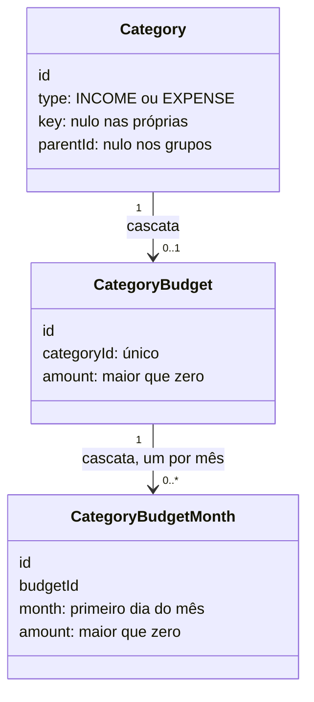

# Orçamento por categoria - Plan

## Goal Capsule

- **Objective:** No fintrack, o usuário sabe quanto ainda pode gastar em cada categoria do mês. Ele define um limite mensal por grupo ou subcategoria e vê, na própria página Categorias, quanto já gastou e quanto resta.
- **Means:** o limite geral e o ajuste do mês ficam em duas tabelas ligadas em cascata, e o banco apaga os ajustes junto com o limite ou com a categoria (KTD1). O módulo puro da página Categorias calcula em centavos o limite do mês, a situação de cada barra e o saldo, e o resumo do mês entrega tudo pronto ao web (KTD4, KTD5).
- **Authority:** os requisitos (R) decidem o comportamento do produto. Decisões, fluxos e exemplos (AE) só os ilustram. Os KTDs decidem o mecanismo dentro dos R que citam, e as unidades não sobrescrevem nenhum dos dois. Ficam fora desta entrega os itens listados em Scope Boundaries.
- **Stop conditions:** pare e pergunte ao usuário se uma decisão marcada `session-settled` se mostrar inviável. Nunca aplique a migração nem rode reset ou `db push` num banco que tenha dados além dos do banco próprio desta worktree.
- **Execution profile:** dois códigos, `api/` e `web/`, em três fases: API em U1 a U4, web em U5 e U6 e testes ponta a ponta em U7. U2 é feita com os testes antes do código.
- **Finisher:** `ce-work` implementa e verifica pelo Verification Contract. O usuário revisa e integra o PR.
- **Open blockers:** nenhum.

---

## Product Contract

### Summary

Cada categoria de despesa, grupo ou subcategoria, pode ter um limite mensal em reais. O limite vale todo mês até o usuário mudar, e um mês específico pode ter um valor próprio. Na página Categorias, cada linha da árvore com limite ganha uma barra "gasto / limite" editável ali mesmo, e o centro da rosca mostra o saldo do mês.

### Problem Frame

A página Categorias responde "para onde foi o dinheiro deste mês", mas não diz quanto ainda dá para gastar. O plano dela deixou o orçamento por categoria de fora de propósito (`docs/plans/2026-10-17-1530-feat-categorias-plan.md`). Sem limite, o usuário faz a conta de cabeça ou volta ao Visor, que ele quer deixar de usar.

---

### Key Decisions

- **O budget é um limite mensal por categoria.** Governs R1, R2. (session-settled: user-approved — chosen over divisão da renda em percentuais e envelopes alocados até zerar: o usuário quer "quanto posso gastar em cada coisa", e o limite fixo responde isso em cima dos totais que já existem)
- **O limite pode ficar no grupo ou na subcategoria, e cada um vale por si.** Governs R1, R9. (session-settled: user-approved — chosen over só grupos, só subcategorias, e limite do grupo calculado pela soma das subcategorias: não exige que os limites somem)
- **O limite se repete todo mês e aceita ajuste num mês específico.** Governs R2, R3. (session-settled: user-approved — chosen over valor fixo sem ajuste e budget montado mês a mês)
- **Os limites ficam na página Categorias, sem página nova.** Governs R6, R7. (session-settled: user-approved — chosen over uma página Orçamento separada e as duas juntas)
- **Estourar o limite só muda a barra.** Governs R8. (session-settled: user-approved — chosen over lembrete no Dashboard e aviso ao lançar um gasto)

### Requirements

**Definir o limite**

- R1. Toda categoria de despesa que entra nos totais da página Categorias, grupo ou subcategoria, pode ter um limite mensal em reais; categorias de receita e as de sistema que ficam fora dos totais não têm limite.
- R2. O limite definido vale para todos os meses, sem prazo, até o usuário mudar ou remover.
- R3. O usuário pode dar a um mês específico um valor próprio, sem alterar os outros meses, e pode remover esse ajuste para o mês voltar ao limite geral; o ajuste só existe numa categoria que já tem limite geral.
- R4. O usuário pode remover o limite de uma categoria, que volta a mostrar só o gasto, e isso remove também os ajustes de mês dela.

**Ver o limite**

- R5. O gasto de cada categoria no mês vem da mesma conta da página Categorias (contas e cartões, cartão pelo mês da fatura, previsões de recorrentes incluídas), sem uma segunda conta.
- R6. Cada categoria com limite mostra no mês exibido uma barra "gasto / limite" e o valor que resta, ou o quanto passou.
- R7. O usuário cria, edita, ajusta o mês e remove o limite direto na linha da categoria, na página Categorias.
- R8. A barra muda de cor ao passar de 80% do limite e fica vermelha quando o gasto passa do limite; nenhum alerta nem bloqueio acompanha isso.
- R9. Cada limite vale por si: a barra do grupo compara o gasto de todo o grupo, subcategorias incluídas, com o limite do grupo, e a da subcategoria compara só o gasto dela com o limite dela, sem exigir que os limites somem.
- R10. Categoria sem limite continua mostrando só o gasto.
- R11. O centro da rosca mostra o saldo do mês: a soma dos limites menos o gasto correspondente, contando cada grupo uma vez, pelo limite do grupo quando ele tem, e senão pelos limites das subcategorias que têm.

**Manter os limites**

- R12. Excluir uma categoria própria apaga o limite dela e os ajustes de mês.

### Acceptance Examples

- AE1. **Covers R5, R6, R9.** Alimentação tem limite de R$ 1.500 e Supermercado, subcategoria dela, R$ 800. Com R$ 600 gastos em Supermercado e R$ 400 em Restaurantes, a barra de Supermercado mostra 600 de 800, e a de Alimentação mostra 1.000 de 1.500.
- AE2. **Covers R2, R3.** O limite de Presentes é R$ 200. O usuário ajusta dezembro para R$ 600; dezembro mostra R$ 600, e os demais meses seguem em R$ 200. Remover o ajuste devolve dezembro a R$ 200.
- AE3. **Covers R8.** Com limite de R$ 500, a barra de Transporte fica neutra com R$ 350, muda de cor com R$ 420 e fica vermelha com R$ 530, mostrando R$ 30 acima do limite.
- AE4. **Covers R11.** Alimentação tem limite de R$ 1.500 com R$ 1.000 gastos, e Lazer, sem limite no grupo, tem a subcategoria Ingressos com limite de R$ 100 e R$ 40 gastos. O saldo é (1.500 + 100) − (1.000 + 40) = R$ 560.

### Scope Boundaries

**Deferred for later**

- Sobra de um mês passando para o seguinte.
- Limite como percentual da renda, ou alocar a renda até zerar.
- Lembrete de categoria estourada no Dashboard.
- Aviso ao lançar um gasto que estoura o limite.
- Página Orçamento separada.
- "Onde dá para cortar": tipo de gasto por categoria, divisão 30/20/50, médias e projeção, previstos no plano de Categorias.

**Considered and not built**

- Uma confirmação extra antes de "Remover limite". O modal já é um passo deliberado, e refazer um limite custa um campo.
- Uma marca na linha da árvore dizendo que o limite do mês é um ajuste. O modal já mostra isso, e nenhum R pede.
- Uma rota só para ler os limites. O resumo do mês já os traz (KTD5).
- Recusar um limite de subcategoria maior que o do grupo. R9 diz que cada limite vale por si.
- Guardar o histórico do limite geral por mês. A assunção do histórico, em Dependencies / Assumptions, aceita que mudar o limite mude a leitura dos meses passados.

### Dependencies / Assumptions

- Depende da árvore de categorias e dos totais do mês da página Categorias, já presentes no código (`web/src/view/pages/Categories`).
- Assumido: o limite geral não guarda histórico, então mudá-lo muda a leitura dos meses passados que não têm ajuste próprio.
- Assumido: o centro da rosca segue o saldo descrito em R11, e não a comparação com a renda.

---

## Planning Contract

### Product Contract preservation

- Changed, confirmado pelo usuário na síntese do planejamento:
  - R3: o ajuste de mês só existe numa categoria que já tem limite geral.
  - R4: remover o limite remove também os ajustes de mês da categoria.
- Changed, esclarecimento sem mudança de escopo: AE1 e AE4 usam os nomes reais do catálogo, Supermercado e Ingressos, no lugar de Mercado e Cinema.
- Added: a subseção "Considered and not built" em Scope Boundaries.
- Removed: a seção Outstanding Questions. A pergunta sobre o limite de R$ 0 foi resolvida assim: o limite é sempre maior que zero, e quem não quer limite o remove (KTD2).
- O restante ficou sem mudança, inclusive R11 e as Key Decisions.

### Key Technical Decisions

- KTD1. **O limite geral e o ajuste do mês ficam em duas tabelas, e o ajuste fica ligado ao limite geral.**
  - `CategoryBudget`: um por categoria, com `categoryId` único e `amount`, apagado em cascata com a `Category`.
  - `CategoryBudgetMonth`: `budgetId`, `month` no primeiro dia do mês e `amount`, único por limite e mês, apagado em cascata com o `CategoryBudget`, no padrão de `GoalSkippedMonth`.

  Como o ajuste aponta para o limite geral, o próprio banco impede ajuste sem limite e apaga os ajustes quando o limite sai (R3, R4). A cascata a partir de `Category` também alcança o `deleteMany` de `moveItemsAndDelete`, então R12 não exige código novo. `amount` é `Float`, como todo valor em dinheiro do schema, e as contas são feitas em centavos (KTD4). Uma coluna de limite em `Category` foi descartada: o serviço teria de apagar os ajustes à mão, e `GET /categories` passaria a levar o limite. Governs R2, R3, R4, R12.
- KTD2. **Quatro rotas em `/categories/:categoryId/budget` gravam e removem os limites.**
  - `PUT /categories/:categoryId/budget`: cria ou troca o limite geral e mantém os ajustes.
  - `DELETE /categories/:categoryId/budget`: remove o limite geral, e a cascata leva os ajustes.
  - `PUT /categories/:categoryId/budget/:month`: cria ou troca o ajuste do mês.
  - `DELETE /categories/:categoryId/budget/:month`: remove o ajuste do mês.

  Os dois `PUT` recebem só `amount`, validado como as outras DTOs de valor: número positivo com no máximo duas casas. Isso recusa o R$ 0. O id passa por `ParseUUIDPipe` e o mês por `ParseMonthPipe`. Os `DELETE` respondem 204 e não falham quando não há o que remover. As consultas novas ficam em `CategoriesRepository`, como `GoalsRepository` guarda os meses pulados. Assim a injeção do serviço e o spec do controller não mudam. Governs R2, R3, R4, R7.
- KTD3. **Toda categoria de despesa que entra nos totais aceita limite, seja padrão ou própria.**
  - A posse passa por `ValidateCategoryOwnershipService`, com 404, e não por `getOwnCategory`, porque o limite não altera a categoria padrão.
  - A categoria precisa ser `EXPENSE` e não ter uma das chaves de `SYSTEM_KEYS_OUT_OF_TOTALS`, que `categories-calculations.ts` passa a exportar em vez de ganhar uma segunda cópia. Fora disso, a API responde 400. `debts` de despesa é aceita.
  - O ajuste exige um limite geral e um mês a até `MAX_DATE_DISTANCE_MONTHS` de hoje, com 400 nos dois casos. A checagem de mês de `getSummary` vira um método privado usado pelas duas rotas.

  Governs R1, R3.
- KTD4. **O limite do mês, a situação da barra e o saldo saem do módulo puro, em centavos.** Uma função nova em `categories-calculations.ts` recebe as linhas de `getCategoryMonthTotals` e os limites com o ajuste do mês. Ela devolve:
  - para cada categoria com limite: o limite do mês, que é o ajuste ou o geral, se ele é ajuste, o que resta, negativo quando passou, e a situação;
  - o saldo do mês, nulo quando nenhuma categoria tem limite.

  A situação é `OK` até 80% do limite, `WARNING` acima de 80% até o limite e `OVER` acima do limite, comparando centavos inteiros. Gastar 100% ainda é `WARNING`, com R$ 0 restando. O saldo segue o pseudo-código de High-Level Technical Design. Governs R5, R6, R8, R9, R10, R11.
- KTD5. **O resumo do mês traz os limites, e o web não faz conta de orçamento.** `GET /categories/summary/:month` busca os limites do usuário, com o ajuste do mês, no mesmo `Promise.all` das categorias. Cada categoria do resumo ganha um objeto de limite com os campos de KTD4 em reais, ou nulo. O resumo também ganha o saldo do mês, em reais ou nulo. Na aba Receitas tudo vem nulo, porque nenhuma categoria de receita tem limite (KTD3). Governs R5, R6, R10, R11.
- KTD6. **O limite é definido pelo menu "⋯" da linha, num modal pequeno.**
  - Na aba Despesas, toda linha da árvore ganha o item "Definir limite", ou "Editar limite" quando já tem um. A árvore de despesas só mostra categorias que entram nos totais, Dívidas incluída, então o web não repete a regra de KTD3.
  - O modal `CategoryBudgetModal` pede o valor em `InputCurrency`. Quando a categoria já tem limite, ele também oferece a escolha entre "Todos os meses" e "Só este mês". A escolha começa em "Só este mês" se o mês exibido já tem ajuste.
  - O modal oferece "Remover ajuste do mês" quando o mês tem ajuste, e "Remover limite" quando há limite.
  - Salvar em "Todos os meses" mantém o ajuste do mês exibido (R3).

  Depois de cada gravação, a chave `['categories', 'summary']` é invalidada. Governs R3, R4, R7.
- KTD7. **A linha com limite ganha uma barra, e o centro da rosca passa a destacar o saldo.**
  - Abaixo do nome, a barra tem o papel `progressbar`, com `aria-valuenow`, `aria-valuemin` e `aria-valuemax` do gasto e do limite do mês, e um `data-status` com a situação da API. O texto diz "R$ gasto de R$ limite", seguido de "restam R$ X" ou de "R$ X acima do limite".
  - A cor segue a situação: neutra, de alerta ou vermelha.
  - Quando o saldo não é nulo, o centro da rosca mostra "Saldo do mês" em destaque, num `#categories-balance` novo. "Total do mês" fica numa linha menor, com o `#categories-net` de hoje. Sem saldo, a rosca fica como está.

  Governs R6, R8, R10, R11.

### High-Level Technical Design

A forma dos dados (KTD1):



O cálculo de KTD4, com o total do mês de cada categoria em centavos:

```text
para cada categoria da aba:
  limite = ajuste do mês ?? limite geral ?? nenhum
  sem limite: sem objeto de limite (R10)
  resta = limite − total
  situação = OVER    se total > limite
             WARNING se total × 5 > limite × 4
             OK      nos demais casos

saldo do mês (R11):
  para cada grupo da aba:
    grupo com limite: limite do grupo − total do grupo
    grupo sem limite: soma, nas subcategorias com limite, de (limite − total)
  nenhum limite no mês: saldo nulo
```

### Sequencing

1. U1 vem primeiro, porque o client do Prisma de U3 e U4 depende do schema novo.
2. U2 não depende de nada e pode ser feita em paralelo com U1.
3. U3 depende de U1. U4 depende de U1, U2 e U3, porque as duas mudam o serviço, o repositório e o spec de categorias.
4. No web, U5 depende de U4, e U6 depende de U3 e U5.
5. U7 fecha com os testes ponta a ponta.

### System-Wide Impact

- **Resumo do mês:** a resposta só ganha campos, e a página Categorias é a única tela que a usa (U4, U5).
- **Menu das linhas:** na aba Despesas, as subcategorias padrão e o grupo Dívidas passam a ter menu. O teste de AE10 do plano de Categorias, em `categories.cy.ts`, muda junto (U7).
- **Exclusão de categoria:** `moveItemsAndDelete` não muda, e a cascata do banco apaga os limites das categorias excluídas (R12). O limite da categoria de destino fica.
- **Atualização das barras:** `invalidateMoneyQueries` já invalida `['categories']`, então um lançamento novo atualiza as barras e o saldo sem código novo.
- **Specs da API:** o repositório falso de `categories.service.spec.ts` ganha os métodos de limite. O spec do controller não muda (KTD2).

### Risks & Dependencies

| Risco | Mitigação |
|---|---|
| Arredondamento de `Float` no que resta e no saldo | O módulo puro soma em centavos com `toCents` e `fromCents`, e a DTO aceita no máximo duas casas |
| A cascata depende das chaves estrangeiras do banco | O schema não define `relationMode`, então o Prisma cria as chaves. O gate Cascata confere as remoções por SQL |
| A migração rodar num banco com dados de outra worktree | A Stop condition do Goal Capsule e o gate Banco, que cria antes o banco próprio da worktree |
| A linha da árvore ficar alta demais no celular | A barra só aparece nas linhas com limite e fica abaixo do nome, sem mudar a largura da linha |

### Deferred to Implementation

- Os nomes exatos da função pura, dos métodos do repositório e dos campos novos do resumo.
- O timestamp da pasta da migração.
- As classes de cor de cada situação, dentro da paleta Tailwind que a página já usa.
- O texto em inglês das mensagens de erro novas, como constantes no padrão de `categories.service.ts`.

---

## Implementation Units

| U-ID | Título | Arquivos principais | Depende de |
|---|---|---|---|
| U1 | Schema e migração dos limites | `schema.prisma`, migração nova | — |
| U2 | Limite do mês, situação e saldo no módulo puro | `categories-calculations.ts` | — |
| U3 | API dos limites | `categories.controller.ts`, `categories.service.ts`, `dto/category-budget.dto.ts`, `categories.repositories.ts` | U1 |
| U4 | Resumo do mês com limites e saldo | `categories.service.ts`, `categories.repositories.ts` | U1, U2, U3 |
| U5 | Barra e saldo na página | `categoriesService.ts`, `CategoryTree.tsx`, `CategoriesDonut.tsx` | U4 |
| U6 | Limite pelo menu da linha | `CategoryTree.tsx`, `modals/CategoryBudgetModal/` | U3, U5 |
| U7 | Testes ponta a ponta | `categories.cy.ts` | U6 |

### U1. Schema e migração dos limites

**Goal:** guardar o limite geral e o ajuste do mês, com as cascatas de KTD1.

**Requirements:** R2, R3, R4, R12; KTD1.

**Dependencies:** nenhuma.

**Files:**
- `api/prisma/schema.prisma`
- `api/prisma/migrations/<timestamp>_create_category_budget/migration.sql`

**Approach:**
1. Acrescentar os dois models de KTD1, mapeados para `categoryBudget` e `categoryBudgetMonth`, e a relação opcional de `Category` com o limite.
2. Gerar a migração com `npx prisma migrate dev --create-only --name create_category_budget`. Ela tem só DDL, sem backfill.

**Patterns to follow:** `GoalSkippedMonth` em `api/prisma/schema.prisma`. `api/prisma/migrations/20261101190000_create_wishlist/migration.sql`.

**Test expectation:** none -- a unidade só tem DDL. As regras ficam nos specs de U3 e U4 e no gate Cascata.

**Verification:** a migração aplica no banco próprio da worktree, e `npx prisma migrate status` diz que o schema está em dia.

### U2. Limite do mês, situação e saldo no módulo puro

**Goal:** calcular sem banco o limite do mês, o que resta e a situação de cada categoria, e o saldo do mês.

**Requirements:** R5, R6, R8 a R11; KTD3, KTD4.

**Dependencies:** nenhuma.

**Files:**
- `api/src/modules/categories/categories-calculations.ts`
- `api/src/modules/categories/categories-calculations.spec.ts`

**Approach:**
1. Exportar `SYSTEM_KEYS_OUT_OF_TOTALS` (KTD3).
2. Criar uma função que recebe as linhas de `getCategoryMonthTotals` e os limites, cada um com a categoria, o valor geral e o valor do ajuste do mês ou nulo, e devolve o resultado de KTD4.

**Execution note:** escreva os testes antes do código, a partir dos AEs.

**Patterns to follow:** as seções e os tipos exportados de `categories-calculations.ts`. Os helpers de `categories-calculations.spec.ts`.

**Test scenarios:**
- Covers AE1. Alimentação com limite de R$ 1.500 e Supermercado com R$ 800, com R$ 600 em Supermercado e R$ 400 em Restaurantes, dão R$ 200 restando em Supermercado e R$ 500 em Alimentação.
- Covers AE2. Presentes com limite geral de R$ 200 e ajuste de R$ 600 no mês dá limite de R$ 600, marcado como ajuste. Sem ajuste no mês, dá R$ 200 sem a marca.
- Covers AE3. Com limite de R$ 500, R$ 350 dá `OK`, R$ 420 dá `WARNING`, e R$ 530 dá `OVER` com −R$ 30 restando.
- Com limite de R$ 500, R$ 400 dá `OK`, e R$ 500 dá `WARNING` com R$ 0 restando.
- Covers AE4. Alimentação com limite de R$ 1.500 e R$ 1.000 gastos, mais Lazer sem limite com Ingressos limitada a R$ 100 e R$ 40 gastos, dão saldo de R$ 560.
- Um grupo com limite conta uma vez só no saldo: Alimentação em 1.500 com 1.000 gastos e Supermercado em 800 com 600 gastos dão saldo de R$ 500.
- Uma categoria sem limite fica sem objeto de limite, e um mês sem nenhum limite dá saldo nulo.
- Um total negativo, vindo de estorno, deixa o que resta maior que o limite e a situação em `OK`.

**Verification:** o spec passa, e o módulo continua sem importar Prisma nem Nest.

### U3. API dos limites

**Goal:** criar, trocar e remover o limite geral e o ajuste do mês, com as regras de KTD2 e KTD3.

**Requirements:** R1 a R4, R7; KTD2, KTD3.

**Dependencies:** U1.

**Files:**
- `api/src/modules/categories/categories.controller.ts`
- `api/src/modules/categories/categories.service.ts`
- `api/src/modules/categories/dto/category-budget.dto.ts`
- `api/src/database/repositories/categories.repositories.ts`
- `api/src/modules/categories/categories.service.spec.ts`

**Approach:**
1. Acrescentar ao controller as quatro rotas de KTD2, com o usuário ativo, e 204 nos `DELETE`.
2. Criar uma DTO com `amount`, usada pelos dois `PUT`.
3. No serviço, fazer a checagem de categoria de KTD3 e extrair a checagem de mês de `getSummary`. As mensagens ficam em constantes.
4. No repositório, gravar o limite geral e o ajuste com `upsert` e apagar com `deleteMany`. `moveItemsAndDelete` fica como está.

**Patterns to follow:** as rotas e DTOs que já existem em `categories.controller.ts` e `dto/`. As mensagens em constantes, o repositório falso em memória e o `describe` de validação das DTOs com `ValidationPipe`, em `categories.service.spec.ts`.

**Test scenarios:**
- Definir R$ 1.500 em Alimentação, que é uma categoria padrão, grava o limite geral. Definir de novo troca o valor e mantém os ajustes.
- Definir o limite de Dívidas de despesa funciona.
- Definir o limite de uma categoria de receita, de `goals`, de `card_payment` ou de `loans` devolve 400.
- Definir o limite de uma categoria de outro usuário devolve 404.
- Um `amount` igual a 0, negativo ou com três casas devolve 400 pela validação da DTO.
- Ajustar um mês numa categoria sem limite geral devolve 400.
- Ajustar um mês a mais de 120 meses de hoje devolve 400. Um mês fora do formato `YYYY-MM` devolve 400 pelo `ParseMonthPipe`.
- Remover o ajuste de um mês apaga só esse ajuste, e os outros meses mantêm os deles.
- Remover um limite ou um ajuste que não existe responde sem erro.

**Verification:** os specs de categorias passam, inclusive o do controller, que não muda.

### U4. Resumo do mês com limites e saldo

**Goal:** entregar ao web, no resumo do mês, o limite de cada categoria e o saldo já calculados.

**Requirements:** R5, R6, R9 a R11; KTD4, KTD5.

**Dependencies:** U1, U2, U3.

**Files:**
- `api/src/modules/categories/categories.service.ts`
- `api/src/database/repositories/categories.repositories.ts`
- `api/src/modules/categories/categories.service.spec.ts`

**Approach:**
1. Criar no repositório uma consulta que traz os limites das categorias do usuário com só o ajuste do mês pedido, e chamá-la no `Promise.all` de `getSummary`.
2. Chamar a função de U2 com as linhas de `getCategoryMonthTotals` e converter os valores com `fromCents`.
3. Acrescentar o objeto de limite, ou nulo, a cada categoria do resumo, e o saldo à raiz da resposta.

**Patterns to follow:** a conversão com `fromCents` que `getSummary` já faz nos totais.

**Test scenarios:**
- Covers AE1. O resumo do mês traz, em reais, Supermercado com limite de 800 e 200 restando, e Alimentação com 1.500 e 500 restando.
- Covers AE2. Com Presentes em R$ 200 e ajuste de R$ 600 no mês seguinte, o resumo do mês seguinte traz 600 com a marca de ajuste, e o do mês atual traz 200. Depois de remover o ajuste, o mês seguinte volta a 200.
- Covers AE4. No caso de AE4, o resumo traz saldo de 560.
- O resumo de Receitas traz todas as categorias sem limite e o saldo nulo.
- Os limites de outro usuário não aparecem no resumo.
- Um resumo sem nenhum limite traz o saldo nulo, e os testes de `getSummary` que já existem passam com o repositório falso sem limites.

**Verification:** os specs passam, e uma chamada real ao resumo devolve os limites gravados pelas rotas de U3.

### U5. Barra e saldo na página

**Goal:** mostrar na árvore a barra de cada categoria com limite, e no centro da rosca o saldo do mês.

**Requirements:** R6, R8 a R11; KTD5, KTD7.

**Dependencies:** U4.

**Files:**
- `web/src/app/services/categoriesService.ts`
- `web/src/view/pages/Categories/useCategoriesController.ts`
- `web/src/view/pages/Categories/components/CategoryTree.tsx`
- `web/src/view/pages/Categories/components/CategoriesDonut.tsx`
- `web/src/view/pages/Categories/index.tsx`

**Approach:**
1. Acrescentar a `CategorySummary` o objeto de limite de cada categoria e o saldo.
2. Fazer `CategoryRow` e as subcategorias levarem o limite junto com o total, no mesmo `useMemo` que já lê os totais.
3. Desenhar a barra de KTD7 nas linhas de grupo e de subcategoria, com as classes `category-budget` e `category-budget-text` para os testes.
4. Passar o saldo a `CategoriesDonut`.

**Patterns to follow:** as classes `category-total` e `category-open` de `CategoryTree.tsx`, que os testes já usam. `formatCurrency`. O centro atual de `CategoriesDonut.tsx`.

**Test expectation:** none -- o web não tem executor de testes de unidade. Os cenários ficam em U7.

**Verification:** o build do web passa, e a página mostra as barras e o saldo dos limites gravados pela API.

### U6. Limite pelo menu da linha

**Goal:** definir, editar, ajustar o mês e remover o limite pela página Categorias.

**Requirements:** R2 a R4, R7; KTD2, KTD6.

**Dependencies:** U3, U5.

**Files:**
- `web/src/app/services/categoriesService.ts`
- `web/src/view/pages/Categories/components/CategoryTree.tsx`
- `web/src/view/pages/Categories/useCategoriesController.ts`
- `web/src/view/pages/Categories/index.tsx`
- `web/src/view/pages/Categories/modals/CategoryBudgetModal/index.tsx`
- `web/src/view/pages/Categories/modals/CategoryBudgetModal/useCategoryBudgetModalController.ts`

**Approach:**
1. No serviço, criar uma função que grava e uma que remove. Cada uma recebe o mês como opcional, e é ele que escolhe a rota de KTD2.
2. `RowMenu` passa a saber se a aba é Despesas e a receber o handler do limite. Ele só deixa de aparecer quando nenhuma ação vale.
3. O controller da página ganha o caso `budget` na união de modais, com a categoria, o limite da linha e o mês exibido.
4. O modal segue KTD6, com um schema zod que usa `positiveCurrency`, a escolha num `radiogroup` de botões e toasts em português.

**Patterns to follow:** `web/src/view/pages/DebtDetail/modals/AdjustExpectedValueModal/`, no valor com `InputCurrency` e `positiveCurrency`. O `radiogroup` de `web/src/view/components/CardEntryModal/index.tsx`. `useDeleteCategoryModalController.ts`, na mutação, no toast e em `getApiErrorPayload`. `formatMonth` para o rótulo do mês.

**Test expectation:** none -- os cenários de gestão ficam em U7.

**Verification:** o build passa, e criar, ajustar e remover pela página mudam a barra sem recarregar.

### U7. Testes ponta a ponta

**Goal:** cobrir os limites pela página e atualizar o teste de menus que já existe.

**Requirements:** R1 a R12, onde a interface os mostra; AE1 a AE4.

**Dependencies:** U6.

**Files:**
- `web/cypress/e2e/categories.cy.ts`

**Approach:**
1. Acrescentar um `describe` de limites em `categories.cy.ts` e reaproveitar `signUp`, `withCategories`, `createTransaction`, `visitCategories`, `group`, `sub` e `brl`. Os limites são criados pela API quando a interface não é o assunto do teste.
2. Atualizar o teste de AE10 do plano de Categorias aos menus novos.

**Patterns to follow:** os testes de `categories.cy.ts`, com títulos que citam o AE e chamadas `cy.apiRequest`.

**Test scenarios:**
- Covers AE1. Com limites de R$ 1.500 em Alimentação e R$ 800 em Supermercado, e lançamentos de R$ 600 em Supermercado e R$ 400 em Restaurantes, a barra de Supermercado diz R$ 600,00 de R$ 800,00, e a de Alimentação diz R$ 1.000,00 de R$ 1.500,00.
- Covers AE2. Pelo menu de Presentes, o usuário define R$ 200. No mês seguinte, ele escolhe "Só este mês" e salva R$ 600. O mês seguinte mostra R$ 600, o atual mostra R$ 200, e "Remover ajuste do mês" devolve o mês seguinte a R$ 200.
- Covers AE3. Com limite de R$ 500 em Transporte, a barra fica com `data-status` `OK` com R$ 350, `WARNING` com R$ 420 e `OVER` com R$ 530. Neste último caso, o texto diz R$ 30,00 acima do limite.
- Covers AE4. No caso de AE4, `#categories-balance` mostra R$ 560,00 e `#categories-net` mostra R$ 1.040,00.
- "Remover limite" numa categoria com ajuste deixa a linha só com o total. Um limite geral novo vale depois também no mês que tinha o ajuste.
- Salvar R$ 0 mostra a mensagem de valor maior que zero e não grava nada.
- Sem nenhum limite, o centro da rosca não tem `#categories-balance`.
- O teste de AE10 do plano de Categorias passa a esperar o seguinte. Na aba Despesas, o menu de Alimentação tem "Criar subcategoria" e "Definir limite", e Delivery e Dívidas têm só "Definir limite". Na aba Receitas, Salário continua sem menu.

**Verification:** `categories.cy.ts` e os demais specs ponta a ponta passam.

---

## Verification Contract

| Gate | Comando (no diretório indicado) | Aplica a | Sinal de pronto |
|---|---|---|---|
| Ambiente | `api/.env` com `DATABASE_URL` apontando para o banco próprio desta worktree | todas | a API sobe apontando para esse banco |
| Dependências | `npm ci` em `api/` e em `web/` | todas | instalação sem erro |
| Banco | Em `api/`, com o Postgres de `api/docker-compose.yaml` rodando: criar o banco próprio da worktree e aplicar as migrações existentes com `npx prisma migrate deploy`. Depois de editar o schema em U1, rodar `npx prisma migrate dev --create-only --name create_category_budget` e aplicar com `npx prisma migrate dev` | U1 em diante | migração aplicada sem erro, `npx prisma migrate status` em dia, e um novo `npx prisma migrate dev` não gera migração |
| Cascata | Com a API rodando e um usuário de teste: gravar pela API um limite no grupo Compras, e um limite e um ajuste numa subcategoria própria dele. Remover o limite da subcategoria e contar por SQL os ajustes dela. Gravar de novo o limite e o ajuste, excluir a subcategoria e contar as linhas dela em `categoryBudget` e `categoryBudgetMonth` | U1, U3 | as contagens dão zero, e o limite de Compras continua |
| Specs da API | `npm test` em `api/` | U1 a U4 | todos passam |
| Lint da API | `npm run lint` em `api/` | U2 a U4 | sem erro, e sem mudança em arquivos fora das unidades |
| Build da API | `npm run build` em `api/` | U1 a U4 | sem erro |
| Lint do web | `npm run lint` em `web/` | U5 a U7 | sem erro |
| Build do web | `npm run build` em `web/` | U5, U6 | sem erro |
| Ponta a ponta | `npm run cy:run-e2e` em `web/`, com a API em :3000, o banco da worktree e `npm run dev` em :5173 | U7 | todos os specs passam, `categories.cy.ts` inclusive |

---

## Definition of Done

- As unidades U1 a U7 estão implementadas, e cada gate do Verification Contract que se aplica a elas passa.
- Todo R de R1 a R12 é atendido. AE1 a AE4 são cobertos por um spec de U2 a U4 e por um cenário de U7.
- Nenhuma decisão `session-settled` foi alterada sem confirmação do usuário.
- O web não calcula o que resta, a situação da barra nem o saldo, e tudo vem do resumo do mês (KTD5).
- `categories-calculations.ts` não importa Prisma nem Nest, e a lista das chaves de sistema fora dos totais existe num lugar só (KTD3).
- Não sobra código de tentativas abandonadas, `console.log` de depuração nem migração extra no diff.
