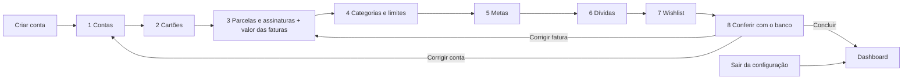
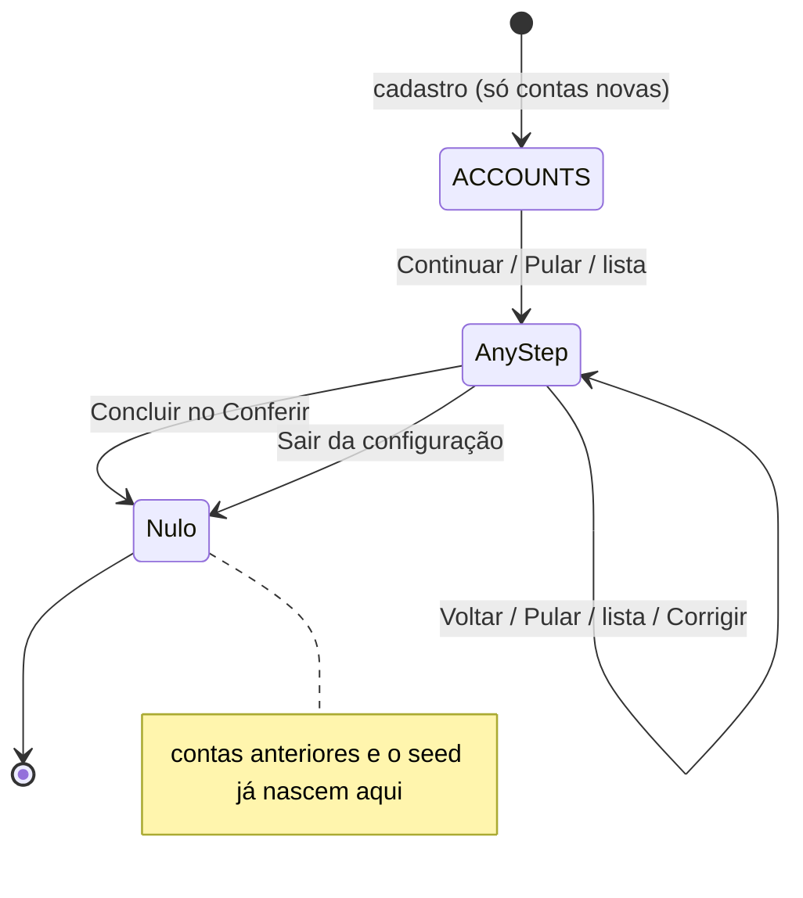

# Onboarding - Plan

## Goal Capsule

- **Objective:** Um parente ou amigo que acabou de criar a conta no fintrack termina a primeira sessão com contas, cartões e compromissos cadastrados, e com os saldos e as faturas não pagas do app iguais aos do banco, sem precisar saber por onde começar.
- **Means:** uma tela de configuração própria, passo a passo, que só contas novas veem (KTD1, KTD3), e um ajuste por fatura que faz o cartão bater com o banco (KTD6).
- **Authority:** os requisitos (R) decidem o comportamento. Key Decisions registram as escolhas de produto e de onde vieram. Os KTDs decidem o mecanismo dentro dos R que citam, e as unidades não sobrescrevem nenhum dos dois. Fluxos (F) e exemplos (AE) só ilustram.
- **Stop conditions:** pare e pergunte ao usuário se uma decisão marcada `session-settled` se mostrar inviável. Nunca aplique migração nem rode reset ou `db push` num banco que tenha dados além dos do banco próprio desta worktree.
- **Execution profile:** dois códigos, `api/` e `web/`. API em U1 a U3, web em U4 a U6 e testes ponta a ponta em U7. U3 é feita com os testes antes do código.
- **Finisher:** `ce-work` implementa e verifica pelo Verification Contract. O usuário revisa e integra o PR.
- **Open blockers:** nenhum.

---

## Product Contract

### Summary

Toda conta nova abre numa tela de configuração com 8 etapas, de Contas até Conferir com o banco. Cada etapa salva os itens na hora, pode ser pulada e é retomada onde a pessoa parou. A fatura de cada cartão bate com o banco por um lançamento de ajuste, "Compras antes do fintrack", que fica fora dos gastos por categoria.

### Problem Frame

Hoje quem cria conta cai no Dashboard vazio. Cada página tem seu próprio estado vazio, mas nada diz a ordem. Algumas coisas dependem de outras: uma meta precisa de uma conta de origem, e uma parcela precisa de um cartão. O dono do fintrack vai trazer parentes e amigos, e o problema que ele mesmo sente ao abrir uma conta nova é "não saber por onde começar".

Essas pessoas chegam com o extrato do banco e a fatura do cartão abertos ao lado e copiam os valores. Se terminarem a primeira sessão com números diferentes dos do banco, deixam de confiar no app. As compras à vista feitas antes do fintrack são a fonte mais provável dessa diferença, porque ninguém vai redigitar uma fatura inteira.

### Actors

- A1. Pessoa nova: parente ou amigo do dono, recém-cadastrado, no computador, às vezes com o extrato e a fatura abertos ao lado.
- A2. Usuário existente: o dono e qualquer conta criada antes desta entrega. Nunca vê o onboarding.

### Key Decisions

- **Tela própria, passo a passo, fora do app normal.** Governs R2. (session-settled: user-directed — chosen over um guia por cima das páginas reais e um checklist no Dashboard, comparados num quadro visual: a pessoa trabalha com o extrato ao lado e precisa de uma coisa por vez, com o caminho inteiro à vista)
- **Passar por todas as áreas do app.** Governs R3. (session-settled: user-directed — chosen over cadastrar só conta e cartão, ou só uma lista "comece por aqui": o dono quer que a pessoa conheça e preencha tudo)
- **Qualquer etapa pode ser pulada.** Governs R5, R13, R19. (session-settled: user-approved — chosen over algumas etapas obrigatórias ou todas obrigatórias: ninguém precisa inventar dados que não tem)
- **Retomar na etapa onde parou.** Governs R7. (session-settled: user-approved — chosen over cair no app normal, com ou sem lembrete de continuar)
- **Saída definitiva.** Governs R8, R9, R27. (session-settled: user-approved — chosen over sair só pulando etapas, ou uma saída reabrível pelo menu: quem não quer o onboarding não fica preso)
- **Cada item é salvo quando é adicionado.** Governs R4. (session-settled: user-approved — chosen over um rascunho gravado no fim e um progresso deduzido dos dados: a conferência compara o banco com os números reais do app, e Corrigir edita o item de verdade)
- **Do extrato, só o saldo atual.** Governs R10. (session-settled: user-approved — chosen over lançar as transações do mês ou de meses anteriores)
- **Do cartão: o cartão, as parcelas em andamento e as assinaturas.** Governs R11, R12. (session-settled: user-approved — chosen over só o cartão, ou toda a fatura compra a compra: sem parcelas e assinaturas as faturas futuras nascem erradas)
- **As faturas batem por ajuste, nas duas faturas não pagas.** Governs R14, R15, R16, R25. (session-settled: user-approved — chosen over conferir só faturas futuras, lançar cada compra à vista, ou ajustar só a fatura aberta: pagar depois a fatura fechada no app sai com o valor certo)
- **O ajuste fica fora dos gastos por categoria.** Governs R17. (session-settled: user-approved — chosen over deixar o ajuste "Sem categoria" ou criar uma marcação própria na compra: é dinheiro anterior ao app, não gasto do mês para categorizar)
- **Categorias: só limites.** Governs R18. (session-settled: user-approved — chosen over também criar e renomear categorias, ou só mostrar a árvore)
- **Dívidas: os dois lados numa etapa.** Governs R20, R26. (session-settled: user-approved — chosen over só o que a pessoa deve, ou duas etapas separadas)
- **Metas sem conta avisa e oferece voltar.** Governs R19. (session-settled: user-approved — chosen over tornar Contas obrigatória ou pular Metas sozinha)
- **Conferir mostra saldos e faturas, com Corrigir.** Governs R23, R24. (session-settled: user-approved — chosen over conferir só os saldos, ou um resumo sem correção)
- **Só contas novas.** Governs R1. As contas que já existem têm seus dados e não precisam ser guiadas.

### Requirements

**Entrada, progresso e saída**

- R1. Toda conta criada a partir desta entrega abre na tela de configuração logo depois do cadastro, em vez do Dashboard. Contas que já existiam nunca veem essa tela.
- R2. A tela fica fora do app normal: sem a navegação principal, com a lista das 8 etapas sempre visível, a etapa atual destacada e o progresso ("2 de 8").
- R3. As etapas são, nesta ordem: Contas, Cartões, Parcelas e assinaturas, Categorias e limites, Metas, Dívidas, Wishlist e Conferir com o banco.
- R4. Cada item é salvo de verdade no momento em que a pessoa o adiciona. Não existe rascunho.
- R5. Toda etapa tem "Pular", que avança sem cadastrar nada. A etapa pulada continua na lista e pode ser reaberta.
- R6. A pessoa pode voltar a qualquer etapa pela lista ou por "Voltar" e editar o que já cadastrou nela.
- R7. Quem sai no meio, fechando o navegador ou entrando de outro computador, volta para a etapa onde parou, com tudo que já cadastrou.
- R8. "Sair da configuração" pede confirmação, avisando que tudo pode ser cadastrado depois nas páginas, e encerra o onboarding de vez.
- R9. Concluir a etapa Conferir também encerra o onboarding. Encerrado por qualquer caminho, a pessoa cai no Dashboard e a tela não volta mais.
- R27. A tela de configuração tem o menu do usuário, com "Sair" da conta, separado de "Sair da configuração".

**Contas**

- R10. A etapa Contas cadastra cada conta com o saldo atual copiado do extrato. Transações passadas não entram.

**Cartões, parcelas e faturas**

- R11. A etapa Cartões cadastra cada cartão com limite, dia de fechamento e dia de vencimento.
- R12. A etapa Parcelas e assinaturas recebe, para cada cartão, as compras parceladas já em andamento (a parcela atual de um total) e as assinaturas que caem nas próximas faturas.
- R13. Sem nenhum cartão cadastrado, a etapa Parcelas e assinaturas avisa que não há cartão e oferece voltar a Cartões ou pular.
- R14. No fim da etapa Parcelas e assinaturas, a pessoa digita, para cada cartão, quanto o banco diz que falta pagar em cada fatura não paga: a aberta e, quando existir, a fechada que espera pagamento (0 quando ela já foi paga no banco).
- R15. Para cada valor informado em R14, o app lança a diferença entre esse valor e as compras já cobradas na fatura como uma compra chamada "Compras antes do fintrack". Assinaturas que ainda não foram cobradas não contam, e diferença zero não lança nada.
- R16. Quando o banco mostra menos do que a fatura já tem, a diferença entra como crédito com o mesmo nome.
- R25. Cada fatura tem no máximo um "Compras antes do fintrack": informar de novo o valor dela substitui o ajuste, e um valor igual às compras já cobradas o remove.
- R17. "Compras antes do fintrack" aparece na fatura com esse nome e fica fora dos totais e dos limites da página Categorias, como já acontece com pagamento de fatura, metas e empréstimos.

**Categorias, metas, dívidas e wishlist**

- R18. A etapa Categorias e limites mostra as categorias de despesa que a conta recebe no cadastro e deixa definir um limite mensal em qualquer grupo ou subcategoria. Criar, renomear ou excluir categorias continua só na página Categorias.
- R19. A etapa Metas cria metas a partir de uma conta de origem. Sem nenhuma conta, avisa que metas precisam de uma conta de origem e oferece voltar a Contas ou pular.
- R20. A etapa Dívidas tem duas partes, "Eu devo" e "Me devem": o que a pessoa deve e quem deve a ela.
- R26. A etapa Dívidas não oferece lançar a entrada de um empréstimo numa conta, porque o saldo copiado do extrato já a inclui (per R10).
- R21. A etapa Wishlist adiciona itens à lista "Geral", que já nasce com a conta.
- R22. Os formulários das etapas seguem as mesmas regras e mensagens de validação dos modais de criação de hoje.

**Conferir com o banco**

- R23. A etapa Conferir mostra o saldo de cada conta, o saldo total e, para cada cartão, o valor de cada fatura ainda não paga, para a pessoa comparar com o app do banco.
- R24. Cada linha da etapa Conferir tem "Corrigir", que leva à etapa daquele item com o item aberto para edição. Ao salvar, a pessoa volta para Conferir.

### Key Flows



- F1. Primeira sessão completa
  - **Trigger:** A1 cria a conta.
  - **Steps:** abre na etapa 1; em cada etapa adiciona itens ou pula; na etapa 3 digita o valor das faturas não pagas; na etapa 8 compara com o banco, corrige o que não bate e conclui.
  - **Outcome:** cai no Dashboard com os números do banco.
  - **Covered by:** R1, R3, R4, R5, R9, R14, R23, R24
- F2. Retomada
  - **Trigger:** A1 fecha o navegador na etapa 4.
  - **Steps:** entra de novo, em qualquer computador.
  - **Outcome:** abre na etapa 4 com o que já cadastrou.
  - **Covered by:** R7
- F3. Saída definitiva
  - **Trigger:** A1 escolhe "Sair da configuração" em qualquer etapa.
  - **Steps:** confirma.
  - **Outcome:** cai no Dashboard agora e em todas as próximas entradas; o que cadastrou fica salvo.
  - **Covered by:** R8, R9

### Acceptance Examples

- AE1. **Covers R14, R15, R17.** Hoje é 16/11. O cartão Itaú fecha dia 25 e vence dia 5, então só existe a fatura aberta (vence 5/12). Ela tem a parcela 4/12 do iPhone, R$ 541,58, e a Netflix, R$ 55,90, cobrada dia 10: R$ 597,48. O banco mostra R$ 1.240,00. O app lança "Compras antes do fintrack" de R$ 642,52 nessa fatura, e o gasto de novembro na página Categorias não muda.
- AE2. **Covers R14, R15.** Hoje é 16/11. O cartão Nubank fecha dia 3 e vence dia 20. A fatura fechada (vence 20/11) tem R$ 541,58 no app, e o banco diz que faltam R$ 2.100,00; a aberta tem R$ 597,48 no app e R$ 890,00 no banco. O app pergunta os dois valores e lança ajustes de R$ 1.558,42 e R$ 292,52.
- AE3. **Covers R16.** A fatura aberta tem R$ 597,48 no app e o banco mostra R$ 550,00, porque um estorno já foi creditado. O app lança um crédito "Compras antes do fintrack" de R$ 47,48.
- AE4. **Covers R5, R19.** A pessoa pula Contas e chega em Metas. A etapa avisa que metas precisam de uma conta de origem. "Voltar a Contas" leva à etapa 1; ela cadastra o Itaú, avança até Metas e agora vê o formulário.
- AE5. **Covers R7.** A pessoa define dois limites na etapa 4 e fecha o navegador. No dia seguinte entra pelo notebook do trabalho e cai na etapa 4 com os dois limites.
- AE6. **Covers R1, R9.** O dono entra e vê o Dashboard, como sempre. Uma pessoa que escolheu "Sair da configuração" também vê o Dashboard em todas as próximas entradas.
- AE7. **Covers R23, R24.** Conferir mostra o Itaú com R$ 8.120,00 e o banco mostra R$ 8.210,00. "Corrigir" abre a etapa Contas com o Itaú em edição; ela salva R$ 8.210,00 e volta para Conferir com o saldo total atualizado.
- AE8. **Covers R25.** Depois do AE1, a pessoa volta à etapa 3 e digita R$ 1.240,00 de novo: nada muda. Ela digita R$ 1.300,00: o ajuste passa a R$ 702,52, e a fatura continua com um só. Ela digita R$ 597,48: o ajuste some.
- AE9. **Covers R14, R16.** No AE2, a pessoa já pagou a fatura fechada no banco e digita 0. O app lança um crédito "Compras antes do fintrack" de R$ 541,58, e a fatura fechada fica paga.

### Success Criteria

- Ao concluir, o saldo total e o valor de cada fatura não paga mostrados no Conferir são iguais aos do app do banco, sem a pessoa ter digitado compra por compra.
- Uma pessoa que nunca usou o fintrack chega ao fim sem precisar perguntar por onde seguir.

### Scope Boundaries

- Lançar transações passadas do extrato (per R10).
- Lançar uma a uma as compras à vista das faturas não pagas.
- Criar, renomear ou excluir categorias dentro do onboarding (per R18).
- Reabrir o onboarding depois de encerrado, por exemplo pelo menu do usuário (per R9).
- Mostrar o onboarding a contas que já existiam (per R1).
- Convidar parentes ou amigos pelo app: o cadastro continua como hoje.
- Um layout próprio para celular: a tela segue desktop first, como o resto do app (`DESIGN.md`).
- Mudar os estados vazios das páginas ou fazer um tour pelas páginas reais depois do fim.

**Considered and not built**

- Trocar o ciclo de um cartão quando os dias são corrigidos no meio do onboarding. Hoje a correção cria uma versão nova a partir da fatura aberta, e a fechada mantém os dias antigos. Muda se alguém precisar corrigir os dias depois de lançar parcelas.
- Limitar a lista de etapas às já visitadas. A lista deixa ir a qualquer etapa, e pular adiante tem o mesmo efeito de "Pular". Muda se pessoas chegarem ao Conferir sem ter passado pela etapa 3.
- Restringir a âncora de uma parcela em andamento a faturas que não venceram. A API já aceita a fatura fechada vencida, e o lembrete de fatura vencida aparece logo no Dashboard. Muda se isso confundir quem acabou de se cadastrar.
- Guardar o valor do banco por fatura para avisar quando ele deixa de bater. Conferir mostra os valores atuais, e a pessoa compara de novo. Muda se cartões forem editados com frequência depois do ajuste.
- Esconder o ajuste da aba de categorias da própria página do cartão. Lá ele aparece como uma fatia com o próprio nome, porque aquela aba mostra a composição da fatura.

### Dependencies / Assumptions

- O app já aceita compra parcelada em andamento, assinaturas projetadas nas faturas futuras, limite em grupo ou subcategoria, dívidas nos dois sentidos e saldo inicial de conta. A meta já exige uma conta de origem.
- Hoje, pagamento de fatura, metas e empréstimos são as categorias de sistema fora dos totais e limites. O grupo de sistema de dívidas conta nos totais. "Compras antes do fintrack" entra no grupo dos que ficam fora.
- O visual segue `DESIGN.md` e a opção A do quadro de formatos (R2): lista de etapas à esquerda e uma etapa por vez à direita.

### Sources / Research

- `DESIGN.md`: público, voz, desktop first e o registro da escolha do formato.
- `docs/plans/2026-10-12-2102-feat-cartoes-plan.md`: compras parceladas em andamento e assinaturas.
- `docs/plans/2026-11-08-1457-feat-orcamento-plan.md`: limites por categoria.
- `docs/plans/2026-10-13-2253-feat-dividas-plan.md` e `docs/plans/2026-10-11-2035-feat-metas-plan.md`: dívidas, pessoas que devem e a regra de meta sem conta.
- Cadastro hoje: `api/src/modules/auth/auth.service.ts` cria categorias e a lista Geral; `web/src/view/pages/Register/useRegisterController.ts` entra direto e `web/src/Router/AuthGuard.tsx` manda para `/`.
- Categorias fora dos totais: `api/src/modules/categories/categories-calculations.ts`.
- Faturas e cartões: `api/src/modules/cards/cards.service.ts` e `api/src/modules/cards/card-calculations.ts`.

---

## Planning Contract

### Product Contract preservation

- Changed, esclarecimento sem mudança de escopo:
  - R14: para a fatura fechada, a pessoa digita quanto falta pagar, e 0 quando já pagou no banco. Digitar o valor cheio de uma fatura já paga faria o pagamento sair duas vezes da conta.
  - R15: "o que a fatura já tem" passa a ser as compras já cobradas, sem assinaturas que ainda não caíram. AE1 diz a data da Netflix.
  - Key Flows: o diagrama ganhou a seta do Corrigir de fatura para a etapa 3, como R24 já dizia.
- Added, necessários para o comportamento combinado funcionar:
  - R25: a etapa 3 roda de novo na retomada, no Corrigir e no caminho do AE4, então o ajuste precisa ser substituído, nunca somado.
  - R26: a entrada do empréstimo contaria o mesmo dinheiro duas vezes no saldo do extrato (R10).
  - R27: tirar a tela do layout do app levaria junto o único "Sair" da conta.
  - AE8 e AE9, para R25 e para a fatura fechada já paga.
  - A subseção "Considered and not built" em Scope Boundaries.
- Removed: a seção Outstanding Questions. Cada pergunta foi resolvida por um KTD (KTD1, KTD4, KTD6, KTD7, KTD9 e KTD11).
- O restante ficou sem mudança, inclusive as Key Decisions e seus rótulos.

### Key Technical Decisions

- KTD1. **O estado do onboarding é uma coluna enum opcional no usuário.** Um enum `OnboardingStep` (ACCOUNTS, CARDS, CARD_ENTRIES, BUDGETS, GOALS, DEBTS, WISHLIST, REVIEW) e `User.onboardingStep` opcional. Nulo quer dizer sem onboarding: encerrado, abandonado de vez ou conta anterior a esta entrega. O cadastro grava ACCOUNTS no mesmo create aninhado das categorias. A migração cria a coluna sem default, então os usuários existentes e o usuário do seed ficam nulos sem UPDATE. A coluna guarda a última etapa vista. Uma tabela própria ou uma data de fim foram descartadas: nada precisa de histórico, e R9 trata o fim e a saída igual. Governs R1, R7, R8, R9.
- KTD2. **Duas rotas em `/users/me/onboarding` movem e encerram o onboarding.** `PATCH` com `{ step }` muda a etapa só enquanto ela não é nula e devolve o estado resultante. `DELETE` grava nulo. `GET /users/me` passa a devolver `onboardingStep`. A condição "só enquanto não é nula" impede que uma segunda aba aberta ressuscite um onboarding encerrado. Governs R7, R8, R9.
- KTD3. **O web tem a rota `/configuracao`, dentro da guarda privada e fora do `AppLayout`.** A guarda manda para `/configuracao` quem tem etapa e manda para `/` quem não tem. Cada mudança de etapa mescla a etapa da resposta no usuário em cache com `setQueryData(['users','me'], user => ({ ...user, onboardingStep }))`, nunca com `invalidateQueries`, porque o `AuthContext` desmonta o app inteiro enquanto busca o usuário. A resposta só traz a etapa, e trocar o usuário inteiro por ela apagaria nome e e-mail. Encerrar faz a mesma mescla antes de navegar. O cabeçalho reusa `Logo` e `UserMenu`. Governs R1, R2, R7, R9, R27.
- KTD4. **"Compras antes do fintrack" é uma categoria de sistema nova, de chave `pre_fintrack`.** Entra em `SYSTEM_CATEGORIES` (e assim no cadastro e no seed por `buildDefaultCategories()`), em `SYSTEM_CATEGORY_KEYS` da API e do web, e em `SYSTEM_KEYS_OUT_OF_TOTALS`. A migração a cria para os usuários existentes, no padrão da `category_tree`, para que todo usuário continue tendo toda categoria de sistema. Nome guardado "Before fintrack", rótulo por chave no web e ícone `receipt`. Governs R17. (session-settled: user-approved — chosen over deixar o ajuste "Sem categoria" ou marcar a compra: é dinheiro anterior ao app, não gasto do mês para categorizar)
- KTD5. **O resumo do mês tira das compras de cartão as chaves de `SYSTEM_KEYS_OUT_OF_TOTALS`.** Hoje essa lista só filtra transações de conta. O filtro entra no caminho das compras de cartão do resumo, e assim o total do mês e o gasto de cada limite seguem juntos. A lista continua existindo num lugar só. Governs R17.
- KTD6. **O ajuste tem um caminho de escrita próprio: `PUT /cards/:cardId/invoices/:month/opening-adjustment` com `{ remaining }`.** Cada fatura tem no máximo um ajuste, achado pelo cartão, pela categoria `pre_fintrack` e por uma data dentro do período da fatura. O serviço recalcula sempre a partir do que a fatura tem sem o ajuste, e o resultado é idempotente. Ele procura a categoria pela chave, como `payInvoice` faz, e não passa pela checagem que recusa categorias de sistema. Governs R14, R15, R16, R25. (session-settled: user-approved — chosen over conferir só faturas futuras, lançar cada compra à vista ou ajustar só a fatura aberta: pagar a fatura fechada no app depois sai com o valor certo)
- KTD7. **A API decide qual fatura fechada ainda não está paga.** É a última fatura fechada enquanto hoje é no máximo o vencimento dela, ou enquanto ela ainda tem saldo depois do vencimento. O status sozinho não serve, porque uma fatura fechada vazia aparece como PAID. `GET /cards` passa a devolver esse mês em `unpaidClosedInvoiceMonth`, nulo quando não há, calculado pela mesma função que a rota de KTD6 usa. A etapa 3 e o Conferir mostram a fatura fechada só quando esse campo não é nulo, sem comparar datas no navegador. A rota de KTD6 aceita o mês aberto e o último fechado, os mesmos que a âncora de parcela em andamento já aceita, e recusa com 400 qualquer outro mês. Assim uma fatura fechada que venceu durante uma retomada continua corrigível. Governs R14, R23.
- KTD8. **O ajuste continua editável pela página do cartão.** A edição de uma compra aceita a categoria `pre_fintrack` quando ela já é a categoria da própria compra e não muda. Qualquer outra entrada numa categoria de sistema continua recusada.
- KTD9. **As etapas reusam os modais de criação e de edição de hoje, sem formulários novos.** Cada etapa mostra o que já existe e um botão "Adicionar" que abre o modal de criação. Clicar num item da lista abre o modal de edição dele (R6).
  - Contas: `NewAccountModal` e `EditAccountModal`, dentro de um `DashboardProvider`.
  - Cartões: `NewCardModal`.
  - Parcelas e assinaturas: `CardEntryModal` com `allowedTabs` em INSTALLMENTS e RECURRING.
  - Categorias: `CategoryBudgetModal`.
  - Metas: `NewGoalModal`, dentro do provider da página Metas.
  - Dívidas: `NewDebtModal` sem a opção de entrada, e `NewBorrowerModal`.
  - Wishlist: `ItemModal` na lista Geral.

  Para editar, cada etapa abre o modal de edição que já existe: `EditAccountModal`, `EditCardModal`, `CardEntryModal` com o lançamento e `EditRecurringChargeModal`, `CategoryBudgetModal` com o limite do item, `EditGoalModal`, `EditDebtModal`, `EditBorrowerModal` e `ItemModal` com o item. Metas, dívidas e pessoas carregam antes o detalhe do item clicado, pela mesma consulta das páginas de detalhe, porque os modais de edição esperam o detalhe.

  Os campos inline do quadro de formatos foram descartados: duplicariam a lógica dos formulários e quebrariam R22. Governs R6, R10, R11, R12, R18, R19, R20, R21, R22, R26.
- KTD10. **Nenhuma etapa cria transação em conta.** Com a entrada do empréstimo escondida (R26), o saldo inicial de uma conta é igual ao saldo atual durante o onboarding. Por isso "Corrigir" numa conta edita o saldo pelo `EditAccountModal`. Governs R10, R24.
- KTD11. **A etapa 3 e o Conferir leem as faturas de `GET /cards/:cardId`, um cartão por vez.** As faturas aberta e fechada já vêm em `invoices[]`, e `GET /cards` diz o mês aberto em `openInvoiceMonth` e a fatura fechada não paga em `unpaidClosedInvoiceMonth` (KTD7). Os dois mostram o saldo da fatura: total menos pago, sem previsão de assinatura. Não há rota nova de leitura, só o campo novo de KTD7. Governs R14, R23.
- KTD12. **`cy.register` encerra o onboarding pela API.** Ele espera a tela chegar a `/configuracao`, o que garante o token salvo, chama `DELETE /users/me/onboarding` e visita `/`, e assim as seis suítes que se cadastram continuam testando o app. Uma suíte nova, `onboarding.cy.ts`, cobre o fluxo.

### Assumptions

- A etapa guardada é a última vista, não a mais avançada.
- O "voltar para Conferir" do Corrigir vale só na sessão. Quem fecha o navegador no meio de uma correção volta na etapa corrigida.
- Todas as etapas da lista são clicáveis.
- "Voltar a Contas", a partir de Metas, leva à etapa 1. A pessoa volta a Metas pela lista ou avançando.
- A rota se chama `/configuracao`, no padrão das rotas em português (`/metas`, `/cartoes`).

### High-Level Technical Design

Estado do onboarding no usuário (KTD1, KTD2):



Componentes e rotas:

```mermaid
flowchart LR
  G[AuthGuard privada] -->|etapa não nula| O[/configuracao]
  G -->|etapa nula| A[AppLayout e páginas]
  O --> L[Lista de etapas + UserMenu + Sair da configuração]
  O --> E[Etapa atual]
  E --> M[Modais de criação de hoje]
  M --> API1[Rotas de contas, cartões, metas, dívidas, wishlist, limites]
  E --> AJ[PUT /cards/:id/invoices/:month/opening-adjustment]
  O --> U[PATCH e DELETE /users/me/onboarding]
  U -->|resposta| C[(cache users/me)]
```

Recalcular o ajuste de uma fatura (KTD6, KTD7). Direção, não especificação:

```text
mês permitido = mês aberto ou último fechado; senão 400
ajuste_atual  = compra pre_fintrack do cartão com data no período da fatura (0 ou 1)
base          = total cobrado da fatura (sem previsão) − valor com sinal de ajuste_atual
diferença     = remaining − base
diferença == 0 → apaga ajuste_atual, se houver
diferença > 0  → PURCHASE de |diferença|; diferença < 0 → REFUND de |diferença|
mesmo tipo de ajuste_atual → atualiza o valor; tipo diferente → apaga e cria
data da compra: hoje na fatura aberta; início do período na fatura fechada
```

### Sequencing

A API vem primeiro: U1 (estado), U2 (categoria) e U3 (ajuste, que depende de U2). O web vem depois: U4 (rota, guarda e moldura) depende de U1, U5 (etapas de cadastro) depende de U4, e U6 (etapa 3 e Conferir) depende de U3, U4 e U5. U7 fecha com os testes ponta a ponta.

### System-Wide Impact

- **Cadastro e login:** toda conta nova passa pela guarda nova. Contas existentes não mudam (KTD1).
- **Resumo de categorias:** o filtro de KTD5 vale para todos os usuários, mas só muda o resultado de quem tem compra de cartão numa categoria de sistema fora dos totais. Hoje ninguém tem, porque a API recusava.
- **Seed e testes:** o seed não muda. `auth.service.spec.ts` lista as categorias de sistema e precisa da nova. As seis suítes Cypress dependem de KTD12.

### Risks & Dependencies

| Risco | Mitigação |
|---|---|
| Fuso horário: "hoje" do servidor e do navegador podem divergir na virada do dia, e uma fatura fechada pode aparecer ou sumir. | A API decide o mês permitido e a fatura fechada não paga (KTD7), e a interface mostra o que `GET /cards` e `GET /cards/:cardId` devolvem, sem recalcular datas no web. |
| A migração cria uma categoria para todos os usuários existentes. | Mesmo padrão já aplicado em `20261017180000_category_tree`, com `WHERE NOT EXISTS`. |
| A edição de uma compra com categoria de sistema abre uma exceção na validação. | A exceção vale só para `pre_fintrack` e só quando a categoria não muda (KTD8). Os specs cobrem a recusa dos outros casos. |
| Escolher a única opção de um Select da Radix no Cypress falha. | Seguir `docs/solutions/test-failures/cypress-cannot-pick-the-only-option-of-a-radix-select.md` em `onboarding.cy.ts`. |

### Sources & Research

- Estado no usuário e migrações com backfill: `api/prisma/schema.prisma`, `api/prisma/migrations/20261017180000_category_tree/migration.sql`, `api/prisma/migrations/20261101190000_create_wishlist/migration.sql`.
- Cadastro e `/users/me`: `api/src/modules/auth/auth.service.ts`, `api/src/modules/users/users.service.ts`, `web/src/app/contexts/AuthContext.tsx` (o app some enquanto o usuário recarrega), `web/src/Router/AuthGuard.tsx`, `web/src/Router/index.tsx`.
- Categorias de sistema: `api/src/modules/categories/categories.constants.ts`, `api/src/modules/categories/categories-calculations.ts` (`SYSTEM_KEYS_OUT_OF_TOTALS`, `countsInTab`, `getMonthCardItems`), `api/src/modules/cards/card-entries.service.ts` (`validateCategory`), `web/src/view/constants/CategoryConstants.ts`, `web/src/app/utils/categories.ts`.
- Faturas: `api/src/modules/cards/card-calculations.ts` (`getInvoiceMonth`, `getInvoiceStatus`, `getInvoices`, `getForecasts`), `api/src/modules/cards/cards.service.ts` (`payInvoice` acha a categoria pela chave, `toCardView` expõe os meses aberto e fechado).
- Formulários reaproveitáveis: `web/src/view/components/CardEntryModal/index.tsx` (`allowedTabs`), `web/src/view/pages/Debts/modals/NewDebtModal/index.tsx`, `web/src/view/pages/Goals/modals/NewGoalModal/useNewGoalModalController.ts` (preso a `useGoalsPage`), `web/src/view/pages/Dashboard/modals/NewAccountModal/useNewAccountModalController.ts` (preso a `useDashboard`).

---

## Implementation Units

### U1. Estado do onboarding na API

- **Goal:** contas novas nascem com etapa ACCOUNTS, e a API lê, move e encerra essa etapa.
- **Requirements:** R1, R7, R8, R9 (KTD1, KTD2).
- **Dependencies:** nenhuma.
- **Files:**
  - `api/prisma/schema.prisma`
  - `api/prisma/migrations/<timestamp>_onboarding/migration.sql`
  - `api/src/modules/auth/auth.service.ts`, `api/src/modules/auth/auth.service.spec.ts`
  - `api/src/modules/users/users.controller.ts`, `api/src/modules/users/users.service.ts`, `api/src/modules/users/dto/update-onboarding.dto.ts`, `api/src/modules/users/users.service.spec.ts`
  - `api/src/database/repositories/users.repositories.ts`
- **Approach:**
  1. Enum e coluna opcional no schema; migração gerada pelo Prisma, sem default e sem UPDATE.
  2. O cadastro grava `onboardingStep: 'ACCOUNTS'` no create aninhado.
  3. `GET /users/me` devolve `onboardingStep`. `PATCH /users/me/onboarding` valida o enum com class-validator e atualiza só onde a etapa não é nula. `DELETE /users/me/onboarding` grava nulo. As duas devolvem `{ onboardingStep }`.
- **Patterns to follow:** o create aninhado de `auth.service.ts`; os DTOs com class-validator dos outros módulos; os specs com `Test.createTestingModule` e repositórios simulados.
- **Test scenarios:**
  - O cadastro cria o usuário com `onboardingStep` ACCOUNTS.
  - `me` devolve nome, e-mail e `onboardingStep`.
  - `PATCH` com GOALS num usuário em CARDS devolve GOALS.
  - `PATCH` num usuário com etapa nula devolve nulo e não muda nada.
  - `DELETE` grava nulo, e um `PATCH` seguinte continua nulo.
  - Covers AE6. Um usuário criado antes da migração tem `onboardingStep` nulo.
- **Verification:** a migração aplica sem erro num banco com usuários, e os usuários existentes ficam com etapa nula.

### U2. Categoria "Compras antes do fintrack" fora dos totais

- **Goal:** a categoria de sistema `pre_fintrack` existe para todos os usuários e não entra nos totais nem nos limites da página Categorias.
- **Requirements:** R17 (KTD4, KTD5, KTD8).
- **Dependencies:** nenhuma.
- **Files:**
  - `api/src/modules/categories/categories.constants.ts`
  - `api/src/modules/categories/categories-calculations.ts`, `api/src/modules/categories/categories-calculations.spec.ts`, `api/src/modules/categories/categories.service.spec.ts`
  - `api/src/modules/cards/card-entries.service.ts`, `api/src/modules/cards/card-entries.service.spec.ts`
  - `api/prisma/migrations/<timestamp>_pre_fintrack_category/migration.sql`
  - `api/src/modules/auth/auth.service.spec.ts`
  - `web/src/view/constants/CategoryConstants.ts`
- **Approach:**
  1. Adicionar a chave, o seed da categoria e a chave nas listas de sistema e de fora dos totais.
  2. Filtrar as compras de cartão pelas chaves fora dos totais no resumo do mês (KTD5).
  3. Na edição de compra, aceitar `pre_fintrack` só quando é a categoria atual da compra e não muda (KTD8).
  4. Migração escrita à mão que insere a categoria para cada usuário sem ela, no padrão da `category_tree`.
  5. No web, o rótulo "Compras antes do fintrack" e a chave em `SYSTEM_CATEGORY_KEYS`.
- **Patterns to follow:** `SYSTEM_CATEGORIES` e a migração `20261017180000_category_tree`; os testes nomeados por AE em `categories.service.spec.ts`.
- **Test scenarios:**
  - Covers AE1. Uma compra de cartão em `pre_fintrack` de R$ 642,52 em novembro não muda o total do mês nem o gasto de nenhum limite.
  - Uma compra de cartão numa categoria comum continua contando.
  - Definir limite em `pre_fintrack` é recusado, como nas outras chaves fora dos totais.
  - Editar o valor de uma compra que já está em `pre_fintrack`, sem mudar a categoria, é aceito.
  - Mudar uma compra comum para `pre_fintrack` é recusado, e criar uma compra em `pre_fintrack` pela rota de compras também.
  - O cadastro cria as categorias de sistema com `pre_fintrack` entre elas.
- **Verification:** a página Categorias de um usuário com um ajuste mostra o mesmo total de antes do ajuste.

### U3. Ajuste das faturas não pagas

- **Goal:** a pessoa informa quanto falta pagar em uma fatura, e o app deixa a fatura com um único ajuste que a iguala ao banco.
- **Requirements:** R14, R15, R16, R25 (KTD6, KTD7).
- **Dependencies:** U2.
- **Files:**
  - `api/src/modules/cards/cards.controller.ts`
  - `api/src/modules/cards/card-entries.service.ts`
  - `api/src/modules/cards/cards.service.ts`, `api/src/modules/cards/cards.service.spec.ts` (campo `unpaidClosedInvoiceMonth`)
  - `api/src/modules/cards/dto/set-opening-adjustment.dto.ts`
  - `api/src/modules/cards/card-entries.service.spec.ts`
- **Approach:**
  1. Rota `PUT /cards/:cardId/invoices/:month/opening-adjustment` com `{ remaining }` não negativo, validando o dono do cartão como as outras rotas de cartão.
  2. Antes de calcular, o serviço materializa as assinaturas já vencidas, como a edição de assinatura faz, para que uma cobrança de hoje não fique de fora da base. Depois segue o recálculo do High-Level Technical Design: mês permitido, ajuste atual, base sem o ajuste e sem previsão, diferença, e então cria, atualiza, troca ou apaga.
  3. A compra se chama "Compras antes do fintrack" e entra na categoria achada pela chave.
  4. `GET /cards` ganha `unpaidClosedInvoiceMonth` pela mesma função que decide o mês permitido (KTD7).
- **Execution note:** escrever os specs antes do código. Os exemplos AE1, AE2, AE3, AE8 e AE9 viram specs com o relógio fixado.
- **Patterns to follow:** `payInvoice` em `cards.service.ts` para achar a categoria pela chave; `fakePrisma()` e `setToday` em `card-entries.service.spec.ts`.
- **Test scenarios:**
  - Covers AE1. Hoje 16/11, Itaú fecha 25 e vence 5, fatura aberta com R$ 597,48 já cobrados; `remaining` 1.240,00 cria uma compra de R$ 642,52 datada de hoje.
  - Covers AE2. Hoje 16/11, Nubank fecha 3 e vence 20; a fechada com R$ 541,58 e `remaining` 2.100,00 cria R$ 1.558,42 no início do período dela; a aberta com R$ 597,48 e `remaining` 890,00 cria R$ 292,52.
  - Covers AE3. Aberta com R$ 597,48 e `remaining` 550,00 cria um crédito de R$ 47,48.
  - Covers AE8. Repetir 1.240,00 não cria nem muda nada; 1.300,00 atualiza o ajuste para R$ 702,52; 597,48 apaga o ajuste.
  - Covers AE9. Fechada com R$ 541,58 e `remaining` 0 cria um crédito de R$ 541,58, e a fatura fica com saldo zero.
  - Um ajuste de compra que vira crédito é apagado e recriado como crédito, e a fatura continua com um só.
  - Uma assinatura com cobrança depois de hoje não entra na base.
  - Um mês depois do aberto ou anterior ao último fechado devolve 400.
  - A fatura fechada do AE2, já ajustada para R$ 2.100,00 e com o vencimento passado, aceita `remaining` 0 e fica paga.
  - `unpaidClosedInvoiceMonth` traz o mês fechado antes do vencimento mesmo com a fatura vazia, continua trazendo depois do vencimento enquanto há saldo, e é nulo depois do vencimento sem saldo.
  - Uma assinatura com cobrança hoje, ainda não materializada, entra na base.
  - O cartão de outro usuário é recusado como nas outras rotas de cartão.
- **Verification:** em cada cenário, o saldo da fatura em `GET /cards/:cardId` é igual ao `remaining` informado.

### U4. Rota, guarda e moldura da configuração

- **Goal:** conta com etapa cai em `/configuracao`, numa tela fora do layout do app com a lista das 8 etapas, a navegação entre elas e as duas saídas.
- **Requirements:** R1, R2, R3, R5, R6, R7, R8, R9, R27 (KTD3, KTD12).
- **Dependencies:** U1.
- **Files:**
  - `web/src/app/entities/User.ts`, `web/src/app/services/usersService.ts`
  - `web/src/Router/index.tsx`, `web/src/Router/AuthGuard.tsx`
  - `web/src/view/pages/Onboarding/index.tsx`, `web/src/view/pages/Onboarding/useOnboardingController.ts`
  - `web/src/view/pages/Onboarding/components/StepList.tsx`, `web/src/view/pages/Onboarding/components/StepFooter.tsx`
  - `web/src/view/constants/OnboardingConstants.ts`
  - `web/cypress/e2e/onboarding.cy.ts` (cenários em U7)
- **Approach:**
  1. `User` ganha `onboardingStep`. O serviço ganha mover e encerrar.
  2. A guarda privada redireciona nos dois sentidos (KTD3), e a rota fica como irmã do `AppLayout`.
  3. A tela segue a opção A de `DESIGN.md`: lista à esquerda com progresso, etapa à direita, cabeçalho com logo, `UserMenu` e "Sair da configuração". O rodapé tem "Voltar", escondido na etapa 1, e um botão principal que diz "Pular etapa" enquanto a etapa não tem item e "Continuar" quando tem. No Conferir ele diz "Concluir".
  4. "Sair da configuração" abre um modal próprio sobre `Modal`, sem o visual de exclusão do `ConfirmDeleteModal`: título "Sair da configuração", o aviso de R8, um botão principal "Sair da configuração" e um botão fantasma "Continuar configurando". Confirmar encerra e navega.
  5. Cada movimento chama o `PATCH` e mescla a etapa da resposta no usuário em cache (KTD3).
- **Patterns to follow:** os controllers de página (`use{Page}Controller`), `cn()` e os tokens de `DESIGN.md`; `ConfirmDeleteModal`.
- **Test scenarios:** cobertos em U7.
  - Covers F1. Depois do cadastro, a pessoa cai em `/configuracao` na etapa Contas.
  - Covers F2 / AE5. Recarregar a página na etapa 4 volta na etapa 4.
  - Covers F3 / AE6. "Sair da configuração" confirmado leva ao Dashboard, e visitar `/configuracao` depois leva a `/`.
  - Visitar `/cartoes` com o onboarding pendente leva a `/configuracao`.
  - "Sair" no menu do usuário encerra a sessão sem encerrar o onboarding.
- **Verification:** `npm run build` e `npm run lint` no web passam, e a navegação não mostra o carregador da página inteira ao trocar de etapa.

### U5. Etapas de cadastro

- **Goal:** as etapas Contas, Cartões, Categorias e limites, Metas, Dívidas e Wishlist mostram o que existe e cadastram pelos modais de hoje.
- **Requirements:** R4, R6, R10, R11, R18, R19, R20, R21, R22, R26 (KTD9, KTD10).
- **Dependencies:** U4.
- **Files:**
  - `web/src/view/pages/Onboarding/steps/AccountsStep.tsx`, `CardsStep.tsx`, `BudgetsStep.tsx`, `GoalsStep.tsx`, `DebtsStep.tsx`, `WishlistStep.tsx` (em `web/src/view/pages/Onboarding/steps/`)
  - `web/src/view/pages/Debts/modals/NewDebtModal/index.tsx`, `web/src/view/pages/Debts/modals/NewDebtModal/useNewDebtModalController.ts`
  - `web/cypress/e2e/onboarding.cy.ts` (cenários em U7)
- **Approach:**
  1. Cada etapa lista os itens pelo hook que já existe (`useBankAccounts`, `useCards`, o resumo de categorias do mês, metas, dívidas, pessoas e wishlist) e abre o modal de criação correspondente. Clicar num item abre o modal de edição dele, carregando antes o detalhe quando o modal exige (KTD9).
  2. Contas e Metas embrulham seus modais nos providers das páginas de origem (KTD9).
  3. Metas sem conta mostra o aviso com "Voltar a Contas" e "Pular" em vez de abrir o modal.
  4. `NewDebtModal` ganha uma prop que esconde a entrada, usada só aqui (R26).
  5. A Wishlist abre o `ItemModal` com a lista Geral como padrão.
- **Patterns to follow:** os estados vazios das páginas Cartões e Dívidas; `invalidateMoneyQueries` depois de salvar.
- **Test scenarios:** cobertos em U7.
  - Adicionar uma conta na etapa 1 mostra a conta na lista da etapa com o saldo digitado.
  - Covers AE4. Pular Contas e chegar em Metas mostra o aviso, e "Voltar a Contas" leva à etapa 1.
  - O modal de dívida na etapa não mostra a opção de entrada, e na página Dívidas continua mostrando.
  - Um item da Wishlist criado na etapa aparece na lista Geral.
  - Editar o limite de um cartão criado na etapa 2 mostra o limite novo na lista da etapa.
- **Verification:** cada item criado numa etapa aparece na página correspondente do app depois do fim.

### U6. Etapa de parcelas e faturas, e etapa Conferir

- **Goal:** a etapa 3 recebe parcelas, assinaturas e quanto falta pagar em cada fatura não paga, e o Conferir mostra saldos e faturas com "Corrigir".
- **Requirements:** R6, R12, R13, R14, R23, R24 (KTD6, KTD7, KTD10, KTD11).
- **Dependencies:** U3, U4, U5.
- **Files:**
  - `web/src/view/pages/Onboarding/steps/CardEntriesStep.tsx`, `web/src/view/pages/Onboarding/steps/ReviewStep.tsx`
  - `web/src/app/services/cardsService.ts` (ou o arquivo de serviço de cartões que já existe)
  - `web/cypress/e2e/onboarding.cy.ts` (cenários em U7)
- **Approach:**
  1. A etapa 3 mostra, por cartão, as parcelas e assinaturas, um botão que abre o `CardEntryModal` limitado (KTD9) e um campo de valor por fatura não paga. Os rótulos são "Fatura aberta · vence DD/MM" e "Fatura fechada · vence DD/MM", com a ajuda "Quanto o app do banco diz que falta pagar." A ajuda da fechada acrescenta "Digite 0 se já pagou."
  2. Os campos vêm preenchidos com o saldo atual da fatura. Cada campo chama o `PUT` ao perder o foco ou no Enter, só se o valor mudou, e mostra ao lado "Salvando", "Salvo" ou o erro. No erro, o campo volta ao saldo atual da fatura. "Pular" e campos intactos não mudam nada.
  3. Sem cartão, a etapa mostra o aviso com "Voltar a Cartões" e "Pular" (R13).
  4. O Conferir lista contas com saldo, o total e, de cada cartão, a fatura aberta e a fechada não paga quando houver, com o saldo vindo de `GET /cards/:cardId` (KTD7, KTD11).
  5. "Corrigir" numa conta abre a etapa 1 com o `EditAccountModal` daquela conta, e numa fatura abre a etapa 3 no campo daquela fatura. Ao salvar, a tela volta ao Conferir (estado só da sessão).
  6. "Concluir" encerra o onboarding e navega para `/`.
- **Patterns to follow:** a página `CardDetail` para ler as faturas de um cartão; `InputCurrency` para os valores.
- **Test scenarios:** cobertos em U7.
  - Covers AE1. Com uma parcela de R$ 541,58 e a Netflix cobrada, digitar R$ 1.240,00 deixa o Conferir mostrando R$ 1.240,00 na fatura aberta.
  - Covers AE7. Corrigir o saldo de uma conta no Conferir volta ao Conferir com o total novo.
  - A etapa 3 sem cartão mostra o aviso e "Voltar a Cartões".
  - "Concluir" leva ao Dashboard, e a página Cartões mostra a fatura com "Compras antes do fintrack".
- **Verification:** depois de concluir, os valores do Conferir batem com o Dashboard e com a página Cartões.

### U7. Testes ponta a ponta

- **Goal:** as suítes existentes continuam passando, e o fluxo de onboarding tem cobertura ponta a ponta.
- **Requirements:** R1 a R27 pelo caminho principal (KTD12).
- **Dependencies:** U4, U5, U6.
- **Files:**
  - `web/cypress/support/commands.ts`
  - `web/cypress/e2e/onboarding.cy.ts`
  - `web/cypress/e2e/signup.cy.ts` e `web/cypress/e2e/signin.cy.ts`, quando esperarem `/` logo depois do cadastro
- **Approach:**
  1. `cy.register` espera `/configuracao`, encerra o onboarding com `cy.apiRequest` e visita `/`.
  2. `onboarding.cy.ts` se cadastra pela tela, sem o helper, e percorre os cenários de U4 a U6.
  3. Usar pelo menos duas opções nos Selects que o teste escolhe, ou seguir a solução registrada para a opção única.
- **Patterns to follow:** os helpers `signUp`, `generateEmail` e `brl` e os comandos `cy.createCard` e `cy.createCardPurchase` de `web/cypress/support/commands.ts`.
- **Test scenarios:**
  - Os cenários marcados "cobertos em U7" em U4, U5 e U6.
  - As suítes `cards`, `categories`, `debts`, `goals`, `wishlist` e `signin` passam sem mudança além do helper.
- **Verification:** `npm run cy:run-e2e` no web passa inteiro.

---

## Verification Contract

| Gate | Comando (no diretório indicado) | Aplica a | Sinal de pronto |
|---|---|---|---|
| Ambiente | `api/.env` com `DATABASE_URL` apontando para o banco próprio desta worktree | todas | a API sobe apontando para esse banco |
| Dependências | `npm ci` em `api/` e em `web/` | todas | instalação sem erro |
| Banco | Em `api/`, com o Postgres de `api/docker-compose.yaml` rodando: aplicar as migrações existentes com `npx prisma migrate deploy`. Depois de editar o schema, `npx prisma migrate dev --create-only --name onboarding`, completar a migração da categoria à mão e aplicar com `npx prisma migrate dev` | U1, U2 | migrações aplicadas sem erro, `npx prisma migrate status` em dia, e um novo `npx prisma migrate dev` não gera migração |
| Usuários existentes | Antes de aplicar as migrações novas, criar um usuário. Depois, ler pela API o `GET /users/me` dele e contar por SQL as categorias `pre_fintrack` dele | U1, U2 | `onboardingStep` nulo e uma categoria `pre_fintrack` |
| Specs da API | `npm test` em `api/` | U1 a U3 | todos passam |
| Lint da API | `npm run lint` em `api/` | U1 a U3 | sem erro, e sem mudança em arquivos fora das unidades |
| Build da API | `npm run build` em `api/` | U1 a U3 | sem erro |
| Lint do web | `npm run lint` em `web/` | U4 a U7 | sem erro |
| Build do web | `npm run build` em `web/` | U4 a U6 | sem erro |
| Ponta a ponta | `npm run cy:run-e2e` em `web/`, com a API em :3000, o banco da worktree e `npm run dev` em :5173 | U7 | todos os specs passam, `onboarding.cy.ts` inclusive |

---

## Definition of Done

- As unidades U1 a U7 estão implementadas, e cada gate do Verification Contract que se aplica a elas passa.
- Todo R de R1 a R27 é atendido. AE1, AE2, AE3, AE8 e AE9 são cobertos por specs de U3. AE1, AE4, AE5, AE6 e AE7 são cobertos por cenários de `onboarding.cy.ts`.
- Nenhuma decisão `session-settled` foi alterada sem confirmação do usuário.
- Contas existentes e o usuário do seed nunca veem a tela de configuração.
- A lista de chaves de sistema fora dos totais existe num lugar só na API e vale para transações e compras de cartão (KTD5).
- Não sobra código de tentativas abandonadas, `console.log` de depuração nem migração extra no diff.
